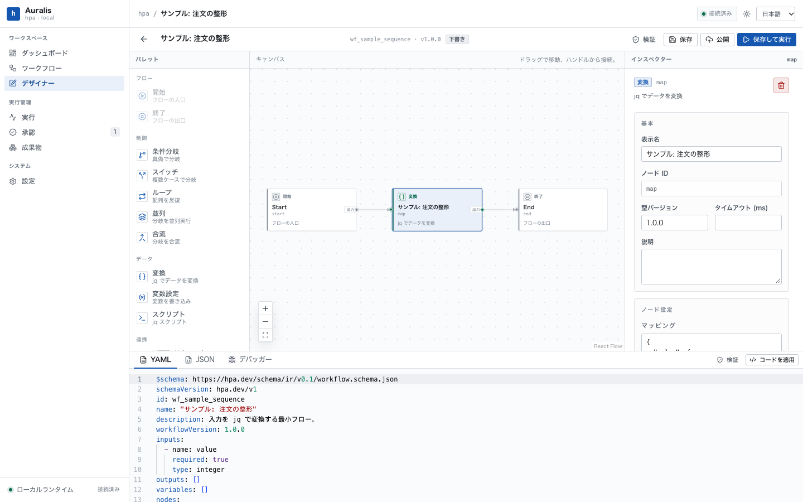
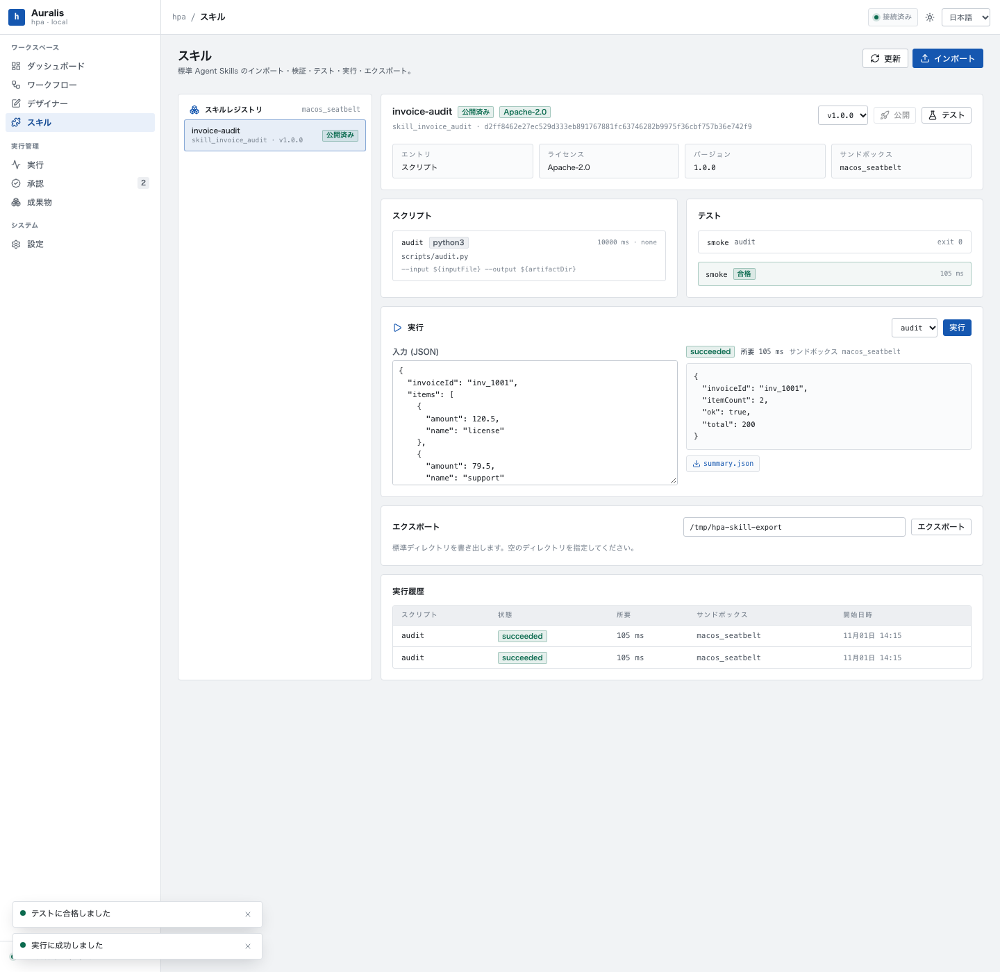
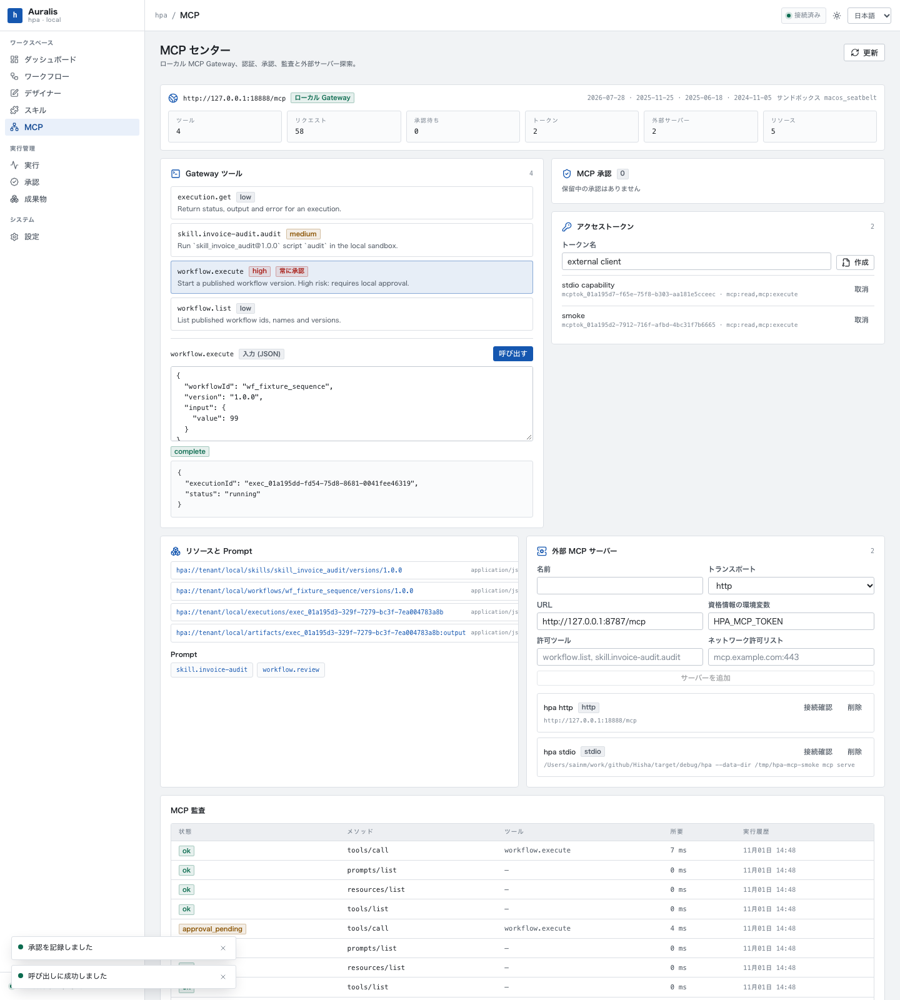
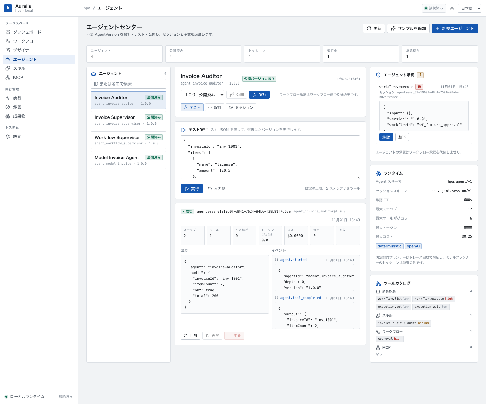
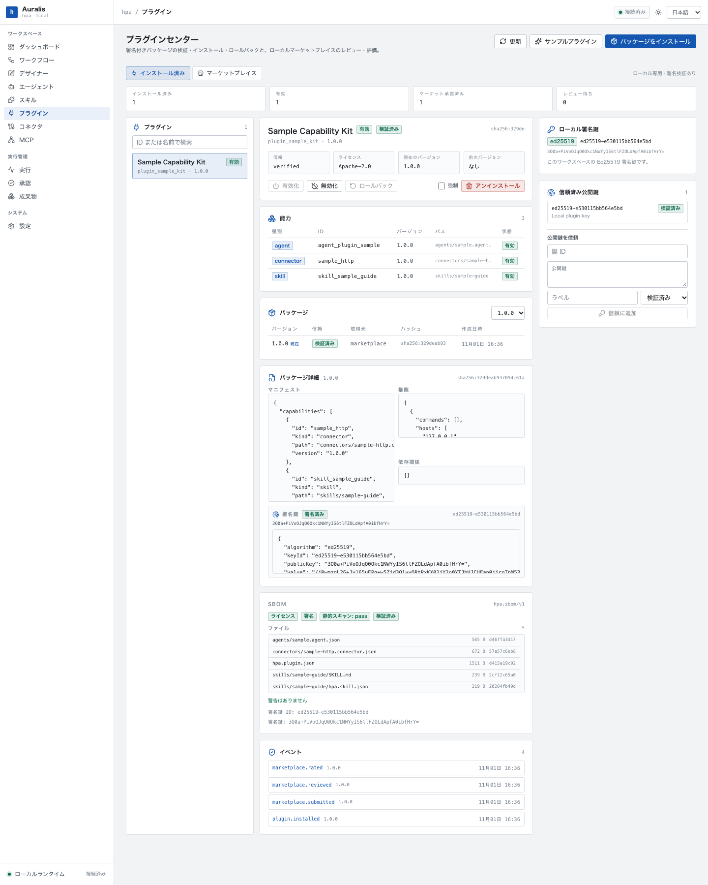
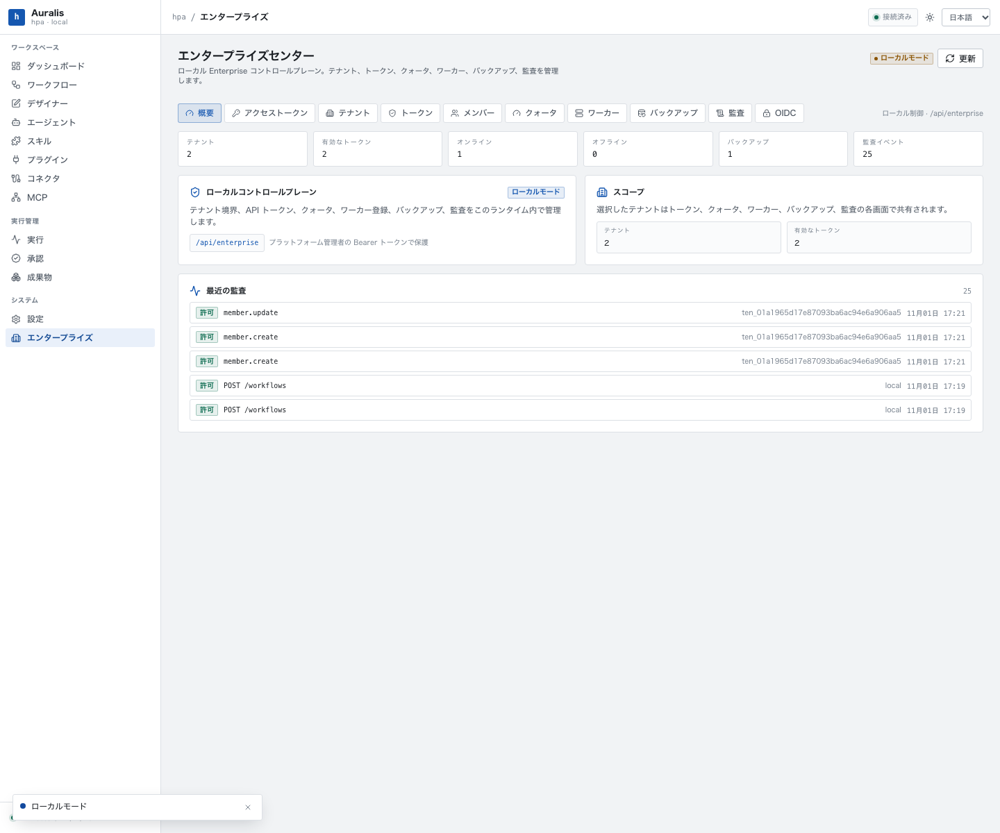
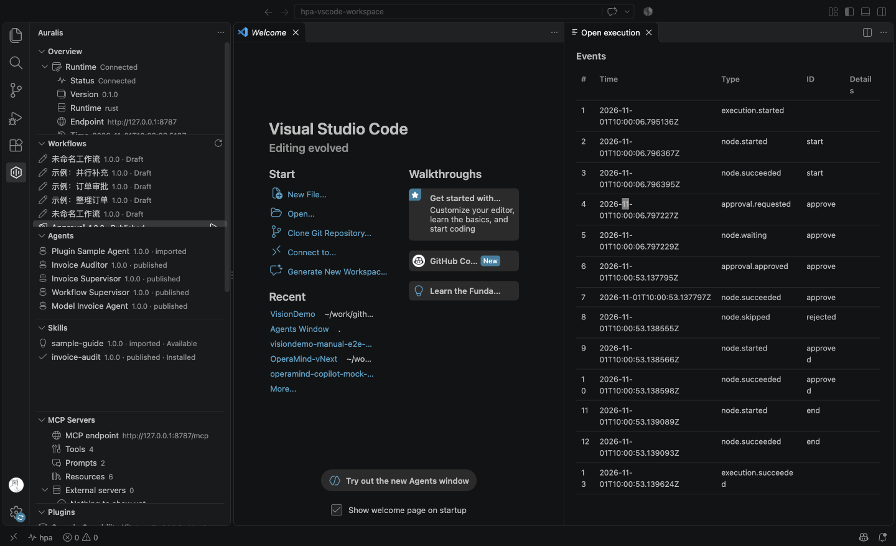
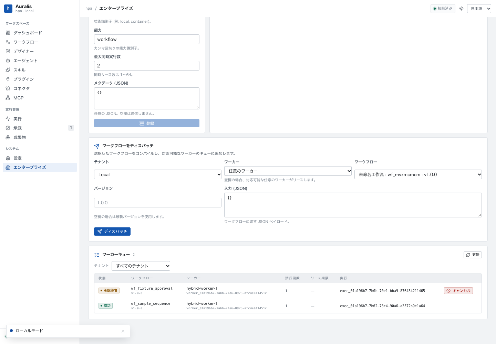
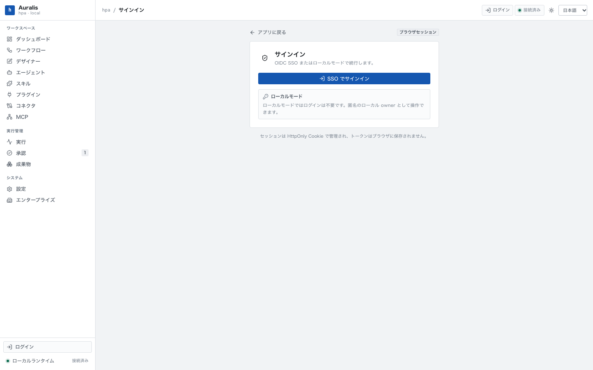

# Auralis（hpa）

Auralis 是一个统一的自动化与 AI 能力平台：用一套 Workflow IR 构建确定性流程，用 Agent 处理动态决策，用标准 Agent Skills 分发能力，通过 MCP 向外部 AI 客户端开放，并支持 Local、Private、SaaS、Hybrid 四种运行形态。

**Build Once. Execute Anywhere. Publish Everywhere.**
**Automation First. AI Optional. AI Native.**

显示名为 **Auralis**，永久内部 ID 为 **hpa**；Hisha 是历史别名。所有包名、二进制、数据目录、环境变量、扩展 ID 与 schema 授权均使用 `hpa`，显示名可独立更换。品牌规则见 [`BRANDING.md`](BRANDING.md)。



















## 当前状态

**Phase 1 至 Phase 11 已收口并通过本地验收。** 产品代码位于 `crates/`、`apps/web/` 与 `apps/vscode-extension/`。

- Rust Core：Canonical Workflow IR、JSON Schema 校验、Saphyr YAML 解析/输出、jaq 表达式、编译器与执行计划；Schema/静态/表达式/依赖/权限与执行策略五类校验；Node Registry（13 类节点、`typeVersion` 解析、旧版 `http.request@0.9.0` 迁移）。
- Runtime：顺序/条件/多路分支/循环/并行节点、重试/退避、节点超时、错误回退、人工审批暂停与恢复、内联子流程、HTTP/HTTPS 客户端、jq 脚本与变量节点；并行分支真并发（`maxConcurrency`），分支进度随检查点持久化；审批 SLA 到点自动按 `onTimeout` 恢复；工作流级 `errorHandling.graph` 在未处理失败后执行并保留原始错误。
- 安全边界：HTTP 默认仅允许回环；外部主机必须在节点 `permissions.network` 显式声明，重定向关闭，URL 禁止 userinfo；DNS 解析后拦截私网地址，除非规则显式允许；脚本仅执行 jq，禁止 `env`/`input`/`input_filename` 等越界函数。
- 持久化：SQLite 保存工作流、发布版本、执行快照、追加事件与输出产物；发布版本冻结 IR 与 Node Registry 版本，同版本内容不可改写；执行可按发布版本启动；进程被强杀后可从最近检查点恢复。
- Local API：127.0.0.1 上的 JSON API、SSE 事件流、审批中心接口、节点注册表 `/api/nodes`、Skill Center/MCP Center/Agent Center API 与嵌入式 Web UI。
- Skill 包与 Registry：标准 `SKILL.md` + 可选 `hpa.skill.json`；未知字段、`LICENSE`/`NOTICE` 原样保留；路径逃逸、符号链接、设备文件、超限包被拒绝；Skill 版本按内容哈希冻结，重复版本不同内容返回 `SKILL_VERSION_FROZEN`。
- Skill Runtime：Rust 执行 Python/Node/Bash/Sh 确定性脚本；独立临时工作区、输入与快照只读、artifacts 可写、argv 数组、占位符替换、环境白名单、命令白名单、超时/输出/产物/CPU 限制、进程组终止；产物内容寻址，审计写入 `logs/audit.jsonl`。
- 沙箱：macOS 使用 seatbelt 拒绝网络、工作区外写入与用户主目录读取；Linux 在可用时使用 bubblewrap 隔离网络与文件系统；导出产物与执行日志留在本地。
- Skill Center：导入、校验报告、测试控制台、确定性运行、发布、导出；导出支持标准目录、Claude Code 与 Codex 的标准 skills 路径。
- 本地 MCP Gateway：stdio + loopback Streamable HTTP；2026-07-28 无状态 `server/discover`、`resultType`、MRTR `input_required`，兼容 2025-11-25 `initialize`/会话；`MCP-Protocol-Version`、`Mcp-Method`、`Mcp-Name` 与 Origin 校验。
- MCP 注册与权限：已发布 Skill 脚本、`workflow.execute`、`workflow.list`、`execution.get` 成为工具；resources 覆盖 Skill/Workflow/Execution/Artifact，prompts 提供 Skill 指导与 Workflow 审查；PAT/stdio 能力令牌按 `mcp:read`/`mcp:execute` scope 过滤。
- MCP 治理：高风险 `workflow.execute` 使用服务端审批 + MRTR 重试；审批绑定参数哈希、TTL 与一次性消费；按 token 限流（默认 120/min，可 `HPA_MCP_RATE_LIMIT` 覆盖）、结构化审计、MCP Center 监控。
- OAuth 资源元数据：`/.well-known/oauth-protected-resource` 与 401 `WWW-Authenticate` challenge；本地以 PAT/stdio 能力令牌认证（完整 OAuth AS/PKCE 流程不在本阶段）。
- MCP Client：stdio 与 Streamable HTTP、modern→legacy 回退、工具白名单、主机白名单与 SSRF/metadata 地址防护、不向工具透传凭证；外部服务器可探测、浏览工具并调用。
- MCP Center：工具/Prompt/Resource 浏览器、调用控制台、审批、PAT 管理、外部服务器探测与调用、审计。
- Web：React 19 + Vite + XYFlow Canvas + Monaco YAML/JSON 编辑器 + 调试面板；节点注册表、网络权限、Skill Center、MCP Center、Agent Center、Plugin Center、Connector Center 与 Enterprise Center；浅色/深色/深海三主题；日语/英语/中文；607px 窄屏布局。
- Agent Platform：不可变 AgentVersion（`hpa.agent/v1`）、Agent Center/Designer/Test、会话与审批；Rust Agent Runtime 支持离线确定性 planner 与可选 OpenAI 兼容模型 planner；Skill/Workflow/MCP 工具调用、步骤/工具/token/成本/时间/深度预算、重复计划防护、检查点与 interrupt/resume、多 Agent handoff 预算继承、确定性 trace 回放；高风险工具强制审批，Workflow 审批保持独立。
- Plugin & Connector Ecosystem：`hpa.plugin/v1` 声明式插件包、tar `.hplugin`、内容哈希与 Ed25519 签名/信任、依赖/兼容性/许可检查、安装/升级/回滚/启停/卸载；本地 Marketplace 的发布/审核/评分/撤回；`hpa.connector/v1` 的 HTTP/File 核心连接器、连接实例、环境变量凭证引用、测试/调用、限流/重试/超时、SSRF/私网/路径逃逸防护与审计；插件可贡献 Connector/MCP/Skill/Agent，且不在 API 进程加载插件代码。
- Enterprise 基座：`control.db` 管理租户、API 令牌、OIDC 成员目录、配额、Worker、备份与审计；每个租户使用独立 SQLite 与独立 API Router，TenantGate 按令牌租户路由，跨租户访问通过测试验证为 0；固定 8 角色 RBAC（`owner/admin/developer/publisher/operator/approver/auditor/viewer`）按 read/write/execute/approve 动作判定；OIDC JWT/JWKS Bearer（EdDSA/RS256/ES256）与 `hpa_ent_` 本地令牌并存；成员目录可覆盖 OIDC 角色并禁用主体；配额覆盖 Workflow/日执行/Skill/Agent/插件/连接/并发；审计支持 JSON/CSV 导出；Worker 注册/心跳/离线派生/禁用；租户备份、恢复、保留、删除与清理。默认本地模式匿名映射为 `local` 租户 owner；`HPA_ENTERPRISE_MODE=1|true|required` 强制 Bearer。
- VS Code & Copilot 集成：`apps/vscode-extension`（`hpa.workbench`）薄客户端，10 个 Tree View、状态栏、Runtime 发现/重连、Workflow 运行与执行 Webview、事件/审批/取消、产物预览；Skill 安装/更新/移除到 `.github/skills` 或个人目录，备份回滚与本地修改检测；官方 `mcpServerDefinitionProviders` 注册本地 MCP Server，PAT 仅存 SecretStorage；`X-HPA-Tool-Name-Style: slug` 适配 VS Code 工具名限制。扩展不执行工作区脚本，未信任工作区只读。
- Hybrid Worker：`hpa worker` 出站轮询控制面，同一 Rust Runtime 执行 Workflow 快照；一次性 `hpa_wrk_` token（租户绑定、SHA-256）、能力/并发、30s 租约、心跳续租、租约过期重排、旧 lease 409、协作取消；首次 start 写回租户 execution/events/artifacts，`remote_executions` 阻止本地 Runtime 接管；审批后 Job 重排恢复；Enterprise Worker Center 注册/派发/队列/取消。
- Browser SSO：OIDC Authorization Code + PKCE（S256，public client）、state/nonce/redirect 校验、EdDSA/RS256/ES256 ID Token、JWKS/OKP/RSA/P-256；服务端 session 只存 token 哈希，`hpa_session` HttpOnly/SameSite=Lax Cookie、CSRF header、登录/会话/登出与失效；成员目录 disabled 拒绝、active 角色覆盖、租户 active 校验、平台管理员 `adminSubjects` allowlist；`/login` 与 Enterprise Center 浏览器登录、ja/en/zh；本地匿名模式与 `hpa_ent_`/OIDC Bearer/Worker/VS Code 认证不回归。
- 触发器与调度：`schedule`（自研 5 字段 cron、固定偏移时区、skip/run_once/catch_up 漏跑策略、乐观锁单飞）与 `webhook`（HMAC-SHA256 签名、±300s 重放窗口、`X-HPA-Event-Id` 幂等、进程内限流）真正驱动已发布版本；`trigger_state`/`trigger_fires` 持久化，重启不丢计划；Triggers 控制台展示下次触发、最近触发与启停。
- OAuth 2.1 授权服务器：内置 AS，Authorization Code + PKCE(S256)、动态客户端注册（RFC 7591）、刷新令牌轮换与复用检测、吊销（RFC 7009）与内省（RFC 7662）、ES256/EdDSA 签发与 24h 轮换重叠的 JWKS；同意页与 Enterprise Center 的 OAuth 控制台；MCP Gateway 除 PAT 外接受 AS 签发的访问令牌。
- 品牌门禁：`scripts/check-brand.mjs` 保证技术标识不混入显示名。

已执行的验收：

```bash
cargo test --workspace                  # 142 passed, 1 ignored (outbound TLS)
cargo clippy --workspace --all-targets -- -D warnings
cargo fmt --all --check
cd apps/web && npm run typecheck && npm test && npm run build
cd apps/vscode-extension && npm install && npm run build && npm test && npm run test:host && npm run package
node scripts/check-brand.mjs
node scripts/check-ir.cjs
```

Phase 1 回归：10 个 IR fixture 的 JSON/YAML 语义往返 100%；分支/循环/并行/重试/超时/错误回退/审批/子流程/HTTPS 均通过运行时测试；并行分支执行中途快照恢复后不会重放已完成请求；100 节点基准（debug 构建、本机）编译 20.3ms、执行 44.4ms（101 步）。

Phase 2 验收：CLI/API/Web 完成导入→测试→运行→发布→导出闭环；Python、Node、Bash 脚本均通过确定性测试；seatbelt 实测拒绝网络连接、工作区外写入与主目录读取；超时、输出上限、命令白名单、输入 Schema 与无许可/专有 Skill 拒绝均有负向测试；MCP stdio 端到端测试完成 `tools/list` 与 `tools/call`；导出目录写入临时 HOME 下的 `.claude/skills/` 与 `$CODEX_HOME/skills/` 结构，Codex 通过 `codex debug prompt-input` 实际发现并列出 `invoice-audit` Skill。<br>Claude Code 的实际会话加载未在本机自动执行（未调用模型/登录会话），导出目录按官方 `.claude/skills/<name>/` 结构验证。

Phase 3 验收：HTTP Gateway 集成测试覆盖 modern `server/discover`/`resultType`、legacy `initialize`/会话、PAT 401、`Mcp-Method` 失配 400、Origin 403、Skill 工具调用与 OAuth 资源元数据；命中限流返回 429 + `Retry-After`；MRTR 高风险审批在 API/Web 完成“input_required → 审批 → 重试执行”，审批绑定参数哈希且一次性消费；stdio 与 HTTP 外部 MCP Server 均通过 hpa MCP Client 探测并完成只读工具调用，SSRF/主机白名单负向测试通过。Claude Code `claude mcp list` 显示 `hpa` 已连接并完成 initialize/tools/list；Codex `codex debug prompt-input` 使用官方配置连接并列出工具。外部模型会话中的工具调用未自动执行（未消耗模型/登录会话）。

Phase 4 验收：Agent Center 完成 AgentVersion 创建→发布→测试运行→审批→会话→回放闭环；确定性 planner 调用已发布 Skill 并生成输出，trace replay 与原始输出一致；同版本不同内容返回 `AGENT_VERSION_FROZEN`；高风险 `workflow.execute` 先触发 Agent 审批，批准后 Workflow 内审批仍独立等待，Agent 审批不能替代 Workflow 审批；父 Agent handoff 继承剩余预算，子 Agent 工具超限与自引用深度均按预算失败；OpenAI 兼容 mock 验证工具调用、token/成本记账、连续计划检测与网络允许列表拒绝；服务重启后 running 会话恢复为 interrupted 并可从检查点继续，等待中的审批记录不变。界面在 1440px 与 607px 均无横向溢出，运行、审批、设计器和会话事件已在浏览器中实际操作验证。

实现与边界详见 [`docs/04-agent/local-agent-platform.md`](docs/04-agent/local-agent-platform.md)。

Phase 5 验收：Plugin Center 完成签名包校验→安装→能力导入→停用/启用→升级→回滚→卸载闭环；Ed25519 信任、内容摘要、未签名/未知键拒绝、许可白名单、依赖检查、路径穿越与符号链接拒绝均有负向测试；本地 Marketplace 完成发布→待审→审核→评分→安装→撤回闭环，未审核安装返回 `PLUGIN_FORBIDDEN`；Connector Center 完成 HTTP/File 连接创建、测试、调用与审计，覆盖 loopback、allowlist、SSRF 私网拒绝、429 限流、500→200 重试与 File 根路径限制；插件贡献的 Connector/Agent/Skill/MCP 能力分别进入对应注册表，Agent 调用 Connector 仍走独立审批。11 个 Phase 5 集成测试与 88 个全量 Rust 测试通过；Web typecheck、9 个 Vitest 与 build 通过；Plugin Center/Connector Center 在 1440px 与 607px 均无横向溢出，并实际在浏览器中调用 File 连接器读取文件。

实现与边界详见 [`docs/07-plugin/local-implementation.md`](docs/07-plugin/local-implementation.md)。

Phase 6 验收：控制面完成租户创建→API 令牌→OIDC 成员目录→配额→Worker 注册/心跳→备份→恢复→审计导出闭环；9 个 HTTP 企业测试与 3 个服务层测试覆盖认证边界、跨租户隔离、RBAC、令牌一次性与吊销、成员 CRUD/租户过滤、配额与并发 429、审计/CSV、租户删除保护、备份恢复/清理、Worker 离线派生与本地 JWKS 的 OIDC 校验；全量 100 个 Rust 测试通过。Web typecheck、9 个 Vitest 与 build 通过；Enterprise Center 的 1440px 与 607px 均无横向溢出、无未翻译 key，并在浏览器中实际切换成员角色；成员页同时验证了服务端角色持久化。截图见 `docs/assets/phase6/`。

实现与边界详见 [`docs/08-platform/local-enterprise.md`](docs/08-platform/local-enterprise.md) 与 [`docs/08-platform/enterprise-operations.md`](docs/08-platform/enterprise-operations.md)。

Phase 7 验收：VS Code 扩展完成 Runtime 连接→Workflow 运行→执行事件/审批→`succeeded`，以及 Skill 安装到 `.github/skills`；`MCP: List Servers` 显示 `Auralis Local MCP`，启动后 `Discovered 4 tools`，slug 别名 `workflow_list` 调用成功；Copilot Chat 读取了安装后的 `invoice-audit` Skill。60 个 Vitest、7 个 Extension Host 检查与 VSIX 临时目录安装通过；全量 Rust 测试 101 passed / 1 ignored。扩展侧栏在 1440px 与 607px 无页面横向溢出，代码/CSP/路径负向检查见实现文档。截图见 `docs/assets/phase7/`。

实现与边界详见 [`docs/14-vscode-copilot/local-implementation.md`](docs/14-vscode-copilot/local-implementation.md)。

Phase 8 验收：真实 `hpa worker` daemon 完成远程 Workflow `succeeded`、审批等待→审批→resumed→`succeeded`，并在 Worker Center 取消审批等待 Job 后 execution 进入 `cancelled`；错误 token 401、租户/worker 隔离、版本/能力/并发槽、租约过期重排与旧 lease 409 均有测试。全量 Rust 114 passed / 1 ignored；Worker queue 单元测试 5、daemon 6、驱动隔离 1、真实 daemon 集成 1。Worker Center 在 1440/607 无页面横向溢出、无未翻译 key，截图见 `docs/assets/phase8/`。

实现与边界详见 [`docs/08-platform/hybrid-workers.md`](docs/08-platform/hybrid-workers.md) 与 [`docs/08-platform/hybrid-worker-deployment.md`](docs/08-platform/hybrid-worker-deployment.md)。

Phase 9 验收：浏览器完成 `/login` → mock IdP 授权码 → `/auth/oidc/callback` → 平台管理员 session → `/enterprise` → 退出全流程，`EdDSA`、`RS256`、`ES256` 三种签名各跑一轮且零错误；Rust HTTP 集成测试覆盖 Cookie 属性、`/api/auth/session`、Cookie 认证写操作缺 `X-HPA-CSRF` 403、state 重放、redirect 逃逸、disabled 成员、nonce 失配与登出后 401。全量 Rust 142 passed / 1 ignored；新增 SSO 单元/集成测试 15 个；Web 10 Vitest、扩展 60 Vitest + 7 host checks 与 build 通过。登录页、已登录 Enterprise、回调错误与 OIDC 配置在 1440/607 无页面横向溢出，截图见 `docs/assets/phase9/`。

实现与边界详见 [`docs/08-platform/browser-sso.md`](docs/08-platform/browser-sso.md)。

Phase 10 验收：`/oauth/register` 注册公共客户端 → `/oauth/authorize` 302 到 `/consent` → 同意 → 回调收码 → `/oauth/token` 换取访问/刷新令牌 → 用访问令牌调用 `/mcp` `server/discover` 成功 → 内省 active → 刷新令牌轮换 → 吊销后 `/mcp` 401。负向覆盖未注册 `redirect_uri`（400 且不重定向）、缺少 PKCE、`plain` 方法、未注册 scope（带 `state` 回到客户端）、错误 `code_verifier`、授权码重放、刷新令牌复用触发整链吊销、拒绝授权 `access_denied`、错误客户端密钥 401、停用客户端后密钥轮换 409。Playwright 真实浏览器完成同一流程并在 1440/607 截图，两页均无横向溢出；控制台列出客户端与已签发令牌。Rust 新增 4 个单元测试与 4 个 HTTP 集成测试，`cargo clippy --workspace --all-targets -- -D warnings`、`cargo fmt --all --check`、品牌门禁与 IR 门禁通过；Web typecheck、10 Vitest（新增 Consent / EnterpriseOAuth 文案门禁）与 build 通过。

实现与边界详见 [`docs/08-platform/oauth-authorization-server.md`](docs/08-platform/oauth-authorization-server.md)。

Phase 11 验收：发布带 `schedule` + `webhook` + `event` 三个触发器的工作流后，`GET /api/triggers` 返回 3 行（`event` 为禁用占位），`next_fire_at` 落在 `09:00 +08:00` 的整分边界；带 `sha256=` 签名的投递返回 202 并生成执行，重复 `X-HPA-Event-Id` 返回 409，错误签名/过期时间戳/缺签名返回 401，未知触发器 404，停用后 409；手动触发与 `/api/trigger-fires` 正常。调度语义用注入时钟测试：到期触发一次并推进、同一时刻重复 tick 不重复、`skip` 丢弃迟到 10 分钟的 slot、`catch_up` 按上限补齐并跳过剩余。Playwright 完成「建工作流→发布→Webhook 投递→手动触发→停用/启用→界面触发」并在 1440/607 截图，无横向溢出。新增 cron/契约单元测试 10 个、调度单元测试 5 个、触发器 HTTP 集成测试 2 个；Web 11 Vitest（新增插值门禁，禁止单花括号占位符）与 build 通过。

实现与边界详见 [`docs/03-workflow/triggers.md`](docs/03-workflow/triggers.md)。

## 运行

要求 Rust 1.99.1（MSRV 1.97）与 Node.js 26。

```bash
cd apps/web
npm install
npm run build

cd ../..
cargo run -p hpa-local -- serve
```

打开终端输出的地址，默认是：

```
http://127.0.0.1:8787
```

数据默认写入 `~/.hpa/hpa.db`；也可使用 `--data-dir` 或 `HPA_DATA_DIR` 指定。首次打开可在工作台点击「サンプルを追加 / Add samples」加载 Workflow 示例；Agent Center 也提供示例 Agent 与发票审计 Skill 的导入入口。企业控制面与租户数据分别写入 `<data_dir>/control.db` 与各租户目录；默认本地模式可直接打开 `/enterprise`，设置 `HPA_ENTERPRISE_MODE=1|true|required` 后除健康检查外都需要 Bearer 令牌。

浏览器 SSO（本地验收可用 mock IdP）：

```bash
node scripts/oidc-mock.mjs
# 可选：OIDC_PORT=18970 OIDC_ALG=EdDSA|RS256|ES256
```

在 Enterprise Center → OIDC 填写 `issuer`、`clientId`、`authorizationEndpoint`、`tokenEndpoint`、`redirectUri`（`http://127.0.0.1:8787/auth/oidc/callback`）、`adminSubjects` 等，然后打开 `http://127.0.0.1:8787/login` 点击 SSO。mock 默认登录 `admin@example.test`（`local` 租户 owner）；它只用于本地验收，不要用于生产。完整契约与测试命令见 [`docs/08-platform/browser-sso.md`](docs/08-platform/browser-sso.md)。

VS Code 扩展：

```bash
cd apps/vscode-extension
npm install
npm run package
code --install-extension hpa-workbench.vsix
```

开发模式也可使用 `code --extensionDevelopmentPath=apps/vscode-extension .`。扩展默认连接 `http://127.0.0.1:8787`；打开 Auralis 活动栏即可查看视图。

Hybrid Worker：

```bash
# 先在 Enterprise Center → ワーカー 注册 Worker，复制一次性 workerToken
HPA_WORKER_TOKEN="<worker-token>" \
  hpa worker --control-url http://127.0.0.1:8787 \
  --max-concurrency 2 --capabilities workflow
```

Worker 主动出站轮询，不开放入站端口；token 只放环境变量，不要写命令行/日志。远程控制面必须 HTTPS。

命令行：

```bash
hpa serve --port 8787 --data-dir ~/.hpa
hpa doctor
hpa validate fixtures/01_sequence.yaml
hpa run fixtures/01_sequence.json --input '{"value": 41}'

hpa --data-dir ~/.hpa skill validate fixtures/skills/invoice-audit
hpa --data-dir ~/.hpa skill import fixtures/skills/invoice-audit
hpa --data-dir ~/.hpa skill publish skill_invoice_audit
hpa --data-dir ~/.hpa skill test skill_invoice_audit
hpa --data-dir ~/.hpa skill run skill_invoice_audit --input '{"invoiceId":"inv_1","items":[{"amount":12.5}]}'
hpa --data-dir ~/.hpa skill export skill_invoice_audit --target claude
hpa --data-dir ~/.hpa mcp token create external
hpa --data-dir ~/.hpa mcp probe -- hpa --data-dir ~/.hpa mcp serve
hpa --data-dir ~/.hpa mcp call --tool skill.invoice-audit.audit --args '{"invoiceId":"inv_1","items":[]}' -- hpa --data-dir ~/.hpa mcp serve

hpa --data-dir ~/.hpa agent import fixtures/agents/invoice-auditor.agent.json
hpa --data-dir ~/.hpa agent publish agent_invoice_auditor
hpa --data-dir ~/.hpa agent run agent_invoice_auditor --input '{"invoiceId":"inv_1","items":[{"amount":12.5}]}'
hpa --data-dir ~/.hpa agent sessions agent_invoice_auditor
hpa --data-dir ~/.hpa agent replay <sessionId>
hpa --data-dir ~/.hpa agent approvals --status pending
hpa --data-dir ~/.hpa agent decide <approvalId> --decision approved

hpa --data-dir ~/.hpa plugin sample
hpa --data-dir ~/.hpa plugin sign ./my-plugin
hpa --data-dir ~/.hpa plugin pack ./my-plugin ./my-plugin-1.0.0.hplugin
hpa --data-dir ~/.hpa plugin install ./my-plugin-1.0.0.hplugin
hpa --data-dir ~/.hpa plugin list
hpa --data-dir ~/.hpa plugin publish ./my-plugin-1.0.0.hplugin
hpa --data-dir ~/.hpa plugin review plugin_example 1.0.0 --status approved
hpa --data-dir ~/.hpa plugin install-marketplace plugin_example 1.0.0
hpa --data-dir ~/.hpa connector sample
hpa --data-dir ~/.hpa connector list
hpa --data-dir ~/.hpa connector connections
hpa --data-dir ~/.hpa connector test <connectionId>
hpa --data-dir ~/.hpa connector invoke <connectionId> read --args '{"path":"welcome.txt"}'
hpa --data-dir ~/.hpa connector audit --limit 50

hpa --data-dir ~/.hpa enterprise init --name bootstrap
hpa --data-dir ~/.hpa enterprise token --tenant local --name ci --role viewer
HPA_ENTERPRISE_MODE=required hpa --data-dir ~/.hpa serve --port 8787
```

MCP HTTP 客户端配置示例（使用 `hpa mcp token create` 输出的一次性令牌）：

```bash
export HPA_MCP_TOKEN="<token>"
claude mcp add hpa http://127.0.0.1:8787/mcp --transport http --scope user --header "Authorization: Bearer $HPA_MCP_TOKEN"
codex mcp add hpa --url http://127.0.0.1:8787/mcp --bearer-token-env-var HPA_MCP_TOKEN
```

OAuth 2.1 授权（不需要预先创建 PAT）：客户端先用 `GET /.well-known/oauth-authorization-server` 发现端点，再用 `POST /oauth/register` 注册，浏览器打开 `/oauth/authorize` 完成同意后即可调用 `/mcp`。支持 OAuth 的 MCP 客户端直接指向 `http://127.0.0.1:8787/mcp` 即可自动走这条流程：

```bash
# 查看 AS 元数据与签名公钥
curl -s http://127.0.0.1:8787/.well-known/oauth-authorization-server
curl -s http://127.0.0.1:8787/oauth/jwks
```

浏览器流程的自动化验收（Playwright，真实点击同意页）：

```bash
HPA_BASE_URL=http://127.0.0.1:8787 node scripts/phase10-oauth-e2e.mjs
```

触发器：在 Workflow IR 里加 `triggers`，发布后到 `/triggers` 查看下次触发时间；Webhook 用 HMAC 签名投递：

```bash
TS=$(date +%s)
BODY='{"action":"published"}'
SIG=$(printf '%s.%s' "$TS" "$BODY" | openssl dgst -sha256 -hmac "$WEBHOOK_SECRET" -r | cut -d' ' -f1)
curl -sS -X POST http://127.0.0.1:8787/hooks/<workflowId>/<triggerId> \
  -H "content-type: application/json" -H "x-hpa-timestamp: $TS" \
  -H "x-hpa-signature: sha256=$SIG" -d "$BODY"

HPA_BASE_URL=http://127.0.0.1:8787 node scripts/phase11-triggers-e2e.mjs
```

开发模式：

```bash
cargo run -p hpa-local -- serve
cd apps/web && HPA_API_URL=http://127.0.0.1:8787 npm run dev
```

## Phase 1 行为边界

以下为当前本地 MVP 的明确边界：

- `http.request` 支持 `http://` 与 `https://`（rustls）；外部主机的访问必须显式声明 `permissions.network`。隐式回环不影响显式规则；私网地址在 DNS 解析后被拦截，除非规则本身允许。
- HTTP 客户端不跟随重定向、不使用系统代理、不接受 URL 中的 userinfo；响应体上限 8 MiB。
- 并行节点在分支内不含人工审批时真并发执行，`maxConcurrency` 限制同轮并发；含审批的分支回退为顺序执行以保证可恢复性。分支子状态随检查点持久化，恢复时已完成的分支不会重跑；同一节点在崩溃瞬间的副作用仍按“至少一次”语义处理。
- 审批 SLA 由本地驱动每秒扫描并自动按 `onTimeout`（`approve` / `reject`）恢复；`pending` 配置会被拒绝。
- 工作流级 `errorHandling.graph` 在根图未处理失败后运行一次，随后仍以原始错误结束执行。
- 发布版本冻结 IR 与 Node Registry 版本；同一 `workflowVersion` 不能改写已发布内容（API 返回 `VERSION_FROZEN`）。执行默认运行最新草稿，也可在请求中带 `version` 运行指定发布版本。
- Node Registry 当前版本 `2026.11.1`；手写配置必须先通过五类校验。`compensate` 错误模式、非 jq 脚本、未知权限与未注册版式会被拒绝。
- 本地运行时限制：100,000 步、每节点默认 30s 超时、工作流可选总超时、HTTP 响应 8 MiB、500 节点/2,000 边、嵌套深度受限。
- Phase 1/2 不包含 Agent；Phase 4 已加入本地 Agent Platform，Phase 5 已加入本地 Plugin/Connector/Marketplace，Phase 6 已加入本地 Enterprise 控制面，Phase 7 已加入本地 VS Code & Copilot 集成，Phase 8 已加入本地/私有 Hybrid Worker 执行，Phase 9 已加入本地 Enterprise Browser SSO。云端多节点 Control Plane、跨租户市场、远程发布者账号、refresh token/SCIM 与计费仍属于后续阶段。

## Phase 2 行为边界

- Skill 脚本只支持本地确定性执行；`network` 权限非空、依赖在线安装、模型/Agent 推理均不在本阶段执行范围内。
- macOS 沙箱由 `sandbox-exec` 提供：拒绝网络、工作区外写入与 `/Users` 读取；Linux 仅在安装 `bwrap` 时提供网络/文件系统隔离，否则退化为进程级隔离并在执行结果中标记 `process`，不应视为强隔离。
- 工作区、输入与快照文件对脚本只读；`artifacts/` 可写。脚本参数使用 argv 数组与占位符替换，不经过 shell 拼接；stdout 默认上限 1 MiB，stderr 256 KiB，产物默认上限 50 MiB/100 个文件。
- Skill 导入只做本地目录读取；不自动安装 Python/Node 依赖，也不下载模型。依赖声明会保留并校验形状，Skill 类型依赖会检查本地 Registry；包管理器依赖需由用户在宿主环境自行准备。
- 发布版本冻结内容哈希；同一 `skillId@version` 不同内容会被拒绝。发布需要许可白名单内的 SPDX 许可；无许可/专有 Skill 可导入查看，但拒绝发布与导出。
- 导出可写标准目录、Claude Code `.claude/skills/<name>/` 或 Codex `$CODEX_HOME/skills/<name>/`。Codex 的 Skill 发现已通过 `codex debug prompt-input` 验证；Claude Code 未执行真实会话加载。
- 本地 MCP Gateway 提供 HTTP 与 stdio；2026-07-28 的 GET/SSE、`subscriptions/listen` 与 tasks 扩展未实现，legacy GET 返回 405；现代请求必须携带 `MCP-Protocol-Version`/`Mcp-Method`（`tools/call`、`resources/read`、`prompts/get` 还需 `Mcp-Name`）。
- Skill Center 不在页面内编辑文件；修改源目录后以新版本重新导入，版本目录不可变。
- 签名/信任验证、Python/Node 离线依赖安装、容器沙箱与远程 Registry 同步尚未实现；manifest 中的 `trust`/依赖字段会保留但不做签名背书。

## Phase 3 行为边界

- 认证为本地 PAT/stdio 能力令牌；仅提供 OAuth 2.1 资源元数据与 401 challenge，未实现授权服务器、PKCE、DCR/CIMD 或 token 刷新。
- `/api/mcp/*` 管理接口与 Web UI 仅绑定 loopback，未额外加登录；HTTP MCP endpoint 必须携带 Bearer token。stdio 首次运行会生成权限 `0600` 的能力令牌文件（可用 `HPA_MCP_TOKEN` 覆盖）。
- 限流为进程内 per-token 滑动窗口，重启后清零；默认 120 请求/分钟，`HPA_MCP_RATE_LIMIT` 可覆盖。
- legacy 会话仅保存在进程内（1 小时 TTL）；2026-07-28 的 GET/SSE、`subscriptions/listen` 与 tasks 扩展未实现。
- 高风险审批目前覆盖 `workflow.execute`；approval 与工具参数哈希绑定、10 分钟过期并一次性消费。MRTR 的 `inputResponses` 不作为授权依据，必须由本地审批中心批准。
- MCP Client 支持 stdio/HTTP 与 modern→legacy 回退；HTTP 默认只允许回环，远端主机必须显式加入网络白名单，并拒绝元数据地址；未实现上游 OAuth 登录或凭证透传。
- 本地工具只暴露“最新且已发布”的 Skill 版本与已发布 Workflow；租户固定为 `local`，多租户隔离尚未实现。
- Claude Code 与 Codex 已通过官方配置连接并完成 initialize/tools/list 发现；外部模型会话中的工具调用未自动执行，只读调用由 hpa MCP Client 在同一 Gateway 上完成。

## Phase 4 行为边界

- 仅本地执行；不自动安装模型、Python/Node 依赖或外部 MCP Server。OpenAI 兼容 planner 只支持单个工具调用/回合。
- 非回环模型 endpoint 必须显式列入 `network`、使用 HTTPS，且解析到私网/链路本地/元数据地址会被拒绝；本机回环无需额外规则。HTTP 不跟随重定向、不使用系统代理、不接受 userinfo。
- 确定性回放仅覆盖 deterministic planner 的 trace replay；模型 planner 的响应与 token/成本仅审计，不承诺跨会话重新生成相同输出。
- 高风险 `workflow.execute`、`mcp.*` 固定需要 Agent 审批；Agent 审批不代替 Workflow 审批。子 Agent 需要审批时父 handoff 失败关闭，必须显式处理子会话或调整审批配置。
- 本地进程重启将 running 会话标记为 interrupted 并可从检查点继续；崩溃瞬间的外部副作用按至少一次语义处理。等待审批的会话与审批记录跨重启保留。
- 会话与事件保存在本地 SQLite；没有云端 Control Plane、Marketplace、多租户隔离或远程 Agent 调度。

## Phase 5 行为边界

- 插件是本地声明的能力包，不执行插件内 Node/TS/JS handler；贡献的 Skill 脚本仍须发布后由既有 Skill Runtime 沙箱执行。本地 SDK 是 `hpa plugin sign/pack/validate/install` CLI 与 JSON manifest，未提供 `@hpa/plugin-sdk` 或 TS handler 运行时。无远程 Marketplace、OCI 分发、系统依赖自动安装或发布者账号。
- 签名信任只有 `verified`/`community`/`untrusted`；本地 Ed25519 私钥保存在 `data_dir/keys/`（Unix `0600`），没有密钥轮换/吊销或官方密钥层级。市场审核与签名信任是两套状态。
- 本地 Marketplace 的审核/评分是单用户本地操作，不具备反刷、SLA、付费或跨租户隔离；撤回不自动卸载已安装版本。
- Connector 仅 HTTP 与 File；HTTP 关闭重定向/代理/userinfo，外部主机必须匹配 Connection `allowedHosts` 且 DNS 私网/链路本地地址被拒绝；DNS 只校验一次、不固定地址，不宣称抵御 DNS rebinding。响应上限 2 MiB，单文件 2 MiB。
- 连接凭证只保存环境变量名；限流为进程内 per-connection/operation 滑动窗口，重启清零；审计不保存响应正文或凭证。
- 插件 `permissions` 只做能力形状与一致性门禁，不是通用运行时权限系统；Connector 的主机白名单来自 Connection 配置。Skill/Agent 贡献仅导入草稿，卸载后仍作为用户资产保留。
- SBOM 是本地文件哈希与声明清单；静态扫描只做固定字符串警告，**没有 CVE 数据库、远程漏洞源或在线撤回**。

## Phase 6 行为边界

- 默认本地模式无登录：匿名请求映射为 `local` 租户的 `owner` 且视为平台管理员；只有设置 `HPA_ENTERPRISE_MODE` 后才强制 Bearer。把本地端口暴露给他人等同于交出控制面。
- 隔离是“每租户独立 SQLite 文件 + TenantGate 路由”，没有 PostgreSQL RLS、数据库级策略或多节点共享；TenantGate 缓存无 TTL，长期运行大量租户会增加内存与文件句柄。
- RBAC 是固定 8 角色 + 4 个路径近似动作（read/write/execute/approve），没有资源级 ACL、自定义角色或 ABAC；`owner/admin/developer/publisher` 对租户 API 实际等价。
- Phase 6 时 OIDC 只接受 EdDSA/Ed25519 Bearer JWT 与 JWKS，没有浏览器 SSO、授权码回调、登录会话、刷新令牌或登出；Phase 9 已加入浏览器 SSO 与 EdDSA/RS256/ES256。成员目录只覆盖 OIDC 主体的角色/禁用状态，没有密码、组、邀请或成员自服务；未登记 OIDC 主体按 claims 认证。
- 配额检查针对特定创建路径与当日计数；日计数按 UTC；并发数统计 `running` + `waiting_approval`。配额不是权限，也不含计量/计费或付费计划。
- Worker 仅是本地注册表 + 心跳：不派发任务、不下发凭证、不建立反向隧道；超过 30 秒无心跳显示 `offline`，数据库状态仍为 `active`。
- 备份使用 `VACUUM INTO` 写本地文件；恢复需要重启进程，且只恢复租户业务库，不恢复控制库中的租户/令牌/配额/审计。控制库本身不在备份范围。
- 审计写入是尽力而为，与业务操作不同事务；没有 WORM、哈希链、自动保留或 SIEM 投递。CSV 对公式前缀做转义，但仍应视为敏感数据。
- `/mcp` 与 OAuth 资源元数据仍绑定 `local` 租户，不经过 TenantGate；`agent/skill/mcp/plugin/connector/run/doctor` CLI 也仍直接操作本地租户库。
- 服务只监听 `127.0.0.1` 明文 HTTP；远程访问需要 TLS 反向代理。没有远程 Worker 执行、HA、在线迁移、租户暂停 API 或控制库在线备份。

## Phase 9 行为边界

- 浏览器 session 是额外认证路径；本地匿名模式、`hpa_ent_`/OIDC Bearer、Worker token 与 VS Code 集成保持不变。
- public client：没有 client secret、refresh token、silent renew、RP-initiated logout、SCIM 或组同步；session 过期即重新登录。
- 服务端 session 只存 token 哈希；Cookie 为 HttpOnly、SameSite=Lax，HTTPS 部署必须设置 `cookieSecure`。CSRF 只对 Cookie 认证的写请求强制，Bearer 不受影响。
- 平台管理员只来自 `adminSubjects`（sub 精确匹配、email 大小写不敏感），ID Token claims 不授予平台管理员；disabled 成员登录被拒绝，既有 session 在后续检查中被拒绝，`/auth/session` 会清除浏览器 Cookie。
- 授权/token/JWKS 端点沿用 HTTPS、network allowlist 与私网拦截；token 请求不跟随重定向、不使用系统代理。PKCE verifier 以明文存 `control.db`，依赖磁盘权限与加密。
- 不调用 UserInfo，只验证 ID Token；不支持第三方 Cookie、SameSite=None、IdP 侧登出或 IdP 会话管理。mock IdP 只用于本地验收。
- 单节点 SQLite：flow/session 表不跨节点共享；登录失败只返回稳定错误码，不向浏览器区分用户不存在与角色无效。

## Phase 11 行为边界

- 只有 `schedule` 与 `webhook` 会真正执行；`event` 通过校验但明确不接线（控制台显示“未接线”），`mcp` 走 `workflow.execute` 工具。
- 触发器只运行**已发布版本**；改草稿不影响正在跑的调度，重新发布会重算 `next_fire_at` 并保留历史。
- cron 是自研 5 字段实现，不支持秒级、`@daily` 别名、`L`/`W`/`#` 扩展；日与周同时受限按并集处理。
- 时区只接受 `UTC` 与固定偏移（`+08:00`），没有 IANA 时区库，因此不处理夏令时。
- `skip` 的迟到阈值固定 60 秒；没有抖动、退避、并发上限或每触发器配额。
- Webhook 只支持 HMAC-SHA256 + 时间戳窗口 + 可选事件 ID 去重；不支持 mTLS、IP 白名单、请求体 schema 校验或同步返回执行结果。
- 签名密钥以明文存在租户库的 `config_json` 里（与 Workflow 快照同库），轮换需要改 IR 并重新发布。
- 调度器每节点各自 tick，靠 `next_fire_at` 乐观锁避免重复触发；没有 leader 选举、分布式队列或跨节点时钟对齐。
- 调度只在本机启动执行，不派发到 Hybrid Worker；远程派发仍走显式 Worker Job 流程。

## Phase 10 行为边界

- 只做授权服务器（AS），不做身份提供方：不签发 ID Token、没有 `/userinfo`、不支持 `openid` scope 或用户注册；登录仍由 Phase 9 的 OIDC SSO 或本地匿名模式提供。
- 签名默认 ES256；`HPA_OAUTH_SIGNING_ALG=EdDSA` 可切换为 Ed25519。不提供 RS256（ring 不能生成 RSA 私钥），需要 RS256 的客户端只能使用 PAT。
- 不支持 CIMD、PAR、JARM、DPoP、mTLS 令牌绑定、token exchange；`response_type` 仅 `code`，`code_challenge_method` 仅 `S256`。
- 访问令牌 1 小时、刷新令牌 30 天且每次使用轮换；刷新令牌复用会吊销整条 family，但没有 refresh token family 的跨节点同步。
- 校验同时验签与查库，吊销立即生效；代价是每个 MCP 请求多一次 SQLite 查询，且多实例部署时吊销状态不共享。
- 授权端点要求浏览器身份：有会话用会话主体，企业模式无会话跳 `/login`，本地模式使用匿名 `local-owner`。本地端口暴露给他人等同于交出授权能力。
- MCP Gateway 仍只服务 `local` 租户：其他租户授权的令牌会被 403 拒绝，与 PAT 的单租户边界一致。
- 同意记录按 client/tenant/subject 覆盖 scope；没有按资源粒度、时间窗或单次授权的细粒度控制，`prompt=none` 不支持。
- 客户端与令牌管理接口属平台管理员操作；本地模式等价 owner，无额外登录。

## Phase 8 行为边界

- Worker 与控制面均为单节点 SQLite；没有 Redis/Postgres 队列、HA、自动扩缩容或跨机控制库共享。Worker 必须能通过 loopback HTTP 或 HTTPS 访问控制面。
- `hpa_wrk_` token 绑定 worker/tenant，明文只返回一次；轮换/禁用/租户删除会吊销。Worker 不得跨租户 lease；任务 snapshot 含 Workflow 定义，禁止把 secret 写进 Workflow。
- 同一 Rust Runtime 执行，不引入第二执行引擎；副作用按至少一次语义。daemon 没有持久 outbox：进程崩溃/断线时，未上报执行依赖 30 秒租约过期重排；旧 lease 的迟到上报返回 409。
- 审批等待释放并发槽；审批后 Job 重新入队并从保存 state 继续。远程审批不做 SLA 自动超时（本地监控跳过远程 execution）。
- 取消对 queued/leased/waiting 立即生效；running 为协作取消（step 之间检查，长 HTTP/脚本不可中断）。本地 Runtime 不接管 `remote_executions`。
- 当前能力类型为 `workflow`，未派发 Agent/Plugin/Connector 等非 Workflow 任务；没有远程凭证注入、对象存储或 mTLS。
- Worker daemon 无本地 data-dir 状态；远程/私有网需 TLS 反向代理；Worker 与控制面版本必须匹配。系统服务示例见 `deploy/`。

## Phase 7 行为边界

- 扩展是薄客户端，不在 VS Code 内执行 Workflow、Skill 脚本或插件代码；所有执行仍走 Rust Local Runtime/MCP Gateway。
- 扩展固定连接现有 `/api/*` 与 `/mcp`；没有远程 Worker、跨租户 MCP 路由或 Marketplace 发布。`/mcp` 仍只服务 `local` 租户。
- VS Code 工具名限制通过 `X-HPA-Tool-Name-Style: slug` 的请求级别名解决；stdio 与其他 HTTP 客户端保持规范点号名。没有为所有客户端强制改名。
- Skill 安装调用 Runtime 的 export API 写快照，扩展与 Runtime 必须共享文件系统；没有在线 Marketplace 下载、自动更新或 Skill 签名重新验证。替换前备份、失败回滚，安装后本地修改需显式确认。
- MCP PAT 与 API token 只在 SecretStorage；不写 settings/workspace/日志/Webview。未信任工作区只读，运行/审批/取消/Skill 写入均被拒绝。
- 实测 VS Code 1.143.1；未建立 1.140–1.143 的运行时/高对比/Remote 兼容矩阵。Copilot Chat 可发现 `.github/skills` 中的 Skill，但模型驱动的 MCP `tools/call` 未验证，也未准备登录会话。
- 未实现 Custom Instructions/Custom Agents 生成、完整 Designer、远程工作区高级支持、Marketplace 发布或自动升级。

## 技术栈

- **Rust**：Core Runtime、IR/编译器/校验器、Skill Loader/Registry/Sandbox Runner、Local API、MCP stdio 服务、Hybrid Worker daemon、SQLite 持久层。
- **TypeScript**：React + Vite Web、Canvas、Monaco、Skill Center、i18n 与调试界面；VS Code 扩展（Tree View/Webview/MCP provider/VSIX）。
- **Python/Node/Bash**：Skill 确定性脚本运行时（由 Rust 启动并沙箱化）；Python AI Worker 仍属后续阶段，确定性 Workflow 不依赖 AI。

完整选型、版本、许可证与证据见 [`docs/13-tech-stack/`](docs/13-tech-stack/README.md)。

## 文档入口

| 读者 | 从这里开始 |
| --- | --- |
| 产品与决策 | [`docs/00-product/product-vision.md`](docs/00-product/product-vision.md) |
| 架构师 | [`docs/02-architecture/system-architecture.md`](docs/02-architecture/system-architecture.md) |
| 工作流开发 | [`docs/03-workflow/workflow-ir.md`](docs/03-workflow/workflow-ir.md) |
| 技术栈与 M0 | [`docs/13-tech-stack/mvp-stack.md`](docs/13-tech-stack/mvp-stack.md) |
| 本地 MCP Gateway | [`docs/06-mcp/local-gateway.md`](docs/06-mcp/local-gateway.md) |
| 本地 Plugin & Connector | [`docs/07-plugin/local-implementation.md`](docs/07-plugin/local-implementation.md) |
| 本地 Enterprise 控制面 | [`docs/08-platform/local-enterprise.md`](docs/08-platform/local-enterprise.md) |
| 企业部署与运维 | [`docs/08-platform/enterprise-operations.md`](docs/08-platform/enterprise-operations.md) |
| Hybrid Worker 协议 | [`docs/08-platform/hybrid-workers.md`](docs/08-platform/hybrid-workers.md) |
| Hybrid Worker 私有部署 | [`docs/08-platform/hybrid-worker-deployment.md`](docs/08-platform/hybrid-worker-deployment.md) |
| OAuth 2.1 授权服务器 | [`docs/08-platform/oauth-authorization-server.md`](docs/08-platform/oauth-authorization-server.md) |
| 触发器与调度 | [`docs/03-workflow/triggers.md`](docs/03-workflow/triggers.md) |
| VS Code / Copilot 集成 | [`docs/14-vscode-copilot/README.md`](docs/14-vscode-copilot/README.md) |
| VS Code Phase 7 本地实现 | [`docs/14-vscode-copilot/local-implementation.md`](docs/14-vscode-copilot/local-implementation.md) |
| 研究证据与许可证 | [`docs/01-research/README.md`](docs/01-research/README.md) |
| 关键决策与 15 个结论题 | [`docs/12-decisions/final-questions.md`](docs/12-decisions/final-questions.md) |

## 强制约束

1. Canvas、YAML、JSON 共享同一 Canonical Workflow IR，不维护三套流程模型。
2. 确定性 Workflow 在无 AI、无云端 Control Plane 时也能完整执行。
3. Agent 与 Workflow 是两种执行模型，可互相调用但不可混同。
4. Skill 遵循 Agent Skills 开放标准，不使用平台私有 Skill 格式。
5. MCP 以当前规范及真实客户端兼容性为准，不假设一个配置适配所有客户端。
6. 未通过 Schema、静态、权限、依赖、执行策略校验的 Workflow 不得发布或执行。
7. 本地运行不强制依赖云端；云端 Control Plane 不直接执行不可信脚本。

## 许可证状态

Auralis/hpa 自身许可证尚未确定。开源复用边界、义务与禁用清单见 [`docs/01-research/license-analysis.md`](docs/01-research/license-analysis.md) 和 [`docs/adr/0012-open-source-reuse-and-licensing.md`](docs/adr/0012-open-source-reuse-and-licensing.md)。在许可证决策完成前，不得把标记为 Design Reference 或 Do Not Use 的代码并入产品。
