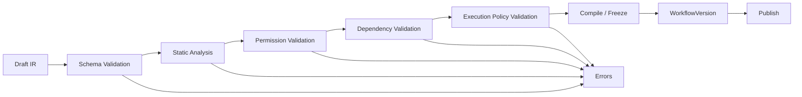

# Control Plane

> Control Plane 负责“定义、校验、准入、编排、治理、审计”，不执行不可信脚本。M0 Local 由 Rust Local API 提供子集；团队/云端版以 NestJS Modular Monolith 交付（M1）。

## 1. 模块与边界

| 模块 | 核心实体 | 对外接口 | 依赖 |
| --- | --- | --- | --- |
| Identity | User, Session, Token, ServiceAccount | OIDC/PAT/登录 | Tenancy |
| Tenancy | Tenant, Workspace, Project, Membership, Role | 组织/成员/配额 | Identity |
| Capability | Capability, Binding, EntryPoint, Dependency | 注册/发现/关系图 | Workflow/Agent/Skill/MCP/Connector |
| Workflow | Workflow, WorkflowVersion, Draft, Layout | CRUD/validate/publish/import/export | IR/JSON Schema；Rust Compiler/Validator gRPC |
| Agent | Agent, AgentVersion, TestRun | CRUD/test/publish | Model/MCP/Workflow/Skill |
| Skill | Skill, SkillVersion, ImportJob | CRUD/validate/test/publish/export | Skill Runtime contract |
| MCP | MCPServer, MCPTool/Resource/Prompt, GatewayClient | register/discover/invoke | Capability/Policy |
| Plugin | Plugin, PluginVersion, Install, Signature | install/upgrade/uninstall | Capability/Marketplace |
| Connector | Connector, Connection, CredentialRef | test/invoke/metadata | Vault/Policy |
| Execution | Execution, NodeExecution, ExecutionEvent, Approval, Artifact | start/resume/cancel/query/stream | gRPC `RuntimeService`（Rust）；本地 Rust Local API |
| Trigger | Trigger, Schedule, Webhook, EventSubscription | create/fire/pause | Execution |
| Governance | Policy, AuditLog, Quota, Retention | evaluate/audit/quota | Tenancy |
| Model | ModelProvider, ModelConfiguration, Budget | CRUD/resolve | LiteLLM |
| Observability | OTel config, metrics, alerts | read | OTel |
| Notification | Email/Webhook/In-app | send | Identity |

## 2. 发布流水线



### 2.1 五类校验

1. **Schema**：IR JSON Schema、节点配置 schema、端口/边合法性。
2. **Static**：可达性、变量绑定、类型兼容、循环/并行/Join 语义、子流程存在/版本、表达式语法。
3. **Permission**：节点/连接器/MCP/Skill/Agent 所需权限是否在租户/工作区/项目范围；凭证引用是否存在。
4. **Dependency**：Node Type 版本、Connector/Plugin/Skill/Model/MCP Server 可用性；版本冲突。
5. **Execution Policy**：超时/重试/并发/预算/风险等级/审批策略/数据保留；高风险写操作是否强制审批。

校验结果结构：

```json
{
  "ok": false,
  "issues": [
    {
      "code": "IR_VAR_UNBOUND",
      "severity": "error",
      "nodeId": "http_1",
      "path": "config.url",
      "message": "变量 orderId 未绑定",
      "fixHint": "在 Start.inputs 或上游节点 outputs 中定义"
    }
  ]
}
```

任一 `error` 阻止发布；`warning` 需显式确认。

### 2.2 版本冻结

`WorkflowVersion` 包含：

- IR 快照（规范化、稳定排序）；
- 解析后的 Node Type/版本清单；
- 依赖（Connector/Skill/Agent/MCP/Model）与版本范围；
- 权限摘要与审批策略；
- 布局（仅 UI；不影响执行）；
- 源文本（YAML/JSON）与哈希（用于审计/保真）；
- 编译产物（执行计划）。

发布后不可修改；回滚 = 指向旧版本，不删除新版本。

## 3. 执行准入

`ExecutionService.start()`（NestJS）：

1. 解析 WorkflowVersion（不可变）。
2. 租户/工作区/项目/用户鉴权；检查配额/并发/预算。
3. 通过 gRPC `RuntimeService.Start` 调 Rust Core（携带 RequestContext/idempotencyKey）；本地模式由 Rust Local API 直接处理。
4. Rust 创建 Execution（UUIDv7、QUEUED）并写 execution schema/outbox；Control Plane 只保存查询索引/审计摘要。
5. 事件流：Rust gRPC stream → NestJS → SSE/WebSocket 给浏览器。
6. 取消/审批/恢复同样经 gRPC；Control Plane 不直接写 execution schema。

幂等：`Idempotency-Key` + tenant + workflowVersion + inputs hash；重复请求返回同一 Execution（可配置窗口）。

## 4. 人工审批

- 由 `human.approval` 节点或高风险工具触发。
- Approval 实体：executionId、nodeId、toolCallId、assignees、formSchema、SLA、status、decision、comment、decidedBy/At。
- 执行进入 WAITING_APPROVAL；检查点保存；Worker 释放租约。
- 审批通过 → resume；拒绝 → 按节点错误策略（fail/skip/fallback）。
- 超时 → 升级/自动拒绝/自动通过（按策略，默认拒绝）。
- 审批与工具调用/执行事件关联；审计独立。

## 5. 调度与触发器

- Schedule：cron/时区/DST；生成 Execution；错过窗口的补跑策略（skip/once/all）。
- Webhook：签名校验、重放保护、租户路由。
- Event：内部事件总线订阅（Workflow 完成、Skill 发布等）。
- MCP Trigger：外部客户端调用触发的工具。
- 所有触发器产生统一 `TriggerEvent` → Execution。

## 6. 事件与 outbox

- 业务状态变更与 outbox 在同一事务写入；投递器发布到 Redis Stream/队列。
- ExecutionEvent 追加式（不可 UPDATE/DELETE）；用于时间线/审计关联。
- 事件 schema 版本化；消费者幂等。
- 审计日志独立表：actor、action、resource、before/after 摘要、IP/UA、requestId、tenant。

## 7. 身份与权限

- 认证：OIDC（企业 IdP）、本地账号（开发）、PAT/服务账号（CLI/外部客户端）。
- 授权：RBAC + 资源级 ABAC/策略；每个入口（API/Workflow Node/Agent Tool/MCP Tool）独立检查。
- 租户隔离：所有查询强制 tenant_id；Postgres RLS 作为第二道防线；跨租户 ID 必须拒绝。
- Worker/本地 Runtime：mTLS/JWT + 短期租约；不接受公网入站。

## 8. 模型与成本

- Model Registry 存 provider/model 配置/能力/价格/预算策略；密钥引用 Vault。
- 调用经 LiteLLM（本地/私有/云）；Hisha 记录 usage/cost 事件，不依赖 LiteLLM UI。
- 预算：Agent/Workflow/租户/工作区多级；超限拒绝或降级（按策略）。
- Prompt/响应日志按数据保留策略脱敏。

## 9. 可观测与运维

- OTel：API/DB/队列/执行/Runtime/MCP/模型调用 span；`hisha.*` 属性。
- 健康检查：`/health/live`、`/health/ready`；依赖检查。
- 迁移：Prisma Migrate；向后兼容（expand/contract）。
- 备份：Postgres PITR + 对象存储版本；恢复演练。
- 配置：环境变量 + 数据库设置；密钥不进配置。

## 10. 失败模式

| 失败 | 行为 |
| --- | --- |
| 数据库不可用 | API 503；执行事件写失败则 Worker 停止确认任务，避免丢事件 |
| Redis 不可用 | 调度/事件降级；禁止启动新执行（按策略） |
| Worker 失联 | 租约超时 → 重新调度；幂等键防重复副作用 |
| 模型不可用 | Agent/LLM 节点失败；确定性 Workflow 不受影响 |
| MCP Server 不可用 | 工具调用失败/重试；熔断；不影响其他工具 |
| 审批人缺失 | SLA 升级/拒绝；审计 |
| 版本不兼容 | 发布拒绝；执行绑定旧版本继续 |

## 11. 相关文档

- [系统架构](system-architecture.md)
- [执行平面](execution-plane.md)
- [统一契约](contracts.md)
- [数据模型](../08-platform/data-model.md)
- [API 规范](../08-platform/api-specification.md)
- [权限模型](../08-platform/permission-model.md)
