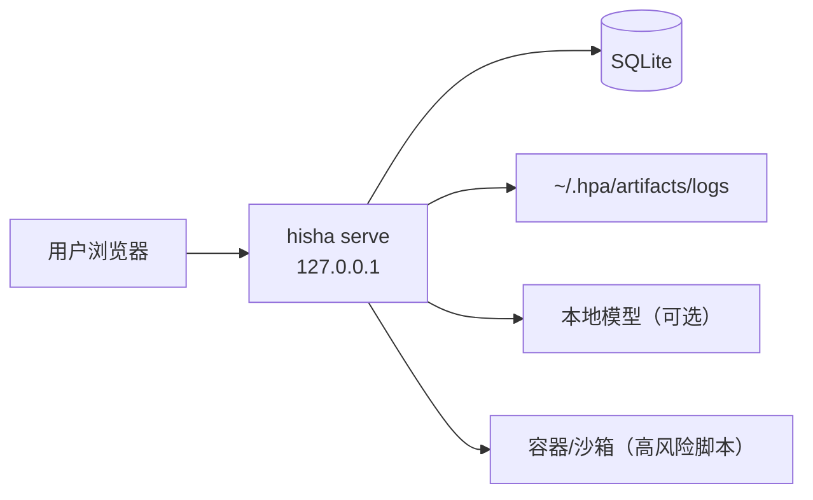
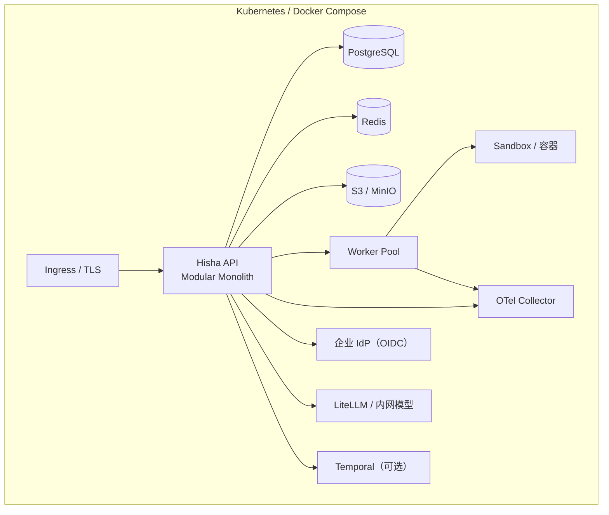
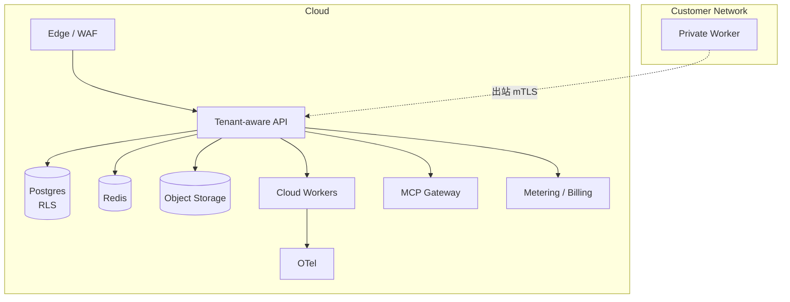

# 部署架构

> 四种模式共享同一 IR/运行时契约：Local、Private/Self-hosted、Cloud SaaS、Hybrid。部署差异只影响 Control Plane/Worker 的位置与运维，不改变流程语义。

## 1. 模式总览

| 模式 | Control Plane | Execution Plane | 数据 | 适用 |
| --- | --- | --- | --- | --- |
| Local | 本地（单进程） | 本地进程/容器 | SQLite/本地文件 | 个人/离线/开发 |
| Private | 企业内 | 私有 Worker | Postgres/Redis/S3 | 合规/内网 |
| SaaS | 云端多租户 | 云 Worker + 可选私有 Worker | 托管 Postgres/Redis/S3 | 快速使用 |
| Hybrid | 云端/私有 | 客户内网 Worker（出站） | 云端元数据 + 本地执行数据 | 数据不出内网 |

## 2. Local

- 单二进制/Node 运行时；默认 loopback；无 Redis/Postgres 依赖。
- 可选云同步（出站 HTTPS），失败不阻塞。
- 备份：导出 `~/.hpa` 加密包；恢复需同一主密钥/密码。
- 更新：签名包 + 回滚；保留上一版本。

## 3. Private / Self-hosted

- 组件：API（可 2+ 副本）、Worker（按队列/标签扩展）、Postgres（HA）、Redis（HA）、S3/MinIO、OTel Collector、Ingress。
- 认证：OIDC/SAML（Phase 6）；RBAC；审计导出。
- 网络：只暴露 API/UI；Worker 不需入站；数据库/缓存不暴露公网。
- 备份：Postgres PITR、对象存储版本、配置/密钥备份；恢复演练。
- 升级：先迁移 DB（expand），再滚动 API/Worker；保留旧 Worker 版本兼容窗口。

## 4. Cloud SaaS

- 多租户：tenant_id + RLS + 每租户 KMS 密钥（Phase 6）；MCP Gateway 按租户端点/token。
- 配额/限流/计量：执行时长、节点调用、模型 token、存储、MCP 调用。
- 计费：Phase 6；Phase 1-4 不做。
- 数据驻留：按区域部署；备份加密；删除流程。
- 私有 Worker：客户内网出站注册，云端只下发任务元数据/短期凭证，不要求入站。

## 5. Hybrid Worker

### 5.1 注册与身份

1. 管理员在云端创建 Worker 注册令牌（一次性、短期、绑定租户/工作区）。
2. Worker 启动，出站 mTLS 连接到 Control Plane，提交：workerId、版本、能力标签、环境、公钥。
3. Control Plane 验证令牌/证书，登记 Worker；返回短期 JWT/证书。
4. Worker 定期轮换凭证；撤销即时生效。

### 5.2 消息

| 消息 | 方向 | 说明 |
| --- | --- | --- |
| register | Worker → CP | 注册/能力 |
| heartbeat | Worker → CP | 负载/健康/租约续期 |
| lease/poll | Worker → CP | 拉取任务；并发槽 |
| start/event/complete | Worker → CP | 执行状态/事件/结果 |
| cancel/drain | CP → Worker | 取消/优雅停机 |
| config/update | CP → Worker | 配置/版本提示（不自动执行代码） |

### 5.3 离线与恢复

- Worker 断网：本地队列缓存任务/事件；重连后按序上报；任务租约过期由 CP 重排。
- 结果重复：幂等键 + 事件 sequence；CP 去重。
- 长时间离线：超过策略 → Worker 标记离线；任务转云 Worker 或失败（按策略）。
- 时钟偏移：租约/超时使用 CP 时间；Worker 只报告单调时钟/相对时间。

### 5.4 凭证隔离

- 云端不下发客户系统凭证；Worker 使用本地 Vault/环境/短期 token。
- 若必须云端下发，使用租户 KMS 封装 + 短期租约 + 审计；默认禁止。
- Worker 不能读取其他租户任务/事件；mTLS 身份 + tenant 校验。

### 5.5 网络策略

- Worker 只需出站 443（mTLS）到 CP；不需要公网入站。
- 可选出站代理；域名白名单。
- 本地执行的外部系统访问由客户网络策略 + Hisha Connector 白名单共同控制。

## 6. 组件规格（建议）

| 组件 | Phase 1 | Private | SaaS |
| --- | --- | --- | --- |
| API | 单副本 | 2+，HPA | 多区域 |
| Worker | 同进程/本地 | 按队列扩展 | 多池 + 私有 Worker |
| Postgres | 单实例 | HA + PITR | 托管 HA |
| Redis | 可选（本地 SQLite） | HA | 托管 |
| 对象存储 | 本地文件 | MinIO/S3 | 托管 S3 |
| OTel | 可选 | Collector | Collector + 后端 |
| Temporal | 不用 | 可选 | Phase 3+ |

> MinIO 的许可证需核查（AGPL）；若不允许，使用商业 S3 兼容存储或其他 Apache-2.0 方案。不要把 AGPL 组件与专有代码混合分发而不评估义务。

## 7. 升级与兼容

- IR schema 版本：向后兼容读取；新版本写旧版需显式迁移。
- Node Type 版本：旧版本保留执行；发布新版本需迁移测试。
- API：`/api/v1` 稳定；破坏性变更走 v2。
- Worker：CP 支持 N-1 Worker；滚动升级；版本不兼容拒绝调度。
- 数据库：expand/contract；迁移可回滚。

## 8. 备份与灾难恢复

- Postgres：每日全量 + WAL 归档；RPO/RTO 目标见性能要求。
- 对象存储：版本/跨区复制；产物保留策略。
- 配置/密钥：加密备份；恢复演练。
- 审计：不可篡改存储/导出；保留期按合规。
- 本地：导出加密包；恢复需主密钥；云同步不是备份。

## 9. 可观测

- OTel Collector 收集 API/Worker/Runtime/MCP/模型调用；Prometheus/Grafana/Tempo 可选。
- 关键指标：执行成功率/延迟、队列深度、租约超时、Worker 离线、审批时长、MCP 错误率、模型成本。
- 告警：SLO burn rate、队列积压、跨租户拒绝、沙箱逃逸尝试。

## 10. 相关文档

- [系统架构](system-architecture.md)
- [Local Runtime](local-runtime.md)
- [安全架构](security-architecture.md)
- [性能要求](../10-quality/performance-requirements.md)
- [图集](diagrams.md)
