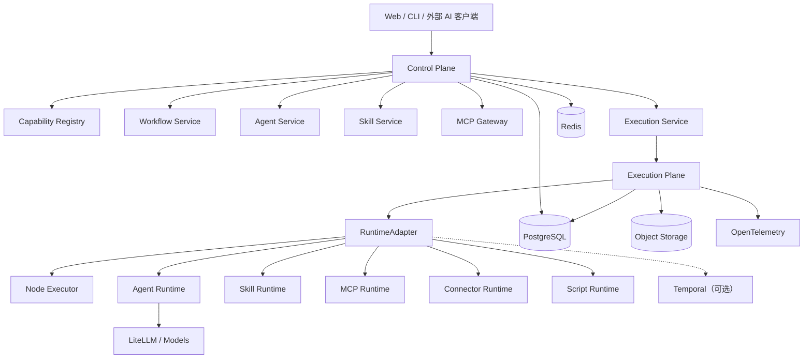
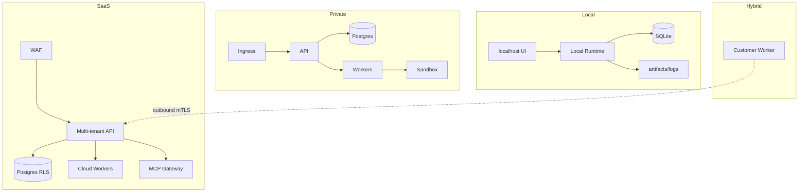
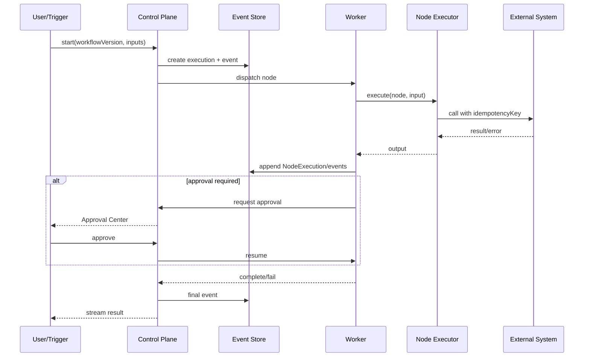
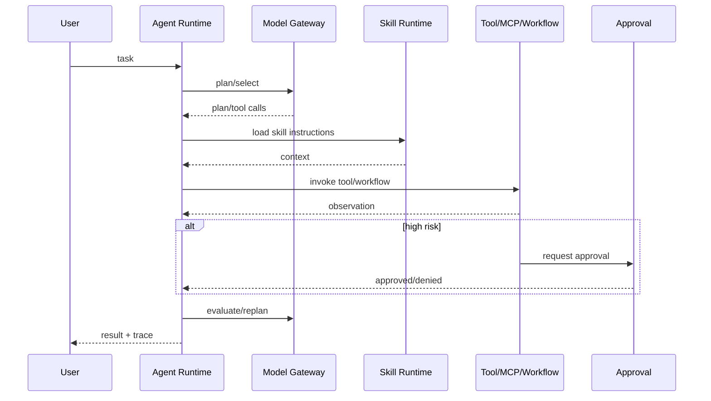
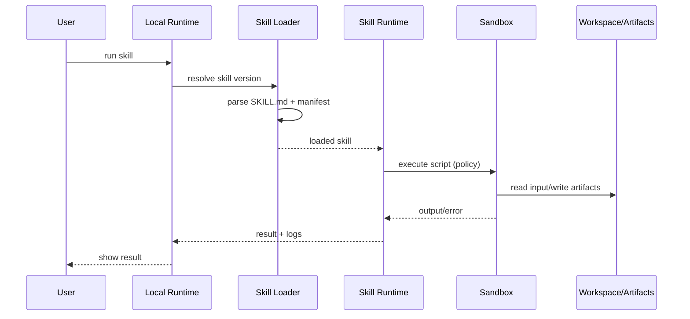
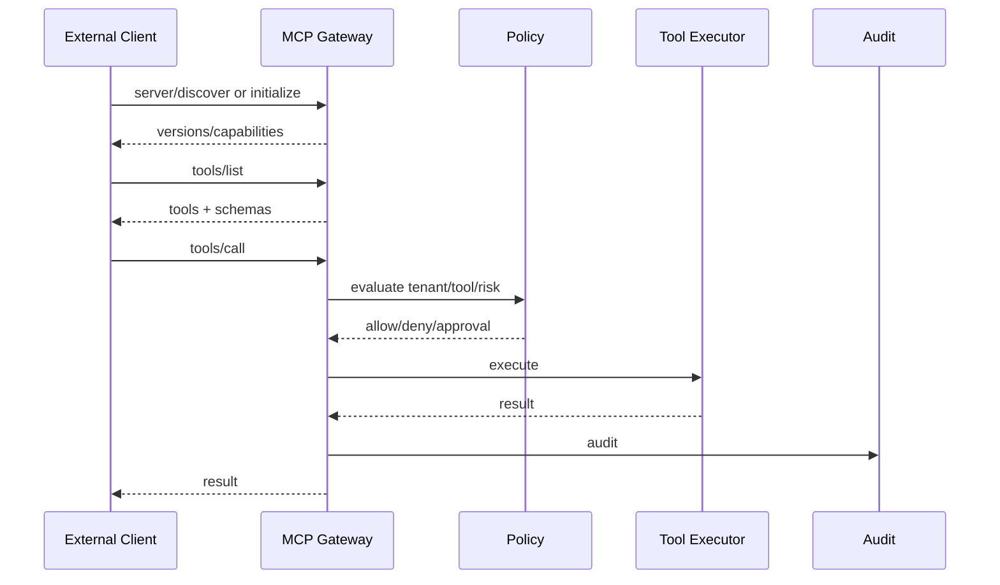
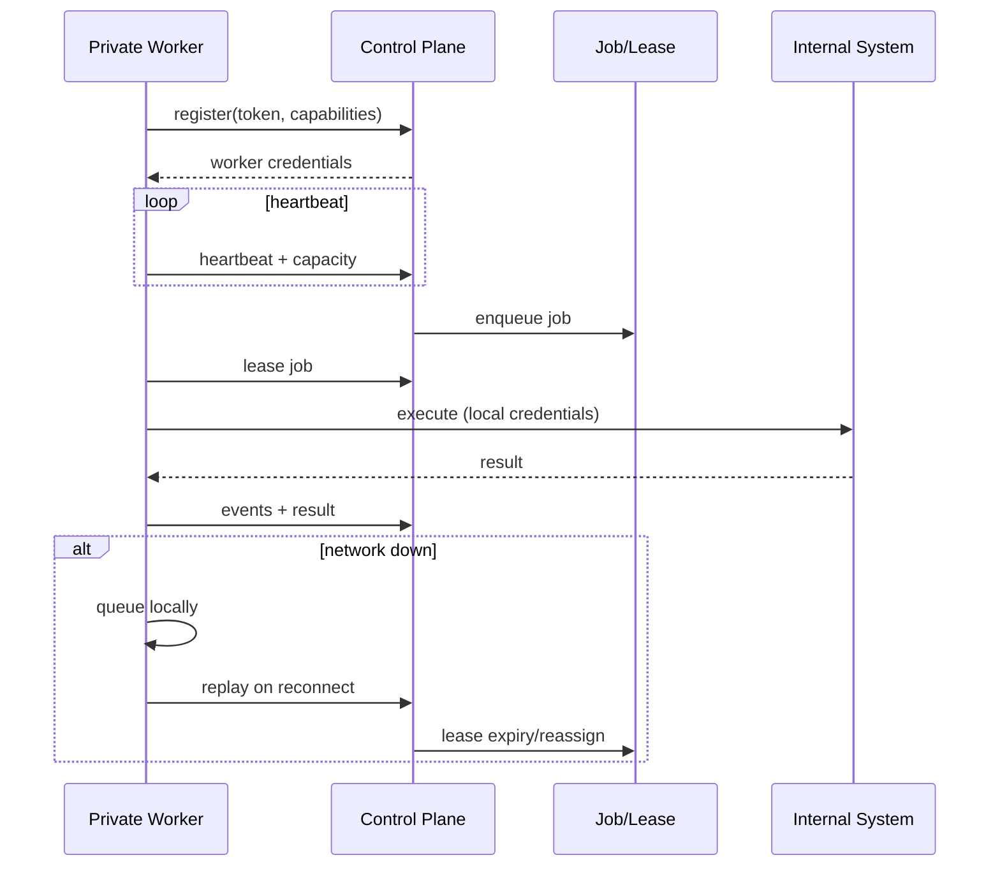
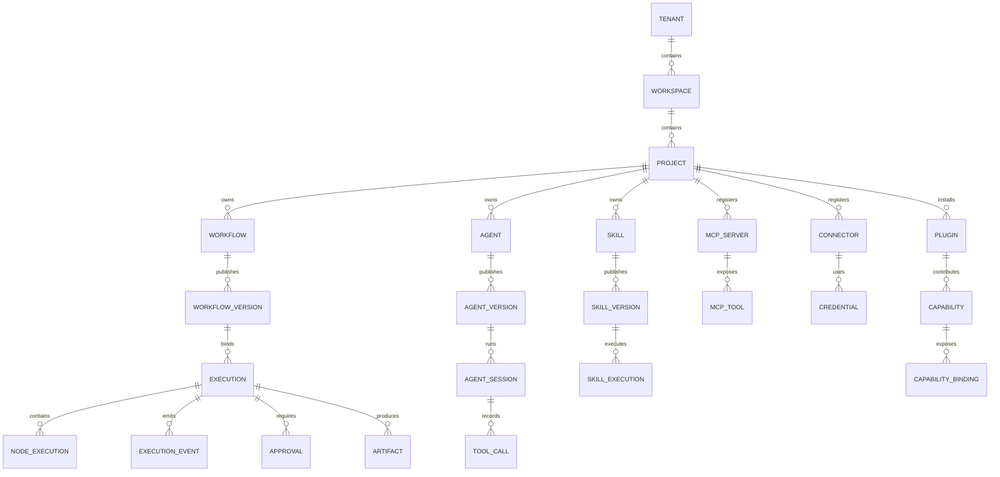
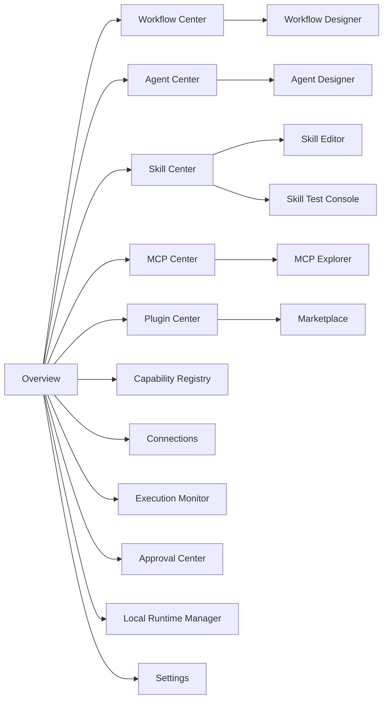

# 图集

> 9 张关键图：系统架构、部署架构、Workflow 执行、Agent 调用、Skill 本地执行、MCP 通信、Hybrid Worker、核心 ER、页面导航。图使用 Mermaid，源文即文档。

## 1. 系统架构

详见 [系统架构](system-architecture.md)。

## 2. 部署架构

详见 [部署架构](deployment-architecture.md)。

## 3. Workflow 执行时序

详见 [执行引擎](../03-workflow/execution-engine.md)。

## 4. Agent 调用时序

详见 [Agent Runtime](../04-agent/agent-runtime.md)。

## 5. Skill 本地执行时序

详见 [本地执行](../05-skill/local-execution.md)。

## 6. MCP 通信时序

详见 [MCP 架构](../06-mcp/mcp-architecture.md)。

## 7. Hybrid Worker 时序

详见 [部署架构](deployment-architecture.md) §5。

## 8. 核心实体关系

详见 [数据模型](../08-platform/data-model.md)。

## 9. 页面导航

详见 [信息架构](../09-ui/information-architecture.md)。

## 10. 相关文档

- [系统架构](system-architecture.md)
- [部署架构](deployment-architecture.md)
- [Workflow 执行引擎](../03-workflow/execution-engine.md)
- [Agent Runtime](../04-agent/agent-runtime.md)
- [Skill 本地执行](../05-skill/local-execution.md)
- [MCP 架构](../06-mcp/mcp-architecture.md)
- [数据模型](../08-platform/data-model.md)
- [信息架构](../09-ui/information-architecture.md)
