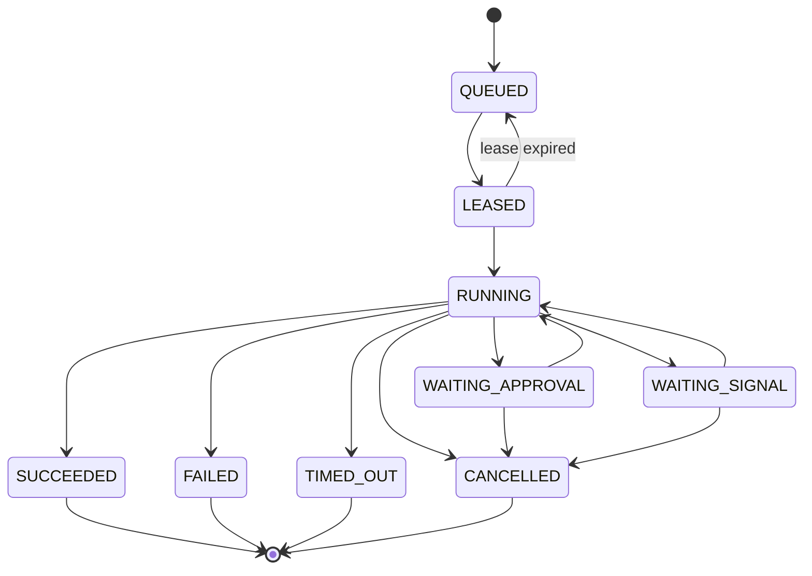
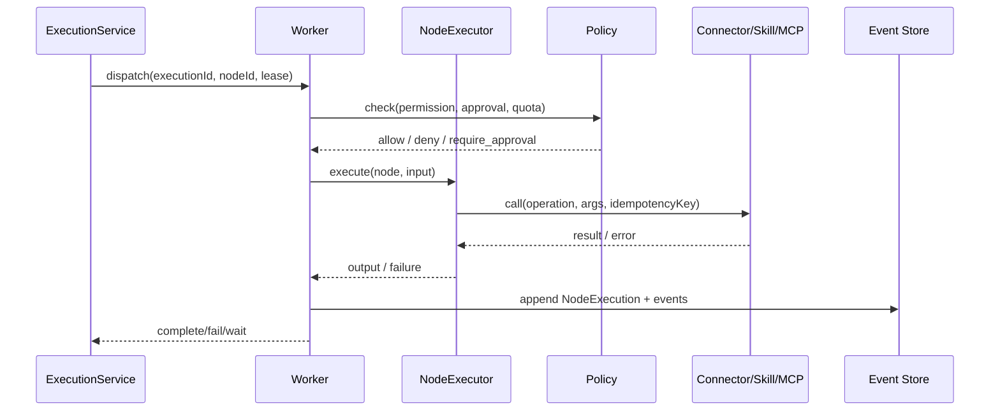

# Execution Plane

> Execution Plane 执行 Workflow/Agent/Skill/MCP/Connector/Script。它不信任 Control Plane 传来的任何代码/参数，所有动作都经过权限/策略/沙箱检查。

## 1. 组件

| 组件 | 职责 | 隔离 |
| --- | --- | --- |
| Worker | Rust 进程：注册、心跳、拉取任务、租约、执行、事件上报、取消 | 独立进程/容器 |
| Local Runtime | Rust 单二进制：本地 API/UI/SQLite/执行；无云运行 | OS 用户/工作区 |
| RuntimeAdapter | 统一执行契约；Local/Worker（Rust）/Temporal（薄适配） | — |
| Node Executor | Rust 节点类型/版本执行、端口、变量、重试/超时 | 视节点类型 |
| Agent Runtime | Python AI Worker（LangGraph）；可选、经 gRPC 调用 | 工具调用经 Policy |
| Skill Runtime | Rust：加载/解析/上下文/脚本/产物 | 脚本沙箱 |
| MCP Runtime | Rust RMCP：Client/Server、版本协商、工具调用 | 网络/租户策略 |
| Connector Runtime | Rust HTTP/DB/Git/等适配 | SSRF/网络策略 |
| Script Runtime | Rust 统一 Executor：Native/WASM/外部 | Sandbox |
| Sandbox | 文件/网络/进程/CPU/内存/超时 | 容器/OS 限制 |
| Event Writer | 追加 ExecutionEvent/NodeExecution | 只追加 |

## 2. RuntimeAdapter 契约

> 以下是语言无关的概念契约；Rust Core 以 `hisha.runtime.v1` gRPC 服务实现，TS/Python 使用生成的客户端。实际 wire format 以 Proto 为准（见 [跨语言通信](../13-tech-stack/cross-language.md)）。

```ts
interface RuntimeAdapter {
  start(spec: ExecutionSpec): Promise<ExecutionHandle>;
  resume(executionId: string, command: ResumeCommand): Promise<void>;
  cancel(executionId: string, reason: string): Promise<void>;
  approve(executionId: string, approvalId: string, decision: ApprovalDecision): Promise<void>;
  query(executionId: string): Promise<ExecutionSnapshot>;
  stream(executionId: string, fromEventId?: string): AsyncIterable<ExecutionEvent>;
  capabilities(): RuntimeCapabilities;
}
```

- `ExecutionSpec` 包含不可变 WorkflowVersion、inputs、tenant/workspace/project、policy snapshot、预算、trace context。
- `RuntimeHandle` 包含 executionId、adapter kind、lease。
- 事件模型统一；Temporal 的 history 在适配器内转换为 Hisha 事件，不暴露原生类型。
- `capabilities()` 声明 durability、maxDuration、parallelism、signals、approvals、artifacts。

## 3. 状态机



节点状态：PENDING → RUNNING → SUCCEEDED/FAILED/SKIPPED/WAITING/CANCELLED；每次 attempt 有独立记录。

## 4. 节点执行语义



- **输入映射**：jq 子集求值；只读输入/变量/上下文；禁止任意代码。
- **输出**：按节点输出 schema 校验；未声明字段需允许（`additionalProperties` 策略）。
- **重试**：`maxAttempts`、`backoff`（constant/linear/exponential + jitter）、`retryOn`（错误码/类型）、`nonRetryable`。每次 attempt 写事件。
- **超时**：节点/容器/执行三级；超时取消下游，触发错误策略。
- **错误策略**：fail / skip / fallback branch / compensate；容器级可配置 fail-fast 或收集。
- **补偿**：失败后按逆序执行已注册补偿动作；best effort；记录结果；不承诺原子性。
- **幂等**：外部调用使用稳定 `idempotencyKey`（executionId + nodeId + 逻辑调用序号 + iteration），重试复用同一 key；连接器/外部系统需支持或 Hisha 记录去重。
- **中止**：协作式取消；脚本/HTTP 可强制；不可强制的外部调用记录为“可能已发生”，由补偿/人工处理。

## 5. 控制流

### 分支

- `condition` / `switch` 节点有命名输出端口；边绑定端口。
- 只执行命中分支；未命中节点不创建 NodeExecution（或标记 SKIPPED，按策略）。

### 循环

- `loop` 容器：`items` 或 `while`；`maxIterations` 强制；`indexVariable`、`itemVariable`、`accumulator`。
- 每轮有独立 scope/变量；支持顺序/并行（受限制）；`break` 条件。
- 失败策略：fail-fast / continue-on-error；每轮结果可聚合。

### 并行

- `parallel` 容器：多个分支子图；`join` 策略 all/any/n_of；`failFast`。
- 分支隔离变量；输出按分支名合并；冲突策略（first/last/error）。
- 并发上限由 Worker/租户策略控制；超限排队。

### 子流程

- `subworkflow` 节点引用 Workflow + 版本范围；发布时解析为具体版本快照。
- 输入/输出合同校验；递归深度限制；禁止循环引用。

## 6. Worker 协议

> Phase 8 本地实现采用出站 HTTP 轮询/租约，而不是本节的 mTLS WebSocket/gRPC；消息语义、租约与断线重排一致。实际 endpoint、状态机和限制见 [`docs/08-platform/hybrid-workers.md`](../08-platform/hybrid-workers.md)。

| 消息 | 方向 | 内容 |
| --- | --- | --- |
| register | Worker → CP | workerId、版本、能力标签、部署环境、公钥/mTLS |
| heartbeat | Worker → CP | 状态、负载、正在执行、租约续期 |
| poll/lease | Worker → CP | 拉取任务；租约 TTL；并发槽 |
| start | Worker → CP | 确认开始、attempt |
| event | Worker → CP | 批量事件（幂等、顺序号） |
| complete/fail | Worker → CP | 结果/错误/产物引用 |
| cancel | CP → Worker | 协作取消 |
| drain | CP → Worker | 优雅停机 |

- 传输：出站 mTLS WebSocket/gRPC；Worker 不需要开放入站端口。
- 离线：本地队列缓存任务/结果；恢复后按顺序上报；租约过期任务由 CP 重新调度。
- 租约：每次续期；失联超过 TTL → QUEUED；幂等键防重复副作用。
- 版本：Worker 声明支持的 runtime/节点版本；不兼容任务不调度。

## 7. 沙箱

| 维度 | 默认 | 可选 |
| --- | --- | --- |
| 文件 | 每执行临时工作区；只读输入；写 artifacts | 挂载只读数据集 |
| 网络 | 默认拒绝（脚本）；连接器按域名/端口白名单 | HTTP 代理 + 审计 |
| 进程 | 限制子进程/命令白名单 | 容器/VM |
| 资源 | CPU/内存/时长/输出大小 | cgroup/容器 |
| 凭证 | 环境变量短期注入；不落盘 | Vault 代理 |
| 隔离 | OS 用户/命名空间/容器 | gVisor/Firecracker（高安全场景） |

本地 macOS/Windows 无 Landlock/namespaces；使用容器（Docker/Podman）或受限进程 + 明确风险提示。高风险 Skill 默认要求容器。

## 8. 事件模型

```json
{
  "eventId": "evt_...",
  "executionId": "exec_...",
  "tenantId": "ten_...",
  "nodeId": "node_...",
  "attempt": 2,
  "type": "node.failed",
  "at": "2026-11-01T00:00:00Z",
  "traceId": "...",
  "data": { "errorCode": "HTTP_TIMEOUT", "retryable": true }
}
```

- 追加式；不允许修改/删除。
- 大对象（日志/产物）放对象存储，事件只存引用/摘要。
- 事件顺序：每执行单调 sequence；消费者按 sequence 去重。
- 审计独立：审计记录“谁做了什么”，事件记录“执行发生了什么”。

## 9. Local / Worker / Temporal

| 维度 | LocalRunner | WorkerRunner | TemporalAdapter |
| --- | --- | --- | --- |
| 存储 | SQLite/本地文件 | Postgres/Redis/S3 | Temporal + Postgres |
| 队列 | 进程内 | Redis Streams + Postgres outbox | Temporal task queue |
| 恢复 | 检查点 | 检查点/租约 | 事件溯源重放 |
| 长任务 | 有限（进程需存活） | 租约/心跳 | 强 |
| 审批 | 本地暂停 | 服务端 Approval | Signal/Update |
| 适用 | 本地/离线/开发 | 私有/云 | 长期/关键流程 |

同一 IR/节点版本/策略在三者上语义一致；差异仅在 durability/运维。Temporal 适配器必须通过 PoC 才启用。

## 10. 失败与恢复

- Worker 崩溃：租约过期 → 重新调度；已产生的副作用由幂等键/补偿处理。
- 事件写失败：Worker 停止确认，重试上报；禁止“执行成功但无事件”。
- 审批超时：按策略升级/拒绝；执行保持 WAITING。
- 取消：设置取消标志；节点检查；不可中断调用记录。
- 数据损坏：从最近检查点恢复；事件日志用于审计/对账。

## 11. 相关文档

- [Workflow 执行引擎](../03-workflow/execution-engine.md)
- [Local Runtime](local-runtime.md)
- [部署架构](deployment-architecture.md)
- [安全架构](security-architecture.md)
- [统一契约](contracts.md)
