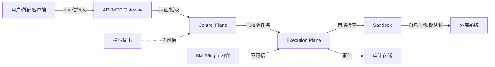

# 安全架构

> 安全默认开启，不以“企业版”为条件。AI 不能绕过权限、审批、预算或审计。

## 1. 威胁模型

| 资产 | 威胁 | 影响 | 控制 |
| --- | --- | --- | --- |
| 凭证/密钥 | 泄漏、越权读取 | 外部系统被入侵 | Vault、加密、引用、短期凭证、最小权限 |
| 租户数据 | 跨租户访问 | 数据泄漏 | tenant_id + RLS、token 绑定、测试 |
| 执行环境 | 恶意脚本逃逸 | 主机/网络被控 | 沙箱、容器、命令/网络/文件策略 |
| Skill/Plugin | 恶意指令/供应链 | Prompt injection、后门 | 签名、来源信任、静态扫描、审核 |
| MCP Tool | 工具滥用/SSRF | 内网探测、数据外泄 | 白名单、网络策略、审批、限流 |
| 模型 | Prompt injection/数据外泄 | 决策被操纵 | 不可信内容隔离、工具 allowlist、输出校验 |
| 审计 | 篡改/删除 | 无法追责 | 追加式、WORM/外部存储 |
| 平台 | DDoS/资源耗尽 | 服务不可用 | 限流、配额、隔离、队列 |

## 2. 信任边界

关键原则：

- 用户输入、模型输出、Skill 指令、MCP 工具结果、外部 API 响应都不可信。
- Control Plane 只接受已校验的 IR/任务；不执行任意代码。
- Execution Plane 的每个动作都过 Policy；沙箱是最后一道边界。
- 审计与执行事件分离；审计不可由业务删除。

## 3. 身份与访问

- **认证**：OIDC（企业）、本地账号（开发）、PAT/服务账号（CLI/外部客户端）、Worker mTLS/JWT。
- **授权**：RBAC（角色）+ ABAC（资源属性/风险/时间/网络）+ 入口级 scope。
- **租户隔离**：令牌绑定 tenant；所有查询强制 tenant_id；Postgres RLS；跨租户 ID 直接拒绝并审计。
- **工作区/项目**：资源归属；成员/角色；共享策略（只读/克隆）。
- **PDP/PEP**：集中策略服务（Casbin 起步，可替换 OPA）；所有 API/节点/工具/MCP 调用走 PEP。
- **会话**：短期 token、刷新轮换、设备/会话撤销；高风险操作再认证（step-up）。

## 4. 凭证与密钥

- Credential Vault：AES-256-GCM envelope encryption；主密钥在 KMS/本地 keychain；租户密钥分离（Phase 6）。
- 引用：Workflow/Skill 只存 `credentialRef`，不存明文。
- 注入：运行时短期解析；环境变量/文件/代理；不写日志；进程退出清理。
- 轮换：定期/按需；连接测试；失效告警。
- 外泄响应：撤销、审计、通知；不因缓存延迟。
- 禁止 token passthrough：MCP 客户端 token 不能直接用于上游 API。

## 5. 沙箱

| 控制 | 默认 | 说明 |
| --- | --- | --- |
| 文件 | 临时工作区；只读输入；写 artifacts | 拒绝 `..`/绝对路径/符号链接逃逸 |
| 网络 | 脚本默认拒绝 | 连接器按域名/端口白名单；HTTP 代理审计 |
| 命令 | 白名单 | 禁止 shell 拼接；参数数组 |
| 资源 | CPU/内存/时长/输出大小 | 超限终止并记录 |
| 环境 | 最小变量；无宿主密钥 | 短期凭证注入 |
| 进程 | 子进程数限制 | 容器/命名空间更佳 |
| 隔离 | OS/容器 | 高风险默认容器 |

本地 macOS/Windows 的隔离弱于 Linux；高风险 Skill 默认要求容器或用户显式确认。沙箱逃逸测试是发布门禁。

## 6. Prompt Injection 与不可信内容

- Skill/Plugin 的 instructions、MCP 工具结果、网页/文件内容都视为数据，不是系统指令。
- Agent Runtime 使用分层消息：系统策略 > 平台策略 > Agent 指令 > Skill 内容 > 工具结果；低层不得覆盖高层。
- 工具调用前做 allowlist/参数校验；高风险写操作强制审批。
- 检测/告警：越权指令、secret 读取、外联、编码混淆；不依赖单一关键词。
- 模型输出（IR/工具参数）按不可信处理：schema 校验、类型/范围、拒绝未知字段（按策略）。
- 上下文隔离：租户/会话/工具结果不混入其他租户；MCP 资源按租户过滤。

## 7. 恶意 Skill/Plugin

- 来源信任等级：官方/已验证/社区/不可信；默认不可信。
- 完整性：SHA-256 + Ed25519/Sigstore 签名；安装时校验；密钥轮换/撤销。
- 静态扫描：危险命令、网络、文件路径、secret 读取、混淆、可疑依赖。
- 权限清单：文件/网络/命令/资源；安装时展示并确认；运行时强制。
- 审核：市场人工/自动审核；举报/下架；版本回滚。
- 隔离：高风险插件在独立 Worker/容器；不加载到 API 进程。

## 8. MCP 安全

- 每个 MCP Server 有租户/工作区归属；Gateway 按 token/租户路由。
- 工具 schema 校验；参数大小/深度限制；拒绝原型污染/路径穿越。
- SSRF：域名/IP 白名单、禁止内网元数据地址、重定向校验、DNS rebinding 防护。
- 认证：OAuth 2.1（RFC 9728/8414/CIMD/DCR）+ PAT；stdio 环境变量；不 token passthrough。
- 限流/配额：按租户/工具/客户端；熔断。
- 审批：高风险写操作（删除/发布/转账/执行脚本）服务端强制审批。
- 审计：client、tenant、tool、参数摘要、结果、审批、trace。
- 资源：按租户过滤；不暴露文件系统路径；大对象分页。

## 9. 数据安全

- 传输：TLS 1.2+；内部 mTLS（Worker/服务）。
- 存储：Postgres 加密（磁盘/KMS）；对象存储 SSE；备份加密。
- 分类：公开/内部/机密/受限；保留/删除策略；PII 脱敏。
- 日志：不记录 secret/token/完整凭证；参数摘要/哈希；可配置脱敏。
- 数据驻留：区域部署；跨境限制；导出/删除 API。
- 备份：加密、异地、恢复演练；删除后备份按保留期过期。

## 10. 审计与合规

- 审计事件：登录、权限变更、发布、执行、审批、MCP 调用、凭证访问、插件安装、配置变更。
- 字段：actor、action、resource、tenant、time、IP/UA、requestId、before/after 摘要、result。
- 存储：追加式；WORM/外部 SIEM；保留期；不可由租户管理员删除。
- 导出：CSV/JSON/OTel；与执行事件通过 executionId 关联。
- 合规映射：SOC2/ISO 27001 的控制点需在 Phase 6 前补充；本文不声称已合规。

## 11. 资源与可用性

- 限流：API/MCP/模型/工具；按租户/用户/客户端。
- 配额：并发执行、节点调用、存储、token、成本。
- 队列隔离：租户/优先级；防止 noisy neighbor。
- DDoS：边缘/WAF；请求大小/深度限制；超时。
- 故障：熔断、退避、降级；不因一个工具拖垮平台。

## 12. 安全开发生命周期

- 威胁建模（本文件）每个 Phase 更新。
- 依赖：SBOM、漏洞扫描、许可证门禁、固定版本。
- 代码：SAST、secret 扫描、依赖审查、代码评审。
- 测试：沙箱逃逸、注入、越权、跨租户、SSRF、路径穿越、MCP conformance。
- 发布：签名、可追溯构建、回滚。
- 响应：漏洞披露、事件响应、通知、取证（审计/事件）。

## 13. 已知限制

- 本地 macOS/Windows 沙箱强度有限；高风险场景需容器。
- 外部系统的 Exactly Once 不可保证；需幂等/补偿/人工对账。
- 模型本身可能泄漏提示/数据；敏感数据需脱敏/本地模型。
- MCP 2026-07-28 生态尚不成熟；兼容层需持续 conformance 测试。
- 第三方 Skill/Plugin 的恶意行为无法完全静态检测；运行时隔离是底线。

## 14. 相关文档

- [权限模型](../08-platform/permission-model.md)
- [Skill 安全](../05-skill/skill-security.md)
- [MCP 安全](../06-mcp/mcp-security.md)
- [测试策略](../10-quality/test-strategy.md)
- [风险登记](../11-roadmap/risk-register.md)
