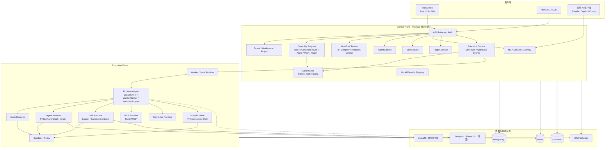

# 系统架构

> 状态：Phase 0 基线。技术版本以 2026-11-01 的 npm/PyPI 元数据为准；正式开发时锁 lockfile 并复验 peerDependencies。
> 关键决策：[ADR-0003 Modular Monolith](../adr/0003-modular-monolith.md)、[ADR-0002 执行引擎](../adr/0002-execution-engine-strategy.md)、[ADR-0014 Rust Core](../adr/0014-rust-core-runtime.md)、[ADR-0015 跨语言契约](../adr/0015-cross-language-contracts.md)、[ADR-0017 CSS](../adr/0017-css-architecture.md)。

## 1. 目标与约束

- 一套 Canonical IR，Canvas/YAML/JSON 一致。
- Workflow 与 Agent 是两种执行模型。
- Local/Private/SaaS/Hybrid 四种部署，同一 IR 语义。
- Control Plane 不执行不可信脚本。
- 本地运行不依赖云端。
- 不在 Phase 1 微服务化；Control Plane 是 Modular Monolith，Execution Plane 的 Worker 可独立部署。
- 复用成熟组件（Temporal/LangGraph/LiteLLM/OTel/Rust RMCP/Skill 标准），但用 Hisha 契约封装。

## 2. 总体架构



## 3. Control Plane 模块

| 模块 | 职责 | 不做什么 |
| --- | --- | --- |
| API Gateway / Auth | OIDC/PAT/服务账号、路由、限流、错误模型 | 不执行节点/脚本 |
| Tenant/Workspace/Project | 租户/工作区/项目、成员、配额 | 不存储执行日志正文 |
| Capability Registry | 统一能力描述、绑定、依赖/版本/关系/可见性 | 不复制实现 |
| Workflow Service | IR、编译、校验、版本、导入/导出、AI 生成 | 不运行 Workflow |
| Agent Service | Agent/版本/配置/测试编排 | 不执行 Agent 循环 |
| Skill Service | Skill 元数据/版本/导入/导出/发布 | 不执行脚本 |
| MCP Service/Gateway | MCP 端点、工具注册、认证/授权/审计 | 不直接执行工具 |
| Plugin Service | 安装/升级/签名/依赖/许可 | 不加载插件代码到 API 进程 |
| Execution Service | 启动/调度/审批/事件/查询/取消 | 不执行不可信代码 |
| Governance | 策略、审计、配额、数据保留 | 不替代业务权限 |
| Model Registry | Provider/模型配置/预算映射（对接 LiteLLM） | 不代理所有模型流量（可经 LiteLLM） |

模块边界：每个模块拥有自己的表/仓储与领域服务；跨模块只通过应用服务/事件，不共享 ORM 实体。Modular Monolith 允许后续拆分，但 Phase 1 不拆。

## 4. Execution Plane 组件

| 组件 | 职责 |
| --- | --- |
| Worker / Local Runtime | 拉取/接收任务、租约、心跳、事件上报、取消 |
| RuntimeAdapter | 统一 start/resume/cancel/stream/query/approve；屏蔽 Local/Worker/Temporal |
| Node Executor | 按节点类型/版本执行；输入映射、输出、重试、超时、错误策略 |
| Agent Runtime | Python AI Worker（LangGraph，可选）：状态图、规划、工具选择、预算、checkpoint、interrupt；gRPC |
| Skill Runtime | Loader/Resolver/Context/Execution/Sandbox/Logger/Artifacts |
| MCP Runtime | MCP Client/Server、协议版本协商、工具调用 |
| Connector Runtime | 外部系统适配、认证、限流、重试、SSRF 防护 |
| Script Runtime | Python/Node/Shell 脚本执行；语言可扩展 |
| Sandbox | 文件/网络/进程/资源限制；容器或 OS 级隔离 |
| Policy | 每次工具/脚本/外部调用前的权限/审批/配额检查 |

## 5. 数据流

### 5.1 发布并执行 Workflow

1. Web/CLI 保存草稿 → Workflow Service 校验 IR Schema。
2. Publish → 编译/静态/权限/依赖/策略校验 → 生成不可变 WorkflowVersion（含 IR、节点版本、依赖、权限摘要）。
3. 用户/触发器请求执行 → Execution Service 创建 Execution，写事件，选择 RuntimeAdapter。
4. Worker/Local 拉取任务 → 按节点执行 → 每次尝试写 ExecutionEvent/NodeExecution。
5. 需要审批 → 创建 Approval，执行暂停/检查点；审批后 resume。
6. 完成/失败 → 写最终状态/产物；UI/SSE 推送；审计。

### 5.2 MCP 调用

外部客户端 → MCP Gateway（认证/租户/协议协商）→ Tool Registry → 权限/审批 → 执行（Workflow/Agent/Skill/Connector）→ 结果/事件 → 审计。Gateway 不把内部 REST 全量暴露。

### 5.3 本地 Skill

Local Runtime → Skill Loader/Resolver → 读取 `SKILL.md`/manifest →（Agent 或确定性入口）→ Script Runtime + Sandbox → Artifacts/Logs；模型可选；不调用云 Control Plane。

## 6. 信任边界

| 边界 | 不可信内容 | 控制 |
| --- | --- | --- |
| 外部客户端 → MCP Gateway | token、工具参数、prompt | OAuth/PAT、租户、schema、限流、审批、审计 |
| 用户 → Workflow/Agent | YAML/JSON、自然语言、Skill | 编译/静态/权限/依赖/策略校验 |
| Skill/Plugin → 运行时 | instructions、scripts、依赖 | 来源信任、签名、沙箱、权限、静态扫描 |
| 模型 → 平台 | 生成的 IR/工具调用 | 结构化输出、schema、allowlist、不信任模型 |
| Worker → Control Plane | 任务结果/事件 | mTLS/JWT、租约、签名、租户校验 |
| Control Plane → 外部系统 | 凭证/请求 | Vault、短期凭证、SSRF、出站策略 |

## 7. 技术栈（Phase 0 技术栈基线）

| 层 | 选择 | 版本（2026-11-01） | 许可证 | 备注 |
| --- | --- | --- | --- | --- |
| Web | React + Vite + TypeScript | React 19.3.1 / Vite 8.3.5 / TS 5.9.3 | MIT / Apache-2.0 | Node 26 LTS；TS 7.0.2 评估 |
| 画布 | `@xyflow/react` | 12.12.0 | MIT | peer React ≥17 |
| UI/CSS | Tailwind 4 + CSS Variables + CSS Modules + PostCSS + Radix/shadcn | Tailwind 4.3.3 / PostCSS 8.5.32 / Radix 1.8.1 | MIT | 无运行时 CSS-in-JS；详见 CSS 架构 |
| 编辑器 | Monaco | monaco-editor 0.57.0 / @monaco-editor/react 4.7.0 | MIT | YAML/JSON/表达式 |
| 状态/数据 | Zustand + TanStack Query/Router | 5.0.16 / 5.105.0 / 1.170.46 | MIT | 编辑器局部状态用 Zustand |
| i18n | i18next + react-i18next | 26.5.12 / 17.1.9 | MIT | 默认 ja；en/zh |
| API | NestJS | 12.3.2 | MIT | Control Plane Modular Monolith |
| Core Runtime | Rust | 1.99.x（MSRV 1.97） | — | IR/编译器/校验器/Runtime/Local/Worker |
| Rust 基础 | tokio 1.54.1 / axum 0.8.9 / sqlx 0.9.0 | — | MIT/Apache | async/HTTP/SQLite+Postgres |
| 内部 RPC | tonic 0.14.9 + tonic-prost + ts-proto 2.18.3 + grpcio 1.85.1 | — | MIT/Apache | Rust/TS/Python gRPC |
| DB（control） | PostgreSQL + Prisma | Prisma 7.10.1 | PostgreSQL/Apache | NestJS 管理 schema |
| DB（execution） | PostgreSQL/SQLite + SQLx | SQLx 0.9.0 | MIT/Apache | Rust 独占 execution schema |
| 队列/缓存 | Redis + Redis Streams / outbox | 以部署版本为准 | MIT/BSD | MVP 异步任务/事件；NATS 后续 |
| 对象存储 | S3/MinIO | 以部署版本为准 | Apache/AGPL（MinIO 需核查） | 产物/日志 |
| Durable | Temporal + 薄适配 Worker | 1.32.1（自托管） | MIT | Phase 3 PoC；非 Rust 核心 |
| Agent | Python 3.13 + LangGraph | 1.2.19 | MIT | 可选 AI Worker |
| 模型网关 | LiteLLM | 1.106.6 | MIT 核心 + EE | HTTP 集成 |
| MCP | Rust RMCP | 3.8.0 | Apache-2.0（过渡） | 2026-07-28 + 2025-11-25 |
| 可观测 | OTel Rust 0.33 + tracing-opentelemetry 0.34 + Node SDK | — | Apache/MIT | Collector 部署 |
| 校验/表达式 | Rust jsonschema 0.60.2 + jaq 3.1.2 + TS Zod 4.6.7/AJV 8.20 | — | MIT | 契约/映射；jq 子集 |
| YAML | Saphyr 0.3.3（Rust）+ `yaml` 2.9.1（TS） | — | MIT/Apache/ISC | YAML 1.2；source map |
| 权限 | Casbin 5.51.1 + Rust Policy | — | Apache-2.0 | PDP/PEP |
| 部署 | Docker/Compose/K8s/Helm | 以部署版本为准 | — | 本地/私有/SaaS |

> 版本只是基线；引入时用 `npm view`/`cargo`/PyPI 复核并检查 peerDependencies/MSRV/许可证。详见 [技术栈](../13-tech-stack/README.md) 与 [证据](../13-tech-stack/evidence.md)。

## 8. 模块化单体边界

```
apps/web/                 # React + Vite
apps/control-plane/       # NestJS Control Plane
apps/local-runtime/       # Rust binary（依赖 crates）
crates/
  hpa-ir/ hpa-schema/ hpa-compiler/ hpa-validator/
  hpa-runtime/ hpa-node-api/ hpa-nodes/ hpa-connectors/
  hpa-skill/ hpa-mcp/ hpa-plugin/ hpa-script/ hpa-sandbox/
  hpa-policy/ hpa-worker/ hpa-observe/ hpa-local/ hpa-proto/
packages/ts/
  ui/ ir-types/ api-client/ sdk/ connector-sdk/ plugin-sdk/ i18n/
python/
  ai-worker/ sdk/ skills/
proto/ schema/ deploy/ tests/ tools/ docs/
```

- 每个 module：controller → application service → domain → repository；跨模块事件用 outbox。
- 共享包只放类型/契约/纯函数；不放数据库实体。
- Worker/Local Runtime 只依赖 Rust crates（`hpa-ir`/`hpa-runtime`/`hpa-proto`），不依赖 NestJS module；Control Plane/Web 只依赖生成的 Proto/OpenAPI 与 `packages/ts/*`。

## 9. 关键取舍

- **不为微服务而微服务**：Phase 1 单体 + 独立 Worker；按负载/团队边界再拆。
- **不把 AI 当默认**：确定性节点/触发器/执行器不依赖模型。
- **不把 Control Plane 变执行器**：所有脚本/工具/节点在 Execution Plane。
- **不把外部客户端当权限边界**：审批/策略在服务端强制。
- **不引入多个执行引擎**：v1 自研轻量；Temporal Phase 3 PoC；Kestra 只做导入/参考。

## 10. 相关文档

- [Control Plane](control-plane.md)
- [Execution Plane](execution-plane.md)
- [Local Runtime](local-runtime.md)
- [部署架构](deployment-architecture.md)
- [安全架构](security-architecture.md)
- [统一契约](contracts.md)
- [图集](diagrams.md)
- [技术栈](../13-tech-stack/README.md)
