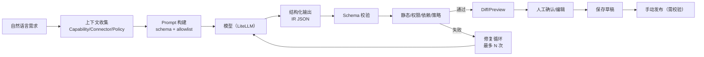

# AI Workflow 生成

> AI 生成是“加速器”，不是执行前提。生成结果一律视为不可信输入，必须通过五类校验与人工确认才能发布。

## 1. 目标

- 自然语言 → 可编辑的 IR 草稿（Canvas/YAML/JSON 同步）。
- 基于现有能力/连接器/权限生成，而不是凭空发明节点。
- 生成过程可解释：使用了哪些节点、权限、假设、缺失项。
- 失败可修复：结构化错误 → 模型修复 → 再校验。
- 不执行未验证的流程；不把 secret 放进 Prompt。

## 2. 生成管线

## 3. 上下文

生成时提供给模型：

- 允许的节点类型/版本 + config schema + 示例（不包含内部实现）。
- 可用 Connector/凭证引用（只给名称/能力，不给 secret）。
- 租户/工作区/项目权限范围。
- 目标触发方式/输入/输出。
- 策略约束（风险等级、审批、预算、durability）。
- 已有 Workflow 片段（可选；用户授权）。

不提供：

- 其他租户数据、secret、内部源码、无关日志。
- 未授权的连接器/工具。
- 可执行脚本内容（除非用户明确引用）。

## 4. 输出约束

- 模型必须输出 JSON（IR 草稿），遵循 `@hpa/schema` 的 JSON Schema；使用 JSON mode/structured outputs（按模型能力）。
- 节点类型/版本必须来自 allowlist；未知类型 → 校验失败。
- 不得包含 secret 值；只能 `credentialRef`。
- 表达式使用 `$expr`/`$template`（jq 子集）；禁止 I/O/环境/时间/模块内建。
- 布局可选；缺失由自动布局生成。
- 输出附带 `assumptions`/`openQuestions`（模型声明不确定点），但**不能**以此替代校验。

## 5. 校验与修复

五类校验（见 [Control Plane](../02-architecture/control-plane.md)）：

1. Schema：IR/节点/端口。
2. 静态：变量/类型/图/容器/表达式。
3. 权限：连接器/工具/模型/审批。
4. 依赖：节点版本/Connector/Skill/MCP/Model。
5. 策略：风险/预算/并发/durability/数据保留。

修复循环：

- 最多 3 次；每次只把结构化错误（code/path/message/fixHint）回传模型。
- 不可自动修复（缺少权限/凭证/业务裁决）→ 停止并交给用户。
- 禁止模型“绕过”校验（例如删除审批节点）；校验器检测策略移除并标记。
- 每次修复保留 diff/trace；可审计。

## 6. 人工确认

- 展示：节点/边差异、权限新增、外部系统访问、审批点、假设/未决问题。
- 高风险变更（网络写、删除、发布、执行脚本）必须显式确认。
- 用户可直接编辑 Canvas/YAML；AI 只是草稿作者。
- 保存 ≠ 发布；发布仍需完整校验与权限。

## 7. 安全

- Prompt injection：用户输入/引用文档可能包含恶意指令；模型输出仍按不可信处理；工具/节点 allowlist。
- 数据泄漏：不把 secret/其他租户数据放入 Prompt；模型网关日志脱敏。
- 供应链：模型/网关版本固定；禁用未知插件。
- 生成脚本：脚本节点默认禁用或要求人工编写/审批；不由模型直接生成并执行未知代码。
- 成本：生成预算/超时；失败不无限重试。

## 8. UX

- 入口：Workflow Center “AI Generate”、Designer 顶部。
- 步骤：描述 → 选择范围/触发 → 生成预览 → 校验结果 → 应用为草稿。
- 状态：生成中/校验中/需修复/需确认/失败；可取消。
- Diff：节点新增/修改/删除；权限/审批变化高亮。
- 解释：每个节点“为什么生成”/使用了哪个连接器；可折叠。
- 失败：展示可操作错误；不建议“重新生成”掩盖问题。

## 9. 评估

- 离线 eval 集：20+ 需求（顺序/分支/循环/并行/审批/子流程/错误处理）。
- 指标：Schema 通过率、五类校验通过率、人工修改率、节点数/复杂度、权限最小化、生成时延/成本。
- 回归：模型/提示/schema 变更必须跑 eval；失败案例入库。
- 人工评审：安全/权限/可维护性。

## 10. 非目标

- 不让模型直接发布/执行。
- 不让模型发明节点/连接器。
- 不把自然语言当唯一真相；IR 才是。
- 不保证生成结果“正确业务语义”；只保证结构/权限/策略可验证。

## 11. 相关文档

- [Workflow IR](workflow-ir.md)
- [YAML/JSON](yaml-json-schema.md)
- [节点规范](node-specification.md)
- [执行引擎](execution-engine.md)
- [安全架构](../02-architecture/security-architecture.md)
