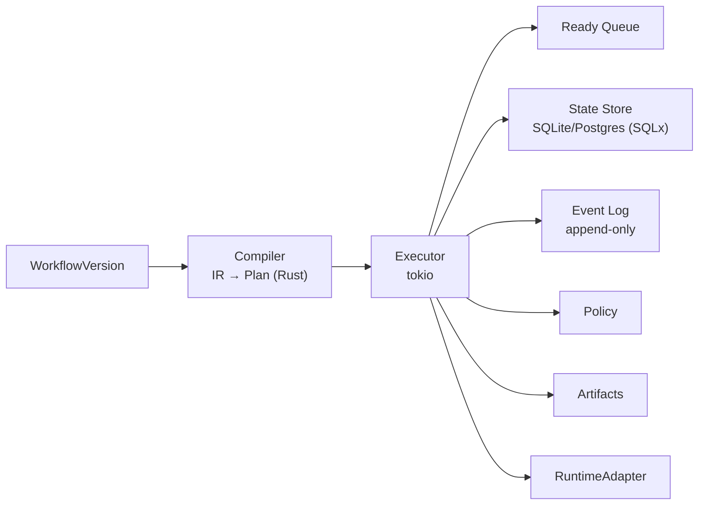

# Workflow 执行引擎

> v1 是 Hisha 自研的 Rust 确定性执行器（`hpa-runtime`）；它保证“检查点 + 至少一次 + 可恢复”，不承诺 Temporal 式确定性重放。需要强 durable 的流程通过 `RuntimeAdapter` 切到 Temporal（Phase 3+）。

## 1. 组件



- **Compiler**：Rust；把 IR 编译为执行计划（节点索引、边索引、容器作用域、端口、表达式 AST、权限摘要）。
- **Executor**：Rust/tokio 状态机 + 调度；单执行内串行/并行由容器控制。
- **State Store**：每节点/检查点快照；SQLite/Postgres（SQLx）。
- **Event Log**：追加事件；UI/审计/恢复依据。
- **Policy**：每步权限/审批/配额。
- **RuntimeAdapter**：Local/Worker（Rust）/Temporal 适配器。

## 2. 编译

1. 读取 WorkflowVersion（不可变 IR）。
2. 解析节点类型/版本；构建节点/边索引。
3. 校验图：DAG、端口、可达性、容器 body、子流程引用。
4. 解析表达式为 AST；推断类型/依赖；收集变量引用。
5. 生成执行计划：
   ```json
   {
     "entry": "start",
     "nodes": { "id": { "type": "...", "typeVersion": "...", "ports": {}, "retry": {}, "timeoutMs": 0 } },
     "edges": [{ "from": "id:port", "to": "id:port" }],
     "scopes": [{ "id": "loop_1", "kind": "loop", "body": ["..."], "maxIterations": 500 }],
     "subflows": {},
     "policySnapshot": {}
   }
   ```
6. 缓存计划（按 version hash）；执行时不再解析 IR。

## 3. 执行循环

```ts
async function execute(plan, ctx) {
  const state = await loadOrInitState(ctx.executionId);
  let ready = state.ready.length ? state.ready : [plan.entry];
  while (ready.length) {
    const batch = takeRunnable(ready, plan, state); // 端口可用、父容器已激活
    const results = await runBatch(batch, ctx);      // 并行或串行
    for (const r of results) {
      await appendEvents(r.events);
      const next = advance(plan, state, r);
      ready.push(...next);
      await checkpoint(state); // 按策略：每节点/每批
    }
    if (state.waiting) return wait(state); // 审批/信号/定时
  }
  return finish(state);
}
```

关键规则：

- 一个节点只有在所有必需入边都满足（或容器激活）时进入 ready。
- 分支节点只激活命中端口；未命中分支不执行。
- 容器（loop/parallel）作为单个节点执行，内部由子执行器驱动；对外只暴露容器输出。
- 失败节点不推进下游（除 error/fallback 端口）。
- 每步写事件/检查点后再推进；崩溃可从最近检查点恢复。

## 4. 状态与检查点

```json
{
  "executionId": "exec_...",
  "workflowVersionId": "wfv_...",
  "status": "RUNNING",
  "sequence": 42,
  "variables": { "input": {}, "vars": {}, "nodes": {} },
  "scopes": {
    "loop_1": { "index": 3, "item": {}, "accumulator": [] }
  },
  "ready": ["node_a:in"],
  "completed": ["start", "fetch_orders"],
  "waiting": null,
  "attempts": { "fetch_orders": 2 },
  "budget": { "steps": 10, "costUsd": 0.02 },
  "traceContext": {}
}
```

- 检查点大小限制（默认 1 MB；大对象放 Artifacts，引用）。
- 检查点写入与事件写入顺序：事件先写（可重放），再更新检查点；或事务内 outbox。
- 恢复：加载检查点 → 重新入队 ready/waiting → 继续；未完成的外部调用按幂等键重试/对账。
- 检查点不替代事件日志；事件用于审计/时间线。

## 5. 分支与端口

- `condition`：`true`/`false` 端口。
- `switch`：`case_<key>`/`default`；无匹配且无 default → 编译错误（可配置）。
- 端口映射在执行计划中预计算；不动态创建端口（除 schema 动态生成时编译期展开）。
- 分支合并：下游节点只要求其入边集合满足；显式 `join` 可用于同步多条分支。

## 6. 循环

- `forEach`：对数组逐项执行 body；`itemVariable`/`indexVariable` 注入子作用域。
- `while`：条件表达式；`maxIterations` 强制；防止无限循环。
- 并发：默认 1；可配置 `concurrency`（受 Worker/租户限制）；结果按索引聚合。
- 失败：`fail-fast` 或 `continue-on-error`；输出包含成功/失败项。
- 输出：`{ items: [...], failed: [...], count: n }`；空数组走 `empty` 端口。
- 嵌套循环受深度限制（默认 10）；每层独立作用域。

## 7. 并行

- `parallel` 容器有多个分支子图（或 body 中的多个入口）；`join`：
  - `all`：全部完成；
  - `any`：任一成功；
  - `n_of`：至少 n 个成功。
- `failFast`：任一失败则取消其他分支（协作式）；否则收集错误。
- 分支变量隔离；输出 `{ branches: { name: output }, errors: [] }`。
- 并发上限：容器/Worker/租户三级取最小；超限排队。
- 取消：设置标志；不可中断分支记录“可能已发生”。

## 8. 子流程

- 内联子流程：编译进同一计划；独立作用域；输入/输出显式。
- 外部子流程：发布时解析为具体 WorkflowVersion；执行创建子 Execution（或内联计划），父子通过合同传递。
- 递归深度限制（默认 20）；循环引用编译拒绝。
- 子流程失败：按父节点错误策略处理；子执行事件可关联查询。

## 9. 重试与超时

- 重试单位是节点 attempt；每次 attempt 写事件。
- 退避：constant/linear/exponential + jitter；最大延迟/最大次数。
- 可重试错误：网络/5xx/限流/超时；不可重试：认证/权限/校验/4xx（可配置）。
- 超时：节点/容器/执行；超时触发取消 + 错误策略。
- 重试不重置已产生副作用；幂等键保持稳定。

## 10. 人工审批与信号

- 节点/工具触发 Approval；执行进入 WAITING_APPROVAL；写检查点；释放 Worker。
- 审批服务独立（Control Plane）；通过 `resume` 唤醒。
- 输出端口：`approved`/`rejected`/`timeout`；表单数据进入节点输出。
- 外部信号（Webhook/MCP/事件）类似：WAITING_SIGNAL + 检查点 + resume。
- 审批/信号重复提交：幂等（approvalId/信号 id）。

## 11. 错误与补偿

- 节点错误策略：fail/skip/continue/fallback/compensate。
- 工作流级错误图：捕获未处理错误，执行清理/通知。
- 补偿：记录已成功节点的补偿动作；失败后逆序执行；记录结果；不掩盖原始错误。
- 不可补偿的外部副作用：标记人工处理；提供对账查询。
- 毒丸/无限重试：最大尝试 + 总时长 + 预算。

## 12. 变量与数据

- 输入映射在节点执行前求值；表达式只读。
- 节点输出经 schema 校验后写入 `nodes.<id>.output`。
- 大对象：Artifact 引用；表达式可读取引用元数据，不自动加载全文。
- 类型：JSON Schema；数字/字符串/日期（ISO 8601 字符串）/二进制（base64/Artifact）。
- 变量快照进入检查点；敏感值不写入事件（脱敏/引用）。

## 13. 事件

事件类型：

- `execution.started/succeeded/failed/cancelled/timed_out`
- `node.queued/started/succeeded/failed/retrying/skipped/waiting`
- `approval.requested/approved/rejected/timeout`
- `signal.received`
- `artifact.created`
- `log`（结构化，限流/截断）

字段：eventId/sequence/type/at/nodeId/attempt/traceId/data；大日志进 Artifact。

## 14. RuntimeAdapter 映射

| 能力 | LocalRunner | WorkerRunner | TemporalAdapter |
| --- | --- | --- | --- |
| 启动 | 进程内 | 队列/租约 | Workflow start |
| 检查点 | SQLite | Postgres | Event history |
| 审批 | 本地暂停 | Approval + resume | Signal/Update |
| 超时 | 计时器 | 租约/计时器 | Workflow timer |
| 取消 | 协作 | 协作 | Cancel |
| 并行 | Promise/Worker | Worker/队列 | Futures/Activities |
| 长任务 | 受进程限制 | 心跳 | 强 |

Temporal 适配器：通用 `HishaWorkflow` 解释器读取 IR 快照；每个节点作为 Activity；分支/循环在 Workflow 内确定性执行；审批用 Signal/Update；事件映射到 Hisha。**PoC 通过前不启用。**

## 15. 限制与配额

- 最大节点数/边数/嵌套深度/循环次数/并行数/执行时长/事件大小/Artifact 大小。
- 租户/工作区/执行级预算（步数/成本/Token/工具调用）。
- 超限：明确错误/暂停/人工决定；不静默截断。

## 16. 测试矩阵

| 场景 | 断言 |
| --- | --- |
| 顺序/分支/多路 | 只执行命中分支 |
| 循环空/单/多/超限 | 输出/错误正确 |
| 并行 all/any/n_of/failFast | 汇总/取消正确 |
| 重试/不可重试/超时 | attempt 事件/最终状态 |
| 审批批准/拒绝/超时/重复 | 恢复/幂等 |
| 崩溃恢复 | 从检查点继续，无重复副作用 |
| 子流程/递归 | 合同/深度限制 |
| 补偿 | 逆序/记录 |
| 变量作用域 | 子图隔离 |
| 大对象/Unicode | Artifact/编码正确 |
| 取消 | 协作/不可中断记录 |

## 17. 相关文档

## 8. 执行列表查询（分页与过滤）

`GET /api/executions` 返回**裸数组**以保持旧客户端兼容，分页元数据放在响应头：

| 参数 | 说明 |
| --- | --- |
| `limit` | 1–200，默认 50 |
| `offset` | 默认 0；与 `limit` 组成页码 `offset / limit` |
| `status` | 可选，`running` / `waiting_approval` / `succeeded` / `failed` / `cancelled` |

响应头 `X-Total-Count` 是该过滤条件下的总条数（分页前）。排序为 `started_at DESC, id DESC`，保证翻页时顺序稳定。

控制台（`/executions`）用 50 条/页做服务端分页，页脚显示「共 N 条 · 第 X/Y 页」；状态筛选也在服务端执行，因此不再是「只在前 100 条里筛选」。

验收：`node scripts/executions-pagination-e2e.mjs`（造 55 条执行 → 第 1 页 50 行、第 2 页 5 行、末页禁用「次へ」、1440/607 无横向溢出）。

- [Workflow IR](workflow-ir.md)
- [节点规范](node-specification.md)
- [表达式与数据映射](expression-and-mapping.md)
- [Execution Plane](../02-architecture/execution-plane.md)
- [PoC A](../11-roadmap/poc-plan.md)
