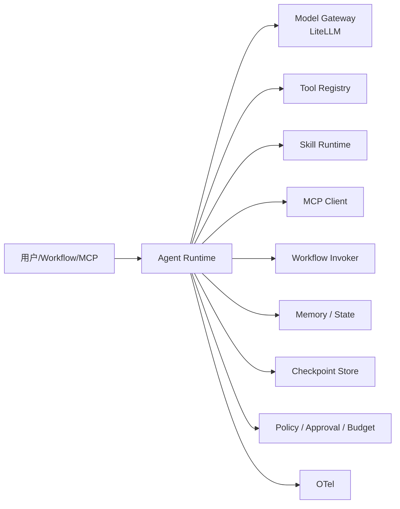

# Agent 架构

> Agent 负责动态规划与决策；Workflow 负责确定性编排。两者可互相调用，但不是同一种执行模型。Agent 不得绕过 Workflow 的权限、审批与策略。

## 1. 定义

```ts
interface AgentVersion {
  id: string;
  version: string;
  name: string;
  description: string;
  systemInstructions: string;
  model: ModelRef;
  temperature?: number;
  skills: SkillRef[];
  tools: ToolRef[];
  mcpServers: McpServerRef[];
  workflows: WorkflowAccess[];
  memory: MemoryConfig;
  state: StateConfig;
  budget: AgentBudget;
  limits: { maxSteps: number; maxToolCalls: number; timeoutMs: number; maxTokens: number; maxCostUsd: number };
  approvalPolicy: ApprovalPolicy;
  outputSchema?: JsonSchema;
  visibility: "private" | "workspace" | "tenant";
}
```

- 发布生成不可变 `AgentVersion`；会话绑定版本。
- `systemInstructions` 是平台/租户可控的指令；Skill 指令是低信任内容，不能覆盖系统指令。
- 预算/限制必填，防止无限循环/无限调用。

## 2. 组件



| 组件 | 职责 |
| --- | --- |
| Agent Runtime | 规划/工具选择/循环/checkpoint/interrupt |
| Model Gateway | 统一模型调用、成本/限流/fallback |
| Tool Registry | 工具发现/schema/权限/风险 |
| Skill Runtime | 加载指令/参考/脚本 |
| MCP Client | 外部工具/资源/Prompt |
| Workflow Invoker | 调用 WorkflowVersion |
| Memory/State | 会话状态、长期记忆、工具结果 |
| Checkpoint | 恢复/中断/审批 |
| Policy | 每次工具/Workflow/模型调用前检查 |

## 3. 运行循环

1. **理解**：解析任务/输入/上下文。
2. **规划**：生成/更新计划（可结构化）。
3. **选择**：Skill/Tool/MCP/Workflow。
4. **调用**：经 Policy；高风险需审批。
5. **观察**：工具结果/错误。
6. **评估**：是否完成/需重规划。
7. **重规划**：在预算/步数内。
8. **输出**：按 outputSchema 结构化；附 trace。

Agent 的“思考”不要求暴露 chain-of-thought；平台记录计划/工具调用/结果/决策摘要，便于审计。

## 4. 工具契约

```ts
interface AgentTool {
  id: string;
  name: string;
  description: string;
  inputSchema: JsonSchema;
  outputSchema: JsonSchema;
  riskLevel: "low" | "medium" | "high" | "critical";
  sideEffects: "none" | "read" | "write" | "external";
  permissions: PermissionRequest[];
  approval: "never" | "policy" | "always";
  idempotency: "supported" | "required" | "unsupported";
  invoke(args: unknown, ctx: ToolContext): Promise<unknown>;
}
```

工具来源：

- 内置（HTTP/DB/文件/Transform）
- Connector
- Workflow（workflow-as-tool）
- MCP Server
- Skill 脚本（经 Skill Runtime，不直接作为工具暴露给模型）

## 5. Agent 与 Workflow

| 调用 | 合同 |
| --- | --- |
| Workflow → Agent | 节点输入/输出 schema；AgentVersion；预算/审批；同步/异步 |
| Agent → Workflow | WorkflowVersion；输入校验；执行 ID；等待/流式；权限检查 |
| Agent → MCP | Tool schema；租户/认证；审批；超时 |
| Workflow → MCP | 节点配置；凭证引用；SSRF/审批 |
| Agent → Agent | TaskEnvelope/ResultEnvelope；预算/深度限制；handoff |

Agent 调用 Workflow 时，Workflow 的权限/审批/策略仍生效；Agent 不能“代签”审批。

## 6. 状态与记忆

- **会话状态**：消息、计划、工具调用、观察、预算使用；checkpoint。
- **长期记忆**：用户/租户/项目级；显式读写；可删除/导出；不自动跨租户。
- **上下文**：系统指令、Agent 指令、Skill 内容、工具结果、历史；按 token 预算压缩/摘要。
- **敏感数据**：分类/脱敏；不把 secret 放入上下文；工具结果可标记敏感。
- **恢复**：从 checkpoint 恢复；中断/审批后继续；不重复已确认的工具调用（幂等）。

## 7. 预算与限制

- 步数、工具调用数、Token、成本、时长、并发子 Agent 数。
- 超限：停止并返回结构化错误/部分结果；写审计。
- 预算分配：Agent 级 → 子 Agent/Workflow 级；子调用不能超父预算。
- 熔断：模型/工具连续失败；降级/终止。

## 8. 安全

- Agent 指令/ Skill 内容/工具结果均不可信；系统策略优先。
- 工具 allowlist + schema + 参数校验；高风险审批。
- 不把 secret 注入 Prompt；工具凭证由运行时注入。
- 租户/工作区隔离；MCP 资源按租户过滤。
- 防止无限循环/递归/自我调用；深度/步数限制。
- 审计：AgentSession、ToolCall、Approval、Workflow Execution 关联。

## 9. 可观测

- Span：agent.session、agent.plan、agent.tool_call、agent.model_call、agent.checkpoint。
- 指标：步数、工具调用、成功率、延迟、Token/成本、审批等待。
- 轨迹：消息/计划/工具参数摘要/结果摘要/错误；敏感字段脱敏。
- 调试：回放/分支测试；模拟工具。

## 10. 与 LangGraph 的关系

- LangGraph 作为 Agent Runtime 内核（状态图/checkpoint/interrupt），封装在 `AgentRuntime` 接口后。
- 不把 LangGraph 的图/状态类型暴露给 Agent 配置/API。
- Hisha 负责：多租户、工具/权限、预算、审批、模型网关、事件、UI。
- 版本锁定；checkpoint schema 迁移；升级回归。

## 11. 非目标

- 不让 Agent 直接执行任意 shell/文件操作（必须经工具/沙箱）。
- 不让 Agent 自行发布 Workflow/修改权限。
- 不承诺 Agent 输出正确；只保证可治理/可审计/可中断。
- 不把 Agent 循环当 Workflow 引擎。

## 12. 相关文档

- [Agent Runtime](agent-runtime.md)
- [多 Agent](multi-agent.md)
- [Skill Runtime](../05-skill/skill-runtime.md)
- [MCP Client](../06-mcp/mcp-client.md)
- [权限模型](../08-platform/permission-model.md)
- [ADR-0004](../adr/0004-agent-runtime-langgraph.md)
