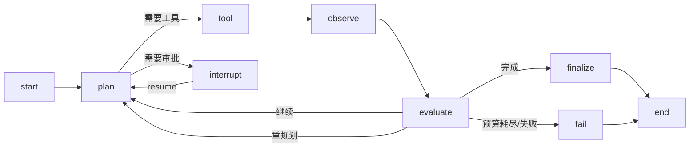

# Agent Runtime

> 状态说明：本文同时描述目标运行时和当前实现。已交付 Rust deterministic/OpenAI-compatible planner，以及显式 `planner.kind = "python"` 的 Python 3.13/LangGraph Worker、Rust ToolService、预算/审批/取消、SQLite checkpoint 和 LiteLLM 适配器。当前传输是 JSONL+HTTP，不是目标 gRPC；未配置 Worker 时 deterministic/OpenAI 路径保持可用。实际边界见 [Python Worker](python-worker.md) 与 [local-agent-platform.md](local-agent-platform.md)。

> 实现方式：可选 Python AI Worker 使用 LangGraph（`langgraph` 1.2.x）作为状态图内核，封装在 gRPC `AgentWorker` 契约后；Rust Core 负责调度/权限/预算/审批/工具/事件，TS 负责 Agent Designer/管理。

## 1. 状态图



- `plan`：模型生成计划/下一步；可结构化。
- `tool`：执行 Tool/MCP/Workflow/Skill；经 Policy。
- `observe`：结果/错误入状态；脱敏/截断。
- `evaluate`：完成/继续/重规划/终止。
- `finalize`：按 outputSchema 结构化输出。
- `interrupt`：等待人工审批/外部信号。

## 2. 状态

```ts
interface AgentState {
  sessionId: string;
  agentVersionId: string;
  messages: Message[];
  plan: PlanStep[];
  step: number;
  toolCalls: ToolCallRecord[];
  observations: Observation[];
  budget: { steps: number; toolCalls: number; tokens: number; costUsd: number; deadline: number };
  memory: { shortTerm: unknown; longTermRef?: string };
  approvals: ApprovalRef[];
  lastError?: AgentError;
  output?: unknown;
  traceContext: TraceContext;
}
```

- 状态可序列化；checkpoint 存 Postgres；大结果放 Artifact/引用。
- 消息/工具结果按 token 预算压缩；保留关键事实/引用。
- 敏感字段标记，日志/checkpoint 脱敏。

## 3. Checkpoint 与恢复

- 每次状态变更（plan/tool/observe/evaluate）保存 checkpoint；`durability` 三档（sync/async/exit）由 Hisha 选择。
- 恢复：加载最近 checkpoint + pending tool call；未确认的工具调用按幂等键重试/查询结果。
- 审批中断：保存 checkpoint，释放 Worker；审批后 `resume`。
- 版本：checkpoint 绑定 AgentVersion/图版本；升级需迁移/拒绝恢复。
- 清理：按保留策略删除；会话删除需审计。

## 4. 模型调用

- 经 Model Gateway（LiteLLM）统一 provider/成本/限流/fallback。
- Prompt 组装：系统策略 → 租户/工作区策略 → Agent 指令 → Skill 内容 → 工具结果 → 用户消息；低信任内容不得覆盖高信任指令。
- 工具选择：结构化 tool schema；模型输出工具名/参数；运行时校验/allowlist。
- 重试：模型 5xx/限流可重试；无效工具调用让模型修复（计入步数）。
- 预算：每次调用前检查 token/成本/时间；超限终止。
- 流式：token/事件流；工具调用以结构化事件输出。

## 5. 工具调用协议

```json
{
  "toolCallId": "tc_...",
  "tool": "mcp:orders.lookup",
  "arguments": { "orderId": "..." },
  "risk": "read",
  "idempotencyKey": "exec/agent/tc/1",
  "approval": "none"
}
```

流程：

1. 解析工具名（内置/Connector/Workflow/MCP/Skill）。
2. 校验参数 schema/大小/深度；拒绝未知字段（按策略）。
3. Policy：权限/租户/风险/预算/审批。
4. 执行：超时/重试/幂等；结果大小限制；脱敏。
5. 记录 ToolCall（参数摘要/结果摘要/错误/耗时）。
6. 高风险写操作：创建 Approval，进入 interrupt；批准后执行。

## 6. 审批

- 审批类型：工具执行、Workflow 发布/执行、外部写操作、数据导出。
- 审批信息：Agent/用户/租户、工具/参数摘要、风险、影响、建议。
- 审批人：角色/用户/组；SLA/升级。
- 拒绝：返回拒绝原因给 Agent；Agent 可重规划/终止。
- 审批不可由 Agent 自行批准；客户端 UI 的确认不等于 Hisha 审批。

## 7. 预算与终止

- 限制：maxSteps/maxToolCalls/timeout/tokens/cost；每次循环检查。
- 终止原因：completed/budget_exhausted/timeout/approval_denied/tool_error/security_blocked。
- 部分结果：返回已完成内容 + 终止原因 + 建议。
- 无限循环：重复计划/工具调用检测；强制终止。
- 子 Agent：预算继承/分配；深度限制。

## 8. 记忆

- 短期：会话消息/观察；checkpoint。
- 长期：显式 memory store（用户/租户/项目）；写入需策略；可删除/导出。
- 不自动把其他会话/租户数据注入；不把 secret 写入记忆。
- 记忆检索：关键词/向量可选；结果标记来源/时间。

## 9. 错误处理

| 错误 | 行为 |
| --- | --- |
| 模型限流/5xx | 退避重试；fallback 模型 |
| 工具超时 | 重试/降级/让 Agent 重规划 |
| 工具权限拒绝 | 返回给 Agent；不重试 |
| 审批拒绝 | 终止/重规划 |
| 预算耗尽 | 终止并返回部分结果 |
| checkpoint 失败 | 停止执行，避免不可恢复；告警 |
| 版本不兼容 | 拒绝恢复；人工处理 |

## 10. 本地 vs 云

- Local：Python AI Worker（可选）+ LangGraph + SQLite checkpointer + 本地/云模型；无 Python 时 Agent 禁用。
- Worker：Python AI Worker + LangGraph + Postgres checkpointer；gRPC 流式事件；审批服务端。
- 同一 AgentVersion/状态 schema；差异在存储/调度；Python 不直接访问 Control Plane DB。
- Python Agent Worker（可选）：LangGraph Python 独立进程已通过 Rust `AiWorkerProcess` start/resume/cancel 契约接入显式 `python` planner；工具调用回 Rust ToolService，审批、风险与幂等由 Rust 最终裁决。

## 11. 可观测

- Span：agent.session、agent.step、agent.model_call、agent.tool_call、agent.checkpoint、agent.approval。
- 指标：步数/工具/成本/延迟/失败率/审批等待。
- 轨迹：计划、工具调用、观察摘要、决策；敏感字段脱敏。
- 回放：从 checkpoint 重放；模拟工具/模型用于测试。

## 12. 测试

- 规划/工具选择/重规划（mock 模型）。
- 预算/步数/工具调用限制。
- 审批批准/拒绝/超时/重复。
- checkpoint 恢复/崩溃/版本迁移。
- 权限/租户/工具 allowlist。
- Prompt injection（工具结果/Skill 内容）。
- 多 Agent handoff/预算继承。
- 本地/云一致性。

## 13. 相关文档

- [Agent 架构](agent-architecture.md)
- [多 Agent](multi-agent.md)
- [Skill Runtime](../05-skill/skill-runtime.md)
- [MCP Client](../06-mcp/mcp-client.md)
- [执行平面](../02-architecture/execution-plane.md)
- [ADR-0004](../adr/0004-agent-runtime-langgraph.md)
