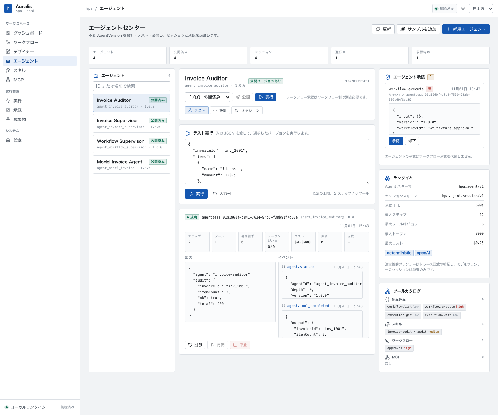
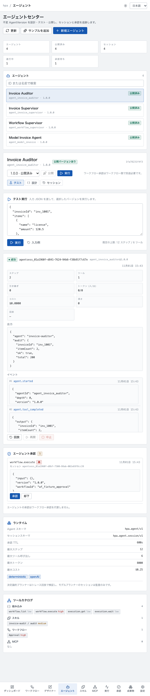
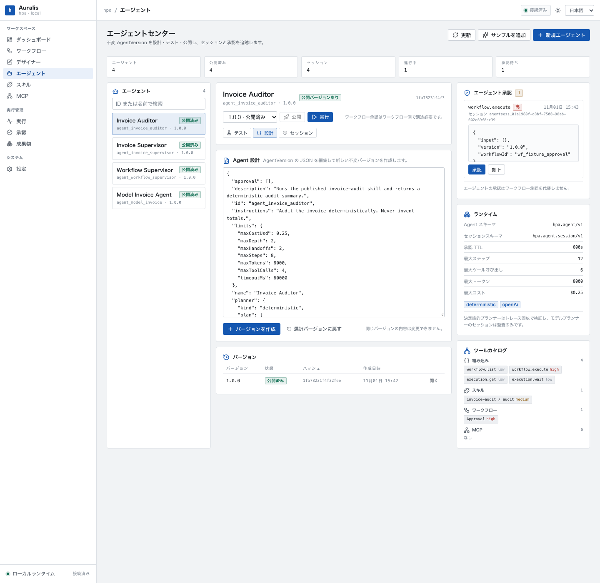

# Phase 4：本地 Agent Platform 实现

Phase 4 在 Local Runtime、Skill Center、Workflow Runtime 与 MCP Gateway 之上增加本地 Agent Platform。Agent 使用同一套 Rust 执行核心调用 Skill、Workflow 与 MCP 工具，不新增脚本执行引擎，也不绕过 Workflow 审批。







## 1. Agent IR

Schema：`hpa.agent/v1`；会话状态：`hpa.agent.session/v1`。

```json
{
  "schemaVersion": "hpa.agent/v1",
  "id": "agent_invoice_auditor",
  "name": "Invoice Auditor",
  "version": "1.0.0",
  "description": "Runs the published invoice-audit skill.",
  "instructions": "Audit the invoice deterministically.",
  "tools": ["skill.invoice-audit.audit"],
  "planner": {
    "kind": "deterministic",
    "plan": [
      {
        "kind": "tool",
        "tool": "skill.invoice-audit.audit",
        "arguments": {
          "invoiceId": { "$input": "invoiceId" },
          "items": { "$input": "items" }
        }
      },
      { "kind": "respond", "output": { "audit": { "$last": true } } }
    ]
  },
  "limits": {
    "maxSteps": 8,
    "maxToolCalls": 4,
    "timeoutMs": 60000,
    "maxTokens": 8000,
    "maxCostUsd": 0.25,
    "maxHandoffs": 2,
    "maxDepth": 2
  },
  "approval": [],
  "subAgents": []
}
```

规则：

- 顶层与 limits/approval/plan 字段拒绝未知键。
- `tools` 只接受 `skill.<skillName>.<scriptId>`、`mcp.<serverId>.<toolName>`、`workflow.execute`、`workflow.list`、`execution.get`、`execution.wait`。
- `approval` 只能覆盖已声明工具；高风险工具不允许 `never`。
- 确定性 planner 必须有非空 plan；plan 中的工具与 subAgent 必须已声明。
- OpenAI planner 的 endpoint 必须是 http(s)，且不能包含 userinfo。

### 参数解析

- `{ "$input": true }`：整个输入。
- `{ "$input": "field.path" }`：输入中的路径。
- `{ "$last": true }`：上一步工具/子 Agent 的完整输出。
- `{ "$last": "executionId" }`：上一步输出中的路径。

解析后的动作会写入 `plan_history`，因此回放比较的是实际执行动作，而不是未解析模板。

## 2. 不可变 AgentVersion

- 版本内容按规范化 JSON 计算 SHA-256。
- `agentId@version` 相同哈希重复提交返回 `inserted: false`。
- 相同版本不同内容返回 `AGENT_VERSION_FROZEN`，必须提升版本号。
- 发布后版本内容与哈希不可改写；运行默认使用最新已发布版本，也可显式指定版本。
- 本地状态写入 SQLite：`agents`、`agent_versions`、`agent_sessions`、`agent_events`、`agent_approvals`。

## 3. Rust Agent Runtime

执行循环：

1. 检查会话是否终态、是否等待审批、是否超时、是否超过步数预算。
2. planner 产生动作（确定性 plan 或 OpenAI 兼容 endpoint）。
3. 解析参数并写入检查点。
4. 对模型 planner 做重复动作防护；连续 3 个相同动作返回 `AGENT_LOOP`。
5. 工具调用前检查工具次数与 token/成本预算。
6. 高风险工具进入审批中断；否则通过既有 Rust 核心执行。
7. 每一步持久化状态与事件；进程重启后可从最近检查点继续。
8. `respond` 结束会话；预算、超时、拒绝、循环等以明确代码失败。

### 工具

| 工具 | 风险 | 执行 |
| --- | --- | --- |
| `skill.<name>.<script>` | medium | 复用 Skill Runtime 沙箱、输入 Schema、输出上限与产物 |
| `workflow.execute` | high | 启动已发布 Workflow 版本，返回 executionId |
| `workflow.list` | low | 列出已发布工作流 |
| `execution.get` | low | 读取执行状态/输出/等待审批 |
| `execution.wait` | low | 轮询最多 30s，遇终态或 waiting_approval 返回 |
| `mcp.<server>.<tool>` | high | 复用 Phase 3 MCP Client 与外部服务器允许列表 |

MCP 与 Workflow 工具不向模型透传上游凭据；Workflow 执行使用官方发布版本与执行快照。

### 预算

默认值：

| 限制 | 默认 |
| --- | --- |
| `maxSteps` | 12 |
| `maxToolCalls` | 6 |
| `timeoutMs` | 60,000 |
| `maxTokens` | 8,000 |
| `maxCostUsd` | 0.25 |
| `maxHandoffs` | 4 |
| `maxDepth` | 2 |

- 工具次数与步骤在调用前检查，达到上限后停止，不会先超用一次。
- OpenAI planner 统计 prompt/completion token 与可选的每 1K 输入/输出成本。
- 子 Agent 继承父会话的剩余步骤、工具、时间、token、成本与深度预算；子 Agent 自身限制再取较小值。
- 子 Agent 失败/预算耗尽/超时会失败父 handoff，并记录 childSessionId。

### 审批与中断/恢复

- `workflow.execute` 与 `mcp.*` 固定为高风险，必须审批。
- Agent 审批写入 `agent_approvals`，默认 TTL 600 秒；等待中的会话状态为 `waiting_approval`。
- 通过 API 决策后才会执行对应工具；拒绝会以 `APPROVAL_REJECTED` 结束会话。
- 审批超时由本地监控标记 expired，并结束等待会话。
- **Agent 审批不等于 Workflow 审批**：Agent 调用 Workflow 后，Workflow 内的人工审批仍由 Workflow 审批中心处理，Agent 工具只能看到 `waiting_approval` 状态，不能代为审批。
- 进程重启时，状态为 `running` 的会话标记为 `interrupted`，可从检查点 `continue`；已存在的等待审批会话与审批记录保持不变。崩溃瞬间的工具副作用按至少一次语义处理。

### 多 Agent handoff

- 只能 handoff 到已声明的 `subAgents`。
- 默认使用子 Agent 最新已发布版本。
- 父会话记录 handoff 次数、子会话 ID、聚合的工具次数/token/成本，并在每次 handoff 后重新检查预算。
- 子 Agent 需要审批时，父 handoff 失败并保留子会话引用；父 Agent 不会代替子 Agent 批准。

## 4. 回放与审计

- 事件流覆盖 started、plan（模型规划）、model_usage、tool_completed/tool_failed、approval_requested/resumed、handoff、interrupted、finished。
- 确定性 planner 使用 **trace replay**：按冻结版本 plan 与记录的工具输出重新解析参数，比较动作、状态与输出；不重复执行工具副作用。
- 模型 planner 的响应与 usage 仅审计，不宣称确定性回放；接口返回 `deterministic: false`。
- 会话状态 schema 为 `hpa.agent.session/v1`，包含 planIndex、messages、预算累计与 pending action。

## 5. API 与 CLI

API（`/api` 前缀）：

```text
GET    /agents
POST   /agents                          { "config": { ... } }
GET    /agents/{id}
GET    /agents/{id}/versions/{version}
POST   /agents/{id}/publish             { "version": "1.0.0" }
POST   /agents/{id}/run                 { "version": "1.0.0", "input": {} }
GET    /agents/sessions?agentId=&limit=
GET    /agents/sessions/{id}
GET    /agents/sessions/{id}/events
POST   /agents/sessions/{id}/continue
POST   /agents/sessions/{id}/cancel
POST   /agents/sessions/{id}/replay
GET    /agents/approvals?status=pending
POST   /agents/approvals/{id}/decide    { "decision": "approved" | "rejected" }
GET    /agents/tools
GET    /agents/runtime
```

CLI：

```bash
hpa --data-dir ~/.hpa agent import fixtures/agents/invoice-auditor.agent.json
hpa --data-dir ~/.hpa agent publish agent_invoice_auditor
hpa --data-dir ~/.hpa agent run agent_invoice_auditor \
  --input '{"invoiceId":"inv_42","items":[{"amount":200}]}'
hpa --data-dir ~/.hpa agent sessions agent_invoice_auditor
hpa --data-dir ~/.hpa agent replay <sessionId>
hpa --data-dir ~/.hpa agent approvals --status pending
hpa --data-dir ~/.hpa agent decide <approvalId> --decision approved
```

## 6. Agent Center

`/agents` 提供：

- Agent 列表与发布状态、版本选择、发布与运行。
- 测试执行：输入 JSON、实时会话状态、输出、事件、预算统计、回放/继续/取消。
- Agent Designer：编辑 `hpa.agent/v1` JSON 并创建新版本；版本列表显示哈希与状态。
- 会话历史与审批面板；审批后立即恢复会话。
- 工具目录与运行时限展示；工作流审批边界提示。
- ja/en/zh 文案；1440px 与 607px 布局均无横向溢出。

## 7. 验收

```bash
cargo test --workspace                  # 71 passed, 1 ignored (outbound TLS)
cargo clippy --workspace --all-targets -- -D warnings
cargo fmt --all --check
cd apps/web && npm run typecheck && npm test && npm run build
node scripts/check-brand.mjs
node scripts/check-ir.cjs
```

Phase 4 自动化覆盖：

- `agent_version_is_immutable_and_replay_matches`：版本冻结、确定性 Skill 工具、回放一致。
- `agent_approval_does_not_bypass_workflow_approval`：Agent 审批后执行 Workflow，Workflow 仍等待自己的审批；审批记录跨服务重启保留。
- `agent_handoff_inherits_budget_and_depth`：父预算限制子工具次数、自引用 handoff 深度失败。
- `openai_planner_calls_tools_accounts_tokens_and_detects_loops`：OpenAI 兼容 mock 的工具调用、token/成本记账、循环防护、网络允许列表失败。
- `interrupted_session_recovers_from_checkpoint`：running 会话恢复为 interrupted 后继续完成。

## 8. 边界

- 仅本地执行；不自动安装模型、Python/Node 依赖或外部 MCP Server。
- 模型 planner 只支持单个工具调用/回合；多工具调用直接返回 `AGENT_MODEL` 错误。
- 非回环模型 endpoint 必须显式列入 `network`，必须使用 HTTPS，解析到私网地址会被拒绝；本机回环无需额外规则。
- 模型 planner 不承诺确定性回放；确定性只由 deterministic planner 的 trace replay 保证。
- 子 Agent 需要审批时父 handoff 失败关闭，不自动批准；需显式运行子 Agent 或调整审批配置。
- 本地进程重启可恢复检查点，但崩溃瞬间的外部副作用按至少一次处理。
- Agent 不提供云端 Control Plane、Marketplace 或多租户隔离；这些仍属于后续阶段。
