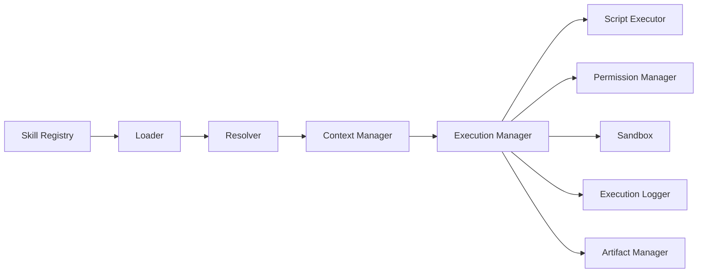

# Skill Runtime

> Skill Runtime 负责加载/解析/执行 Skill，但不把 Skill 变成可执行程序。它由 Agent Runtime 或确定性入口调用；所有脚本经 Sandbox/Policy。

## 1. 组件



| 组件 | 职责 |
| --- | --- |
| Loader | 读取目录/包；校验结构/frontmatter/manifest；拒绝路径逃逸 |
| Resolver | 解析 name/version/依赖；选择版本；冲突处理 |
| Context Manager | 组装 instructions/references/script 元数据；渐进披露；token 预算 |
| Execution Manager | 选择执行模式；编排脚本/工具；超时/取消；结果 |
| Script Executor | 启动 Python/Node/Shell；参数/env/stdin；捕获 stdout/stderr/exit |
| Permission Manager | 文件/网络/命令/环境/资源策略 |
| Sandbox | 工作区/容器/OS 限制 |
| Execution Logger | 事件/日志/审计；脱敏 |
| Artifact Manager | 产物写入/引用/清理/保留 |

## 2. 加载与解析

```ts
interface SkillLoader {
  inspect(path: string): Promise<SkillInspection>;
  load(ref: SkillRef, ctx: SkillContext): Promise<LoadedSkill>;
}

interface LoadedSkill {
  manifest: SkillManifest;
  skillMd: string;
  frontmatter: SkillFrontmatter;
  files: SkillFile[];
  scripts: ScriptDescriptor[];
  trust: TrustLevel;
}
```

规则：

- `name`/`description` 校验；版本来自 manifest/registry。
- 拒绝符号链接/绝对路径/`..`；限制文件数/大小/深度。
- 脚本路径必须在 `scripts/`（或 manifest 允许的路径），不可指向外部。
- 未知字段保留；不执行任何内容 during load。
- 依赖解析：Skill/脚本包/连接器；锁定版本；冲突报错。

## 3. 渐进披露

1. 只加载 metadata（name/description/version/license）。
2. 选择后加载 `SKILL.md`（≤500 行建议）。
3. 按需加载 `references/*`；不一次性注入全部。
4. 脚本只在需要时执行；脚本输出/产物按需引用。
5. 上下文预算：超过 token 限制时摘要/分片；保留关键指令。

## 4. 执行模式

### Agent-guided

- Agent Runtime 加载 Skill 指令；模型按指令选择工具/脚本。
- Skill 内容视为不可信数据；不得覆盖系统/平台策略。
- 工具调用经 Tool Registry/Policy；高风险审批。

### Deterministic

- `entry.kind = script`：直接执行声明的脚本入口；无模型。
- 输入：JSON（stdin/参数/文件），输出：JSON（stdout/文件/artifacts）。
- 退出码：0 成功；非 0 失败；错误信息结构化（JSON 优先）。
- 适用：本地离线、Workflow 节点、MCP Tool 后端。

### Hybrid

- 云模型/本地脚本或本地模型/云工具；数据边界在 manifest/策略中声明。
- 传输策略：只发送必要上下文；结果脱敏；审计。

## 5. 脚本执行

```json
{
  "runtime": "python3",
  "args": ["--input", "/work/input.json", "--output", "/work/artifacts"],
  "env": { "LANG": "C.UTF-8" },
  "timeoutMs": 120000,
  "network": "none",
  "resources": { "cpu": 1, "memoryMb": 512 }
}
```

- 工作目录：每执行临时目录；输入只读；`artifacts/` 可写。
- 输出：stdout 限制（如 1 MB）；大结果写 artifact。
- 超时：终止进程树；记录。
- 语言：Python/Node/Shell 内置；通过 runtime registry 扩展（版本/路径/健康检查）。
- 不通过 shell 拼接参数；使用 argv 数组；禁止 `shell=True`。

## 6. 权限与沙箱

- 默认：无网络、只读输入、临时写、无 secret、命令白名单。
- 高风险：容器（Docker/Podman）或 OS 级隔离；本地 macOS/Windows 明确提示。
- 网络：域名/端口白名单；HTTP 代理审计；DNS rebinding/SSRF 防护。
- 文件：路径规范化/realpath 校验；禁止挂载宿主敏感目录。
- 资源：CPU/内存/时长/输出大小；超限终止。
- Secret：只注入显式绑定凭证；环境变量最小化；不落盘/日志。

## 7. 上下文管理

- 输入：Skill 参数、工作区/项目元数据（按权限）、用户提供文件。
- 不自动注入其他 Skill/租户/会话数据。
- 引用文件：路径 + 摘要/大小；按需读取；不把二进制塞入 Prompt。
- 输出：结构化结果 + 引用；模型生成的内容标记来源。
- 压缩：长文档摘要/分块；保留原文引用。

## 8. 事件与产物

- 事件：skill.loaded/resolved/started/script.started/script.stdout/script.failed/artifact.created/finished。
- 日志：结构化、脱敏、限流；stderr 截断。
- 产物：内容寻址；元数据（mime/size/hash/createdBy）；保留/删除策略。
- 审计：谁在何时以何权限执行了哪个 SkillVersion/脚本；结果摘要。

## 9. 错误

| 错误 | 处理 |
| --- | --- |
| `SKILL_INVALID` | 导入/发布拒绝；修复提示 |
| `SKILL_NOT_FOUND` | 版本/依赖解析失败 |
| `SKILL_PERMISSION` | 沙箱/策略拒绝 |
| `SCRIPT_TIMEOUT` | 终止；可重试（按策略） |
| `SCRIPT_EXIT` | 非 0；stdout/stderr 摘要 |
| `SCRIPT_OUTPUT_INVALID` | 输出 schema 校验失败 |
| `SKILL_DEPENDENCY` | 版本冲突/缺失 |

## 10. 本地/云

- 同一 Runtime 核心；Local 用 SQLite/文件，Cloud 用 Postgres/S3。
- 本地不调用云 Control Plane；云执行由 Worker 托管。
- 同一 SkillVersion/脚本哈希/权限策略；结果事件一致。
- Hybrid：模型/工具位置可配置；数据边界显式。

## 11. 测试

- 结构/frontmatter/路径/脚本解析。
- 权限/沙箱/网络/文件逃逸。
- 确定性执行/输出 schema/退出码。
- Agent-guided：mock 模型/工具。
- 离线/本地/云一致性。
- 导出到外部客户端的加载兼容。

## 12. 相关文档

- [Skill 规范](skill-specification.md)
- [本地执行](local-execution.md)
- [Skill 安全](skill-security.md)
- [Agent Runtime](../04-agent/agent-runtime.md)
- [MCP Server](../06-mcp/mcp-server.md)
