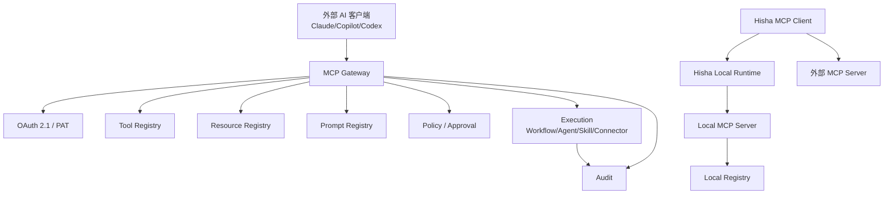

# MCP 架构

> Hisha 既是 MCP Client（调用外部工具），也是 MCP Server/Gateway（向外部 AI 客户端暴露能力）。协议以 2026-07-28 为目标，兼容旧版；详见 [标准研究](../01-research/standards/mcp-2026-07-28.md)。

## 1. 角色

| 角色 | 职责 |
| --- | --- |
| MCP Client | 连接外部 Server；发现/调用 Tools/Resources/Prompts |
| MCP Server | 暴露 Hisha 能力（本地/远端） |
| MCP Gateway | 面向外部客户端的统一入口：协议/认证/授权/租户/限流/审计/注册表 |
| Tool Registry | 由 Capability Registry 生成的工具描述/schema/风险/权限 |
| Resource Registry | 资源 URI/权限/租户过滤 |
| Prompt Registry | 可复用模板/版本/权限 |

## 2. 拓扑



## 3. 能力映射

| Hisha Capability | MCP 暴露 | 说明 |
| --- | --- | --- |
| WorkflowVersion | Tool（`workflow.execute`/`get_execution`） | 输入/输出 schema；版本固定；高风险执行审批 |
| AgentVersion | Tool（`agent.run`/`get_status`） | 预算/审批；异步任务 |
| SkillVersion | Tool（`skill.get`/`skill.execute`） | 标准 Skill；脚本沙箱；可只读/写 |
| Connector | Tool（按 operation） | 认证/凭证引用；风险分级 |
| Artifact | Resource | 租户/执行范围过滤 |
| Execution | Resource | 只读；敏感字段脱敏 |
| Prompt | Prompt | 参数化模板 |
| Knowledge | Resource/Prompt | 权限/租户过滤 |

> 不自动把内部 REST 全量映射为 MCP Tool；工具必须经过能力注册、schema、权限、风险/审批配置。

## 4. 版本策略

- **默认目标**：2026-07-28（无状态、`server/discover`、`_meta`、`resultType`、MRTR、`subscriptions/listen`、tasks 扩展）。
- **兼容**：2025-11-25/2025-06-18/2025-03-26（initialize/会话/旧 Streamable HTTP/HTTP+SSE）。
- **协商**：客户端先 `server/discover`；失败/旧客户端回退 `initialize`；按请求独立判定，不依赖连接状态。
- **实现**：Rust RMCP 3.8.0 负责协议/传输/认证（支持 2026-07-28 与 2025-11-25）；TS Control Plane 只做注册/管理/审计查询。
- **测试**：两套协议 conformance；真实客户端（Claude/Copilot/Codex）回归。

## 5. Gateway 设计

### 端点

- `https://<tenant>.hpa.example.com/mcp` 或 `https://hpa.example.com/mcp` + token 识别租户。
- 仅 POST（2026-07-28）；旧版兼容 GET/SSE 在兼容层。
- 本地：`http://127.0.0.1:<port>/mcp` + 能力令牌；stdio 模式独立。

### 认证/授权

- OAuth 2.1：RFC 9728 Protected Resource Metadata、RFC 8414/OIDC Discovery、RFC 8707 resource indicators、CIMD（优先）/DCR（兼容）、RFC 9207 iss。
- PAT/服务账号：用于不支持 OAuth 的 CLI；短期/可撤销。
- Token 绑定 tenant/workspace/user/scopes；工具级授权；不 token passthrough。
- 高风险写操作：服务端审批（即使客户端确认了）。

### 工具注册

每个工具：

```json
{
  "name": "workflow.execute",
  "title": "执行 Workflow",
  "description": "...",
  "inputSchema": { "type": "object", "properties": {}, "required": [] },
  "outputSchema": { "type": "object" },
  "annotations": { "readOnlyHint": false, "destructiveHint": false, "idempotentHint": false, "openWorldHint": true },
  "risk": "high",
  "permissions": ["workflow:execute"],
  "approval": "always",
  "ttlMs": 60000,
  "cacheScope": "private"
}
```

- 名称稳定/唯一；避免内部 API 名称泄漏。
- 描述面向模型；schema 严格；参数大小/深度限制。
- 结果 `resultType`/`content`/结构化输出；错误标准化。
- 缓存：`ttlMs`/`cacheScope`；租户私有数据 `private`。

### 资源/Prompt

- Resource URI：`hpa://tenant/{tenant}/executions/{id}`；权限过滤。
- 大对象分页/引用；不返回文件系统路径。
- Prompt 模板版本化；参数 schema；租户可见性。

### 限流/审计

- 按 tenant/client/tool 限流；配额/并发；熔断。
- 审计：client、tenant、tool、参数摘要、结果摘要、审批、trace；不记录 secret。
- 监控：错误率/延迟/调用量/审批等待。

## 6. 本地 MCP

- stdio 优先；HTTP loopback + 能力令牌。
- 本地 Registry/工具/权限/审计；离线可用。
- 可作为外部客户端（Claude/Copilot/Codex）的本地工具源。
- 与云端 Gateway 同构的工具描述/权限，但租户=本地工作区。

## 7. 外部 MCP Client

Hisha 作为 Client 连接外部 Server：

- 支持 stdio/HTTP；按 2026-07-28 优先，旧版兼容。
- 认证：OAuth/PAT/env；token 存储 Vault；不 passthrough。
- 发现：tools/resources/prompts；schema 缓存；变更通知。
- 调用：超时/重试/取消；错误映射；结果大小限制。
- 安全：SSRF/域名白名单；工具风险/审批；租户隔离。

## 8. 错误模型

| 场景 | 错误 |
| --- | --- |
| 未认证/过期 | 401 + OAuth 发现信息 |
| 无权限/租户不符 | 403（不泄漏内部） |
| 工具不存在 | JSON-RPC `-32602` |
| schema 不合法 | `-32602` + 字段 |
| 审批等待 | `input_required` / 任务状态 |
| 限流 | 429 + retry-after |
| 上游失败 | 工具错误 + 可重试标志 |
| 版本不支持 | `UnsupportedProtocolVersionError` |

## 9. 与 Workflow/Agent/Skill

- 工具调用创建 Execution/AgentSession；返回 executionId/sessionId；支持轮询/流式。
- 长任务用 tasks 扩展或 Hisha 异步句柄；不阻塞 HTTP 请求。
- 审批：MCP 调用可触发 Approval；客户端显示等待；Hisha 服务端强制。
- 结果：结构化 + 资源引用；大结果用 Resource/Artifact。

## 10. 非目标

- 不暴露内部管理 API/数据库/文件系统。
- 不假设所有客户端支持同一版本/配置。
- 不依赖客户端审批作为安全边界。
- 不把 MCP 当 Workflow 引擎/Agent 运行时。
- 不把 legacy SSE 作为新设计。

## 11. 相关文档

- [MCP Client](mcp-client.md)
- [MCP Server/Gateway](mcp-server.md)
- [MCP 安全](mcp-security.md)
- [外部 AI 集成](external-ai-integration.md)
- [MCP 2026-07-28 研究](../01-research/standards/mcp-2026-07-28.md)
