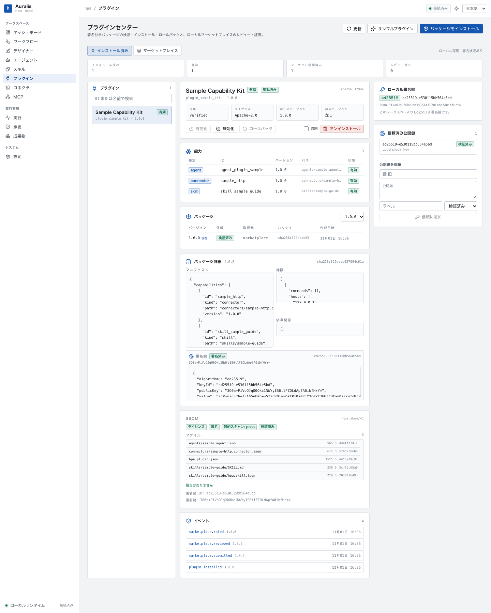
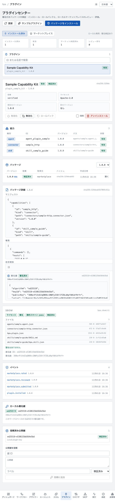
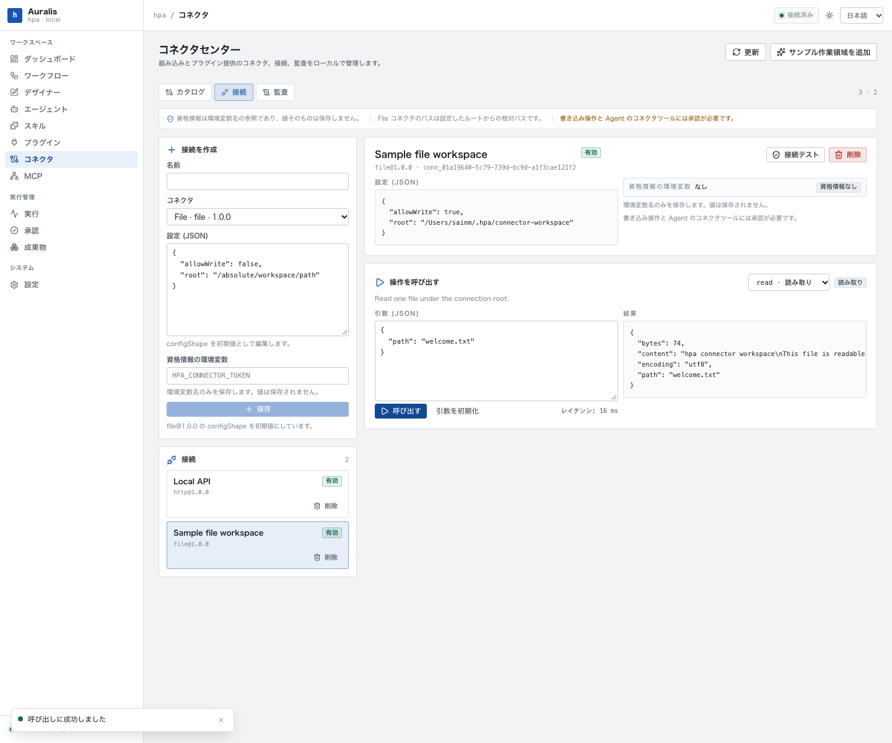
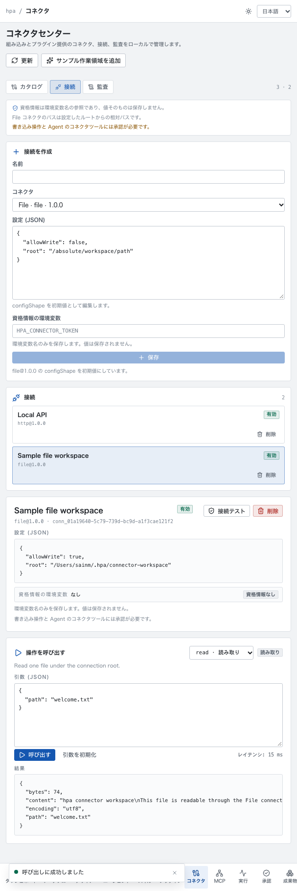
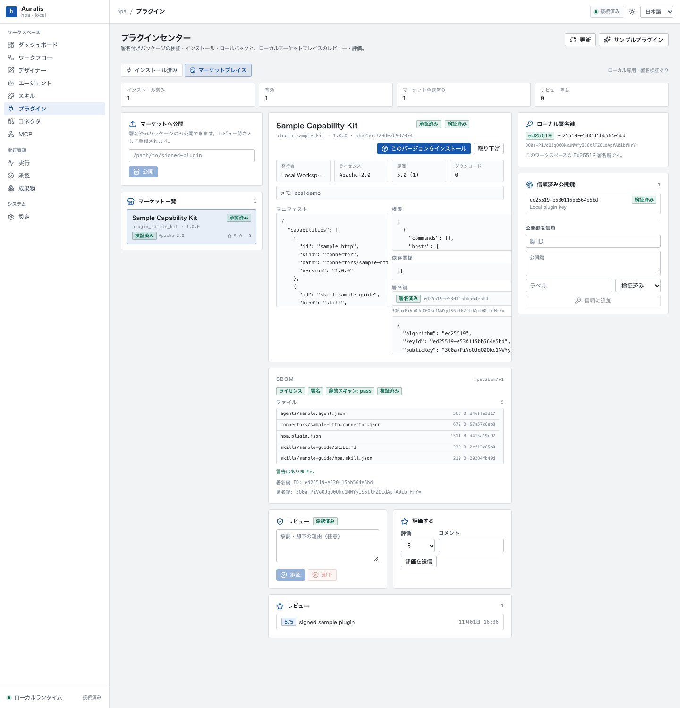

# Phase 5：本地 Plugin & Connector 实现

Phase 5 在 Local Runtime 上增加插件分发与连接器运行时。当前实现是**本地、声明式**的：插件只携带 manifest 与 JSON/Skill/Agent 配置，不把任意 JavaScript/TypeScript handler 加载进 API 进程；没有远程 Marketplace、云端 Control Plane 或多租户。插件贡献的 Connector 与 MCP Server 进入本地注册表，Skill 与 Agent 以草稿导入，仍按各自的契约执行。











## 1. 范围与状态

- 实现位于 `crates/hpa-local/src/plugin.rs`、`connector.rs`、`api.rs`、`main.rs`、`db.rs`，UI 为 `/plugins` 与 `/connectors`。
- Plugin Center 覆盖安装、升级、回滚、启停、卸载、密钥信任、本地发布/审核/评分/撤回；Connector Center 覆盖目录、连接、测试、调用与审计。
- 不做：远程 Marketplace、OCI 分发、Node/TS handler 执行、脚本沙箱的新执行引擎、系统依赖自动安装、漏洞数据库/在线漏洞源、多租户。
- 声明式能力只有四种：`connector`、`mcp`、`skill`、`agent`。没有 Node、Tool、Trigger 等旧文档中的插件内容类型。

## 2. 包格式与 manifest

分发格式为 tar 归档 `.hplugin`；安装入口也接受一个目录，目录与归档走同一套校验。归档由 GNU tar header 打包，仅允许普通文件；目录安装拒绝符号链接与非普通文件，归档拒绝目录项以外的非普通文件（设备、FIFO、符号链接）。两种来源都拒绝绝对路径、`..` 与空路径。

| 限制 | 值 |
| --- | --- |
| 文件数 | `MAX_PLUGIN_FILES = 500` |
| 整包解压后字节 | `MAX_PLUGIN_BYTES = 20 MiB` |
| 单文件字节 | `MAX_PLUGIN_FILE_BYTES = 5 MiB` |

manifest 固定文件名 `hpa.plugin.json`，schema 为 `hpa.plugin/v1`；顶层及嵌套结构均 `deny_unknown_fields`。字段：`schemaVersion`、`id`、`name`、`version`、`description?`、`license`、`publisher?`、`compatibility`、`capabilities[]`、`dependencies[]`、`permissions[]`、`integrity?`、`signature?`、`metadata?`。`integrity` 在结构上可选，但加载时必填。

```json
{
  "schemaVersion": "hpa.plugin/v1",
  "id": "plugin_example",
  "name": "Example",
  "version": "1.0.0",
  "license": "Apache-2.0",
  "publisher": { "id": "local", "name": "Local Workspace", "url": "https://example.com" },
  "compatibility": { "hpa": ">=0.1.0, <1.0.0", "os": ["macos"], "runtimes": [] },
  "capabilities": [
    { "kind": "connector", "id": "example_http", "version": "1.0.0", "path": "connectors/example.json" },
    { "kind": "mcp", "id": "example_mcp", "version": "1.0.0", "path": "mcp/server.json" },
    { "kind": "skill", "id": "skill_example", "version": "1.0.0", "path": "skills/example" },
    { "kind": "agent", "id": "agent_example", "version": "1.0.0", "path": "agents/example.json" }
  ],
  "dependencies": [{ "kind": "plugin", "id": "plugin_base", "range": "^1.0.0" }],
  "permissions": [{ "kind": "network", "hosts": ["127.0.0.1"] }],
  "integrity": { "algorithm": "sha256", "digest": "sha256:..." },
  "signature": { "algorithm": "ed25519", "keyId": "ed25519-...", "publicKey": "base64...", "value": "base64..." }
}
```

- `id` 只允许 ASCII 字母、数字、`.`、`_`、`-`；`version` 与 capability `version` 必须是 semver；重复的 `kind+id` capability 被拒绝。
- capability `path` 必须是包内相对路径。Connector 与 Agent 指向文件，且其 id/version 必须与 capability 一致；MCP 指向配置文件（文件本身不含 id/version，服务器 id 由插件与 capability id 生成）；Skill 指向目录，必须存在 `<path>/SKILL.md`。
- `compatibility.hpa` 是 semver 范围，按当前二进制 `CARGO_PKG_VERSION` 校验；`os` 非空时必须包含 `std::env::consts::OS`；`runtimes` 仅保留，不参与校验。
- `dependencies` 只支持 `kind: "plugin"`；安装时要求依赖已安装且状态为 `enabled`，`installed_version` 满足 semver `range`。不自动安装依赖。
- `permissions` 允许 `network`、`filesystem`、`commands`、`credential`。Connector 为 HTTP 时插件必须声明 `network`，为 File 时必须声明 `filesystem`，Connector 自身也必须声明同类权限；stdio MCP 必须声明 `commands`。权限不构成通用的文件/网络运行时沙箱；主机白名单来自 Connection 配置。
- license 走现有 `allowed_license` 白名单（Apache-2.0、MIT、BSD、ISC、MPL-2.0、GPL/LGPL/AGPL 等）；不在白名单返回 `PLUGIN_LICENSE`。

内容摘要（`contentHash`）为 `sha256:<hex>`，对包内除 `hpa.plugin.json` 外的文件按路径升序计算：逐文件写入 `path`、`0x00`、十进制字节长度、`0x00`、文件内容的 SHA-256 十六进制、`0x00`，再对整串做 SHA-256。因此 manifest 本身由签名保护，其他文件由 `integrity.digest` 保护；摘要不匹配返回 `PLUGIN_SIGNATURE`。

## 3. 签名与信任

- 本地 Ed25519 密钥位于 `<data_dir>/keys/plugin-ed25519.key`（Base64 的 32 字节种子，Unix 下权限 `0600`），公钥写入同目录 `plugin-ed25519.pub`。首次使用时生成，并在 `plugin_trusted_keys` 中登记为 `verified`。
- `keyId` 为 `ed25519-` 加公钥 SHA-256 前 16 位十六进制。
- 签名载荷是 ASCII 字符串：`hpa.plugin/v1\n{id}@{version}\n{contentHash}\n{去掉 signature 的紧凑 JSON manifest}`。签名值 Base64 编码，必须为 64 字节；只接受 `algorithm: "ed25519"`，公钥必须为 32 字节。
- 验签使用 manifest 内嵌 `publicKey`。随后按 `(key_id, public_key)` 查信任库：命中且 trust 为 `verified` 则为 `verified`，否则为 `community`。
- 信任等级只有 `verified`、`community`、`untrusted`；没有 `official`。未签名包为 `untrusted`，且默认拒绝。
- `BundleOptions` 语义：`allowUnsigned` 允许本地开发安装未签名包（仍要求 integrity）；`allowUntrusted` 允许 `community` 签名者；`requireSignature` 强制签名，并允许 `community`（市场发布/安装使用）。API 的 `/plugins/inspect` 与 `/plugins/install` 暴露前两个布尔值，`requireSignature` 固定为 false。
- `POST /api/plugins/keys` 可登记任意公钥为 `verified` 或 `community`（默认 `verified`），`GET /api/plugins/keys` 列出；没有删除、吊销、轮换或官方密钥层级。
- 密钥信任只影响插件包，不等同于市场审核；审核状态与签名信任分别记录。

## 4. 生命周期

| 操作 | 行为 |
| --- | --- |
| 安装 | 校验 manifest/路径/摘要/签名/许可/兼容性/依赖/能力文件；包写入 `<data_dir>/plugins/packages/{id}/{version}.hplugin`，文件解压到 `<data_dir>/plugins/installed/{id}/{version}`，激活能力并置为 `enabled`。 |
| 升级 | 只接受严格更高的 semver；同版本直接返回详情；更低版本返回 `PLUGIN_CONFLICT`（提示使用 rollback）。旧版本成为 `previousVersion`，旧能力被停用。 |
| 回滚 | 必须有 `previousVersion`；停用当前版本、激活上一版本并交换 `installedVersion`/`previousVersion`；只保留一层。 |
| 停用 | 插件状态 `disabled`；其 Connector 定义 `status='disabled'`，MCP Server `enabled=0`，`plugin_capabilities` 全部 `disabled`。已有 Connection 保留但调用返回 `CONNECTOR_FORBIDDEN`（connector disabled）。 |
| 启用 | 重新激活当前 `installedVersion`：Connector 置回 enabled，MCP `enabled=1`，capability 置回 enabled。 |
| 卸载 | 默认检查依赖它的已安装插件，存在依赖则 `PLUGIN_CONFLICT`；`force=true` 跳过。删除该插件的 Connector 定义与 MCP Server，capability 标记 `uninstalled`，清空安装版本并删除已解压目录。 |

能力落点：

- Connector：以 `connector_definitions` 注册，`status='enabled'`，记录 `plugin_id`/`plugin_version`；同一 `connectorId@version` 已由其他插件或内置 Connector 注册时拒绝（`CONNECTOR_FORBIDDEN`），内容不同则冻结错误。
- MCP：注册到 `mcp_servers`，`id` 为 `plugin_<pluginId>_<capabilityId>` 并做字符归一化，`enabled=1`；`plugin_id` 用于停用/卸载。stdio 必须有 `command` 且插件声明非空 `commands` 权限；HTTP 必须有 http(s) URL。
- Skill：调用既有 Skill Registry 导入，状态为 `imported`（草稿），**不自动发布**；插件安装不会执行 Skill 脚本。
- Agent：写入 `agent_versions`，状态为 `imported`（草稿），**不自动发布**；id/version 必须与 capability 一致。

卸载后 Skill/Agent 草稿保留；Connector/MCP 注册被删除；包归档、`plugin_packages` 记录、SBOM 与事件保留；已存在的 Connection 记录保留，但因 Connector 定义不存在而不可用。版本冻结：`plugin_packages` 同一 `pluginId@version` 内容哈希不同返回 `PLUGIN_VERSION_FROZEN`；Connector 同 id/version manifest 不同返回 `CONNECTOR_INVALID` 并要求提升版本；Agent/Skill 各自沿用 `AGENT_VERSION_FROZEN` 与 `SKILL_VERSION_FROZEN`。

## 5. 本地 Marketplace

- `plugin publish <path>` / `POST /api/marketplace/publish` 只接受签名包（强制 `requireSignature`，`allowUnsigned=false`，`allowUntrusted=true`），写入 `plugin_packages`、`plugins.status='available'` 与 `plugin_market_listings.review_status='pending'`。
- 审核只能把 `pending` 改为 `approved` 或 `rejected`，可带 `reviewNote`，写 `reviewed_at`；重复审核或非 pending 返回 `PLUGIN_CONFLICT`。
- 评分 1..5，可带评论；`rating` 返回 `{average, count}`。评分不要求已安装，也没有防刷、用户维度限制或分页。
- 撤回把任意非 `withdrawn` 的 listing 置为 `withdrawn` 并写 `withdrawn_at`；可重新提交为 `pending`。
- 安装只允许 `approved` 且未撤回的 listing；否则 `PLUGIN_FORBIDDEN`。安装复用签名校验，成功后 `downloads` 加 1。
- 所有数据在本地 SQLite；没有远程索引、下载服务、发布者账号、付费、搜索/分类或审核 SLA。

## 6. Connector 运行时

内置两个声明式 Connector（启动时 `initialize` 注册）：

| Connector | 版本 | 操作 |
| --- | --- | --- |
| `http` | `1.0.0` | `request`（risk `write`）：`method`、`path`、`query`、`headers`、`body`、`idempotencyKey` |
| `file` | `1.0.0` | `read`、`list`（read），`write`（write） |

Connection 保存 `connector_id`、`connector_version`、`config_json` 与 `credential_env`；保存时 Connector 必须存在且 `enabled`。HTTP 配置：`baseUrl`、`allowedHosts[]`、`auth { kind: none|bearer|header, header? }`、`timeoutMs`、`maxAttempts`、`rateLimitPerMinute`、`maxResponseBytes`。File 配置：`root`、`allowWrite`、`maxFileBytes`。未知配置键被拒绝。

认证只保存环境变量名：`credential_env` 必须匹配 `[A-Za-z_][A-Za-z0-9_]*`，调用时用 `std::env::var` 读取；bearer/header 认证缺少变量返回 `CONNECTOR_FORBIDDEN`。数据库与 API 不保存密钥值；审计只保存状态、延迟、响应字节数/条目数、attempts 与 idempotency key 摘要，不持久化响应正文、文件内容或凭证。

HTTP 规则：

- 只允许 `http`/`https`；禁止 URL userinfo；客户端关闭重定向（`redirect::Policy::none()`）并设置 `no_proxy()`。
- `localhost` 或字面量回环 IP 直接允许，无需 `allowedHosts`。外部主机必须先匹配 `allowedHosts`（精确主机、`*.suffix` 后缀匹配、可选 `:port`，或 `*`），再解析 DNS；解析结果中的回环地址放行，IPv4 私网/链路本地/广播/未指定/文档地址与 IPv6 unique-local/链路本地/未指定/组播被拒绝（`CONNECTOR_FORBIDDEN`）。校验后请求由 reqwest 重新解析，未固定已校验地址。
- 方法只允许 `GET`、`POST`、`PUT`、`PATCH`、`DELETE`；`CONNECT`/`TRACE` 拒绝。路径会拼接到 base path，包含 `.` 或 `..` 段时拒绝。调用方不能设置 `host`、`content-length`、`connection`、`transfer-encoding`、`authorization`；header 名/值含 CR/LF 被拒绝。
- 内置 `request` 只取 `arguments.query`；插件 Connector 的 GET/DELETE 取整个 `arguments` 作为 query，其他方法取 `arguments.query`。内置 `request` 的 body 取 `arguments.body`；插件 Connector 的 GET/DELETE 无 body，其他方法取 `arguments.body`，缺省时使用整个 arguments。
- 单请求超时由 `arguments.timeoutMs` 覆盖 Connection 配置，默认 15000，夹取 100..60000；客户端总超时 30s。响应上限默认 2 MiB，配置值夹取 1 KiB..2 MiB；超限、非 2xx、连接/超时失败返回 `CONNECTOR_UPSTREAM`。JSON content-type 解析为 JSON，其余为文本，空响应为 `null`。
- 重试次数 `maxAttempts` 取 Connection 优先、Operation 次之，默认 1，夹取 1..4。仅 429 与 5xx 触发 HTTP 重试：`Retry-After` 整数秒最多等 2 秒，否则 200ms；超时/连接错误按 `100ms * attempt` 退避。重试复用同一个 `Idempotency-Key`；写/破坏性操作未提供时自动生成 `idem_<uuid>`。
- 限流是进程内 per `connectionId:operation` 的 60 秒滑动窗口，默认 60/min，取 Connection 配置优先、Operation 次之，最小 1；超过返回 `CONNECTOR_RATE_LIMIT`（429）。测试连接不计数；进程重启后清零。

File 规则：`root` 在保存与每次调用时 canonicalize，必须是目录。输入的 `path` 必须相对；绝对路径与 `..` 返回 `CONNECTOR_FORBIDDEN`。read/list 对目标 canonicalize 后必须仍以 root 开头，越界符号链接返回 `CONNECTOR_FORBIDDEN`；write 要求 `allowWrite=true`，父目录 canonicalize 后必须在 root 内，目标是符号链接时拒绝，写入采用临时文件加 rename。read/write 上限默认 2 MiB（配置值取 `min(maxFileBytes, 2 MiB)`）；文本返回 UTF-8，二进制返回 Base64。`list` 只列一层。

`POST /connections/{id}/test` 执行轻量测试（HTTP GET `baseUrl`，File 检查 root 可读/可写）；`POST /connections/{id}/invoke` 先校验输入 JSON Schema，再执行并写 `connector_audit`（`test` 或操作名、`succeeded`/`failed`、延迟、detail）。

## 7. Agent 集成

- 连接工具名为 `connector.<connectionId>.<operation>`；目录只包含能解析到 enabled Connector 定义的 Connection，并带 `operationRisk`（`read`/`write`/`destructive`）与输入 Schema。
- Agent Runtime 把所有 `connector.*` 视为高风险：即使操作声明为 `read`，也会先创建 `agent_approvals` 并进入 `waiting_approval`；批准后才调用 Connector。Agent 审批与 Workflow 审批是两套记录，Agent 审批不能替代 Workflow 审批。
- 插件贡献的 MCP Server 以 `enabled=1` 注册，进入 Agent/MCP 目录；插件停用后 `enabled=0`，读取接口按 `enabled=1` 过滤。
- 插件贡献的 Skill/Agent 仅作为 `imported` 草稿存在，不进入“最新已发布”工具/运行集合；需要用户在 Skill Center/Agent Center 另行发布。
- Agent 工具 Schema 来自 Connector operation 的 `inputSchema`；缺少时退化为 `additionalProperties: true`。

## 8. SBOM 与门禁

每次存储/检查包时生成 `hpa.sbom/v1`，包含 `pluginId`、`version`、`license`、`contentHash`、`trust`、`signerKeyId`、`publicKey`、`localKeyId`、`files[]`（每个文件的 `path`、`size`、`sha256`）、`capabilities`、`dependencies`、`permissions`、`gates`、`warnings`。

`gates` 只有三项：`license`（是否在本地 SPDX 白名单）、`signature`（是否有签名）、`staticScan`（`pass` 或 `warnings`）。静态扫描是对 UTF-8 文本做固定字符串匹配：`child_process`、`eval(`、`curl | sh`、`wget | sh`、`rm -rf /`、`-----begin private key-----`。命中只产生 warning，不阻止安装。

**没有 CVE 数据库，没有远程漏洞源，也没有依赖漏洞解析或恶意软件扫描**；SBOM 是包内文件哈希与声明清单，不是供应链漏洞报告。所有门禁均为本地确定性检查。

## 9. API 与 CLI

API 前缀 `/api`，错误体为 `{"error":{"code","message","details"}}`。主要错误码：`PLUGIN_INVALID`(422)、`PLUGIN_NOT_FOUND`(404)、`PLUGIN_VERSION_FROZEN`(409)、`PLUGIN_SIGNATURE`(422)、`PLUGIN_LICENSE`(422)、`PLUGIN_DEPENDENCY`(409)、`PLUGIN_CONFLICT`(409)、`PLUGIN_FORBIDDEN`(403)；`CONNECTOR_INVALID`(422)、`CONNECTOR_NOT_FOUND`(404)、`CONNECTOR_FORBIDDEN`(403)、`CONNECTOR_RATE_LIMIT`(429)、`CONNECTOR_UPSTREAM`(502)。

```text
GET    /plugins
GET    /plugins/key
GET    /plugins/keys
POST   /plugins/keys                 { "keyId", "publicKey", "label", "trust": "verified"|"community" }
POST   /plugins/inspect              { "path", "allowUnsigned", "allowUntrusted" }
POST   /plugins/install              { "path", "allowUnsigned", "allowUntrusted" }
POST   /plugins/sample
GET    /plugins/{id}
GET    /plugins/{id}/versions/{version}
POST   /plugins/{id}/enable
POST   /plugins/{id}/disable
POST   /plugins/{id}/rollback
POST   /plugins/{id}/uninstall       { "force": false }
GET    /marketplace
POST   /marketplace/publish          { "path" }
GET    /marketplace/{id}/versions/{version}
POST   /marketplace/{id}/versions/{version}/review    { "status": "approved"|"rejected", "note": "" }
POST   /marketplace/{id}/versions/{version}/withdraw
POST   /marketplace/{id}/versions/{version}/rate      { "rating": 5, "comment": "" }
POST   /marketplace/{id}/versions/{version}/install
GET    /connectors
GET    /connectors/{id}
POST   /connectors/sample
GET    /connections
POST   /connections                   { "id?", "name", "connectorId", "connectorVersion?", "config", "credentialEnv?" }
DELETE /connections/{id}
POST   /connections/{id}/test
POST   /connections/{id}/invoke       { "operation", "arguments" }
GET    /connector-audit?limit=50
```

`POST /plugins/install` 返回插件详情：`plugin`、`packages`、`installedPackage`、`capabilities`、`sbom`、`events`。`POST /marketplace/publish` 返回 listing 详情；审核/评分返回同一形状。

CLI：

```bash
hpa --data-dir ~/.hpa plugin key
hpa --data-dir ~/.hpa plugin keys
hpa --data-dir ~/.hpa plugin sign ./my-plugin
hpa --data-dir ~/.hpa plugin pack ./my-plugin ./my-plugin-1.0.0.hplugin
hpa --data-dir ~/.hpa plugin validate ./my-plugin-1.0.0.hplugin [--allow-unsigned] [--allow-untrusted]
hpa --data-dir ~/.hpa plugin install ./my-plugin-1.0.0.hplugin [--allow-unsigned] [--allow-untrusted]
hpa --data-dir ~/.hpa plugin list
hpa --data-dir ~/.hpa plugin show plugin_example
hpa --data-dir ~/.hpa plugin disable plugin_example
hpa --data-dir ~/.hpa plugin enable plugin_example
hpa --data-dir ~/.hpa plugin rollback plugin_example
hpa --data-dir ~/.hpa plugin uninstall plugin_example --force
hpa --data-dir ~/.hpa plugin sample
hpa --data-dir ~/.hpa plugin publish ./my-plugin-1.0.0.hplugin
hpa --data-dir ~/.hpa plugin marketplace
hpa --data-dir ~/.hpa plugin review plugin_example 1.0.0 --status approved --note "ok"
hpa --data-dir ~/.hpa plugin withdraw plugin_example 1.0.0
hpa --data-dir ~/.hpa plugin rate plugin_example 1.0.0 5 --comment "works"
hpa --data-dir ~/.hpa plugin install-marketplace plugin_example 1.0.0

hpa --data-dir ~/.hpa connector list
hpa --data-dir ~/.hpa connector connections
hpa --data-dir ~/.hpa connector add "Local API" http \
  --config '{"baseUrl":"http://127.0.0.1:8787","allowedHosts":["127.0.0.1"],"auth":{"kind":"none"}}'
hpa --data-dir ~/.hpa connector add "Files" file --config-file ./file-connection.json
hpa --data-dir ~/.hpa connector test conn_xxx
hpa --data-dir ~/.hpa connector invoke conn_xxx request --args '{"method":"GET","path":"/health"}'
hpa --data-dir ~/.hpa connector audit --limit 50
hpa --data-dir ~/.hpa connector sample
```

## 10. 证据与边界

集成测试位于 `crates/hpa-local/tests/plugins.rs`：`signed_plugin_lifecycle_imports_capabilities_and_exposes_sbom`、`unsigned_plugin_requires_allow_unsigned`、`tampered_plugin_content_fails_integrity`、`tampered_signed_manifest_fails_signature_verification`、`proprietary_license_is_denied_by_the_license_gate`、`plugin_archive_path_traversal_is_rejected`、`plugin_upgrade_and_rollback_track_versions`、`marketplace_review_rate_install_and_withdraw`、`connector_http_rate_limit_retry_and_ssrf`、`file_connector_enforces_workspace_boundaries`、`agent_connector_tool_requires_independent_approval`。单元测试包括 `manifest_paths_and_hashes_are_deterministic`、`archive_roundtrip_preserves_files`、`mcp_server_ids_are_stable`、`manifest_and_config_validation`、`path_resolution_blocks_escape`、`host_rules_are_exact_or_wildcard`。

截图位于 `docs/assets/phase5/`：Plugin Center（1440/607）、Connector Center（1440/607）与本地 Marketplace（1440）。Plugin Center（`/plugins`）提供已安装/市场两个标签、安装路径与 `allowUnsigned`/`allowUntrusted` 开关、详情/版本/SBOM/事件、密钥信任、发布/审核/评分/撤回；Connector Center（`/connectors`）提供内置与插件来源目录、连接表单、测试/调用结果与审计。截图在 1440 与 607 宽度下均无横向溢出，实际调用了 File 连接器读取 `welcome.txt`。

边界：仅本地 SQLite 和本地文件；声明式插件，不执行插件内 Node/TS/JS handler；不自动安装系统依赖；无远程 Marketplace；限流为进程内存，重启清零；插件市场审核与评分是本地单用户操作，不具备发布者身份、反刷或 SLA；`compatibility.runtimes` 未参与执行；插件 `permissions` 只做结构/一致性门禁，不是通用运行时权限系统。DNS 只在请求前校验一次，未固定到已校验地址；本地面向单用户，不宣称抵御 DNS rebinding。

## 11. 安全非目标

- 不把任意插件代码加载进 API 进程；插件 manifest 不承载可执行 handler，贡献的 Skill 脚本仍只能在发布后由既有 Skill Runtime 沙箱执行。
- 不允许插件提升权限或改写平台配置；贡献能力仍受 Connector、Skill、MCP、Agent 各自契约限制。
- 不允许绕过 Agent/Workflow 审批；Connector 调用不会因“只读”而跳过 Agent 高风险审批。
- 不允许未签名的市场包；市场安装强制 `requireSignature`。
- 不提供 CVE/漏洞数据库、在线漏洞源或自动撤回已安装版本。
- 不提供云端 Marketplace、多租户隔离、远程发布者账号或计费。
