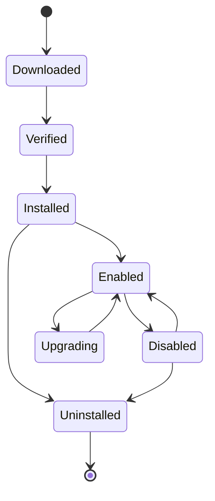

# 插件架构

> 插件是能力分发包，不是 Skill 的替代品。它可以打包 Skills、MCP 配置、Agents、Node/Connector 定义、脚本、文档；安装后仍按各自的契约与权限运行。

## 1. 包格式

```text
my-plugin/
├── hpa.plugin.json       # manifest
├── README.md
├── LICENSE
├── NOTICE
├── skills/
│   └── my-skill/
├── agents/
│   └── my-agent.yaml
├── nodes/
│   └── my-node/
├── connectors/
│   └── my-connector/
├── mcp/
│   └── servers.yaml
├── scripts/
└── docs/
```

分发为 `.hplugin`（zip/tar）或 OCI artifact；内容寻址存储。

## 2. Manifest

```json
{
  "schemaVersion": "hpa.plugin/v1",
  "id": "plugin_github_tools",
  "name": "GitHub Tools",
  "version": "1.2.0",
  "description": "GitHub connectors, nodes and skills",
  "license": "Apache-2.0",
  "publisher": { "id": "acme", "name": "Acme", "url": "https://example.com" },
  "compatibility": { "hisha": ">=1.0.0 <2.0.0", "runtimes": ["node"], "os": ["linux", "darwin", "win32"] },
  "capabilities": [
    { "type": "connector", "id": "github", "version": "1.2.0" },
    { "type": "node", "id": "github.issue.create", "version": "1.0.0" },
    { "type": "skill", "id": "skill_github_triage", "version": "1.0.0" }
  ],
  "dependencies": [
    { "type": "plugin", "id": "plugin_http_core", "range": "^1.0.0" }
  ],
  "permissions": [
    { "kind": "network", "hosts": ["api.github.com:443"] },
    { "kind": "credential", "provider": "github" }
  ],
  "integrity": { "algorithm": "sha256", "digest": "sha256:..." },
  "signature": { "algorithm": "ed25519", "keyId": "acme-2026", "value": "base64..." },
  "metadata": { "homepage": "", "repository": "", "tags": ["github"] }
}
```

## 3. 内容类型

| 内容 | 契约 |
| --- | --- |
| Skills | Agent Skills 标准 + `hpa.skill.json` |
| Agents | AgentVersion 配置 |
| Nodes | NodeDefinition + 运行时实现 |
| Connectors | Connector 接口 + auth/schema |
| MCP 配置 | Server 连接配置（凭证引用） |
| Scripts | 沙箱脚本；权限声明 |
| Docs | 使用/许可/支持 |

同一底层能力可以注册为 Node 与 Tool，但每个入口独立权限/审批（Capability Binding）。

### 概念区分

| 概念 | 是什么 | 不是什么 |
| --- | --- | --- |
| Node | Workflow 中的一个执行步骤（类型 + 版本 + config） | 不是外部系统适配器本身 |
| Connector | 外部系统适配器（认证/操作/schema） | 不是 Workflow 节点 |
| Tool | Agent 可调用的操作（可来自 Connector/Workflow/MCP/内置） | 不是 Skill |
| Skill | 标准 Agent Skills 知识包（instructions/references/scripts/assets） | 不是可执行程序/插件 |
| Trigger | 启动 Workflow 的事件源（定时/Webhook/事件/MCP） | 不是 Workflow 内部节点 |
| Worker | 实际执行任务的进程/环境（Local/Private/Cloud/Hybrid） | 不是节点 |
| MCP Server | 按 MCP 协议暴露 Tools/Resources/Prompts 的服务 | 不是内部 REST API |
| Plugin | 能力分发包（可含上述内容 + 文档/签名/依赖） | 不是 Skill 格式/运行时 |

## 4. 安装/升级/卸载

### 安装

1. 读取 manifest；schema/兼容性/许可。
2. 校验签名/完整性；信任等级。
3. 解析依赖（插件/版本/Hisha 版本）。
4. 权限确认（管理员/用户）。
5. 扫描内容（Skill/脚本/依赖/危险模式）。
6. 写入内容寻址存储；注册能力（草稿/启用）。
7. 审计。

### 升级

- semver；major 需确认；依赖/权限差异展示。
- 迁移节点/Agent/Skill 版本；保留旧版本执行。
- 回滚到旧版本；数据迁移不可逆时提示。

### 卸载

- 依赖影响分析；阻止破坏性卸载或要求迁移。
- 删除注册/文件；保留审计；不删除用户数据/执行历史（按策略）。

## 5. 隔离

- 插件代码不在 API 进程加载；Node/Connector/Tool 在 Worker/Local Runtime 执行。
- 每个插件声明权限；运行时强制。
- 高风险插件在独立 Worker/容器；网络/文件策略。
- 插件不能直接访问其他租户/工作区数据。

## 6. 签名与信任

- 发布者密钥；Ed25519/Sigstore；密钥轮换/吊销。
- 安装校验；信任等级：official/verified/community/untrusted。
- 未知来源默认不可信；需管理员批准/容器。
- 撤回：下架/黑名单/通知。

## 7. 依赖/版本

- 插件依赖插件/能力/运行时；版本范围；冲突解析。
- 与 Hisha 版本兼容；不兼容拒绝安装。
- 能力版本与插件版本分离；升级插件不一定升级能力。
- 锁文件/SBOM。

## 8. 生命周期



## 9. 安全

- manifest/schema/签名/依赖/许可/权限全校验。
- 内容扫描；脚本沙箱；网络/文件白名单。
- 不在 Control Plane 执行插件代码。
- 供应链：SBOM/漏洞/撤回。
- 审计：安装/启用/升级/权限/执行。

## 10. 与 Skill/MCP 的关系

- 插件可包含 Skill/MCP 配置；安装后 Skill 仍按标准加载，MCP 仍按协议连接。
- 插件不是 Skill 格式；不能把私有格式伪装成 Skill。
- 插件可提供 MCP Server，但认证/租户/审计由 Hisha 管理。

## 11. 非目标

- 不把插件当任意代码执行入口（必须声明能力/权限）。
- 不允许插件修改平台核心/绕过审批。
- 不自动安装未签名/未知插件。
- 不把插件市场当无审核的 npm。

## 12. 相关文档

- [Plugin SDK](plugin-sdk.md)
- [Marketplace](marketplace.md)
- [Skill 规范](../05-skill/skill-specification.md)
- [MCP 架构](../06-mcp/mcp-architecture.md)
- [统一契约](../02-architecture/contracts.md)
