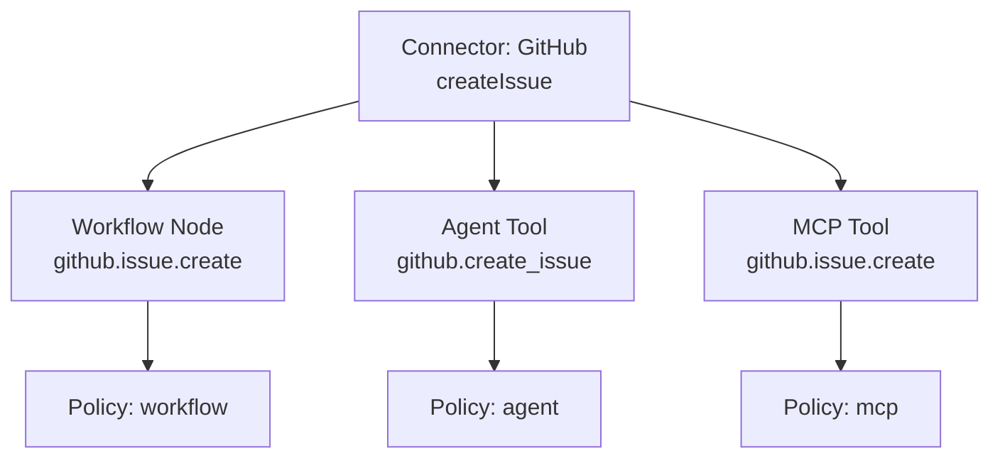
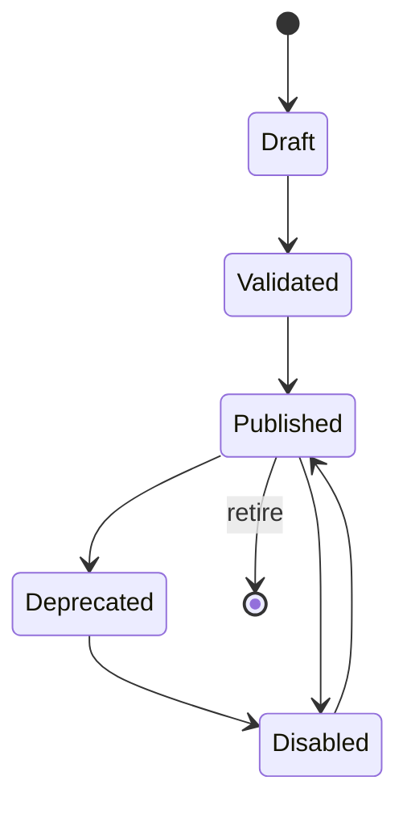

# 统一能力注册中心

> 目标：同一底层能力只定义一次，通过 Binding 暴露为 Workflow Node、Agent Tool、MCP Tool、Skill、Plugin；每个入口独立权限/审批。避免 Workflow/Agent/Skill/MCP 各自重复定义。

## 1. 类型

| 类型 | 说明 | 入口 |
| --- | --- | --- |
| `workflow` | 已发布 WorkflowVersion | API/Node/Tool/MCP |
| `agent` | AgentVersion | API/Node/Tool/MCP |
| `skill` | SkillVersion（标准） | Agent/Workflow/MCP |
| `tool` | 原子操作 | Agent/MCP/Workflow |
| `connector` | 外部系统适配器 | Node/Tool/MCP |
| `node` | Workflow 节点定义 | Workflow |
| `trigger` | 事件入口 | Workflow |
| `mcp_server` | 外部 MCP Server | Agent/Workflow |
| `plugin` | 分发包 | 安装/贡献能力 |

## 2. 描述

```ts
interface Capability {
  id: string;
  tenantId: string;
  type: CapabilityType;
  name: string;
  version: string;
  description: string;
  inputSchema: JsonSchema;
  outputSchema: JsonSchema;
  dependencies: CapabilityDependency[];
  permissions: PermissionRequest[];
  runtime: { kind: "local" | "worker" | "remote"; requirements?: string[] };
  owner: string;
  visibility: "private" | "workspace" | "tenant" | "public";
  status: "draft" | "published" | "deprecated" | "disabled";
  riskLevel: "low" | "medium" | "high" | "critical";
  documentation: string;
  bindings: CapabilityBinding[];
  source: { kind: "builtin" | "plugin" | "user" | "import"; ref?: string };
}

interface CapabilityBinding {
  id: string;
  capabilityId: string;
  entryType: "workflow_node" | "agent_tool" | "mcp_tool" | "skill" | "api";
  config: Record<string, unknown>;
  policy: PolicyRef;
  enabled: boolean;
}
```

## 3. 单一实现，多入口



- 实现只有一个（Connector Operation）；Node/Tool/MCP 是 Binding。
- 每个 Binding 有自己的 config（默认值/限制）与 policy（权限/审批/预算）。
- 发布/版本：能力版本 + Binding 配置版本；入口可独立启用/禁用。
- 删除能力前检查 Binding/依赖。

## 4. 生命周期



- Draft：可编辑；不执行。
- Validated：schema/静态/权限/依赖通过。
- Published：不可变；可绑定/执行。
- Deprecated：不推荐；仍可执行；迁移提示。
- Disabled：新执行拒绝；旧执行继续。
- Retire：需无活动依赖/迁移。

## 5. 依赖/版本

- `dependencies`: capability/connector/plugin/model/mcp；版本范围。
- 发布时解析锁定；运行时按锁定版本。
- 冲突/缺失 → 发布拒绝。
- 升级：兼容检查；破坏性变更需新 major；迁移/通知。
- 能力关系图：依赖/被依赖/绑定/入口；影响分析。

## 6. 发现

- 搜索：名称/描述/类型/标签/输入输出字段。
- 过滤：类型/可见性/状态/风险/版本/所有者。
- 详情：schema/示例/权限/依赖/绑定/文档/版本历史。
- 推荐：最近使用/收藏/项目相关。
- 外部：MCP Registry 导入 → 生成 `mcp_server`/`tool` 能力（只读/受限）。

## 7. 重复预防

- 唯一键：`(tenant, type, name, version)`；同一实现多入口用 Binding。
- 导入冲突：同 ID 不同内容 → 拒绝/要求新版本；同内容 → 去重。
- 插件贡献能力：插件 ID + 能力 ID；卸载检查依赖。
- 节点/工具同名不同语义 → 编译/注册拒绝。

## 8. 权限

- 能力级：谁能查看/发布/绑定/执行。
- Binding 级：入口独立权限/审批/预算/限流。
- 风险：能力/入口可覆盖（只能提高风险，不能降低）。
- 公开能力：只读；执行仍需租户授权。
- 审计：注册/发布/绑定/执行/禁用。

## 9. 运行时

- `runtime.kind`: local/worker/remote。
- 依赖：Python/Node/容器/模型/网络。
- 执行器：Node Executor/Agent Tool/MCP Gateway 按 Binding 调用。
- 版本固定；运行中执行不因升级改变。

## 10. UI

- 列表/卡片/关系图/详情。
- 关系图：能力→依赖→Binding→入口；影响分析。
- 绑定编辑器：入口类型/权限/审批/预算/默认值。
- 版本/废弃/迁移提示。
- 与 Workflow Designer/Agent Designer/MCP Center 联动。

## 11. API

| 方法 | 路径 | 说明 |
| --- | --- | --- |
| GET/POST | `/capabilities` | 列表/注册 |
| GET/PATCH | `/capabilities/{id}` | 详情/更新（draft） |
| POST | `/capabilities/{id}/publish` | 发布 |
| POST | `/capabilities/{id}/bindings` | 创建入口 |
| PATCH | `/capabilities/{id}/bindings/{bid}` | 配置/策略 |
| GET | `/capabilities/{id}/graph` | 关系图 |
| GET | `/capabilities/{id}/dependents` | 影响分析 |

## 12. 示例：HTTP Connector

```json
{
  "capability": {
    "id": "cap_http_orders",
    "type": "connector",
    "name": "orders-api",
    "version": "1.0.0",
    "inputSchema": { "type": "object" },
    "outputSchema": { "type": "object" },
    "permissions": [{ "kind": "network", "hosts": ["api.example.com:443"] }],
    "riskLevel": "medium"
  },
  "bindings": [
    { "entryType": "workflow_node", "config": { "operation": "listOrders" }, "policy": "pol_node" },
    { "entryType": "agent_tool", "config": { "operation": "listOrders" }, "policy": "pol_agent_read" },
    { "entryType": "mcp_tool", "config": { "name": "orders.list" }, "policy": "pol_mcp_read" }
  ]
}
```

## 13. 测试

- 唯一性/去重/多入口。
- 版本/依赖/冲突/升级。
- 权限/审批/Binding 独立。
- 关系图/影响分析。
- 插件贡献/卸载。
- 公开/共享/克隆。
- 运行时版本固定。

## 14. 相关文档

- [权限模型](permission-model.md)
- [数据模型](data-model.md)
- [插件架构](../07-plugin/plugin-architecture.md)
- [MCP 架构](../06-mcp/mcp-architecture.md)
- [Workflow 节点](../03-workflow/node-specification.md)
