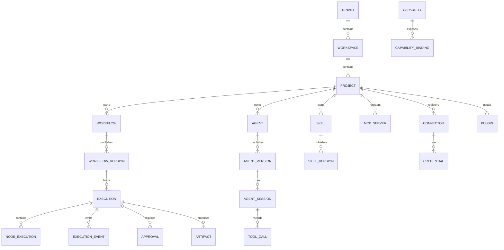

# 数据模型

> 原则：PostgreSQL 为主；JSONB 承载 IR/配置；查询字段规范化；执行事件追加式；不做过度建模。Phase 1 只实现子集，后续按需扩展。

## 1. 通用约定

- ID：UUIDv7（时间有序）；外部可读 ID 加前缀（`wf_`、`exec_`、`skill_`）。
- 时间：`timestamptz`，UTC 存储；展示按租户时区。
- 租户：所有租户数据带 `tenant_id`；Postgres RLS 兜底。
- 范围：`workspace_id`/`project_id` 按资源；跨范围引用需显式共享。
- 版本：已发布资源不可变；草稿可变；执行绑定版本。
- 删除：用户资源软删除（`deleted_at`）；执行事件/审计不可删除（按保留策略归档）。
- 加密：凭证/secret 密文 + KMS/主密钥；不存明文。
- 大对象：对象存储 + `artifact` 元数据；事件只存引用。
- 枚举：数据库枚举或 check；对外用稳定字符串。

## 2. 实体清单

| 实体 | 作用 | 关键字段 | Phase |
| --- | --- | --- | --- |
| Tenant | 隔离边界 | id, name, slug, status, plan | P1 |
| Workspace | 团队/环境 | id, tenant_id, name, slug | P1 |
| Project | 资源分组 | id, workspace_id, name | P1 |
| User | 用户 | id, email, name, status | P1 |
| Membership | 用户-范围-角色 | user_id, scope_type/id, role_id | P1 |
| Role | 角色 | id, tenant_id, name, permissions | P1 |
| Permission | 权限点 | id, action, resource_type | P1 |

企业成员目录的 Phase 13 实际表：

| 表 | 关键字段 | 约束 |
| --- | --- | --- |
| `enterprise_members` | id, tenant_id, subject, user_name, external_id, role, base_role, scim_json, status | `(tenant_id, subject)` 唯一；同租户 userName/externalId 唯一 |
| `enterprise_scim_groups` | id, tenant_id, display_name, external_id, role, scim_json | 同租户 displayName 唯一；role 只允许固定 8 角色或空 |
| `enterprise_scim_group_members` | tenant_id, group_id, member_id | 复合主键；组和成员必须属于同一租户 |

`base_role` 是直接角色，`role` 是当前有效角色。组角色冲突时事务失败，不自动选择最高权限。详见 [SCIM](scim.md)。
| Policy | 策略 | id, scope, effect, conditions, version | P1（基础） |
| Workflow | 流程 | id, project_id, name, status, current_version_id | P1 |
| WorkflowVersion | 不可变版本 | id, workflow_id, version, ir JSONB, hash, created_by | P1 |
| WorkflowNode | 节点索引（可选） | id, version_id, node_id, type, type_version | P1（查询/分析） |
| WorkflowEdge | 边索引（可选） | id, version_id, source, target, ports | P1（查询/分析） |
| NodeType | 节点定义/版本 | id, type, version, schema, runtime, status | P1 |
| Execution | 运行 | id, workflow_version_id, status, inputs, outputs, worker_id, started/finished, duration_ms（派生）, error | P1 |
| NodeExecution | 节点运行 | id, execution_id, node_id, attempt, status, input/output refs, error | P1 |
| ExecutionEvent | 追加事件 | id, execution_id, sequence, type, node_id, data JSONB, at | P1 |
| ExecutionCheckpoint | 检查点 | id, execution_id, sequence, state JSONB, size | P1 |
| Approval | 审批 | id, execution_id/node_id/tool_call_id, status, assignees, form, decision | P1 |
| Artifact | 产物 | id, execution_id, uri, mime, size, sha256, retention | P1 |
| Trigger | 触发器 | id, workflow_id, type, config, enabled | P1 |
| Schedule | 定时 | id, trigger_id, cron, timezone, catch_up, next_run | P1 |
| Credential | 凭证引用 | id, tenant_id, provider, ciphertext, key_id, status | P1 |
| Connector | 连接器定义 | id, type, version, schema, status | P1（内置） |
| Connection | 连接实例 | id, connector_id, credential_id, config | P1 |
| Capability | 统一能力 | id, type, version, schemas, permissions, status | P1（基础） |
| CapabilityBinding | 入口绑定 | id, capability_id, entry_type, config, policy | P1 |
| Worker | Worker 注册 | id, tenant_id, status, capabilities, last_heartbeat | P1（本地无） |
| AuditLog | 审计 | id, tenant_id, actor, action, resource, data, at | P1 |
| Agent | Agent 定义 | id, project_id, name, status, current_version_id | P2 |
| AgentVersion | 不可变版本 | id, agent_id, version, config JSONB | P2 |
| AgentSession | 会话/执行 | id, agent_version_id, status, state JSONB, parent_session_id | P2 |
| AgentPlan | 计划 | id, session_id, step, plan JSONB | P2 |
| ToolCall | 工具调用 | id, session_id/execution_id, tool, args, result, status | P2 |
| Skill | Skill | id, project_id, name, status, current_version_id | P2 |
| SkillVersion | 版本 | id, skill_id, version, manifest, content_hash | P2 |
| SkillExecution | 执行 | id, skill_version_id, status, inputs, outputs, artifacts | P2 |
| MCPServer | MCP Server | id, project_id, name, transport, config, auth | P2 |
| MCPTool | 工具 | id, server_id, name, schema, risk, enabled | P2 |
| MCPResource | 资源 | id, server_id, uri, mime, permissions | P2 |
| MCPPrompt | Prompt | id, server_id, name, arguments, template | P2 |
| Plugin | 插件 | id, name, status | P3 |
| PluginVersion | 版本 | id, plugin_id, version, manifest, signature, hash | P3 |
| PluginInstall | 安装 | id, plugin_version_id, scope, status, installed_by | P3 |
| ModelProvider | Provider | id, tenant_id, kind, config | P2 |
| ModelConfiguration | 模型 | id, provider_id, model, limits, price | P2 |
| UsageRecord | 用量 | id, tenant_id, kind, quantity, cost, at | P4 |
| Quota | 配额 | id, scope, kind, limit, used | P4 |

## 3. 关系



## 4. 关键设计

### Schema 所有权

Phase 13 已落地的 PostgreSQL 18 基线以两个业务 schema 为边界，migration 和 schema owner 统一为 `hpa_migrator`：

| Schema | 内容 | 当前访问 |
| --- | --- | --- |
| `hpa_control` | Tenant、令牌、OIDC/OAuth、成员、Worker、任务、配额、审计 | 租户/Worker/管理/审计角色按 RLS 或显式授权访问 |
| `hpa_tenant` | Workflow、Execution、Event、Artifact、Skill、Agent、MCP、Plugin、Connector、Trigger | `tenant_id` + FORCE RLS |
| `hpa_internal` | 租户上下文函数 | 只授予函数执行权限 |
| Local SQLite | 当前运行中的单租户/单控制面实现 | `hpa-local` |

- 租户表通过 `tenant_id` 复合键和外键保持边界；RLS policy 同时检查读与写。
- PostgreSQL migration 由 Rust/SQLx 执行并校验 checksum；`HPA_POSTGRES_RUNTIME=1` 时 Workflow/Execution/Trigger 及 remote marker 走 PostgreSQL，Enterprise、Worker Job 和多数 Agent/Skill 元数据仍是 SQLite。不能把部分 Repository 切换当成完整生产路由完成。
- 未来若拆分 Control/Execution/AI schema，必须新增 migration 与读写所有权 ADR；不得在未迁移数据的情况下引入第二套语义。
- 运维约束、角色和回滚策略见 [PostgreSQL 控制面基线](postgres-control-plane.md)。

### WorkflowVersion

```sql
CREATE TABLE workflow_versions (
  id uuid PRIMARY KEY,
  workflow_id uuid NOT NULL REFERENCES workflows(id),
  version text NOT NULL,
  ir jsonb NOT NULL,
  ir_hash text NOT NULL,
  schema_version text NOT NULL,
  policy_snapshot jsonb NOT NULL,
  created_by uuid NOT NULL,
  created_at timestamptz NOT NULL DEFAULT now(),
  UNIQUE (workflow_id, version)
);
```

- 不可变：无 UPDATE；只 INSERT/SELECT（软删除标记仅限管理）。
- `ir_hash` 语义哈希；用于去重/审计。
- 节点/边索引可从 IR 派生；为大图查询可写 `workflow_nodes`/`workflow_edges`（P1 可选）。

### Execution / NodeExecution / Event

```sql
CREATE TABLE executions (
  id uuid PRIMARY KEY,
  tenant_id uuid NOT NULL,
  workflow_version_id uuid NOT NULL,
  status text NOT NULL,
  inputs jsonb,
  outputs jsonb,
  input_hash text,
  idempotency_key text,
  worker_id uuid,
  started_at timestamptz,
  finished_at timestamptz,
  error jsonb,
  trace_id text
);
CREATE UNIQUE INDEX ux_exec_idem
  ON executions (tenant_id, workflow_version_id, idempotency_key)
  WHERE idempotency_key IS NOT NULL;

CREATE TABLE execution_idempotency (
  tenant_id text NOT NULL,
  idempotency_key text NOT NULL,
  request_hash text NOT NULL,
  execution_id uuid NOT NULL,
  created_at timestamptz NOT NULL,
  PRIMARY KEY (tenant_id, idempotency_key),
  UNIQUE (tenant_id, execution_id)
);

CREATE TABLE execution_cancel_requests (
  tenant_id text NOT NULL,
  execution_id uuid NOT NULL,
  requested_at timestamptz NOT NULL,
  PRIMARY KEY (tenant_id, execution_id)
);

CREATE TABLE execution_events (
  id uuid PRIMARY KEY,
  execution_id uuid NOT NULL REFERENCES executions(id),
  sequence bigint NOT NULL,
  type text NOT NULL,
  node_id text,
  attempt int,
  data jsonb NOT NULL,
  at timestamptz NOT NULL DEFAULT now(),
  UNIQUE (execution_id, sequence)
);
```

- 事件只 INSERT；大对象引用 Artifact。
- `sequence` 每执行单调；消费者幂等。
- 当前本地实现把启动/重试幂等映射存入 `execution_idempotency`，与 execution+start event 同事务；运行中取消先写 `execution_cancel_requests`，由 execution owner 在步骤边界协作停止。
- `NodeExecution` 每次 attempt 一行；不覆盖历史。
- 索引：`(tenant_id, status, started_at desc)`、`(execution_id, sequence)`。

### AgentSession / ToolCall

- AgentSession 绑定 AgentVersion；`state` 为 checkpoint 摘要/引用；大状态放对象存储。
- ToolCall 关联 Session 或 Execution；记录 tool/args 摘要/result 摘要/status/风险/审批。
- AgentPlan 可选（计划步骤/版本）；不要求 chain-of-thought。

### Capability / Binding

```sql
CREATE TABLE capabilities (
  id uuid PRIMARY KEY,
  tenant_id uuid NOT NULL,
  type text NOT NULL,
  version text NOT NULL,
  name text NOT NULL,
  input_schema jsonb NOT NULL,
  output_schema jsonb NOT NULL,
  permissions jsonb NOT NULL,
  runtime jsonb NOT NULL,
  status text NOT NULL,
  visibility text NOT NULL,
  UNIQUE (tenant_id, type, name, version)
);
CREATE TABLE capability_bindings (
  id uuid PRIMARY KEY,
  capability_id uuid NOT NULL REFERENCES capabilities(id),
  entry_type text NOT NULL,
  config jsonb NOT NULL,
  policy jsonb NOT NULL,
  enabled boolean NOT NULL DEFAULT true,
  UNIQUE (capability_id, entry_type)
);
```

- 一个能力多入口；每个 Binding 独立权限/策略。
- 关系表：`capability_dependencies(capability_id, depends_on_id, range)`。

### Credential

- `ciphertext`（AES-GCM）、`key_id`、`nonce`、`aad`（tenant/resource）；不存明文。
- 元数据：provider、scopes、expires_at、last_used_at、status。
- 访问审计；轮换。

### AuditLog

```sql
CREATE TABLE audit_logs (
  id uuid PRIMARY KEY,
  tenant_id uuid NOT NULL,
  actor_type text NOT NULL,
  actor_id text NOT NULL,
  action text NOT NULL,
  resource_type text NOT NULL,
  resource_id text,
  data jsonb NOT NULL,
  ip inet,
  user_agent text,
  request_id text,
  at timestamptz NOT NULL DEFAULT now()
);
```

- 只 INSERT；分区/归档；外部 SIEM 可选。
- 不含 secret；before/after 摘要。

## 5. 多租户与 RLS

```sql
ALTER TABLE executions ENABLE ROW LEVEL SECURITY;
CREATE POLICY tenant_isolation ON executions
  USING (tenant_id = current_setting('hisha.tenant_id')::uuid);
```

- 应用层强制 tenant_id；RLS 兜底；Worker/系统角色绕过需显式。
- 跨租户查询仅平台管理员/审计（独立角色）。
- 唯一索引包含 tenant_id；避免跨租户冲突。

## 6. 索引/性能

- 执行列表：`(tenant_id, status, started_at desc)`；按 workflow/project 过滤。
- 事件：`(execution_id, sequence)`；按 type/time 可选。
- 审批：`(tenant_id, status, created_at)`；assignee 索引。
- 能力：`(tenant_id, type, status)`；GIN 索引 schema/标签（按需）。
- 审计：按月分区；`(tenant_id, at desc)`。
- JSONB 只索引常用查询字段；避免过度 GIN。

## 7. 保留/删除

- 执行/事件：默认 30 天（可配）；归档到对象存储。
- 审计：按合规（默认 1 年+）。
- Artifact：按执行/策略；大对象生命周期。
- 软删除资源：保留引用；硬删除需依赖检查/审计。
- 租户删除：导出/延迟删除/法务保留。

## 8. 迁移

- Prisma Migrate；expand/contract；向后兼容。
- IR/schema 迁移独立于 DB 迁移。
- 回滚脚本/备份；不丢事件。
- 版本化 seed/字典（NodeType/Capability）。

## 9. 不做

- 不引入图数据库（Capability 关系用边表/递归 CTE）。
- 不为“完整”而建所有实体；Phase 1 只建 P1。
- 不把 IR 拆成大量关系表（JSONB + 索引）。
- 不用事件日志替代审计。

## 10. 相关文档

- [API 规范](api-specification.md)
- [权限模型](permission-model.md)
- [能力注册中心](capability-registry.md)
- [系统架构](../02-architecture/system-architecture.md)
- [图集](../02-architecture/diagrams.md)
