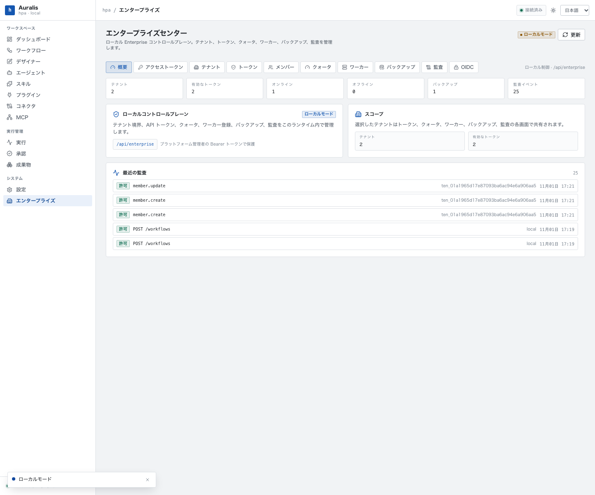
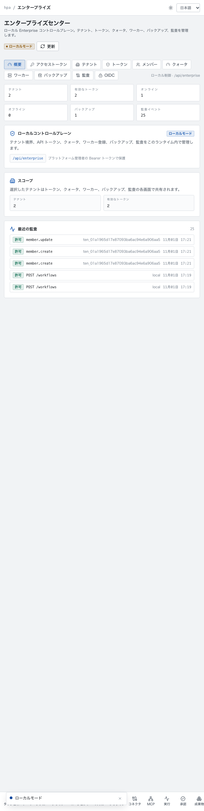
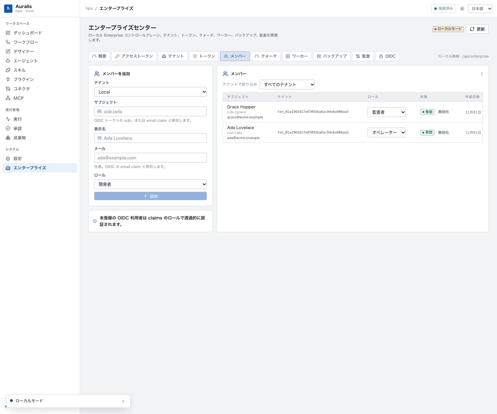

# 本地企业控制平面运维手册

> 适用于单机部署的 Phase 6 本地企业控制面。所有命令均以数据目录 `HPA_DATA` 和本地地址 `http://127.0.0.1:8787` 为例；生产环境请通过 SSH 隧道或反向代理访问，并先阅读[实现与安全模型](local-enterprise.md)。

## 1. 拓扑与前提

```text
浏览器/curl/Enterprise Center -> 127.0.0.1:8787（明文 HTTP） -> hpa serve（单进程）
  ├── control.db（控制面）  ├── hpa.db（local）  ├── tenants/{id}/hpa.db  └── backups/{id}/
```

- 运行时只监听 `127.0.0.1`，不提供 TLS；远程使用必须经反向代理或 SSH 隧道。
- SQLite 单节点部署：不要用两个 `hpa serve` 进程共享同一数据目录，也不要放在 NFS 等共享文件系统上。
- 默认数据目录为 `$HPA_DATA_DIR`（非空时）或 `~/.hpa`；`--data-dir` 优先。二进制为 `hpa`（包 `hpa-local`）。

## 2. 路径与保留边界

| 路径 | 说明 | 备份方式 |
| --- | --- | --- |
| `<data_dir>/control.db` | 租户、令牌哈希、配额、审计、Worker、备份记录、OIDC | 本功能不备份；停机复制或 `sqlite3 .backup` |
| `<data_dir>/hpa.db` | `local` 租户业务库 | 通过控制面创建备份 |
| `<data_dir>/tenants/{tenantId}/hpa.db` | 其他租户业务库 | 通过控制面创建备份 |
| `<data_dir>/backups/{tenantId}/` | `VACUUM INTO` 生成的完整副本 | 由保留策略/手工删除 |

备份是整库副本，不是增量；不包含 `control.db`。备份文件含业务数据，默认没有应用层加密。

## 3. 启动与模式切换

```bash
export HPA_DATA=/srv/hpa
mkdir -p "$HPA_DATA"
chmod 700 "$HPA_DATA"

# 本地模式（默认，无认证）
hpa --data-dir "$HPA_DATA" serve --port 8787

# 企业模式（除 /api/health 外均需 Bearer）
HPA_ENTERPRISE_MODE=1 hpa --data-dir "$HPA_DATA" serve --port 8787
```

`HPA_ENTERPRISE_MODE` 只识别 `1`、`true`、`required`，大小写敏感；其他值（包括 `TRUE`、`yes`）都会落到本地模式。

```bash
curl -sS http://127.0.0.1:8787/api/health
```

健康检查始终公开，返回中的 `"enterprise"` 为是否强制认证；它不证明令牌有效。企业模式下未带令牌访问 `/api/workflows` 应得到 401 `UNAUTHORIZED`。

## 4. 首次初始化

先初始化引导管理员令牌，再以企业模式启动（也可以先启动再初始化，数据目录必须一致）：

```bash
hpa --data-dir "$HPA_DATA" enterprise init --name local-admin
```

输出 JSON 中的 `token` 形如 `hpa_ent_...`，**只显示一次**，立即存入密码管理器。若已存在未吊销的平台管理员令牌，命令返回 409 `ADMIN_TOKEN_EXISTS`；改用：

```bash
hpa --data-dir "$HPA_DATA" enterprise token \
  --tenant local --name local-admin-2 --role owner --platform-admin
```

`enterprise init/token` 会创建/打开控制库，但不会启动 HTTP 服务。引导令牌属于内置 `local` 租户，`platform_admin=true`。

## 5. 令牌运维

### 5.1 创建

```bash
curl -sS -X POST http://127.0.0.1:8787/api/enterprise/tokens \
  -H "Authorization: Bearer $HPA_TOKEN" \
  -H 'content-type: application/json' \
  -d '{"tenantId":"local","name":"ci","role":"viewer","expiresInDays":30}'
```

- `role`：`owner|admin|developer|publisher|operator|approver|auditor|viewer`。
- `platformAdmin` 可省略；为 `true` 时可管理控制面并绕过租户 RBAC。
- `expiresInDays` 省略即永不过期；提供时夹到 1–3650 天。
- 响应中的 secret 只出现这一次；列表不返回 secret/哈希。

### 5.2 查看与吊销

```bash
# tenantId 为 camelCase；省略则返回全部
curl -sS "http://127.0.0.1:8787/api/enterprise/tokens?tenantId=local" \
  -H "Authorization: Bearer $HPA_TOKEN"

curl -sS -X DELETE "http://127.0.0.1:8787/api/enterprise/tokens/{tokenId}" \
  -H "Authorization: Bearer $HPA_TOKEN"
```

吊销立即生效，返回 `{"revoked":true|false}`；记录保留用于审计。没有 CLI 吊销命令。平台管理员令牌可查看/吊销所有租户令牌；普通租户 `owner` 访问这些接口返回 403 `PLATFORM_ADMIN_REQUIRED`。

### 5.3 轮换建议

为每个集成单独签发、设置过期时间、最小角色；离职/泄露立即吊销；不要把平台管理员令牌发给常规客户端。浏览器中的令牌可被同源 XSS 读取，Enterprise Center 只适合受控终端。

## 6. 租户运维

```bash
# 创建（ID 由服务端生成，形如 ten_<uuid>）
curl -sS -X POST http://127.0.0.1:8787/api/enterprise/tenants \
  -H "Authorization: Bearer $HPA_TOKEN" \
  -H 'content-type: application/json' \
  -d '{"name":"Acme"}'

# 查看详情（含配额、Worker、备份）
curl -sS http://127.0.0.1:8787/api/enterprise/tenants/{tenantId} \
  -H "Authorization: Bearer $HPA_TOKEN"

# 删除
curl -sS -X DELETE http://127.0.0.1:8787/api/enterprise/tenants/{tenantId} \
  -H "Authorization: Bearer $HPA_TOKEN" \
  -H 'content-type: application/json' \
  -d '{"confirm":true}'
```

删除的精确行为：

- 租户记录改为 `status=deleted`，列表不再显示。
- 该租户所有令牌写入 `revoked_at`；之后一律 401。
- 删除 `<data_dir>/tenants/{tenantId}/` 整个目录（文件删除失败会被忽略）、该租户的备份文件与备份记录、Worker 与配额行，并移除进程内缓存；审计记录保留。
- **不删除**配额行、审计、Worker 记录、备份记录与备份文件；`local` 租户禁止删除（409 `TENANT_PROTECTED`）。
- 删除活跃租户不会停止已启动的审批监控/运行时；可能有任务继续持有已删除数据库句柄。应先摘流量、等待任务结束，再删除，必要时重启清理。

新租户的 `hpa.db` 在首次访问时创建；未产生业务数据前创建备份会返回 404。

## 7. 配额

```bash
curl -sS -X PUT http://127.0.0.1:8787/api/enterprise/quotas/{tenantId} \
  -H "Authorization: Bearer $HPA_TOKEN" \
  -H 'content-type: application/json' \
  -d '{"maxWorkflows":100,"maxExecutionsPerDay":1000,"maxSkills":100,"maxAgents":100,"maxPlugins":50,"maxConnections":100,"maxConcurrentRuns":8}'
```

PUT 必须包含全部 7 个字段且非负；0 表示禁止。检查点与默认值见[实现与安全模型](local-enterprise.md#6-配额)。命中资源/日上限返回 429 `TENANT_QUOTA`，并发上限返回 429 `TENANT_CONCURRENCY`。配额即时生效，无需重启。当前没有用量计费、账单或配额使用率接口。

## 8. 备份、恢复与保留

### 8.1 创建与查看

```bash
curl -sS -X POST http://127.0.0.1:8787/api/enterprise/tenants/local/backups \
  -H "Authorization: Bearer $HPA_TOKEN"

# 列表使用 camelCase tenantId
curl -sS "http://127.0.0.1:8787/api/enterprise/backups?tenantId=local" \
  -H "Authorization: Bearer $HPA_TOKEN"
```

返回 `id`、`tenantId`、绝对 `path`、`size`、`sha256`、`createdAt`、`status=ready`。备份路径必须在 `<data_dir>/backups` 下；越界路径会被拒绝。

### 8.2 恢复

```bash
curl -sS -X POST http://127.0.0.1:8787/api/enterprise/backups/{backupId}/restore \
  -H "Authorization: Bearer $HPA_TOKEN"
```

恢复会校验 SHA-256，替换目标租户 `hpa.db`，删除 `-wal`/`-shm`，返回 `requiresRestart:true`。**必须重启 `hpa serve`**：进程内连接池仍指向旧文件，继续写入会产生不可预期结果。建议顺序：

1. 停止新请求（反向代理下线或停进程前摘流量）。
2. 调 restore。
3. 立即停止并重启 `hpa serve`。
4. 用原令牌验证租户 API，再恢复流量。

恢复只替换租户业务库，不恢复控制库中的租户状态或令牌。对已删除租户，restore 会重建文件，但租户仍为 `deleted`、令牌仍吊销，且没有激活 API；该备份不能直接恢复为可用租户。备份文件在恢复后仍然保留。

### 8.3 删除与保留

```bash
curl -sS -X DELETE "http://127.0.0.1:8787/api/enterprise/backups/{backupId}" \
  -H "Authorization: Bearer $HPA_TOKEN"

curl -sS -X POST http://127.0.0.1:8787/api/enterprise/backups/purge \
  -H "Authorization: Bearer $HPA_TOKEN" \
  -H 'content-type: application/json' \
  -d '{"retainDays":30,"retainCount":10}'
```

`purge` 按租户分别排序：同时超出保留天数且超出保留数量才删除；两个维度任一为 0 表示该维度不保留（两者都为 0 会清空全部）。没有自动清理任务，需要外部定时调用。删除租户不会删除其备份目录，备份会一直保留到手工删除或 purge。

## 9. 审计导出

```bash
# 审计筛选使用 camelCase tenantId
curl -sS "http://127.0.0.1:8787/api/enterprise/audit?tenantId=local&limit=100" \
  -H "Authorization: Bearer $HPA_TOKEN"

curl -sS "http://127.0.0.1:8787/api/enterprise/audit/export?format=csv&tenantId=local" \
  -H "Authorization: Bearer $HPA_TOKEN" -o audit.csv
```

`format` 省略或非 `csv` 时返回 JSON。CSV 对 `= + - @` 开头的字段前置单引号，所有字段加引号；导出后仍应按不可信文本处理。没有删除审计的 API，也没有自动归档/保留任务，`control.db` 会随审计增长。

## 10. OIDC 配置

```bash
curl -sS http://127.0.0.1:8787/api/enterprise/oidc \
  -H "Authorization: Bearer $HPA_TOKEN"

curl -sS -X PUT http://127.0.0.1:8787/api/enterprise/oidc \
  -H "Authorization: Bearer $HPA_TOKEN" \
  -H 'content-type: application/json' \
  -d '{"issuer":"https://issuer.example/","audience":"hpa-control","jwksUrl":"https://issuer.example/jwks","network":["issuer.example"]}'
```

- 支持 EdDSA、RS256、ES256 Bearer JWT 与 JWKS（OKP/RSA/P-256）；外部 IdP 必须直接签发可验证 JWT。
- 必须配置 `issuer`、`audience`、`jwksUrl`；claim 需含 `sub`、`exp`、`tenant_id`（或 `tenantId`）、`role`（或 `roles` 首个值）。
- `network` 是主机白名单：`*`、精确主机、`*.example.com`，可带 `:port`；没有 CIDR。非回环 JWKS 必须 HTTPS 且主机在名单内。
- 回环地址（`localhost`、`127.0.0.1`、`::1`）允许 HTTP，便于本地测试；生产不要依赖该例外。
- JWKS 请求禁用重定向和代理，10 秒超时，响应上限 1 MiB；解析出的私网/链路本地地址会被拒绝。该检查降低 SSRF 风险，但不是完整网络沙箱。
- JWKS 缓存 5 分钟；保存配置会清空缓存。IdP 轮换密钥时可在保存后立即生效，或等待缓存过期。
- OIDC Bearer 用户不是平台管理员；租户必须已存在且 active。Bearer 没有登出或令牌吊销列表。

### 10.2 浏览器 SSO

同一 `enterprise_oidc` 行还保存浏览器 SSO 字段：`clientId`、`authorizationEndpoint`、`tokenEndpoint`、`redirectUri`、`scopes`、`adminSubjects`、`cookieSecure`、`sessionTtlSeconds`。Authorization Code + PKCE、会话与 CSRF 的完整契约见[Browser SSO](browser-sso.md)。

```bash
curl -sS -X PUT http://127.0.0.1:8787/api/enterprise/oidc \
  -H "Authorization: Bearer $HPA_TOKEN" \
  -H 'content-type: application/json' \
  -d '{
    "issuer":"https://issuer.example/",
    "audience":"hpa-web",
    "jwksUrl":"https://issuer.example/jwks",
    "network":["issuer.example"],
    "clientId":"hpa-web",
    "authorizationEndpoint":"https://issuer.example/authorize",
    "tokenEndpoint":"https://issuer.example/token",
    "redirectUri":"https://hpa.internal/auth/oidc/callback",
    "scopes":["openid","email","profile"],
    "adminSubjects":["admin@example.com"],
    "cookieSecure":true,
    "sessionTtlSeconds":28800
  }'
```

- 浏览器 session 是额外认证路径；Bearer、Worker 与本地匿名模式语义不变。`adminSubjects` 命中 sub 或 email 时才是平台管理员，ID Token claims 不授予平台管理员。
- HTTPS 部署必须 `cookieSecure=true`；Cookie 为 HttpOnly/SameSite=Lax。Cookie 认证的写请求必须带 `X-HPA-CSRF`。
- 成员目录 disabled 会拒绝登录并在后续会话检查中拒绝；active 成员角色覆盖 claims。
- 没有 refresh token、silent renew、RP-initiated logout、SCIM/组或多 IdP；session 过期即重新登录。

### 10.1 成员目录

成员目录用于给已登记的 OIDC 主体固定角色或禁用访问：

```bash
curl -sS -X POST http://127.0.0.1:8787/api/enterprise/members \
  -H "Authorization: Bearer $HPA_TOKEN" \
  -H 'content-type: application/json' \
  -d '{"tenantId":"acme","subject":"oidc|ada","displayName":"Ada","email":"ada@example.com","role":"developer"}'

curl -sS -X PUT http://127.0.0.1:8787/api/enterprise/members/{memberId} \
  -H "Authorization: Bearer $HPA_TOKEN" \
  -H 'content-type: application/json' \
  -d '{"role":"operator","status":"disabled"}'

curl -sS "http://127.0.0.1:8787/api/enterprise/members?tenantId=acme" \
  -H "Authorization: Bearer $HPA_TOKEN"
```

- subject 在租户内唯一；email 小写存储。匹配顺序为 subject 精确匹配，再按 email 大小写不敏感匹配。
- 命中且 active 时，目录 role 覆盖 JWT 的 role；命中且 disabled 时 OIDC 请求返回 401 并写 deny 审计。
- 未登记的 OIDC 主体仍按 JWT claims 的 role 认证；成员记录不影响 `hpa_ent_` 令牌。
- 目录不等于登录系统：没有密码、组、会话、邀请或成员自服务。

## 11. Worker 与 Hybrid 执行

```bash
curl -sS -X POST http://127.0.0.1:8787/api/enterprise/workers \
  -H "Authorization: Bearer $HPA_TOKEN" \
  -H 'content-type: application/json' \
  -d '{"tenantId":"local","name":"build-01","kind":"remote","capabilities":["workflow"],"maxConcurrency":2}'

curl -sS -X POST http://127.0.0.1:8787/api/enterprise/worker-jobs \
  -H "Authorization: Bearer $HPA_TOKEN" \
  -H 'content-type: application/json' \
  -d '{"tenantId":"local","workflowId":"wf_sample_sequence","input":{"value":41}}'

curl -sS "http://127.0.0.1:8787/api/enterprise/worker-jobs?tenantId=local" \
  -H "Authorization: Bearer $HPA_TOKEN"

HPA_WORKER_TOKEN="<一次性 workerToken>" \
  hpa worker --control-url http://127.0.0.1:8787 --max-concurrency 2 --capabilities workflow
```

- 注册响应的一次性 `workerToken` 只显示一次；轮换用 `POST /api/enterprise/workers/{id}/token`，禁用会吊销 token。
- Worker 主动出站 heartbeat/lease；30s 租约、10s 心跳建议；过期 Job 自动重排。审批等待释放槽，审批后重新入队。
- Worker 只执行 Workflow 快照，不访问租户 SQLite、不接收凭证；远程执行通过 `remote_executions` 标记防止本地 Runtime 接管。
- 取消对 queued/leased/waiting 立即生效，running 为 step 间协作取消；远程审批 SLA 不自动超时。
- 完整协议见 [`hybrid-workers.md`](hybrid-workers.md)，systemd/TLS/排空/故障排查见 [`hybrid-worker-deployment.md`](hybrid-worker-deployment.md)。

## 12. 变更、重启与容量

- 配额、令牌、租户、OIDC 配置即时生效；`serve` 重启后从 `control.db` 重新加载。
- 恢复备份后必须重启；升级二进制、修改监听端口、修复数据库文件后也应重启。
- 每租户连接池 8、控制库 4；租户缓存没有淘汰，长期运行大量租户会增加内存与文件句柄。
- 单节点 SQLite 没有在线迁移、只读副本、故障切换或跨机共享；扩容只能纵向或拆分部署。
- 停机备份控制库：

```bash
systemctl stop hpa   # 或等价方式停止 hpa serve
sqlite3 "$HPA_DATA/control.db" ".backup '/safe/control-$(date +%F).db'"
systemctl start hpa
```

## 13. 安全基线

- 企业模式 + 仅回环监听；远程经 TLS 反向代理，并限制 `/api/enterprise/*` 来源。
- 数据目录 `0700`，备份目录单独加密/限权；备份与控制库都含敏感数据。
- 平台管理员令牌不入代码库/CI 日志；按集成签发最小角色令牌并设置过期；Enterprise Center 的 localStorage 令牌避免在共享浏览器使用。
- OIDC 使用 HTTPS、精确 issuer/audience、最小主机白名单、短 `exp`；只把 OIDC 配置权限给平台管理员。浏览器 SSO 在 HTTPS 下必须 `cookieSecure=true`，`adminSubjects` 只加入确需控制面权限的主体。
- 不在 Worker `metadata`、备份路径或租户名称中放 secret；删除租户/恢复前先摘流量，恢复后重启，不要并发运行两个服务进程。

## 14. 明确不支持

- 多节点、HA、自动故障切换、SQLite 多写者/共享存储；远程凭证下发/对象存储、Agent/Plugin 远程派发、持久 outbox、mTLS、Redis；远程审批 SLA 自动超时。
- 浏览器 SSO：Authorization Code + PKCE、服务端 session、CSRF、成员目录与管理员 allowlist；仍不支持 refresh token、silent renew、RP-initiated logout、SCIM/组、第三方 Cookie 或多 IdP。
- 组、成员自服务、密码/邀请；RLS、细粒度/自定义 RBAC、ABAC 策略引擎。
- 审计 WORM/防篡改、自动保留、外部 SIEM 投递；计量、账单、付费计划、租户自助注册。
- 控制库在线备份、租户暂停/恢复 API、备份加密。
- MCP 租户路由：`/mcp` 仍绑定 `local` 租户运行时。
- 通过 CLI 操作租户库：`agent/skill/mcp/plugin/connector/run/doctor` 仍直接使用 `<data_dir>/hpa.db`。

## 15. 故障排查

| 现象 | 检查 |
| --- | --- |
| 401 `UNAUTHORIZED` | 是否企业模式；是否带 `Bearer`；令牌是否 `hpa_ent_` 前缀、已吊销/过期 |
| 403 `PLATFORM_ADMIN_REQUIRED` | 控制面只接受 `platformAdmin=true` 的令牌或 session；OIDC Bearer 用户永远不是管理员，浏览器 session 仅 `adminSubjects` 命中者为管理员 |
| 403 `CSRF_REQUIRED` | Cookie 认证的写请求缺少或错配 `X-HPA-CSRF`；Bearer 请求不需要该头 |
| 403 `RBAC_DENIED` | 角色与动作映射；`viewer/auditor` 只读，`operator` 不能写，`approver` 不能执行 |
| 404 `NOT_FOUND` | 租户/备份/Worker 不存在；跨租户资源 ID 只会返回 404 |
| 409 `ADMIN_TOKEN_EXISTS` | 已有未吊销管理员令牌；用 `enterprise token --platform-admin` |
| 409 `TENANT_PROTECTED` | 不能删除 `local` |
| 422 `OPS_INVALID` | Worker 名称/类型/metadata、备份 ID、OIDC 配置无效 |
| 403 `OPS_FORBIDDEN` | 备份路径越界、JWKS URL 含 userinfo、非 HTTPS/不在白名单/解析到私网 |
| 502 `OPS_UPSTREAM` | JWKS 拉取失败、响应过大、密钥/地址解析失败 |
| 429 `TENANT_QUOTA` / `TENANT_CONCURRENCY` | 调整配额或等待运行结束；并发统计含 `waiting_approval` |
| `/api/health` 的 `enterprise` 为 false | 环境变量未精确设为 `1`/`true`/`required` |

## 16. 验收与测试

```bash
cargo test -p hpa-local --test enterprise && cargo test -p hpa-local --test enterprise_ops && cargo test -p hpa-local --test browser_sso
```

两套企业测试分别覆盖 HTTP 认证/隔离/RBAC/令牌/成员目录/配额/审计/租户生命周期，以及备份恢复/清理、Worker 心跳、OIDC 本地 JWKS 校验；Phase 8 另有 Worker 队列/daemon 单元测试和真实 daemon 集成测试，覆盖租约过期、审批恢复、取消、remote execution 隔离。Phase 9 的 `browser_sso` 覆盖 Cookie 属性、CSRF 403、state 重放、redirect 逃逸、disabled 成员、nonce 失配与登出后 401；`scripts/phase9-sso-e2e.mjs` 用 Playwright 在 EdDSA/RS256/ES256 三种算法下完成浏览器登录/退出。用例名见[实现与安全模型](local-enterprise.md#12-测试覆盖)。本文不声明通过数量，以实际运行结果为准。

Enterprise Center 的 1440/607 证据：





成员目录页：



## 17. 已知差异

- `permission-model.md`/`data-model.md` 描述 PostgreSQL、RLS、自定义角色和细粒度权限；`implementation-roadmap.md` 的 Phase 6 还含 SSO、Cloud/Hybrid Worker、计费。本实现是 SQLite + 文件级隔离 + 固定角色粗动作映射，只覆盖其中子集。
- Enterprise Center 与直接 API 均使用 camelCase `tenantId` 过滤审计；`limit` 最大 5000。
- 租户删除会吊销令牌，并清理成员、配额、Worker、备份记录与备份文件、租户目录和路由缓存；审计记录保留。控制库本身不在租户备份范围内。

## 18. 相关文档

[实现与安全模型](local-enterprise.md) · [权限模型](permission-model.md) · [数据模型](data-model.md) · [实施路线图](../11-roadmap/implementation-roadmap.md)
