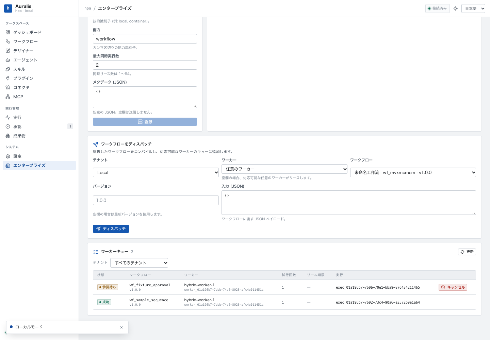
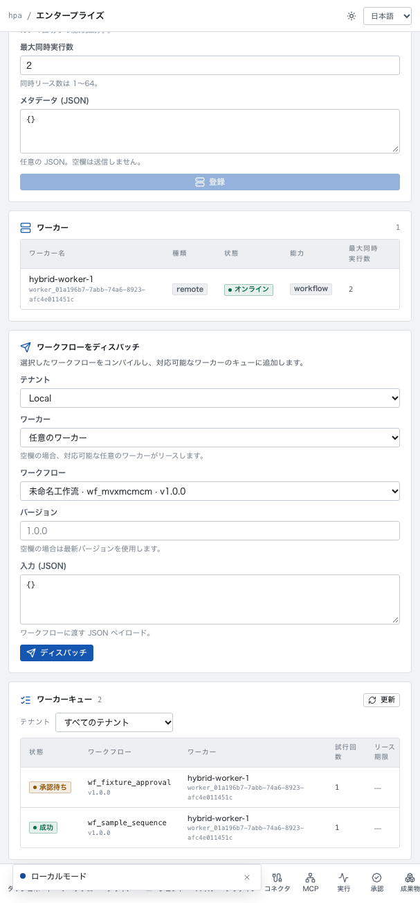

# Phase 8 本地 Hybrid Worker：协议与执行契约

> 本文冻结 Phase 8 MVP 的控制面/Worker 协议。实现复用 `hpa-core` 的同一套编译、IR 与 Runtime；Worker 不引入第二执行引擎，也不在控制面之外创建一套 Workflow 语义。

## 1. 范围

- 控制面：worker 一次性注册令牌、能力/并发声明、租约队列、租约过期重排、心跳续租、任务事件/状态回写、审批后重新入队、取消标记。
- Worker：`hpa worker` daemon，主动出站轮询，同一 Rust Runtime 执行 Workflow 快照；不在 Worker 侧访问租户 SQLite。
- 控制面执行持久化：Worker 首次 start 时在租户库创建 execution；后续事件/状态写回租户库。执行与本地执行使用同一 `executions`/`events`/`artifacts` 表。
- 远程执行标记：`remote_executions` 表阻止服务重启时本地 Runtime 接管远程 execution。
- UI：Enterprise Worker Center 中创建 Worker/token、查看队列与租约、派发 Workflow、取消任务。

不做：Redis/Kafka、mTLS、双向隧道、任务产物对象存储、自动扩缩容、浏览器 SSO、控制面多节点。

## 2. 角色与认证

| 角色 | 认证 | 能力 |
| --- | --- | --- |
| 平台管理员 | `hpa_ent_` token（现有 RBAC） | 注册 Worker、签发/轮换 token、派发/取消任务、查看队列 |
| 租户用户 | 现有租户 Bearer | 现有本地 Workflow 执行不变；远程派发 MVP 通过平台管理员/Worker Center |
| Worker daemon | `hpa_wrk_` 一次性令牌 | heartbeat/lease/start/events/complete；仅限绑定租户 |

- Worker token 形如 `hpa_wrk_<base64url>`；控制库只存 SHA-256 哈希与 worker/tenant 绑定。
- 注册 Worker 的响应包含明文 `workerToken` 一次；之后可通过 `POST /api/enterprise/workers/{id}/token` 轮换，旧 token 立即吊销。
- Worker 禁用时吊销 token；租户删除会吊销 token 并取消非终态 Job。禁用 Worker 的运行中 Job 不主动取消，等待租约过期重排（当前实现）。
- Worker 端点不经过 TenantGate/RBAC；所有数据查询强制 `tenant_id` 绑定，跨租户 lease/report 返回 404/409。

## 3. 数据模型（control.db）

```text
enterprise_workers:
  id, tenant_id, name, kind, status, capabilities_json, max_concurrency,
  runtime_version, last_heartbeat_at, registered_at, metadata_json

enterprise_worker_tokens:
  id, worker_id, tenant_id, token_hash UNIQUE, created_at, revoked_at

enterprise_worker_jobs:
  id, tenant_id, worker_id, execution_id UNIQUE, workflow_id, workflow_version,
  workflow_json, state_json, status, attempts, lease_id, lease_expires_at,
  runtime_version, required_capabilities_json, resumed, cancel_requested,
  error, created_at, updated_at
```

租户库新增 `remote_executions(execution_id PRIMARY KEY, worker_id, created_at)`，用于本地 Runtime 恢复/审批扫描排除远程 execution。

Job 状态机：

```text
queued -> leased -> running -> waiting_approval -> queued -> ...
                            -> succeeded | failed
queued/leased/waiting_approval -> cancelled
lease expired -> queued
```

- `attempts` 在每次 lease 时 +1；同一执行可能因租约过期至少执行一次。
- `lease_id` 每次 lease 新生成；start/events/complete 必须匹配当前 lease，否则 409。
- `execution_id` 在 enqueue 时生成；首次 worker start 前租户库没有 execution 行。
- 审批等待时 Job 进入 `waiting_approval`，释放并发槽；审批 API 保存新 state 后将 Job 重新置为 `queued`、`resumed=true`、清空 lease。

## 4. HTTP 契约

Worker 头：`Authorization: Bearer hpa_wrk_...`；请求/响应 JSON camelCase。

### 4.1 heartbeat

`POST /api/worker/heartbeat`

```json
{"version":"0.1.0","capabilities":["workflow"],"maxConcurrency":2,"activeJobs":["job_..."]}
```

响应：

```json
{"workerId":"worker_...","tenantId":"ten_...","serverTime":1793520000000,"cancelJobs":["job_..."]}
```

- 更新 worker 心跳、能力、版本和 `max_concurrency`；续租 `activeJobs` 对应的未终态任务。
- `cancelJobs` 包含控制面已请求取消、仍持有租约的 Job；Worker 在两 step 间协作取消。

### 4.2 lease

`POST /api/worker/lease`

```json
{"slots":2,"version":"0.1.0","capabilities":["workflow"]}
```

响应：

```json
{"jobs":[{
  "jobId":"job_...","executionId":"exec_...","leaseId":"lease_...","attempt":1,
  "workflowId":"wf_...","workflowVersion":"1.0.0","resumed":false,
  "runtimeVersion":"0.1.0","leaseExpiresAt":1793520030000,
  "workflow":{ "...Workflow IR..." },
  "state":{ "...ExecutionState..." }
}],"cancelJobs":[]}
```

- 原子地清理过期租约；只选择属于该 worker 租户、未被其他 worker 指定、版本匹配、能力满足的 queued Job。
- 并发上限取 `min(request.slots, worker.max_concurrency - active_jobs)`。
- Worker 不访问租户 DB；`workflow` 与 `state` 是完整快照。

### 4.3 start / events / complete

`POST /api/worker/jobs/{jobId}/start`

```json
{"leaseId":"lease_...","state":{...},"events":[{"sequence":0,"kind":"execution.started",...}]}
```

`POST /api/worker/jobs/{jobId}/events`

```json
{"leaseId":"lease_...","state":{...},"events":[...]}
```

`POST /api/worker/jobs/{jobId}/complete`

```json
{"leaseId":"lease_...","status":"waiting_approval|succeeded|failed|cancelled","state":{...},"events":[...]}
```

响应均为 `{"accepted":true}`。

- start：首次创建租户库 execution 行、写 `remote_executions` 标记、写 start event；`execution_id`/workflow snapshot 必须匹配 Job。
- events：仅接受当前 lease；`state.id` 必须等于 Job executionId；事件按 `sequence` 幂等写入。
- complete：终态写 output artifact；`waiting_approval` 释放 lease，Job 转 waiting。
- 状态、事件来自 Worker 的同一 Rust Runtime；控制面不做二次执行。

### 4.4 管理 API

```text
POST   /api/enterprise/workers                 创建 Worker，响应含一次性 workerToken
POST   /api/enterprise/workers/{id}/token      轮换 token
GET    /api/enterprise/workers                 现有列表 + capabilities/maxConcurrency/runtimeVersion
GET    /api/enterprise/worker-jobs?tenantId=   队列/租约/结果
POST   /api/enterprise/worker-jobs             派发 {tenantId,workflowId,workerId?,input?,version?}
POST   /api/enterprise/worker-jobs/{id}/cancel 取消/请求协作取消
GET    /api/enterprise/tenants/{id}/workflows  派发用 Workflow 摘要
```

派发 API 读取租户库 Workflow（或发布版本），编译并生成初始 `ExecutionState`；非法 Workflow 返回 422，不进入队列。`env` 不作为远程派发字段（避免把 secret 写入控制库）。

## 5. Worker daemon

```bash
HPA_WORKER_TOKEN=hpa_wrk_... hpa worker \
  --control-url http://127.0.0.1:8787 \
  --max-concurrency 2 \
  --capabilities workflow
```

- 只接受回环 HTTP 或 HTTPS 控制面；令牌可来自 `HPA_WORKER_TOKEN`，不打印。
- 主循环：heartbeat（10s）→ lease（空闲 1s）→ 每个 Job 独立 tokio task。
- 每个 Job：解析 workflow/state → compile（同一 `hpa_core`）→ `start_event`（仅 `resumed=false`）→ loop `step` → 每步上报 state/events → waiting/terminal 时 complete。
- 取消：heartbeat 返回的 Job id 触发 CancellationToken；step 之间调用 `cancel_execution` 并 complete cancelled；长 HTTP/脚本调用为尽力取消。
- 断线：上报失败指数退避重试；租约过期后控制面重排，旧 lease 的迟到上报 409 并被丢弃。
- Worker 版本与控制面 `runtime_version` 不一致时不被派发；能力必须包含 Job 的 required capabilities。
- 当前 CLI 没有 `--drain`；SIGTERM 直接停止进程，未上报的 Job 依赖 30s 租约过期重排。禁止把 SIGTERM 当成优雅排空承诺。

## 6. 审批、取消与本地 Runtime 隔离

- Worker 遇到 approval：complete `waiting_approval`，控制面写租户库 execution waiting；Worker 释放槽。
- 审批 API `decide_approval` 保存新 state 后，若存在远程 Job：
  - 不触发本地 `RuntimeManager`；
  - Job `queued`、`state_json` 更新、`resumed=true`、清空 lease；Worker 下次 lease 继续。
- 取消 API：
  - queued/leased/waiting：标记 `cancel_requested`/cancelled；heartbeat 通知 Worker；
  - running：MVP 只做协作取消（Worker 在 step 间停止）；本地 cancel 仍是 waiting-only。
- 服务重启：
  - `RuntimeManager::recover`/审批扫描排除 `remote_executions` 中的 execution；
  - Worker 继续 heartbeat/lease；未上报的旧 lease 过期后重排。
- 远程 execution 的审批 SLA 不自动超时（本地监控跳过）；需人工在 Approval Center 处理。

## 7. 私有部署约束

- Worker 主动出站，不需要入站端口；控制面必须 TLS 终止（反向代理或私有网络）。
- Worker token 放环境变量/Secret 文件，不写命令行/日志；控制面只存哈希。
- 控制面与 Worker 版本/Registry 版本必须匹配；升级先排空 Worker。
- SQLite 控制面单节点；多节点/Redis/HA 不在本阶段。
- 任务 payload 含 Workflow 快照，禁止写入未经审计的 secret；连接器凭证仍留在租户/连接器配置，不进入远程 Job。

## 8. 验收

- Worker token 一次性、租户绑定、轮换/禁用/租户删除吊销。
- enqueue→lease→start→events→complete 闭环；租户库 execution/events/artifact 正确。
- 跨租户 lease/report 0；旧 lease 迟到上报拒绝；过期租约重排；并发槽/能力/版本过滤。
- 审批等待→decide→requeue→complete。
- Worker daemon 真实进程执行示例 Workflow；断线重连/过期重排；取消协作。
- 服务重启后本地 Runtime 不接管远程 execution。
- Worker Center 1440/607、ja/en/zh、无横向溢出。

## 9. 实现状态（2026-11-01）

已落地：

- `crates/hpa-local/src/worker.rs`：control.db token/job schema、租约、状态机、取消、审批重排。
- `crates/hpa-local/src/worker_daemon.rs`：`hpa worker` 出站轮询、心跳、同一 `hpa-core` Runtime、逐步事件/状态上报、退避重试与取消。
- `crates/hpa-local/src/enterprise.rs`：`/api/worker/*`、`/api/enterprise/worker-jobs`、Worker Center 接口；Worker 首次 start 时把 execution/events/artifacts 写回租户库。
- 租户库 `remote_executions` 标记；本地 `RuntimeManager::recover` 与审批 SLA 扫描跳过远程 execution，审批 API 通过 `requeue_execution` 恢复远程 Job。
- Enterprise Center 的“ワーカー”页：注册/能力/并发/一次性 token、轮换、派发、队列、取消；截图 `docs/assets/phase8/`。
- `hpa worker --control-url ... --max-concurrency N --capabilities workflow`；token 来自 `HPA_WORKER_TOKEN`。

验收：

- Worker queue 单元测试 5 个、Worker daemon 单元测试 6 个、驱动隔离 1 个、HTTP+真实 daemon 集成测试 1 个；全量 Rust 114 passed / 1 ignored。
- 集成测试覆盖：错误 token 401、token/租户绑定、版本/能力/并发槽、租约过期重排与旧 lease 409、事件/完成写回、审批等待→审批→resumed→成功、取消、Worker Center 数据。
- 1440/607 截图无页面横向溢出、无未翻译 key；最终服务实际运行 `hybrid-worker-1`，队列包含成功和审批等待 Job。





仍未实现：持久 outbox（进程崩溃前未上报的结果依赖租约重排/至少一次）、远程 Worker 的凭证注入/对象存储、审批 SLA 自动超时、Redis/多节点、mTLS、自动扩缩容。部署与运维见 [Hybrid Worker 私有部署](hybrid-worker-deployment.md)。

## 10. 相关文档

- [执行平面](../02-architecture/execution-plane.md)
- [本地 Enterprise](local-enterprise.md)
- [企业运维](enterprise-operations.md)
- [测试策略](../10-quality/test-strategy.md)
