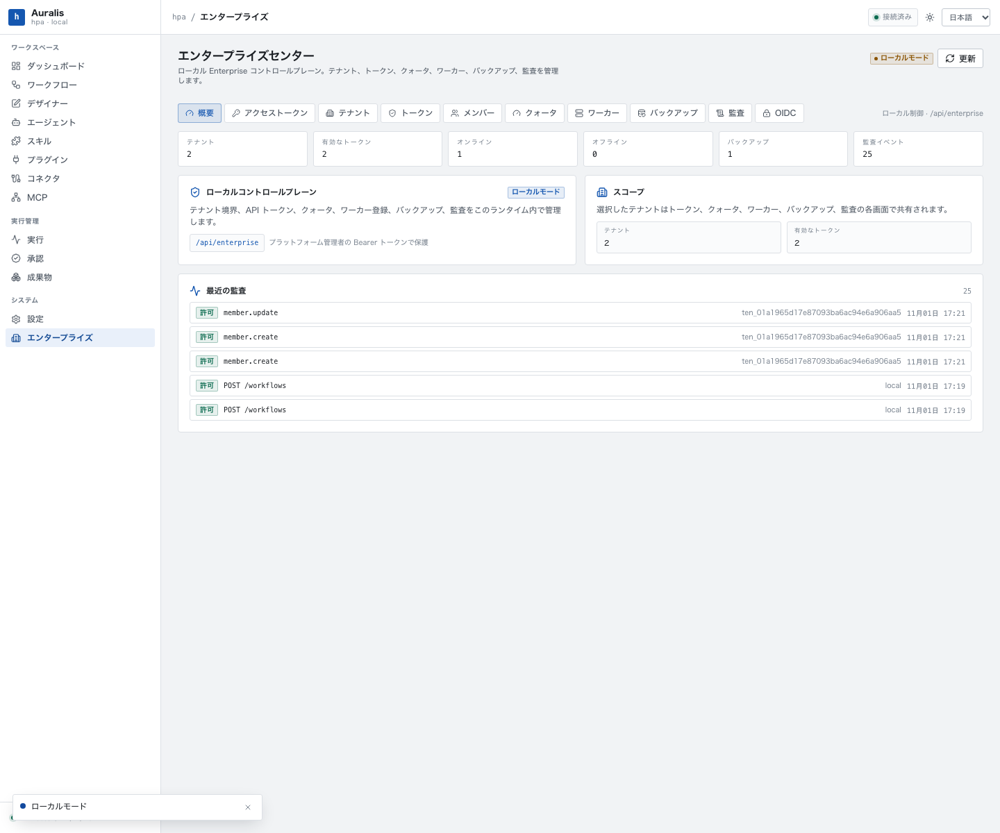
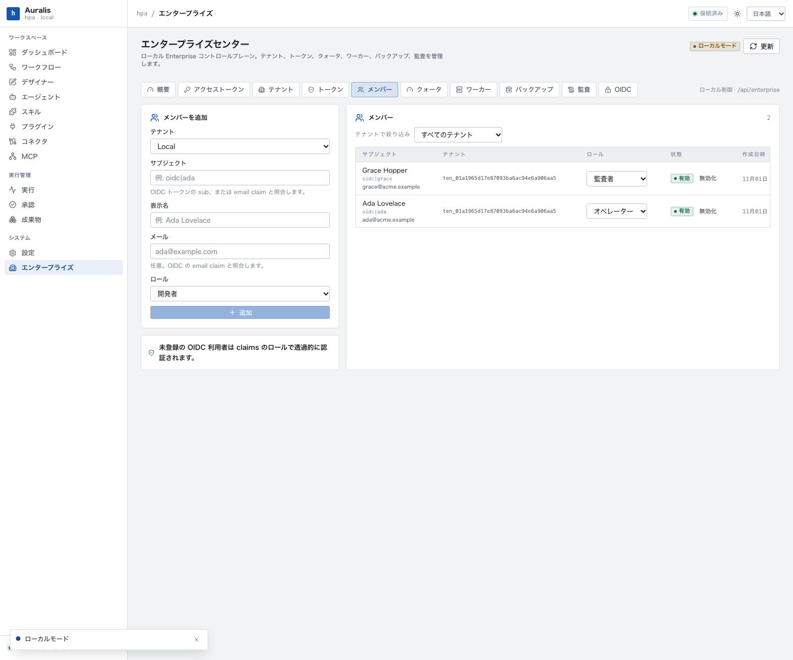
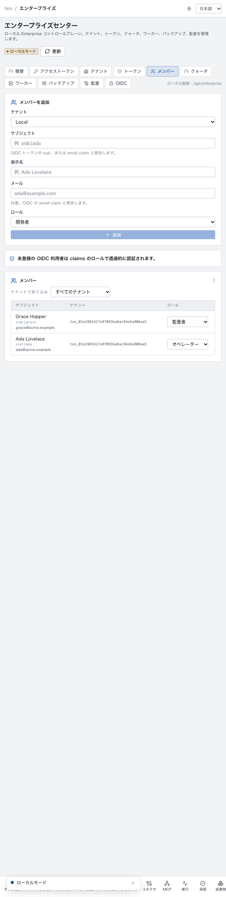

# 本地企业控制平面：实现与安全模型

> 本文描述 Phase 6 在当前仓库中实际落地的本地企业控制平面：单节点、SQLite、本地控制库 + 每租户数据库。它不等于完整的 SaaS/HA 控制面，也不等同于[权限模型](permission-model.md)中规划的全部 RBAC/ABAC/RLS 能力。

## 1. 定位与结论

- 默认仍是本地单用户模式：业务 API 无认证，匿名请求映射到内置租户 `local`；控制面在此模式下同样不要求令牌。
- 设置 `HPA_ENTERPRISE_MODE=1|true|required` 后进入企业模式：除 `/api/health` 外，`/api/*` 需要 `Authorization: Bearer`。
- 控制面数据在 `<data_dir>/control.db`；租户业务数据在各自的 `hpa.db`。
- 默认隔离手段是“每租户独立 SQLite 文件 + TenantGate 路由”。设置 `HPA_POSTGRES_RUNTIME=1` 后 Workflow/Execution/Trigger、Worker Job、Enterprise、Agent、Skill、MCP、Connector 与 Plugin 元数据使用 PostgreSQL 权威与 FORCE RLS；SQLite 仅作单节点模式或可重建缓存。
- 角色是固定的 8 个粗粒度角色，权限按 HTTP 动作近似映射；没有资源级 ACL、自定义角色或 ABAC 策略引擎。
- 单节点运行；没有多节点、HA 或计量计费。浏览器 SSO 由 Phase 9 补齐，出站 Worker 派发由 Phase 8 补齐。

## 2. 运行模式

`serve` 读取环境变量（大小写敏感，仅这三个值视为开启）：

```text
HPA_ENTERPRISE_MODE=1
HPA_ENTERPRISE_MODE=true
HPA_ENTERPRISE_MODE=required
```

| 模式 | 认证 | 数据归属 | `/api/health` |
| --- | --- | --- | --- |
| 本地模式（默认） | 不要求 Bearer；匿名请求映射为 `local` 租户的 `owner`，且 `platform_admin=true` | 业务 API 固定 `local` | 公开 |
| 企业模式 | 除健康检查外都要求 Bearer；无效/缺失返回 401 `UNAUTHORIZED` | 由令牌或 OIDC claims 的 `tenant_id` 决定 | 公开 |

本地模式下控制面也接受匿名平台管理员，因此可以创建其他租户和令牌；但匿名业务请求始终落到 `local`。这进一步说明本地模式只适合受信单机。

`/api/health` 在两条路径下都公开，返回 `status`、`internalId`、`version`、`brand`、`runtime` 与 `enterprise` 布尔值（即 `require_auth`）。不要用健康检查判断租户权限；它不返回任何租户数据。

本地模式没有“登录”概念，匿名即平台管理员。因此本地模式只适合单机、可信用户；把端口暴露给他人等同于交出控制面。

## 3. 控制库、租户库与路由

### 3.1 文件布局

| 路径 | 内容 |
| --- | --- |
| `<data_dir>/control.db` | 租户、配额、令牌哈希、成员目录、审计、Worker 注册、备份记录、OIDC 配置 |
| `<data_dir>/hpa.db` | 内置租户 `local` 的业务数据 |
| `<data_dir>/tenants/{tenantId}/hpa.db` | 其他租户的业务数据 |
| `<data_dir>/tenants/{tenantId}/...` | 该租户的 Skill、插件、连接器、产物等服务数据目录 |
| `<data_dir>/backups/{tenantId}/backup-{millis}.db` | 备份文件 |

`control.db` 表：`enterprise_tenants`、`enterprise_quotas`、`enterprise_tokens`、`enterprise_members`、`enterprise_audit`、`enterprise_backups`、`enterprise_workers`、`enterprise_oidc`。租户业务表不写入控制库。

### 3.2 初始化与缓存

- 启动时创建控制库、补齐 schema，并幂等插入 `local` 租户（名称 `Local`）及默认配额。
- 即使企业模式启动，也会初始化 `local` 租户状态；`/mcp` 仍使用这份本地运行时（见限制）。
- 每个租户首次被访问时构建 `TenantEntry`：打开 `hpa.db`、恢复未完成执行、启动执行与 Agent 审批监控、初始化连接器，并构建该租户独立的 API Router。
- `TenantEntry` 按 `tenant_id` 缓存在进程内 `HashMap`，没有 TTL 或容量上限；删除租户或恢复备份时移除对应缓存项。
- 每个租户数据库连接池上限为 8；控制库连接池上限为 4。

### 3.3 TenantGate

`/api/{*rest}` 由 `tenant_gate` 处理，顺序为：

1. `/api/health` 直接返回，不认证。
2. 解析 Bearer：`hpa_ent_...` 查控制库哈希；其他恰好两个点的 JWT 走 OIDC 校验；否则拒绝。
3. 用角色与动作映射做 RBAC 判定；平台管理员令牌可绕过 RBAC。
4. 按 principal 的租户获取/构建 `TenantEntry`；租户不存在或已删除则无法访问。
5. 做配额检查。
6. 非 GET 请求写入一条 `allow` 审计（GET 不写）。
7. 去掉 `/api` 前缀，重写 URI 后把请求交给该租户的 Router。

租户 API 路径中不包含租户 ID；租户完全由令牌决定。跨租户资源 ID 只会在本租户库中查找，通常返回 404，测试明确验证不会泄漏其他租户的 Workflow。

### 3.4 隔离边界

- 租户业务数据物理分离在独立 SQLite 文件中；没有共享业务表，也没有 `tenant_id` 过滤查询。
- `platform_admin` 只能通过 `/api/enterprise/*` 管理租户、令牌、成员、配额、备份、Worker 和审计元数据；它不会因此获得读取其他租户业务 API 的能力（业务 API 仍绑定令牌所属租户）。
- 控制面跨租户操作是设计内能力，但每次变更写控制审计。
- 没有 RLS、数据库级策略或加密多租户 schema；安全性依赖文件权限、TenantGate 和进程边界。

## 4. 认证与令牌

### 4.1 平台令牌

- 格式：`hpa_ent_` + 32 字节随机数的 base64url（无填充）。
- 存储：只保存 SHA-256 十六进制哈希，不保存明文；创建响应中的 `token` 只出现一次。
- 记录：`id`、名称、租户、角色、`platform_admin`、创建/最近使用/过期/吊销时间。
- 创建时校验租户存在且 `status='active'`；角色必须是 8 个固定角色之一。
- `expiresInDays` 可省略（永不过期）；提供时会被夹到 1–3650 天。
- 认证时检查哈希、`revoked_at`、`expires_at`，成功后更新 `last_used_at`。
- 吊销是软吊销：`DELETE /api/enterprise/tokens/{id}` 写 `revoked_at`，已吊销令牌立即 401，但记录保留。
- 令牌列表不返回 secret 或哈希；只返回元数据及 `platformAdmin`。

`hpa enterprise init` 创建唯一的引导平台管理员令牌：若已存在未吊销的 `platform_admin=1` 令牌，返回 409 `ADMIN_TOKEN_EXISTS`。之后仍可通过 API/CLI 创建更多平台管理员令牌；唯一性只约束引导流程。

### 4.2 OIDC Bearer

本节描述 OIDC **Bearer** 路径；浏览器 Authorization Code + PKCE SSO 见 Phase 9 文档：

- 只接受 `alg=EdDSA`、JWKS 中 `kty=OKP`、`crv=Ed25519` 的密钥；按 `kid` 匹配，无 `kid` 时仅允许单密钥。
- 必须校验 `exp`（必需）、可选 `nbf`，允许 60 秒时钟偏差；`iss` 必须精确匹配配置，`aud` 可为字符串或数组且必须包含配置值。
- 必须包含非空 `sub`、`tenant_id`（或 `tenantId`）、`role`（或 `roles` 的第一个元素）；角色必须是固定角色。
- 可选 `email` 参与成员目录匹配；未匹配成员时 actor 标识为 `oidc:{email|sub}`。
- OIDC principal 永远不是平台管理员；租户必须存在且为 `active`，否则 401。
- Bearer 路径本身没有授权码回调、会话 Cookie 或登录 UI；浏览器登录使用 `/login` 和 [`browser-sso.md`](browser-sso.md) 的 session/CSRF 流程。

### 4.3 成员目录

`enterprise_members` 是面向 OIDC 主体的轻量目录，成员即租户内的用户记录；它不是完整身份系统：

- 字段：`id`、`tenantId`、`subject`（租户内唯一）、`displayName`、`email`（小写存储，可为空）、`role`、`status`（`active`/`disabled`）、创建/更新时间。
- API：`GET/POST /api/enterprise/members`、`PUT/DELETE /api/enterprise/members/{id}`；全部要求平台管理员令牌，`GET` 支持 `tenantId` 过滤。
- `POST` 需要 `tenantId`、`subject`、`role`；`displayName` 缺省为 subject；`email` 必须含 `@`。重复 subject 返回 409 `MEMBER_EXISTS`。
- `PUT` 可更新 `displayName`、`email`、`role`、`status`；空 body 返回 400 `MEMBER_UPDATE_EMPTY`；非法状态/角色分别返回 `MEMBER_STATUS_INVALID`/`ROLE_INVALID`。
- OIDC Bearer 校验通过后，先按 `subject` 精确匹配，再按 `email`（大小写不敏感）匹配：
  - 命中且 `status=disabled`：401 `UNAUTHORIZED`，并记 `member.authenticate` deny 审计。
  - 命中且 `status=active`：使用目录中的 `role`，principal 为 `member:{id}`。
  - 未命中：保持无状态，使用 claims 中的 `role`，principal 为 `oidc:{identity}`。
- 成员只影响 OIDC 租户 principal；`hpa_ent_` 平台令牌的角色不因成员记录改变。
- 没有密码、组、会话、邀请流程或成员自服务；平台管理员通过 API/Enterprise Center 维护目录。

## 5. 角色与动作

RBAC 只有四个动作，按请求方法与路径近似映射：

| 动作 | 触发条件（`/api` 之后） |
| --- | --- |
| `read` | `GET` / `HEAD` |
| `approve` | `POST /executions/{id}/approvals`；`POST /agents/approvals/{id}/decide` |
| `execute` | `POST /workflows/{id}/executions`；`POST /executions/{id}/cancel`；`POST /agents/{id}/run`；`POST /agents/sessions/{id}/continue|cancel` |
| `write` | 其余 `POST`/`PUT`/`PATCH`/`DELETE` |

| 角色 | read | write | execute | approve |
| --- | --- | --- | --- | --- |
| `owner` | 允许 | 允许 | 允许 | 允许 |
| `admin` | 允许 | 允许 | 允许 | 允许 |
| `developer` | 允许 | 允许 | 允许 | 允许 |
| `publisher` | 允许 | 允许 | 允许 | 允许 |
| `operator` | 允许 | 拒绝 | 允许 | 拒绝 |
| `approver` | 允许 | 拒绝 | 拒绝 | 允许 |
| `auditor` | 允许 | 拒绝 | 拒绝 | 拒绝 |
| `viewer` | 允许 | 拒绝 | 拒绝 | 拒绝 |

拒绝返回 403 `RBAC_DENIED` 并写审计。`platform_admin` 绕过上述判定。

这是粗粒度、路径级的权限：`owner`/`admin`/`developer`/`publisher` 对租户 API 实际等价；没有“只读某个 Workflow”“按项目授权”“自定义角色”“显式 deny 策略”等能力。[权限模型](permission-model.md)中的细粒度权限点、ABAC 与 RLS 仍属于目标设计，不是本实现的现状。

控制面路由 `/api/enterprise/*` 不走这套动作映射，统一要求平台管理员令牌；租户 `owner` 也会得到 403 `PLATFORM_ADMIN_REQUIRED`。

## 6. 配额

新租户与 `local` 的默认值相同：

| 配额 | 默认 | 检查点 |
| --- | --- | --- |
| `maxWorkflows` | 100 | `POST /workflows`，统计 `workflows` 总数 |
| `maxExecutionsPerDay` | 1000 | `POST .../executions` 的当日 `started_at`；以及 Agent 当日会话 |
| `maxSkills` | 100 | `POST /skills/import`，统计去重后的 Skill |
| `maxAgents` | 100 | `POST /agents` |
| `maxPlugins` | 50 | `POST /plugins/install`，排除 `uninstalled` |
| `maxConnections` | 100 | `POST /connections` |
| `maxConcurrentRuns` | 8 | 启动执行时统计 `running` + `waiting_approval` |

- 只有 `POST`/`PUT` 会进入检查；实际只对上述 `POST` 路径计数，`PUT` 不触发配额分支。
- 日计数按 UTC 日期前缀匹配；Agent 会话没有独立配额字段，复用 `maxExecutionsPerDay`。
- 超限返回 429：资源数/日计数为 `TENANT_QUOTA`，并发为 `TENANT_CONCURRENCY`。
- 配额是资源限制，不是权限；即使角色允许，也可能被配额拒绝。
- 配额可通过 `PUT /api/enterprise/quotas/{tenant_id}` 即时调整，无需重启。值为 0 表示不允许该资源。

## 7. 审计

控制面审计写入 `enterprise_audit`，字段为：`id`、`at`、`tenantId`、`actorId`、`actorType`、`action`、`resource`、`decision`、`reason`、`detail`。典型事件：

- `token.create`、`token.revoke`、`member.create`、`member.update`、`member.delete`、`member.authenticate`（拒绝时）、`tenant.create`、`tenant.delete`、`quota.update`
- `quota.check`（拒绝时）、`enterprise.admin`（非管理员访问控制面时）
- `worker.register`、`worker.disable`、`backup.create/delete/restore/purge`、`oidc.update`
- TenantGate 的租户 API：每个非 GET 写 `METHOD /path` 的 allow；RBAC 拒绝写 deny

查询与导出：

- `GET /api/enterprise/audit?tenantId=&limit=`，默认 50，夹在 1–5000。
- `GET /api/enterprise/audit/export?format=json|csv&tenantId=&limit=`，默认 1000。
- CSV 表头固定为 `at,tenantId,actorId,actorType,action,resource,decision,reason`；每个字段加引号，内部引号翻倍；以 `= + - @` 开头的值前置单引号，降低表格公式注入风险。
- 没有删除审计的 API；但审计不是 WORM/防篡改存储，控制库文件的管理员仍可直接修改。审计写入是尽力而为，与业务操作不在同一事务，写入失败会被忽略。
- 审计不含 IP、User-Agent、请求 ID，也没有哈希链或签名。

## 8. Worker 注册与 Hybrid 执行

Phase 6 的注册/心跳在 Phase 8 扩展为可用的远程执行闭环；完整协议见 [`hybrid-workers.md`](hybrid-workers.md)。

注册/心跳（管理员）：

- `POST /api/enterprise/workers` 注册，`{tenantId,name,kind,metadata?,capabilities?,maxConcurrency?}`；租户必须 active，`metadata` 只能是对象或 null；响应含一次性 `workerToken`。
- `POST /api/enterprise/workers/{id}/heartbeat` 更新 `last_heartbeat_at`；`POST /api/enterprise/workers/{id}/token` 轮换 token。
- `POST /api/enterprise/workers/{id}/disable` 持久化 `disabled` 并吊销 token；列表派生 `online/offline/disabled`，数据库中仍存 `active`。
- 能力默认 `["workflow"]`，并发 1–64；版本由 daemon heartbeat 写入。

Hybrid 执行：

- Worker 使用 `hpa_wrk_` token 调用 `/api/worker/heartbeat|lease|jobs/...`；只出站，不开放入站端口，token 绑定 tenant/worker。
- `POST /api/enterprise/worker-jobs` 派发 Workflow（编译校验后入队）；`GET /api/enterprise/worker-jobs` 查看队列；`POST .../{id}/cancel` 取消/协作取消。
- 30s 租约、心跳续租、过期重排、旧 lease 409、能力/版本/并发过滤。
- Worker 首次 start 写租户 execution/events/artifacts；`remote_executions` 标记阻止本地 Runtime 恢复/审批 SLA 扫描接管。
- 审批等待释放槽；审批 API 保存 state 后通过 `requeue_execution` 让 Worker 继续。远程审批不自动 SLA 超时。
- 不派发 Agent/Plugin/Connector 非 Workflow 任务、不下发凭证、不建立反向隧道；不把敏感信息放入 `metadata`。

## 9. 备份与恢复

- 创建：`POST /api/enterprise/tenants/{id}/backups`，对该租户的 `hpa.db` 执行 `VACUUM INTO`，生成 `<data_dir>/backups/{tenant}/backup-{epoch_ms}.db`。
- 记录：大小、整文件 SHA-256、`status=ready`、创建时间；租户数据库文件不存在时返回 404。
- 恢复：`POST /api/enterprise/backups/{id}/restore`，校验路径在备份目录内、状态为 `ready`、SHA-256 匹配；写临时文件后原子替换目标 `hpa.db`，删除 `-wal`/`-shm`，返回 `requiresRestart:true`。
- 恢复不会重启进程，也不会停止已打开的 SQLite 连接池；必须由运维重启后继续使用。
- 恢复不会恢复控制库中的租户/令牌记录，也不会自动创建租户。
- 删除：`DELETE /api/enterprise/backups/{id}`；清理：`POST /api/enterprise/backups/purge`（`retainDays` 默认 30，`retainCount` 默认 10）。
- 保留规则：按租户分别排序，只有同时超出保留天数且排名超出保留数量才删除；任一维度为 0 表示该维度不保留。没有自动清理定时任务。
- 备份文件在恢复后保留；租户删除会删除该租户目录，并通过备份服务删除该租户的备份文件与 `enterprise_backups` 记录，同时删除 `enterprise_workers` 与 `enterprise_quotas` 行；审计记录保留。
- **控制库 `control.db` 不在此备份范围内**；租户、令牌、配额、审计、OIDC 配置需要单独保护。

## 10. Enterprise Center

前端入口 `/enterprise`，导航为“企业版”。行为：

- 令牌保存在浏览器 `localStorage` 的 `hpa.enterprise.token`；`api.ts` 对所有请求（包括 JSON/CSV 导出 blob）附加 `Authorization: Bearer`。
- 无令牌时可点“不使用令牌重试”进入页面级本地模式：客户端不发送 Authorization；服务端若为本地模式则成功，若为企业模式则显示 401/403 拒绝。这不是服务端模式开关。
- 标签页：总览、访问、租户、令牌、成员、配额、工作节点、备份、审计、OIDC。
- 令牌签发后只在该面板显示一次 secret，可复制；列表只显示元数据与状态；支持按租户筛选和吊销。
- 成员面板支持按租户筛选、添加 OIDC subject/邮箱、切换角色、启用/禁用与删除；未登记 OIDC 主体的回退行为在面板内说明。
- 租户删除要求输入租户名确认；恢复备份有“完成后可能需要重启”的警告；审计支持 JSON/CSV 下载。
- OIDC 面板配置 Bearer 校验（issuer/audience/JWKS/网络白名单）与浏览器 SSO（clientId、authorization/token/end-session endpoint、redirectUri、postLogoutRedirectUri、scopes、adminSubjects、cookieSecure、sessionTtlSeconds）；refresh 与 RP logout 契约见 [Browser SSO](browser-sso.md)。




成员目录页：





租户与 Worker 视图见 `docs/assets/phase6/tenants-1440.png` 与 `docs/assets/phase6/workers-1440.png`。截图在最终 release 服务上、选择 Acme 租户并发送 Worker 心跳后生成；成员角色切换在浏览器中实际操作并回读。

## 11. 限制与安全姿态

- `/mcp` 及 `/.well-known/oauth-protected-resource*` 不经过 TenantGate，仍绑定启动时的 `local` 租户运行时；本阶段不提供 MCP 的租户路由。
- `hpa agent/skill/mcp/plugin/connector/run/doctor` 等 CLI 仍直接打开 `<data_dir>/hpa.db`，不会解析租户或企业令牌；只有 `serve` 挂载企业路由，`enterprise init/token` 操作控制库。
- 每个租户启动两个后台审批监控任务；缓存移除/租户删除没有停止句柄，删除活跃租户后任务可能继续持有已删除数据库的句柄并报错。
- 成员目录服务 OIDC Bearer 与浏览器 session 的角色/状态覆盖；SCIM 2.0 Users/Groups 维护租户成员、组和固定角色映射。仍没有密码、邀请或成员自服务。未登记的 OIDC 用户仍是按 claims 认证的无状态声明。
- 没有 RLS；隔离是文件级 + 路由级。控制库中的跨租户元数据由平台管理员统一管理。
- 审计可读、可导出，但不可证明未被篡改；没有 WORM、保留策略执行器或外部 SIEM 投递。
- 单节点 SQLite：不支持多进程共享数据目录、HA、只读副本、在线迁移或跨机挂载。
- 服务只监听 `127.0.0.1` 的明文 HTTP；远程访问需 SSH 隧道或反向代理提供 TLS。
- 无远程凭证派发/对象存储、无 Agent/Plugin 远程派发、无 durable outbox/mTLS/Redis/多节点、无多 IdP/第三方 Cookie、无计费/计量；SCIM/组角色映射、租户暂停/恢复与 Browser SSO refresh/logout 已在 Phase 13 补齐。
- 备份与控制库均未由应用加密；依赖磁盘/文件系统加密与目录权限。

## 12. 测试覆盖

`crates/hpa-local/tests/enterprise.rs`（HTTP 端到端）包含：

```text
enterprise_auth_boundary_and_health
tenant_isolation_and_admin_boundary
rbac_roles_enforced_per_tenant
tokens_secret_listing_revoke_and_admin_only
members_directory_crud_and_tenant_filter
quota_max_workflows_and_audit
audit_entries_and_csv_export
tenant_lifecycle_delete_and_protected_local
concurrent_run_quota_enforced
worker_daemon_executes_remote_workflow_and_resumes_approval
scim_users_groups_filters_etags_and_role_mapping_are_fail_closed
scim_migrates_existing_sqlite_members_without_losing_direct_roles
```

`crates/hpa-local/tests/enterprise_ops.rs`（服务层）包含：

```text
backups_restore_purge_delete
workers_register_heartbeat_offline_disable
oidc_verification_with_local_jwks
```

`crates/hpa-local/tests/browser_sso.rs`（浏览器 SSO HTTP 端到端）包含：

```text
browser_sso_login_session_csrf_and_failures
browser_sso_requires_configuration_and_csrf
browser_sso_refresh_rejection_revokes_the_session
```

这些用例覆盖认证边界、健康检查公开性、跨租户隔离、角色拒绝、令牌一次性与吊销、成员 CRUD/租户过滤、SCIM Users/Groups/filter/PATCH/ETag/角色冲突、旧库迁移、配额与并发 429、审计/CSV、租户删除保护、备份恢复/清理、Worker 离线派生，以及本地 JWKS 的 OIDC 校验；Phase 9 另覆盖 SSO 登录回调、Cookie 属性、CSRF、state 重放、disabled 成员、refresh 失败撤销与 RP-initiated logout。本文不声称测试通过数量；以实际运行结果为准。

Phase 9 在最终 release 服务上用 mock IdP 分别以 EdDSA、RS256、ES256 完成浏览器登录、session、Enterprise 访问与退出；截图见 `docs/assets/phase9/`。该验证不等同于外部 IdP 兼容性测试。

## 13. 相关文档

- [权限模型](permission-model.md)
- [数据模型](data-model.md)
- [SCIM 2.0](scim.md)
- [本地部署与运维](enterprise-operations.md)
- [Hybrid Worker 协议与实现](hybrid-workers.md)
- [Hybrid Worker 私有部署](hybrid-worker-deployment.md)
- [实施路线图](../11-roadmap/implementation-roadmap.md)
