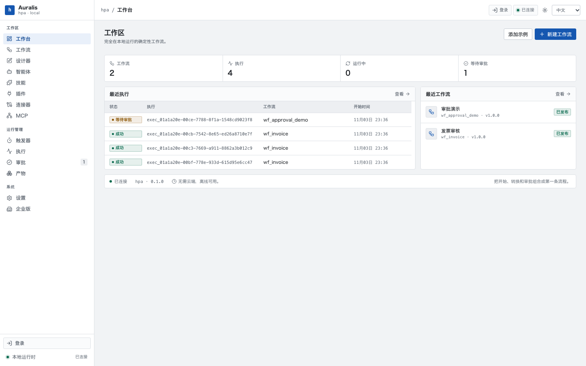
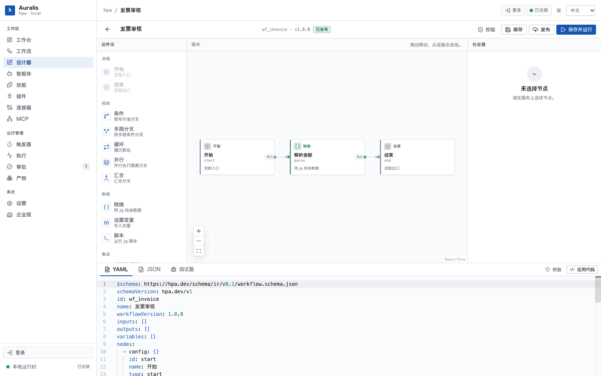
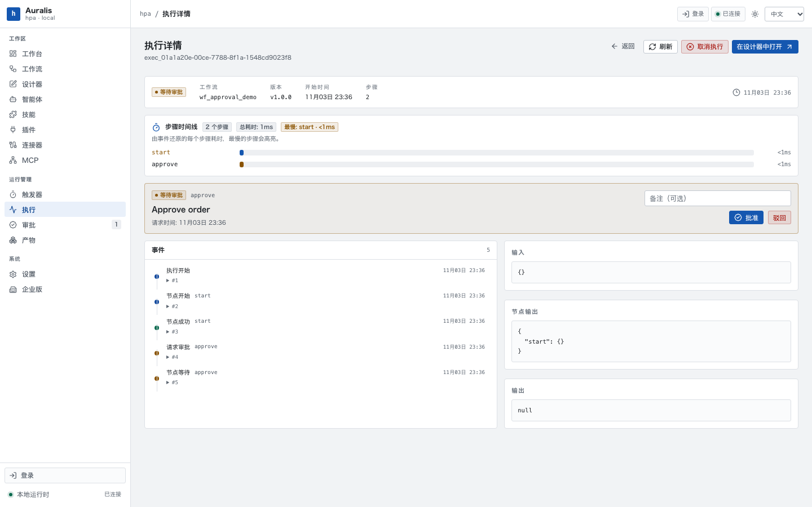
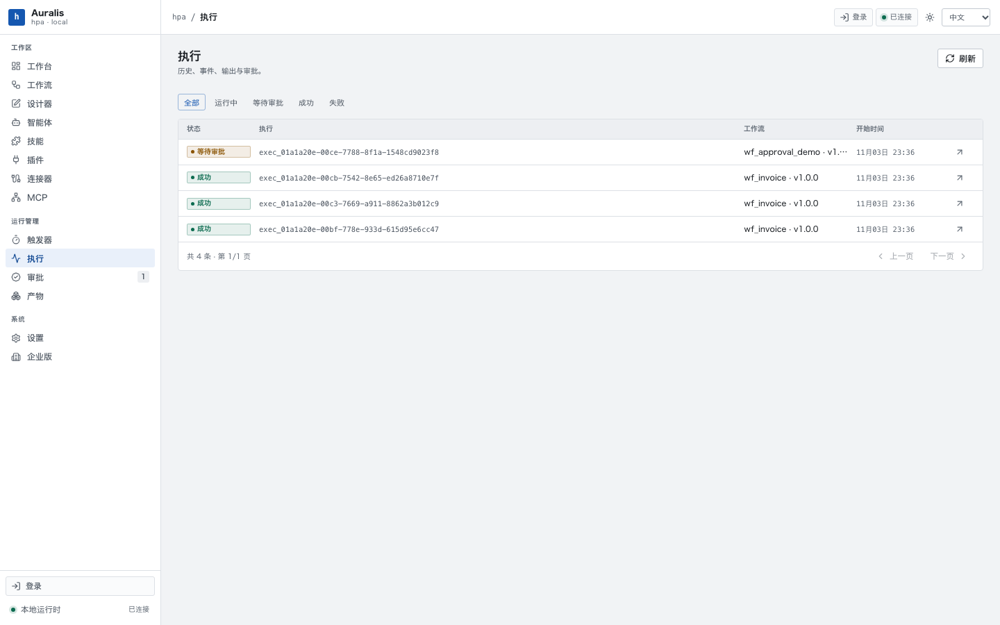
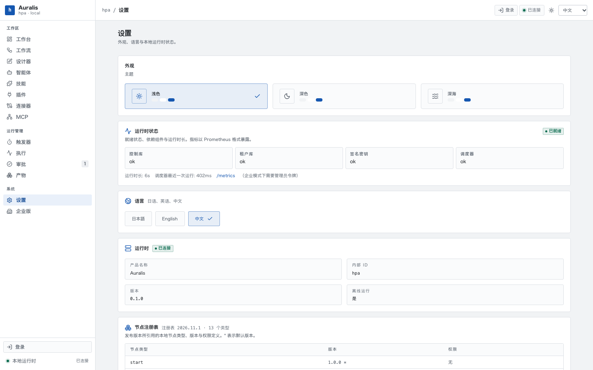

# 手动测试指南

> 面向"想亲手点一遍"的人。每条路径都写清楚**点哪里**和**应该看到什么**；截图来自 `scripts/manual-walkthrough-shots.mjs` 的真实运行（2026-11-03，本地模式、中文界面）。

## 1. 启动

### 本地模式（最快，无需数据库）

```bash
cd /path/to/Hisha
cargo build -p hpa-local          # 首次需要；之后可直接用 target/debug/hpa
./target/debug/hpa --data-dir /tmp/hpa-demo serve --port 8787
```

打开 http://127.0.0.1:8787 。**本地模式不需要登录**，直接进控制台。界面默认日文，左下角「設定 → 言語」可切中文（切换会记住）。

### PostgreSQL 模式

```bash
createdb hpa_demo
export HPA_POSTGRES_URL=postgresql://$USER@127.0.0.1:5432/hpa_demo
./target/debug/hpa --data-dir /tmp/hpa-pg db migrate
./target/debug/hpa --data-dir /tmp/hpa-pg enterprise init      # 记下返回的 token

HPA_ENTERPRISE_MODE=required HPA_POSTGRES_RUNTIME=1 \
  ./target/debug/hpa --data-dir /tmp/hpa-pg serve --port 8788
```

企业模式需要认证：`/enterprise` 等管理页要管理员令牌；普通租户 API 可用 `Authorization: Bearer hpa_ent_...`。浏览器里的完整登录依赖外部 IdP，手动测试建议先用本地模式。

### 双节点（体验跨节点）

```bash
# 终端 1 / 终端 2，两个不同 data-dir、两个端口，共用同一个 HPA_POSTGRES_URL
HPA_POSTGRES_RUNTIME=1 HPA_ENTERPRISE_MODE=required HPA_NODE_ID=node-a \
  ./target/debug/hpa --data-dir /tmp/hpa-a serve --port 8801
HPA_POSTGRES_RUNTIME=1 HPA_ENTERPRISE_MODE=required HPA_NODE_ID=node-b \
  ./target/debug/hpa --data-dir /tmp/hpa-b serve --port 8802
```

在 A 上建的令牌、会话、执行，B 上立刻可用（`scripts/multi-node-e2e.mjs` 已自动验证这 10 项）。

## 2. 界面地图

| 页面 | 路径 | 用途 |
| --- | --- | --- |
| 工作台 | `/` | 概览：工作流数、执行数、等待审批数、最近执行 |
| 工作流 | `/workflows` | 工作流列表与管理 |
| 设计器 | `/designer?id=…` | 拖拽编排、YAML/JSON、校验、发布、保存并运行 |
| 执行 | `/executions` | 执行列表（分页 + 状态筛选） |
| 执行详情 | `/executions/:id` | 步骤时间线、事件、审批、输入输出 |
| 审批 | `/approvals` | 待处理审批集中视图 |
| 设置 | `/settings` | 主题/语言、节点注册表、运行时状态 |
| 企业版 | `/enterprise` | 租户/成员/配额/令牌（需管理员） |



## 3. 手动路径

### 路径 A：三分钟跑通一条工作流

1. 进入 `/designer`（「新建工作流」）。
2. 左侧「组件库」拖入：`开始` → `转换` → `结束`，连线。
3. 点 `转换` 节点，右侧检查器填 `config.mapping`，例如 `{"amount": {"$expr": "1 + 1"}}`。
4. 顶部「校验」→ 应提示通过；「保存」→ 成功提示；「发布」→ 版本变为 `v1.0.0 已发布`。
5. 「保存并运行」→ 跳到执行详情。

**预期**：状态 `成功`；「步骤时间线」出现 `start → parse → end` 三段，总耗时毫秒级；事件列表依次是 `执行开始 / 节点开始 start / 节点成功 start / …`。



### 路径 B：审批暂停与恢复

1. 设计器「导入」`fixtures/08_approval.json`。
2. 发布并运行 → 执行详情显示 **等待审批**。
3. 审批面板里填备注（可选）→「批准」。

**预期**：状态从 `等待审批` 变成 `成功`；事件列表出现 `请求审批 approve` → `节点等待 approve` → 恢复后继续；时间线里 `approve` 那段会明显长于其他节点（它吃了人工等待时间）。



### 路径 C：执行列表分页

1. 用同一工作流连续运行 60 次（或 `for i in $(seq 60); do curl -s -X POST …/executions -d '{"input":{}}' -H 'content-type: application/json'; done`）。
2. 打开 `/executions`。

**预期**：每页 50 条，页脚「共 N 条 · 第 1/2 页」；点「下一页」剩 10 条，末页「下一页」置灰；点状态标签（如 `成功`）后页码回到第 1 页，且**总数按状态重算**（不是只在前 100 条里筛）。



### 路径 C2：重试、幂等与协作取消

1. 运行一条 `succeeded`、`failed` 或 `cancelled` 的 Workflow，打开执行详情，点「重试」。
2. 观察 URL 切换到一个新的 `exec_...`，新执行从原 Workflow 快照和原输入开始。
3. 对启动接口连续发送两次带同一 `Idempotency-Key` 和相同 JSON 的请求，应返回同一个 execution；改成不同 input 应返回 `409 IDEMPOTENCY_CONFLICT`。
4. 运行一个在单步内等待数秒的 Workflow，在状态为 `运行中` 时点「取消」；提示应为“取消请求已接收”，当前步骤结束后状态变为 `已取消`。

```bash
curl --noproxy '*' -X POST http://127.0.0.1:8787/api/workflows/<workflow-id>/executions \
  -H 'content-type: application/json' \
  -H 'Idempotency-Key: manual-run-001' \
  -d '{"input":{}}'
```

### 路径 D：设置页的运行时状态

打开 `/settings`，滚到「运行时状态」。

**预期**：四张检查卡（控制库、租户库、签名密钥、调度器）都是 `ok`；显示运行时长与「调度器最近一次运行」毫秒数；`/metrics` 链接可点开（本地模式直接返回 Prometheus 文本）。



### 路径 E：触发器

1. 在设计器给工作流加 `schedule`（cron）或 `webhook` 触发器，发布。
2. 打开 `/triggers`，找到该触发器 →「手动触发」。

**预期**：出现一条新执行；webhook 类型会显示投递地址；停用后手动触发返回 409。

### 路径 F：技能

1. `/skills` →「导入」，选一个 `SKILL.md` 目录。
2. 版本页「测试运行」。

**预期**：本地能导入、能看源码、能发布；**测试运行在本机会失败**，因为脚本要走 `sandbox-exec`，而当前环境禁止嵌套沙箱。想跑通就带 `HPA_SKILL_ALLOW_UNSANDBOXED=1` 启动（结果里会标记 `sandbox=process`，生产禁用）。

### 路径 G：企业模式（可选）

`/enterprise` → 新建租户 → 建成员 → 改配额 → 建令牌。

**预期**：配额改完立刻生效（新建工作流超过 `maxWorkflows` 会返回 429 `TENANT_QUOTA`）；令牌只显示一次；吊销后立刻 401。

## 4. 会绊到你的几件事

| 现象 | 原因 | 处理 |
| --- | --- | --- |
| `curl 127.0.0.1` 返回 `502 upstream connect failed` | 本机 HTTP 代理拦截了明文请求 | `curl --noproxy '*' …`，或 unset `HTTP_PROXY` |
| 技能测试运行失败 | 禁止嵌套 `sandbox-exec` | `HPA_SKILL_ALLOW_UNSANDBOXED=1`（仅限本地/受限 CI） |
| `pnpm: command not found` | 未安装或未加入 PATH | `corepack pnpm …`，或直接用已构建的 `target/debug/hpa`（前端内嵌，无需 dev server） |
| 页面语言是日文 | 默认 locale 为 `ja` | 左下角「設定 → 言語」切中文 |
| 想从头再来 | 数据都在 `--data-dir` | 停服务后删掉该目录 |

## 5. 手动测不到的部分

这些依赖外部环境，代码里标为 `BLOCKED_EXTERNAL`：

- 真实 AI 客户端（Claude Code / Codex / GitHub Copilot）的模型会话与工具调用
- 企业 IdP 登录、SCIM 推送、证书轮换、Vault 注入
- 跨主机主备切换、VIP、生产 Collector、在线 PITR

## 6. 一键复现本文的截图

```bash
cargo build -p hpa-local
node scripts/manual-walkthrough-shots.mjs      # 写 docs/assets/manual/*.png
```

脚本会起一个临时实例、造 4 条执行（含 1 条待审批）、按中文界面截 5 张图，然后清理。
