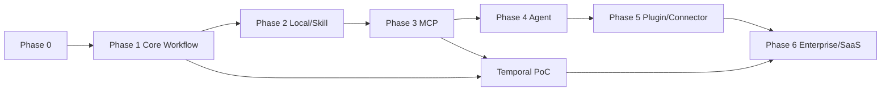

# 实施路线图

> 不一次性实现整个平台。每个 Phase 有明确退出标准；未通过不进入下一阶段。周期是相对估算（假设 3-5 人全职），不是承诺日期。
>
> 当前完成度按本地 MVP 与完整路线图两套口径记录，见 [实现状态与验收边界](../10-quality/implementation-status.md)。

## 1. 总览

| Phase | 目标 | 周期（估） | 退出标准 |
| --- | --- | --- | --- |
| 0 | Research & Architecture | 完成 | 本套文档 + PoC 方案 |
| 1 | Core Workflow Platform | 8-12 周 | Canvas/YAML/JSON 可执行；本地运行 |
| 2 | Local Runtime & Skill Center | 8-12 周 | 离线 Skill 加载/执行/导出 |
| 3 | MCP Ecosystem | 6-10 周 | Gateway + 外部客户端调用 |
| 4 | Agent Platform | 8-12 周 | Agent + Skill/MCP/Workflow + 审批/恢复 |
| 5 | Plugin & Connector Ecosystem | 8-12 周 | SDK/安装/市场/签名 |
| 6 | Enterprise & SaaS | 12-20 周 | 多租户/Worker/Hybrid/合规 |

## 2. Phase 0（已完成）

交付：

- 16 项目研究、许可证、对比矩阵、复用策略。
- 产品需求、系统架构、IR/节点/执行、Agent/Skill/MCP/Plugin、数据/API/权限、UI、质量/路线图、15 个结论题、ADR。
- 三个 PoC 方案（不在本轮执行）。

## 3. Phase 1：Core Workflow Platform

### 范围

- Monorepo：`crates/hpa-*`（Rust Core/Local/Worker）、`apps/web`（React）、`apps/control-plane`（NestJS）、`schema/`、`proto/`、`packages/ts/*`。
- IR v1 + JSON Schema + YAML/JSON 序列化 + SourceMap。
- Workflow Designer（Canvas/Inspector/Debugger/Topbar；YAML/JSON 面板）。
- 节点：Start/End/Condition/Switch/Loop/Parallel/Join/HTTP/Script/Transform/SetVariable/Human Approval/Subflow。
- 轻量运行时（本地 + Worker 同核）；检查点/事件/恢复；审批。
- Node Registry、五类校验、发布版本、执行监控基础。
- 本地文件/CLI 启动；i18n ja/en/zh；基础设计系统。
- M0 本地切片不引入 NestJS/Python/MCP/WASM/Temporal；团队/Control Plane/云端切片在同一阶段后段或 M1 加入（见 [MVP](../13-tech-stack/mvp-stack.md)）。

### 工作流

1. IR/Schema/编译器 + 测试（第 1-3 周）。
2. 运行时 + 节点 + 事件/检查点（第 3-6 周）。
3. Designer/Inspector/调试器（第 4-9 周）。
4. 校验/发布/版本/权限基础（第 6-9 周）。
5. 执行监控/审批/本地运行（第 8-11 周）。
6. 硬化/性能/安全/验收（第 10-12 周）。

### 退出标准

- P1-01..P1-11（见验收标准）。
- 本地断网运行一个含分支/循环/并行/审批的 Workflow。
- Canvas↔YAML↔JSON 语义往返 fixture 100%。
- 无 AI 依赖。

### 关键风险

IR 过度设计、画布性能、执行语义边界、许可证污染。缓解：PoC A 先冻结、fixture 驱动、代码审查/路径门禁。

## 4. Phase 2：Local Runtime & Skill Center

### 范围

- Local Runtime 完整：本地 Registry/SQLite/产物/日志/同步（可选）。
- Skill Center：导入/编辑/测试/发布/导出；标准 Agent Skills。
- Skill Runtime：Loader/Resolver/Context/Execution/Script/Permission/Sandbox/Artifacts。
- 脚本运行时 Python/Node/Shell；沙箱；离线；模型可选。
- Skill 测试控制台；签名/信任基础。
- 本地 MCP Server/Client 基础（为 PoC B）。

### 退出标准

- P2-01..P2-08。
- 无网络机器：导入→校验→执行→产物→导出。
- 外部客户端加载导出 Skill（至少 Claude Code/Codex）。

## 5. Phase 3：MCP Ecosystem

### 范围

- MCP Gateway（2026-07-28 + 旧版兼容）、OAuth 2.1/PAT、工具/资源/Prompt 注册、限流/审计/审批。
- MCP Client（stdio/HTTP）、MCP Explorer、MCP Center。
- 外部客户端集成（Claude/Copilot/Codex）；PoC B 执行。
- 工具由 Capability Registry 生成；高风险审批。

### 退出标准

- P3-01..P3-08。
- 至少 2 个真实外部客户端完成“发现→只读调用→写操作审批→结果”。
- 2026-07-28 conformance + 2025-11-25 兼容。

## 6. Phase 4：Agent Platform

### 范围

- Agent Center/Designer/Test；AgentVersion。
- Agent Runtime（Python 3.13 + LangGraph，可选 AI Worker）+ 预算/限制/工具/ Skill/MCP/Workflow。
- Checkpoint/interrupt/resume/审批；多 Agent。
- 模型网关（LiteLLM）；成本/预算。
- Agent 观测/会话/回放。

### 退出标准

- P4-01..P4-08。
- Agent 通过 Skill 指导调用 MCP 工具，并调用 Workflow 完成任务。
- 审批/恢复/预算/权限不可绕。

### Temporal PoC

- 在 Phase 3/4 之间做 Temporal 适配器 PoC（IR 解释器 + Activity + Signal）；只验证最小闭环；不默认启用。

## 7. Phase 5：Plugin & Connector Ecosystem

### 范围

- Plugin SDK/Manifest/签名/安装/升级/回滚/卸载。
- Connector SDK + 核心 Connector（HTTP/DB/File/Git/MQ/S3）。
- Marketplace（审核/评分/撤回/许可）。
- 插件贡献能力/多入口权限；供应链/SBOM。

### 退出标准

- P5-01..P5-07。
- 示例插件从开发→签名→市场→安装→使用→回滚。
- Connector 权限/SSRF/限流测试通过。

### 本地实现状态（2026-11-01）

本地 Phase 5 MVP 已实现 `hpa.plugin/v1` + Ed25519 + tar 包、安装/升级/回滚/启停/卸载、本地 Marketplace（审核/评分/撤回）、Agent Connector 工具审批、SBOM/许可/静态扫描门禁与 Plugin Center/Connector Center。P13-05 已增加 PostgreSQL/Git/Redis MQ/S3 Connector、签名远程/离线 Marketplace、发布者与索引 key 轮换/吊销、撤回传播、Marketplace UI、OSV/离线漏洞库和 key-based cosign/OCI digest provenance；Fulcio/Rekor keyless、Registry attestation 拉取与恶意软件情报仍为后续目标。详见 [`remote-marketplace.md`](../07-plugin/remote-marketplace.md)。

## 8. Phase 6：Enterprise & SaaS

### 范围

- 多租户/RLS/OIDC/SSO/RBAC/审计/配额。
- Private/Cloud Worker/Hybrid 注册/断线/恢复/凭证隔离。
- 备份/恢复/保留/删除；计量/计费（如启用）。
- 性能/合规/运营。

### 退出标准

- P6-01..P6-07。
- 跨租户测试 0；Hybrid 断线恢复；备份演练。
- SaaS/Private 部署手册/运维手册。

### 本地实现状态（2026-11-01）

本地 Phase 6 已实现单节点 Enterprise 基座：`control.db` 控制面、每租户独立 SQLite + TenantGate、跨租户访问测试为 0；8 固定角色 RBAC、配额、成员目录、审计 JSON/CSV 导出；`hpa_ent_` 令牌与 OIDC EdDSA JWT/JWKS；Worker 注册/心跳/离线派生/禁用；租户备份/恢复/保留/删除清理；Enterprise Center 的 1440/607 界面。浏览器 SSO 已由 Phase 9 补齐；未实现 PostgreSQL RLS、远程/Hybrid Worker 派发（Phase 8 已补齐）、HA/多节点、计费与租户自助注册。详见 [`docs/08-platform/local-enterprise.md`](../08-platform/local-enterprise.md) 与 [`docs/08-platform/enterprise-operations.md`](../08-platform/enterprise-operations.md)。

## 8a. Phase 7：VS Code & GitHub Copilot 本地集成（增量）

### 范围

- TypeScript VS Code 扩展：Runtime 发现/健康、10 个 Tree View、执行/产物 Webview、命令/状态栏。
- 官方 `mcpServerDefinitionProviders`、SecretStorage PAT、`.github/skills` 安装/更新/移除与本地修改保护。
- ja/en/zh、工作区信任、离线/CSP 安全边界、VSIX 打包。

### 本地实现状态（2026-11-01）

已实现 `apps/vscode-extension`（`hpa.workbench`），使用现有 Rust Local API、MCP Gateway 与 Skill Export，不新增执行引擎。VS Code 1.143.1 实测 MCP provider 启动与 4 个工具发现；为 VS Code 工具名限制增加 `X-HPA-Tool-Name-Style: slug`。60 个 Vitest、7 个 Extension Host 检查、VSIX 临时目录安装通过；工作流运行→审批→成功与 Skill 安装已实际操作。Copilot 模型的 MCP `tools/call` 未验证；Custom Instructions/Agents 生成、远程 Worker、Marketplace 发布仍延后。详见 [`docs/14-vscode-copilot/local-implementation.md`](../14-vscode-copilot/local-implementation.md)。

## 8b. Phase 8：Hybrid Worker 执行（本地/私有）

### 范围

- Worker 一次性 token、能力/并发、租约队列、心跳续租、断线重排、协作取消、版本/租户隔离。
- `hpa worker` 出站轮询，用同一 Rust Runtime 执行 Workflow 快照；事件/状态/产物写回租户库。
- 审批后 Job 重排；服务重启不接管远程 execution；Worker Center 派发/队列/取消。
- 私有部署 systemd/TLS/运维。

### 本地实现状态（2026-11-01）

已实现 `core` 队列 + daemon + Worker Center + 私有部署文档。真实 daemon 集成测试完成远程 Workflow 成功、人工/自动审批恢复、取消；start/events/complete 使用本地持久 outbox，远程审批 SLA 由控制面处理。仍不做 Redis/多节点、mTLS、远程凭证注入、对象存储与自动扩缩容。详见 [`docs/08-platform/hybrid-workers.md`](../08-platform/hybrid-workers.md)。

## 8c. Phase 9：本地 Enterprise Browser SSO

### 范围

- OIDC Authorization Code + PKCE（S256，public client，无 secret）、state/nonce/redirect 校验。
- ID Token EdDSA/RS256/ES256 与 JWKS OKP/RSA/P-256；JWKS 缓存与端点 SSRF 防护。
- 服务端 session（token 哈希）、HttpOnly/SameSite Cookie、CSRF header、登录/会话/登出/失效。
- 成员目录 disabled/角色覆盖、tenant active、平台管理员 `adminSubjects` allowlist。
- `/login`、全局 session/CSRF 注入、Enterprise Center 浏览器登录，ja/en/zh；Bearer 与本地匿名模式不回归。
- mock IdP、Rust HTTP 集成测试、Playwright 浏览器验收、1440/607 截图。

### 本地实现状态（2026-11-01）

已实现 `browser_auth`、`oidc_verify` 与控制面路由/CSRF 接线；`/login` 与 Enterprise Center 可在浏览器完成 SSO 登录/退出并显示角色与管理员状态。EdDSA/RS256/ES256 三种算法均通过 Playwright 流程；Rust HTTP 测试覆盖 Cookie 属性、CSRF 403、state 重放、redirect 逃逸、disabled 成员、nonce 失配与登出后 401。Phase 10 随后补齐独立的 OAuth AS。Phase 13 为 Browser SSO 增加 AES-GCM token-at-rest、refresh 轮换/CAS、静默续期和 RP-initiated logout，并增加 SCIM 2.0 Users/Groups 与组角色映射；仍未支持第三方 Cookie 或多 IdP。详见 [`docs/08-platform/browser-sso.md`](../08-platform/browser-sso.md) 与 [`docs/08-platform/scim.md`](../08-platform/scim.md)。

## 8d. Phase 10：内置 OAuth 2.1 授权服务器

### 范围

- Authorization Code + PKCE（S256，强制）、`state` 往返、授权码一次性与 120s TTL。
- 动态客户端注册（RFC 7591）与手工注册；公共/机密客户端、密钥哈希、启停与轮换。
- 刷新令牌轮换与复用检测（family 级吊销）、吊销（RFC 7009）、内省（RFC 7662）。
- ES256（默认）/EdDSA 签发，JWKS 与密钥轮换 24h 重叠窗口。
- 同意页与 `oauth_consents`；本地模式匿名 owner、企业模式跳 `/login`。
- MCP Gateway 接受 AS 访问令牌（`aud` 绑定、单租户约束）；`authorization_servers` 元数据。
- Enterprise Center → OAuth 2.1：端点、客户端、令牌与密钥轮换控制台；ja/en/zh。

### 本地实现状态（2026-11-01）

已实现 `crates/hpa-local/src/oauth.rs` + `oauth_http.rs`、`/consent` 页面与 Enterprise Center OAuth 标签页。4 个单元测试与 4 个 HTTP 集成测试通过；Playwright 走通「注册 → 授权 → 同意 → 换令牌 → 调用 MCP → 吊销」并覆盖 1440/607 截图；MCP PAT 与 stdio 令牌路径不回归。不做 ID Token、CIMD、PAR、JARM、DPoP、token exchange、RS256 与跨节点吊销同步。详见 [`docs/08-platform/oauth-authorization-server.md`](../08-platform/oauth-authorization-server.md)。

## 8e. Phase 11：触发器与调度

### 范围

- `trigger.config` 强类型化：schedule（cron/时区/misfire/maxCatchUp/input）与 webhook（secret/enabled），未知字段拒绝。
- 自研 5 字段 cron（`*`/列表/区间/步长/月周缩写，日周并集语义）与固定偏移时区；无新依赖。
- 调度器：`trigger_state` 持久化 `next_fire_at`，每秒 tick，乐观锁单飞，skip/run_once/catch_up 三种漏跑策略。
- Webhook 入站：HMAC-SHA256 + `±300s` 重放窗口 + `X-HPA-Event-Id` 幂等 + 1 MiB 体积上限 + 进程内限流。
- 发布即同步触发器快照；`/api/triggers` 启停/手动触发/触发历史；`/triggers` 控制台（ja/en/zh）。

### 本地实现状态（2026-11-01）

已实现 `crates/hpa-core/src/trigger.rs`（cron/event 契约）、`crates/hpa-local/src/scheduler.rs`（调度与发火）、`hooks.rs`（入站）、`db.rs` 的 `trigger_state`/`trigger_fires`，以及 `/triggers` 页面。`event` 通过 `/api/events/{topic}` 按租户订阅并支持事件 ID 幂等；目录通知与 HTTP 测试覆盖 schedule/webhook/event。仍不做跨进程事件总线、分布式调度、DST 时区、mTLS/IP 白名单与远程 Worker 直接派发。详见 [`docs/03-workflow/triggers.md`](../03-workflow/triggers.md)。

## 8f. Phase 12：可观测性与执行洞察

### 范围

- 进程内指标注册表 + Prometheus 文本暴露：HTTP 路由/方法/状态/延迟、执行与节点直方图、调度器 tick 与心跳、触发器发火、租户状态 gauge。
- `route` 标签使用路由模板而非真实路径；租户网关兜底路由不重复计数。
- `/api/ready` 真依赖探针（控制库、租户库、签名密钥、调度器心跳），企业模式下指标需要管理员令牌。
- 执行详情步骤时间线（事件配对、最慢高亮、重试与未闭合 span）；设置页运行时状态卡片。

### 本地实现状态（2026-11-01）

已实现 `crates/hpa-local/src/metrics.rs` 与 `observe.rs`、driver/scheduler 埋点、`ExecutionDetail` 时间线与设置页状态卡片。2 个指标渲染单元测试、2 个 HTTP 集成测试通过；Playwright 覆盖时间线与设置页，1440/607 无横向溢出。不做 OTLP 导出、跨进程追踪、持久化指标与可配置桶。详见 [`docs/08-platform/observability.md`](../08-platform/observability.md)。

## 8g. Phase 13：生产级补全（当前目标）

> 状态：**IN_PROGRESS**。P13-01～07 的本地代码与自动化基线已落地并通过真实 PostgreSQL、Redis、MinIO、Git、Python 和 OTLP receiver 测试；Worker Job、Enterprise、Agent、Skill、MCP、Connector 与 Plugin 元数据已切到 PostgreSQL 权威。剩余阻塞是统一 outbox、多 IdP/真实企业基础设施、跨主机自动故障切换/PITR、跨版本滚动升级、生产 Collector 和真实外部 AI 客户端。完整完成定义见 [Phase 13 生产级补全](phase-13-production-completion.md)。

范围：

- PostgreSQL 控制面、RLS、migration/import/rollback。
- 分布式调度、可靠 outbox/队列、HA Worker lease。
- 持久 MCP session/subscription/task 与多节点 Event Bus。
- 可选 Python 3.13/LangGraph Worker 和 LiteLLM 网关。
- DB/Git/MQ/S3 Connector、远程 Marketplace、发布者治理。
- OTLP/跨进程追踪、企业认证剩余能力、mTLS 与对象存储。
- Claude Code、Codex、GitHub Copilot/Chat 的真实端到端证据。

首个里程碑：P13-01 PostgreSQL schema/RLS 契约和迁移测试。

## 8h. Phase 14：Skill 元数据 PostgreSQL 权威

> 状态：**本地验收完成**（2026-11-03）。Skill 包与版本元数据（skills/skill_versions/skill_files/skill_runs/skill_run_artifacts）在 `HPA_POSTGRES_RUNTIME=1` 时以 PostgreSQL 为权威，支持跨节点导入、版本/文件读取、发布状态、运行与产物；本地 SQLite 模式与 Skill API/CLI/MCP 路径不改变。签名文件、跨节点 Skill 文件同步与 Skill 执行所有权不在本阶段。完整契约见 [Phase 14 Skill PostgreSQL](phase-14-skill-postgres.md)。

## 8i. Phase 15：MCP 控制面元数据 PostgreSQL 权威

> 状态：**本地验收完成**（2026-11-03）。MCP PAT、审批、审计与外部服务器元数据（mcp_tokens/mcp_approvals/mcp_audit/mcp_servers）在 `HPA_POSTGRES_RUNTIME=1` 时以 PostgreSQL 为权威，支持跨节点 token 创建/查找/吊销、审批决定/一次性消费/过期、审计写入与服务器管理；本地 SQLite 模式、MCP Gateway/stdio/HTTP 传输与 MCP Center 不改变。持久 MCP session/task 状态仍由 `HPA_POSTGRES_MCP=1` 独立覆盖，Plugin/Connector 元数据不在本阶段。完整契约见 [Phase 15 MCP PostgreSQL](phase-15-mcp-control-postgres.md)。

## 8j. Phase 16：Connector 元数据 PostgreSQL 权威

> 状态：**本地验收完成**（2026-11-03）。Connector 定义、连接与审计（connector_definitions/connections/connector_audit）在 `HPA_POSTGRES_RUNTIME=1` 时以 PostgreSQL 为权威，节点启动幂等注册内置连接器，支持跨节点创建/读取/更新/测试/删除连接与审计；插件启停/卸载的 Connector 贡献走同一路径。本地 SQLite 模式与执行引擎不改变。插件包、签名与 Marketplace 元数据不在本阶段。完整契约见 [Phase 16 Connector PostgreSQL](phase-16-connector-postgres.md)。

## 8k. Phase 17：Plugin 元数据 PostgreSQL 权威

> 状态：**本地验收完成**（2026-11-03）。插件生命周期、本地 Marketplace 与远程 Marketplace 元数据（plugin_packages/plugins/plugin_capabilities/plugin_events/plugin_market_listings/plugin_reviews/publishers/sources/remote_packages/event_stream）在 `HPA_POSTGRES_RUNTIME=1` 时以 PostgreSQL 为权威；插件贡献的 MCP server 与 Connector 分别走 Phase 15/16 的存储。包文件、签名私钥与安装目录仍属节点本地，跨节点启用需目标节点具备文件。本地 SQLite 模式与插件 CLI/UI 不改变。完整契约见 [Phase 17 Plugin PostgreSQL](phase-17-plugin-postgres.md)。

## 8l. Phase 18：Agent 会话 owner lease

> 状态：**本地验收完成**（2026-11-03）。`hpa_tenant.agent_sessions` 增加 owner/token/expiry 租约列；AgentRuntime 在 start/drive/approval resume/recover 时获取租约，persist/emit 使用 holder+token+未过期围栏，终态或等待审批释放；`recover` 跳过仍被其他节点持有的 running 会话，只接管过期会话。本地 SQLite 模式不变。完整契约见 [Phase 18 Agent lease](phase-18-agent-lease.md)。

## 8m. Phase 19：远程 Marketplace 全链路

> 状态：**本地验收完成**（2026-11-03）。签名远程 Marketplace 索引、跨节点刷新、远程安装与撤回传播已打通；未缓存包的节点在安装时自动刷新来源，刷新后重新校验批准/撤回/签名/哈希。包缓存仍为节点本地，元数据与撤回状态在 PostgreSQL。完整契约见 [Phase 19 远程 Marketplace](phase-19-remote-marketplace.md)。

## 8n. Phase 20：PG 模式配额计数收口

> 状态：**本地验收完成**（2026-11-04）。`maxPlugins` 与 `maxConnections` 配额在 `HPA_POSTGRES_RUNTIME=1` 时改为按 `hpa_tenant.plugins` / `hpa_tenant.connections` 计数，修复此前仍查 SQLite 导致的跨节点配额绕过；本地 SQLite 模式不变。完整契约见 [Phase 20 配额计数](phase-20-quota-counts.md)。

## 8o. Phase 21：配额门禁覆盖所有创建入口

> 状态：**本地验收完成**（2026-11-04）。`/plugins/sample`、`/connectors/sample`、本地与远程 Marketplace 安装路径统一进入 `maxPlugins` / `maxConnections` 检查；配额为 0 时全部 429，提高后立即恢复。完整契约见 [Phase 21 配额入口](phase-21-quota-entrypoints.md)。

## 8p. Phase 22：Agent 工具副作用租约守卫

> 状态：**本地验收完成**（2026-11-04）。Agent 驱动循环每一轮、工具执行前、Python 工具服务与审批恢复前续租并校验 token；租约丢失时新副作用不再执行。本地 SQLite 模式无租约。完整契约见 [Phase 22 工具租约](phase-22-agent-tool-lease.md)。

## 8q. Phase 23：MCP 2026-07-28 server-stateless conformance

> 状态：**本地验收完成**（2026-11-04）。官方 conformance 升级到 `0.2.0-alpha.12`；新增 requirements 运行模式与 `test:mcp-conformance:2026`。2025-11-25 核心 9/9，2026-07-28 `server-stateless` 28/28；per-request `_meta`、-32020/-32022/-32021/-32601 语义与订阅确认已对齐。Phase 23 完成时媒体 fixture、MRTR、caching/completion 与 tasks 仍未覆盖，其中媒体/缓存/Header 由 Phase 24 补齐、MRTR 由 Phase 25 补齐。完整契约见 [Phase 23 MCP stateless](phase-23-mcp-2026-stateless.md)。

## 8r. Phase 24：MCP 2026-07-28 内容与 Header conformance

> 状态：**本地验收完成**（2026-11-04）。工具图像/音频/嵌入资源/混合内容/进度、Resources/Prompts、completion、caching、JSON Schema 2020-12 与 Header（含 base64 Mcp-Param）场景通过；`test:mcp-conformance:2026-content` 18 个场景 0 failed。Phase 24 完成时完整 requirements 剩余 MRTR 与 tasks extension，MRTR 由 Phase 25 补齐、tasks extension 由 Phase 26 补齐。完整契约见 [Phase 24 MCP content](phase-24-mcp-content-conformance.md)。

## 8s. Phase 25：MCP 2026-07-28 MRTR conformance

> 状态：**本地验收完成**（2026-11-04）。SEP-2322 `InputRequiredResult` 的 elicitation/sampling/roots、requestState 完整性、多输入、多轮、能力过滤、缺失/非法响应与 `prompts/get` 场景全部通过；`test:mcp-conformance:2026-mrtr` 覆盖 14 个场景、40 项检查 0 failed。2026-07-28 计分 server requirements 达到 37/37（Phase 25 完成时总计 162 passed / 29 failed，失败全部在不计分的 tasks extension，后由 Phase 26 补齐）。完整契约见 [Phase 25 MRTR](phase-25-mcp-mrtr-conformance.md)。

## 8t. Phase 26：MCP 2026-07-28 tasks extension conformance

> 状态：**本地验收完成**（2026-11-04）。SEP-2663 tasks extension 的 capability 协商、扁平 `CreateTaskResult`、`tasks/get` DetailedTask、`tasks/update`/`tasks/cancel` 空 ack、部分输入满足、MRTR 组合、`-32021` gating、`tasks/result|list` `-32601` 与 tasks 方法 `Mcp-Name` 校验全部通过；`test:mcp-conformance:2026-tasks` 覆盖 10 个场景。完整 2026 requirements 达到 **193 passed / 0 failed**。完整契约见 [Phase 26 tasks](phase-26-mcp-tasks-extension.md)。

## 8u. Phase 27：双控制面 + 双 Worker 滚动升级

> 状态：**本地验收完成**（2026-11-04）。两个控制面共享 PostgreSQL、两个 Worker 经故障切换代理消费 Job；控制面逐个替换、Worker 分别执行中强杀并重启后，6 个 Job 全部成功，重派 `attempts >= 2` 且 `executionId` 不变。`test:worker-rolling` 21/21 checks，`test:multi-node` 10/10、`test:rolling` 17/17 回归通过。完整契约见 [Phase 27 滚动升级](phase-27-worker-rolling-upgrade.md)。

## 9. 依赖/顺序

- Phase 2 依赖 Phase 1 的运行时/IR。
- Phase 3 依赖 Capability Registry/权限/审批（Phase 1 基础）。
- Phase 4 依赖 Phase 2/3。
- Phase 5 依赖 Phase 3/4 的能力模型。
- Phase 6 依赖全部。

## 10. 不做/延后

- 微服务拆分（Phase 6 后按需）。
- 完整 BPMN/CMMN/DMN。
- 自研 durable execution（用 Temporal）。
- 自研模型/向量数据库。
- 付费市场/计费（Phase 6+）。
- 移动端原生 App（窄屏 Web 优先）。
- Kestra 内核/插件生态。

## 11. 团队假设

- 1 架构/技术负责人；2 后端（NestJS/运行时/安全）；2 前端（React/画布）；1 AI/Agent；0.5 SRE；0.5 安全/法务；设计/文档按需。
- 安全/许可证评审贯穿，不是最后补。
- 每个 Phase 结束做回顾/风险更新/文档同步。

## 12. 相关文档

- [验收标准](../10-quality/acceptance-criteria.md)
- [风险登记](risk-register.md)
- [PoC 方案](poc-plan.md)
- [测试策略](../10-quality/test-strategy.md)
