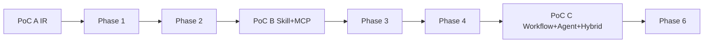

# 三个 PoC

> PoC 的目标是验证架构假设，不是做完整产品。每个 PoC 有明确问题、最小范围、验收证据与放弃条件。未通过不进入对应 Phase。

## PoC A：Workflow IR 往返与执行

### 要回答的问题

1. 一个 Canonical IR 能否同时承载 Canvas/YAML/JSON 且语义一致？
2. 分支/循环/并行/数据映射/异常/节点版本/布局是否能在同一模型中长期扩展？
3. 轻量运行时能否在无 AI 情况下执行完整语义？
4. YAML/JSON 文本保真的边界在哪里？

### 范围

- `crates/hpa-ir`、`hpa-schema`、`hpa-compiler`、`hpa-runtime`；最小 Web 画布（React + XYFlow）或直接 JSON 画布；Rust Local API/JSON Schema。
- YAML/JSON 序列化；SourceMap/CST 实验。
- 节点：Start/End/Condition/Switch/Loop/Parallel/Join/HTTP(mock)/Transform/Approval(mock)/Subflow。
- Fixture：
  1. 顺序 + 条件；
  2. 多路 switch；
  3. forEach + 聚合；
  4. parallel all + failFast；
  5. 数据映射（jq 过滤/聚合）；
  6. 重试/超时/错误 fallback；
  7. 人工审批暂停/恢复；
  8. 子流程 + 版本；
  9. 节点 typeVersion 迁移；
  10. 布局/注释/Unicode/CRLF。

### 非目标

- 完整 UI/权限/多租户/真实连接器/Agent/MCP。
- 生产级 durable execution。
- 与 Kestra/Temporal 集成。

### 步骤

1. 冻结 IR schema v0.1；写 10 个 fixture（IR + 期望结果）。
2. 实现 Canvas→IR / IR→Canvas（含布局）。
3. 实现 IR→YAML / YAML→IR；IR→JSON / JSON→IR。
4. 实现编译器（端口/容器/变量/表达式）。
5. 实现轻量运行时（顺序/分支/循环/并行/审批/重试/超时）。
6. 往返矩阵：Canvas→IR→YAML→IR→JSON→IR→Canvas；记录差异。
7. 执行矩阵：每个 fixture 在 YAML/JSON/Canvas 三种来源执行，比较事件/输出。
8. 文本保真实验：YAML 注释/格式/锚点；SourceMap 编辑。
9. 崩溃恢复：杀进程/检查点；重复副作用（mock HTTP 幂等）。
10. 写报告：模型是否可扩展、需调整字段、性能/复杂度。

### 验收

- 10/10 fixture 语义往返 `semanticEqual`（忽略布局）。
- 10/10 fixture 执行输出/关键事件一致（三种来源）。
- 审批/恢复/重试/超时通过。
- 规范文本往返稳定；注释实验结论明确（保留/降级）。
- 无 AI 依赖。
- 性能：100 节点图编译 < 200ms；执行调度开销 < 50ms/节点（本地）。
- 报告列出 IR 需要修改的点（如有）。

### 放弃/调整条件

- 需要为每个视图维护独立模型 → 停止，重新设计 IR。
- 容器/循环语义无法统一 → 调整 IR（不是打补丁）。
- 运行时恢复需要重写事件模型 → 重新评估轻量 vs Temporal。

### 交付物

- PoC 代码/测试（不作为产品代码直接合并）。
- 往返/执行矩阵报告。
- IR v1 修订/ADR。
- 性能/复杂度数据。

### 估算

2-3 人 × 3-4 周。

## PoC B：Local Skill + MCP + Copilot/Claude/Codex

### 要回答的问题

1. 标准 Skill 能否在外部客户端加载并按指导调用 MCP 工具？
2. 本地 MCP Server 能否调用本地脚本/文件，并完整审计？
3. Hisha 的 MCP Gateway/本地 Server 能否兼容 2026-07-28 与旧客户端？
4. 外部客户端配置差异是否可控？

### 范围

- 一个标准 Skill（如 `invoice-audit`）：SKILL.md + scripts/audit.py + references。
- 本地 MCP Server：工具 `invoice.audit` → 调用脚本 → 产物。
- 本地 Runtime/审计日志。
- 外部客户端：Claude Code、VS Code/Copilot、Codex（至少两个真实可用）。
- 认证：stdio/本地 HTTP；远端 Gateway 可选 PAT/OAuth。
- 协议：2026-07-28 + 2025-11-25 兼容。

### 非目标

- 多租户 SaaS/市场/计费。
- 复杂 Agent 规划。
- 生产级沙箱（PoC 用容器/受限进程即可，但必须记录边界）。

### 步骤

1. 创建 Skill；校验/测试；导出标准目录。
2. 在 Claude Code/Codex 安装 Skill（按各自路径）；确认加载。
3. 启动本地 MCP Server（stdio + HTTP）；工具 schema/审计。
4. 在客户端配置 Hisha MCP（按各自格式：`mcpServers`/`servers`/`[mcp_servers]`）。
5. 客户端发现工具；调用只读工具；调用写工具（触发审批）。
6. 按 Skill 指导调用 `invoice.audit`；脚本读取本地文件/写产物；结果返回客户端。
7. 断网重跑（本地模式）；检查审计。
8. 用旧协议客户端/模拟器测试兼容。
9. 记录每个客户端的配置/失败/版本。

### 验收

- 至少 2 个真实客户端完成：发现→调用→Skill 指导→本地脚本→结果。
- 审计包含 client/tenant/tool/参数摘要/结果/审批/trace。
- 本地脚本在沙箱/受限环境执行；无越权文件/网络。
- 导出 Skill 在目标客户端可加载。
- 2026-07-28 与 2025-11-25 至少各一条成功路径。
- 配置差异记录清楚；无“万能配置”假设。

### 放弃/调整条件

- 客户端不支持所需 MCP 版本且无兼容路径 → 缩小支持矩阵/明确限制。
- Skill 加载路径/字段差异不可调和 → 客户端适配器分层。
- 本地脚本无法安全隔离 → 强制容器/限制功能。

### 交付物

- Skill 包/脚本/测试。
- 本地 MCP Server 代码/配置。
- 客户端配置样例/兼容矩阵。
- 审计样例/安全报告。
- 集成指南修订。

### 估算

1-2 人 × 2-3 周。

## PoC C：Workflow + Agent + Hybrid Runtime

### 要回答的问题

1. Workflow 调用 Agent、Agent 调用 Workflow 的合同是否清晰？
2. 本地 Worker + 云端 Control Plane 的注册/心跳/任务/结果/断线恢复是否可行？
3. 人工审批/中断/恢复/多租户隔离能否贯通？
4. 是否需要 Temporal？（PoC 只验证轻量运行时 + 最小 durable 语义）

### 范围

- 最小 Control Plane（API + DB + 队列/租约）。
- 本地 Worker（出站连接；mock 云环境可用 Docker Compose）。
- Workflow：调用 Agent 节点 → Agent 调用 MCP 工具 + Workflow 子流程 → 审批 → 恢复。
- 租户 A/B 隔离；Worker 断线/恢复；审批拒绝/超时。
- 可选：Temporal 最小 PoC（IR 解释器 + Activity + Signal）单独分支，不混入主 PoC。

### 非目标

- 完整 SaaS/计费/市场。
- 生产级 HA/多区域。
- 完整 Agent 规划/多 Agent。

### 步骤

1. 定义 Workflow/Agent/MCP 合同与 TaskEnvelope/ResultEnvelope。
2. 实现最小 Control Plane（租户/执行/审批/事件/租约）。
3. 实现本地 Worker 注册/心跳/拉取/事件/结果；出站连接。
4. Workflow 调用 Agent（同步/异步）；Agent 调用 Workflow/MCP。
5. 审批：暂停/恢复/拒绝/超时；审批人权限。
6. 断线：Worker 离线→租约过期→重排；恢复→幂等去重。
7. 租户隔离：A/B 任务/事件/审批不可见。
8. 可选 Temporal：同一 IR 编译到解释器；比较恢复/复杂度。
9. 记录故障/恢复/成本/性能。

### 验收

- Workflow↔Agent↔MCP 闭环成功；事件/审批/审计可追溯。
- Worker 断线恢复：任务不丢/不重复副作用（幂等）。
- 审批暂停/恢复/拒绝/超时正确。
- 跨租户 0。
- 本地 Worker 不需要入站端口。
- Temporal（如做）结论明确：采用/不采用/条件。

### 放弃/调整条件

- 合同无法同时满足 Workflow/Agent/MCP → 重新设计边界。
- Worker 离线恢复不可靠 → 引入 Temporal/调整租约。
- 多租户隔离失败 → 停止，修数据模型/RLS。

### 交付物

- 最小实现/测试/部署脚本。
- 时序/故障报告。
- 合同/数据模型修订。
- Temporal 结论（如做）。

### 估算

2-3 人 × 4-6 周（依赖 Phase 1/2/3 基础）。

## 补充 PoC：Kestra vs Temporal 引擎对比

> 这是研究性 spike，不属于三个产品 PoC；目的是用可运行证据回答“底层执行引擎”问题，而不是把 Kestra 引入核心。

### 范围

- Kestra 2.0.7 单机（Docker Compose/H2 或 Postgres），用 YAML 建一个等价流程：分支 + 循环 + 并行 + 人工 Pause + 重试/超时。
- Temporal 1.32.1 dev server + 薄适配 Worker（TypeScript/Go SDK；用代码/IR 解释器建同一流程：分支 + 循环 + 并行 + Signal 审批 + 重试/超时）；Rust Core 通过 gRPC 调用 Activity/节点。
- 同一输入/外部 mock；记录启动时间、资源、开发 LOC、扩展方式、恢复行为、许可/运维。
- Hisha IR → 两引擎的最小映射（只做 PoC 所需节点）。

### 验收

- 两个引擎都能完成同一流程；结果/关键事件等价。
- 记录：本地启动时间/内存、插件/扩展开发成本、审批/恢复行为、失败场景。
- 结论明确：Temporal 适配器是否值得做；Kestra 是否只保留导入/参考。
- 不把 Kestra/Temporal 同时引入产品核心。

### 估算

1-2 人 × 1-2 周；在 Phase 3 前完成。

## 执行顺序

- PoC A 是 Phase 1 前置。
- PoC B 是 Phase 3 前置/并行。
- PoC C 依赖 Phase 2/3/4；不早于 Phase 4 中段。
- Temporal 最小 PoC 在 Phase 3/4 之间，不影响主路径。

## 相关文档

- [执行引擎选型](../01-research/architecture-comparison.md)
- [Workflow IR](../03-workflow/workflow-ir.md)
- [MCP 2026-07-28](../01-research/standards/mcp-2026-07-28.md)
- [外部客户端](../01-research/standards/external-ai-clients.md)
- [验收标准](../10-quality/acceptance-criteria.md)
