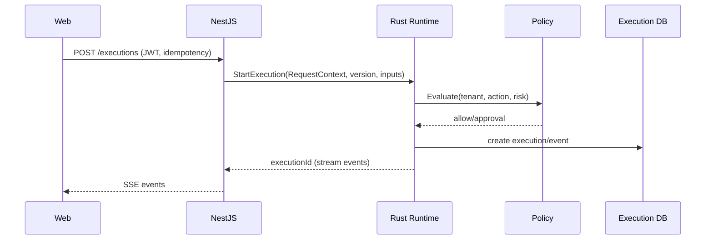
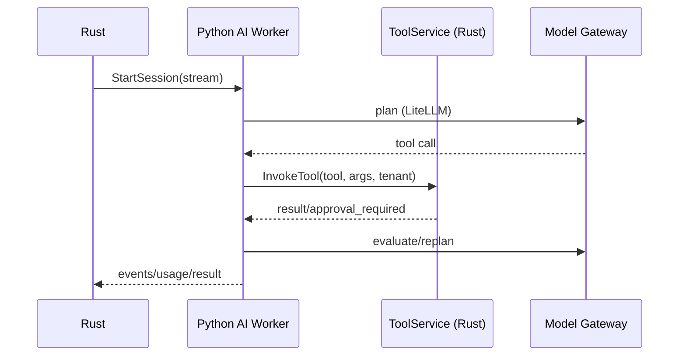

# 跨语言通信

> 原则：**契约在边界，语言内部对象不跨界**。内部服务用 gRPC/Protobuf，外部用 REST/OpenAPI，数据契约用 JSON Schema，AI 工具用 MCP，异步用事件/队列。

## 1. 通道选择

| 通道 | 用途 | 契约 | 流式 | 认证 | 结论 |
| --- | --- | --- | --- | --- | --- |
| REST/HTTP | 浏览器、外部 API、Webhook、健康 | OpenAPI 3.1 | SSE | OIDC/PAT | 外部主通道 |
| gRPC/Protobuf | NestJS ↔ Rust、Rust ↔ Python、Worker | Proto | 双向/服务端流 | mTLS + JWT | 内部主通道 |
| JSON Schema | IR、Node/Tool/Plugin/Connector 配置 | JSON Schema 2020-12 | — | — | 数据契约 |
| MCP | 外部 AI 客户端/Server | MCP 2026-07-28 + legacy | Streamable HTTP | OAuth 2.1/PAT | AI 工具协议 |
| 队列 | 任务分发、重试、离线 | Proto/JSON envelope | — | mTLS/JWT | 异步 |
| 事件 | 执行/审计/通知 | Proto/JSON event | SSE/gRPC stream | 同服务 | 最终一致 |

不采用：

- 浏览器直连 gRPC（用 REST/SSE）。
- 用 MCP 作为内部服务总线（它是 AI 工具协议，不承载平台控制流）。
- 用 REST 承载高频 Node/Worker 通信（gRPC 更合适）。
- 语言间共享内存/PyO3 作为主集成（GIL/崩溃/部署复杂；仅限受控库）。

## 2. gRPC 契约

### 2.1 包/服务

```text
proto/hisha/common/v1/common.proto
proto/hisha/runtime/v1/runtime.proto
proto/hisha/agent/v1/agent.proto
proto/hisha/tool/v1/tool.proto
proto/hisha/policy/v1/policy.proto
proto/hisha/worker/v1/worker.proto
```

| 服务 | 提供方 | 调用方 | 方法 |
| --- | --- | --- | --- |
| `RuntimeService` | Rust | NestJS/CLI | Validate/Compile/Start/Resume/Cancel/Query/StreamEvents |
| `AgentWorker` | Python | Rust | StartSession/ResumeSession/CancelSession/Health（流式事件） |
| `ToolService` | Rust | Python/NestJS | ListTools/InvokeTool |
| `PolicyService` | NestJS（缓存）/Rust 本地 | Rust | Evaluate/ApprovalStatus |
| `WorkerService` | NestJS | Rust Worker | Register/Heartbeat/Lease/Events/Complete |
| `RegistryService` | NestJS | Rust | GetWorkflowVersion/GetCapability/GetSecretRef |

- Proto 包名带版本；破坏性变更新包；Buf breaking 门禁。
- 生成：Rust `tonic-prost-build` 0.14.9；TS `ts-proto` 2.18.3 + `@grpc/grpc-js` 1.14.7；Python `grpcio-tools` 1.85.1。
- 不使用 `google.protobuf.Any` 作为通用载荷；具体 oneof/消息，避免类型黑洞。

### 2.2 通用字段

```proto
message RequestContext {
  string tenant_id = 1;
  string workspace_id = 2;
  string project_id = 3;
  string actor_id = 4;
  string request_id = 5;
  string traceparent = 6;
  string idempotency_key = 7;
  string locale = 8;
  int64 deadline_unix_ms = 9;
}
```

- 所有请求带 `RequestContext`；服务端校验租户/actor/scope。
- `deadline_unix_ms` 与 gRPC deadline 双保险；超时取消传播。
- `traceparent` 透传 OTel；不依赖隐式全局。
- `idempotency_key` 用于启动/工具/审批等有副作用操作；服务端保存窗口。

### 2.3 错误

```proto
enum ErrorCode {
  ERROR_CODE_UNSPECIFIED = 0;
  IR_SCHEMA_INVALID = 1001;
  IR_STATIC_INVALID = 1002;
  PERMISSION_DENIED = 2001;
  APPROVAL_REQUIRED = 2002;
  DEPENDENCY_MISSING = 3001;
  EXEC_TIMEOUT = 4001;
  EXEC_CANCELLED = 4002;
  SANDBOX_DENIED = 5001;
  MCP_PROTOCOL_ERROR = 6001;
  CONNECTOR_UPSTREAM_ERROR = 7001;
  SKILL_INVALID = 8001;
  PLUGIN_SIGNATURE_INVALID = 9001;
  RATE_LIMITED = 9101;
  INTERNAL = 9999;
}
message ErrorDetail {
  ErrorCode code = 1;
  string message = 2;
  bool retryable = 3;
  string remediation = 4;
  string trace_id = 5;
  repeated FieldError fields = 6;
}
```

映射：

| Hisha | gRPC | REST | MCP JSON-RPC |
| --- | --- | --- | --- |
| IR/validation | INVALID_ARGUMENT | 422 | -32602 |
| Permission | PERMISSION_DENIED | 403 | -32003 |
| Approval | FAILED_PRECONDITION + code | 409/202 | tool result waiting |
| Not found | NOT_FOUND | 404 | -32602 |
| Rate limit | RESOURCE_EXHAUSTED | 429 | -32000 + retry |
| Timeout | DEADLINE_EXCEEDED | 504 | tool error |
| Cancelled | CANCELLED | 499 | -32800 |
| Internal | INTERNAL | 500 | -32603 |

不把 gRPC 状态码直接暴露给浏览器；REST 使用 RFC 9457 `problem+json`；MCP 用 JSON-RPC error + data。

## 3. REST/OpenAPI

- 外部 API `/api/v1`；OpenAPI 3.1；NestJS Swagger 生成；`openapi-typescript` 生成类型；`openapi-fetch` 客户端。
- SSE：`text/event-stream`；`Last-Event-ID`；心跳/超时；断线重连。
- 认证：OIDC/PAT；租户上下文；幂等键；分页 cursor；ETag/If-Match。
- 错误：`application/problem+json`；code/traceId/remediation；不泄漏内部路径/secret。
- Webhook：HMAC + timestamp + replay protection；重试/退避/去重。
- 浏览器不直连 Rust gRPC；NestJS 代理/聚合；本地模式由 Rust Axum 暴露同一 OpenAPI 子集。

## 4. JSON Schema

- Draft 2020-12；`$id` 版本化；IR/Node/Tool/Plugin/Connector/Agent 配置。
- IR schema 是源；TS 类型生成；Rust `jsonschema` 校验；Python 只读契约。
- 禁止远程 `$ref`（不可信 schema）；所有 ref 本地注册/白名单。
- 生成代码/文档进 CI；schema 变更需兼容性检查。
- JSON 不是内部 RPC 的 wire format（gRPC 用 Proto）；JSON 用于用户/边缘/配置。

## 5. MCP

- 由 Rust RMCP 实现；2026-07-28 + 2025-11-25；Streamable HTTP/stdio；OAuth 2.1/PAT。
- NestJS 只管理 Server 注册/工具绑定/权限/审计；不实现协议。
- 工具由 Capability Registry 生成；高风险审批在 Rust/Control Plane 服务端强制。
- 不暴露内部 REST/数据库/文件系统；Resources 按租户过滤。
- MCP 不作为内部服务调用通道；内部工具调用走 `ToolService` gRPC。

## 6. 队列与事件

- MVP：Postgres outbox + Redis Streams；消费者组；至少一次；幂等。
- 规模/多区域：NATS JetStream（Phase 6 评估）；不引入 Kafka 作为初始依赖。
- 执行事件：Rust 追加 `ExecutionEvent`；gRPC 流给 NestJS；SSE 给浏览器；大对象放 Artifact。
- 事件顺序：每 execution 单调 sequence；消费者去重；失败重试/死信。
- 审计独立：AuditLog 由 Control Plane/Rust 写专用存储；事件不是审计。
- 定时/延迟：Temporal（Phase 3+）或 Rust timer + 持久化（标准运行时）；不在 MVP 引入 Temporal。

## 7. 超时/取消/重试/幂等

| 机制 | 规则 |
| --- | --- |
| Deadline | 每个 gRPC 请求带 deadline；HTTP 超时；执行级 deadline |
| Cancel | 取消传播到 Rust/Python/子进程/HTTP；不可中断调用记录“可能已发生” |
| Retry | 仅幂等/明确可重试；指数退避 + jitter；流式不盲目重试 |
| Idempotency | 启动/工具/审批/外部写操作带稳定 key；重试复用 |
| At-least-once | 不承诺 Exactly Once；补偿/对账/审计 |
| Backpressure | 有界队列/流控；拒绝而非无限缓冲 |

## 8. 认证与租户

- 边缘：OIDC/PAT；NestJS 验证并签发短期内部 JWT（tenant/workspace/scopes/audience）。
- 内部：mTLS + JWT；gRPC metadata；服务间不信任网络。
- Rust Worker：注册令牌 → 短期证书/JWT；租约绑定 tenant。
- Python AI Worker：短期 JWT；只拿会话/tool 权限；不拿长期上游凭证。
- 禁止 token passthrough；上游凭证由 Rust Vault/Connector 解析。
- 所有请求 tenant 必须匹配 token；跨租户拒绝并审计。

## 9. 版本兼容

| 契约 | 版本策略 |
| --- | --- |
| Proto | 包版本 `v1`；字段只增不删/不改语义；Buf breaking；新包做破坏性变更 |
| JSON Schema | `$id`/`schemaVersion`；旧版本可读；迁移器 |
| OpenAPI | `/api/v1`；新增可选字段；破坏性变更 v2 |
| MCP | 协议版本协商；RMCP 支持 2026-07-28/2025-11-25 |
| 事件 | `schemaVersion`；消费者兼容新增字段 |
| Runtime | Worker 声明支持版本；CP 支持 N-1；不兼容拒绝调度 |

## 10. 时序

### 启动 Workflow



### Agent 工具循环



### MCP

外部客户端 → Rust RMCP Gateway → Policy/Approval → Tool/Workflow/Skill → 结果/审计；NestJS 只提供 Registry/Policy/审计查询。

## 11. 测试

- Proto：Buf lint/breaking；生成代码 drift；兼容字段。
- 契约：Rust/TS/Python 三方同一 fixture；错误码/超时/取消。
- 集成：真实 gRPC/TLS/Postgres/Redis；Worker 断线；Python 重启。
- 幂等：重复 Start/Tool/Approval；事件去重。
- 安全：租户/越权/token passthrough/大 payload。
- 流式：背压/断线/重连/取消。

## 12. 反模式

- 共享内部对象/语言专用序列化（pickle/JSON of Rust structs）。
- 用 REST 传输高频流式事件/大对象。
- 用 MCP 代替内部 RPC/队列。
- 把 gRPC 状态码直接暴露给浏览器。
- 在无幂等保证下自动重试写操作。
- 依赖客户端 token 访问上游。
- 让 Python/TS 直接写 Rust execution schema。

## 13. 相关文档

- [Rust 技术栈](rust-stack.md)
- [TypeScript 技术栈](typescript-stack.md)
- [Python 技术栈](python-stack.md)
- [Script/Plugin 执行](script-plugin-execution.md)
- [统一契约](../02-architecture/contracts.md)
- [MCP 架构](../06-mcp/mcp-architecture.md)
