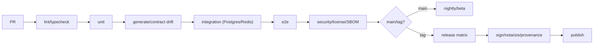

# Monorepo、构建与发布

> 一个仓库，三种语言，四个边界：`schema/proto`（契约）、`crates`（Rust）、`apps/packages`（TS）、`python`（AI）。所有生成物可复现，所有发布物可签名。

## 1. 仓库结构

```text
hisha/
├── Cargo.toml                  # Rust workspace
├── Cargo.lock
├── rust-toolchain.toml         # 1.99.x / MSRV 1.97
├── deny.toml
├── nextest.toml
├── package.json
├── pnpm-workspace.yaml
├── pnpm-lock.yaml
├── turbo.json
├── pyproject.toml              # uv workspace
├── uv.lock
├── .github/workflows/
│
├── schema/
│   ├── ir/v0.1/                # Canonical IR JSON Schema
│   ├── node/v1/                # Node/Tool schema（生成 + 手写约束）
│   ├── plugin/v1/              # Plugin manifest schema
│   ├── connector/v1/
│   └── errors/v1/
│
├── proto/hisha/
│   ├── common/v1/
│   ├── runtime/v1/
│   ├── agent/v1/
│   ├── tool/v1/
│   ├── policy/v1/
│   └── worker/v1/
│
├── crates/
│   ├── hpa-ir/
│   ├── hpa-schema/
│   ├── hpa-yaml/
│   ├── hpa-expression/
│   ├── hpa-compiler/
│   ├── hpa-validator/
│   ├── hpa-runtime/
│   ├── hpa-node-api/
│   ├── hpa-nodes/
│   ├── hpa-connectors/
│   ├── hpa-skill/
│   ├── hpa-mcp/
│   ├── hpa-plugin/
│   ├── hpa-script/
│   ├── hpa-process/
│   ├── hpa-resource/
│   ├── hpa-sandbox/
│   ├── hpa-policy/
│   ├── hpa-worker/
│   ├── hpa-local/
│   ├── hpa-observe/
│   ├── hpa-proto/            # build.rs + tonic-prost-build
│   └── hpa-test-support/
│
├── apps/
│   ├── local-runtime/          # Rust binary（依赖 crates）
│   ├── control-plane/          # NestJS
│   ├── vscode-extension/       # 增量集成：VS Code/Copilot（不改变核心）
│   └── web/                    # React + Vite
│
├── packages/ts/
│   ├── ui/                     # Design System/tokens/components
│   ├── ir-types/               # 从 schema/ir 生成
│   ├── api-client/             # 从 OpenAPI 生成
│   ├── sdk/                    # 外部 TS SDK
│   ├── connector-sdk/
│   ├── plugin-sdk/
│   └── i18n/
│
├── python/
│   ├── ai-worker/              # LangGraph + gRPC
│   ├── sdk/
│   └── skills/
│
├── plugins/
├── skills/
├── deploy/
│   ├── docker/
│   ├── compose/
│   ├── helm/
│   └── otel/
├── tests/
│   ├── fixtures/               # IR/Workflow 往返/执行
│   ├── conformance/            # MCP/协议/契约
│   ├── cross-language/         # Rust/TS/Python
│   ├── integration/
│   └── e2e/
├── tools/
├── docs/
└── README.md
```

### 边界规则

- `crates/*` 不依赖 `apps/*`/TS/Python；只依赖其他 crates 与头等库。
- `apps/control-plane` 不依赖 Rust 源码；只依赖生成的 Proto/OpenAPI。
- `apps/web` 不依赖 `apps/control-plane` 源码；只依赖 `packages/ts/*`。
- `python/ai-worker` 不依赖 Rust/TS 源码；只依赖生成的 Proto。
- `schema/`、`proto/` 是唯一跨语言契约源；禁止手写重复 DTO。
- 本地控制面子集在 Rust；云端在 NestJS；共享 OpenAPI/IR 契约与 fixture。

## 2. 依赖管理

| 生态 | 工具 | 锁文件 | 规则 |
| --- | --- | --- | --- |
| Rust | Cargo workspace | `Cargo.lock` | `[workspace.dependencies]` 统一版本；禁止 `*`；features 最小 |
| TypeScript | pnpm 12 + workspace catalog | `pnpm-lock.yaml` | 统一 React/TS/Vite 版本；禁止重复版本 |
| Python | uv 0.13 | `uv.lock` | Python 3.13；dev 依赖分离；hash 校验 |
| Proto | Buf 1.75 | — | lint/breaking；生成代码 CI drift |
| OpenAPI | NestJS Swagger + openapi-typescript | `openapi.json` | 快照 + drift |
| 容器 | Docker/Compose/Helm | 镜像 digest | 非 root/只读；SBOM/provenance |

- 依赖升级：Renovate/Dependabot + 人工评审；Rust `cargo update` 分组；TS/pnpm；Python uv。
- 许可证/漏洞：`cargo-deny`、`cargo-audit`、`pip-audit`、npm audit、Trivy、Syft；禁止 AGPL/SSPL/未知许可进入核心。
- 所有直接依赖记录用途/许可/维护者/退出方案（ADR/PR 模板）。

## 3. 生成顺序

```text
schema/ir + proto
  ├─> Rust: prost/tonic（build.rs，OUT_DIR）
  ├─> TS: ir-types（json-schema-to-typescript）、ts-proto
  ├─> Python: grpcio-tools
  ├─> OpenAPI: NestJS Swagger → openapi.json → api-client（openapi-typescript）
  └─> Docs/Conformance
```

- Rust Proto 代码在构建时生成，不提交；TS/Python 生成代码提交并 CI drift 检查。
- IR TS 类型提交；`schema/ir` 变更需迁移/兼容检查。
- `openapi.json` 由 NestJS 生成/快照；破坏性检查用 `@redocly/cli` 或 `oasdiff`（待选）。

## 4. 构建

### Rust

```bash
cargo build --workspace --release
cargo nextest run --workspace
cargo clippy --workspace --all-targets -- -D warnings
cargo fmt --all --check
cargo deny check
cargo audit
```

- `sqlx` 编译期查询：CI 设置 `DATABASE_URL` 或 `.sqlx` 离线缓存；`cargo sqlx prepare`。
- `build.rs` 只做 Proto/嵌入资源；不下载任意脚本。
- `sccache`；target 分层；CI 缓存。

### TypeScript

```bash
pnpm install --frozen-lockfile
pnpm --filter @hpa/ir-types generate
pnpm --filter @hpa/api-client generate
pnpm tsc -b
pnpm lint
pnpm test
pnpm build
pnpm e2e
```

- Vite 8 构建 web；NestJS tsc/SWC 构建 API。
- UI 静态资源构建后由 CDN/Nest 或本地 `rust-embed` 打包。
- 生成代码 drift 检查；禁止手改生成文件。

### Python

```bash
uv sync --frozen
uv run ruff check .
uv run ruff format --check .
uv run mypy .
uv run pytest
```

- LangGraph/Pydantic/gRPC 版本锁定；容器镜像固定 digest。
- 不把 Python 构建塞进 Rust 单二进制；可选镜像/sidecar。

## 5. 测试策略（工具）

| 层 | Rust | TS | Python |
| --- | --- | --- | --- |
| Unit | cargo test / nextest | Vitest | pytest |
| Property | proptest（可选） | fast-check（可选） | hypothesis（可选） |
| Contract | tonic/proto fixtures | ts-proto fixtures | grpcio fixtures |
| Integration | Testcontainers/Compose | Testcontainers/MSW | pytest + grpc |
| E2E | 二进制/Worker | Playwright | — |
| Security | cargo-deny/audit + sandbox tests | axe/Playwright + npm audit | pip-audit |
| Performance | criterion（可选） | Lighthouse/Playwright | pyperf（可选） |

- 跨语言 fixture 在 `tests/fixtures`：同一 IR/输入/期望事件，在三端验证。
- MCP conformance 在 `tests/conformance`（2026-07-28 + 2025-11-25）。
- 崩溃恢复：杀进程/断网/租约；不以 mock 代替。
- 视觉/窄屏/三语：Playwright + 截图。

## 6. CI/CD



Jobs：

| Job | 内容 |
| --- | --- |
| `proto` | Buf lint/breaking；生成 drift |
| `rust` | fmt/clippy/nextest/deny/audit；OS matrix |
| `ts` | pnpm install/typecheck/lint/vitest/build/Playwright；OpenAPI drift |
| `python` | uv sync/ruff/mypy/pytest；gRPC contract |
| `integration` | Compose Postgres/Redis/Rust/Nest/Python；e2e |
| `security` | SBOM/Trivy/secret scan/license |
| `docs` | links/Mermaid structure/required docs |
| `release` | tag；构建/签名/公证/发布 |

- 当前 CI 使用版本化 Action、`contents: read` 最小权限和冻结锁文件；正式发布应把 Action 再固定到受审 SHA，并接入 OIDC 发布与 environment secrets。不要在日志打印 token。
- 缓存：sccache、pnpm store、uv cache、Cargo registry；缓存 key 包含 lockfile hash。
- 分支保护是 GitHub 仓库外部配置：上线前应把 `CI / verify` 设为 required check 并禁止绕过。仓库文件本身不能证明该设置已启用。

## 7. 版本管理

| 对象 | 策略 |
| --- | --- |
| 平台/二进制 | 发布列车 `vX.Y.Z`（apps/crates 同步）；semver |
| Rust crates | semver；内部 crate 可随平台版本 |
| TS packages | Changesets semver；`@hpa/*` |
| Python | semver；`hpa-ai-worker` |
| IR schema | `schemaVersion`（v1/v2）；兼容读取 |
| Proto | 包 `v1`；只增不删；Buf breaking |
| OpenAPI | `/api/v1`；破坏性 v2 |
| DB | 顺序迁移；expand/contract |

- 变更日志：Changesets（TS）、cargo-release/release-plz（Rust，待验证）、uv/手动（Python）；统一 `CHANGELOG.md` 汇总。
- 发布标签：`vX.Y.Z`；组件包独立标签可选；发布说明列迁移/破坏性变更。

## 8. 发布

1. 版本 bump + 变更日志 + 迁移说明。
2. CI 全绿 + 安全/许可/SBOM。
3. 构建矩阵（见 [跨平台](cross-platform.md)）。
4. 签名/公证/ provenance（cosign/SLSA）。
5. 发布：GitHub Releases、容器 registry、npm/PyPI（如发布）、安装器。
6. 部署：先 migrate（向后兼容），再滚动 API/Worker；保留 N-1。
7. 回滚：应用版本回滚；DB 不降级（expand/contract）。
8. 公告/文档/支持矩阵。

产物：

- Rust 二进制/安装器；Docker 镜像（api/worker/local/python）；Helm chart。
- SBOM（CycloneDX/SPDX）、checksums、签名、provenance。
- `openapi.json`、Proto descriptor、IR schema。
- Web 静态资源（CDN/嵌入）。

## 9. 本地开发

```bash
# 依赖
rustup toolchain install 1.99.0
corepack enable && pnpm install
uv sync

# 生成
cargo run -p hpa-proto --bin generate   # 或 build.rs
pnpm generate

# 后端/本地
cargo run -p hpa-local -- serve
pnpm --filter @hpa/web dev
pnpm --filter @hpa/control-plane start:dev

# 测试
cargo nextest run --workspace
pnpm test
uv run pytest
```

- `.env.example`；本地 Postgres/Redis Compose；不把 secret 提交。
- `doctor` 检查工具链/端口/DB/沙箱/Python/Node。

## 10. 风险

- 三语言工具链/版本漂移 → 锁文件/CI 矩阵/生成 drift。
- 编译时间/CI 成本 → sccache/缓存/分层/仅必要 features。
- 生成代码/契约漂移 → PR 门禁/单一源。
- 发布签名/公证 → secrets/流程/演练。
- 依赖许可/漏洞 → cargo-deny/pip-audit/npm audit/SBOM。
- 本地/云端功能矩阵 → 契约测试/发布检查。

## 11. 相关文档

- [跨平台](cross-platform.md)
- [Rust 技术栈](rust-stack.md)
- [TypeScript 技术栈](typescript-stack.md)
- [Python 技术栈](python-stack.md)
- [测试策略](../10-quality/test-strategy.md)
- [实施路线图](../11-roadmap/implementation-roadmap.md)
