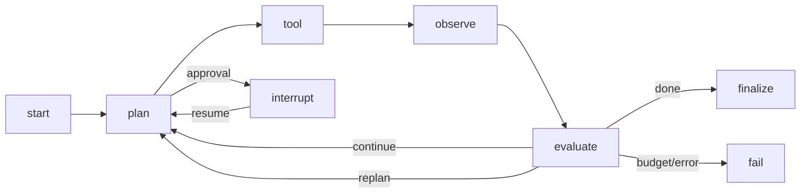

# Python 技术栈

> 定位：**可选 AI Worker**。Agent 规划/模型调用/LangGraph 在 Python；Workflow 执行、权限、沙箱、MCP、Skill 文件与脚本仍由 Rust Core 负责。没有 Python 时，确定性 Workflow/Skill 不受影响。

## 1. 运行时与依赖

| 包 | 版本（2026-11-01） | License | 说明 |
| --- | --- | --- | --- |
| Python | 3.13.x | PSF | 本机 3.9.6 不满足；需安装 3.13 |
| LangGraph | 1.2.19 | MIT | Agent 状态图/checkpoint/interrupt |
| langgraph-checkpoint-postgres / sqlite | 3.2.0 / 3.1.3 | MIT | Agent 检查点（AI 独立 schema/本地 SQLite） |
| Pydantic | 2.14.2 | MIT | AI 请求/响应/配置模型 |
| FastAPI | 0.162.0 | MIT | 仅健康/指标/可选管理 HTTP |
| Uvicorn | 0.54.0 | BSD-3-Clause | FastAPI server（可选） |
| LiteLLM | 1.106.6 | MIT 核心 + EE | 模型网关（独立服务；HTTP） |
| grpcio / grpcio-tools | 1.85.1 | Apache-2.0 | gRPC 服务/客户端/生成 |
| protobuf | ≥7.35.1,<8 | BSD-3-Clause | 由 grpcio-tools 约束 |
| openai | 3.42.0 | Apache-2.0 | Provider 适配器（可选） |
| anthropic | 2.3.0 | Apache-2.0 | Provider 适配器（可选） |
| langchain-core | 1.7.3 | MIT | LangGraph 依赖 |
| uv | 0.13.6 | Apache-2.0 | 依赖/虚拟环境/构建 |
| pytest | 9.2.0 | MIT | 测试 |
| ruff | 0.17.3 | MIT | lint/format |
| mypy | 2.4.1 | MIT | 类型检查 |

> 使用 Python 3.13 作为基线；3.14 需在 LangGraph/Pydantic/protobuf 兼容验证后再升级。

## 2. 职责

| 模块 | 职责 | 不做什么 |
| --- | --- | --- |
| `ai-worker` | 接收 AgentSession；运行 LangGraph；模型调用；工具选择；checkpoint/interrupt | 不执行 Workflow；不直接访问 Control Plane DB |
| `agent-graph` | 规划/执行/观察/评估/重规划；预算检查 | 不定义平台权限/租户 |
| `model-client` | 通过 LiteLLM/OpenAI-compatible HTTP 调用模型；统一 usage | 不泄露 provider 类型到平台 |
| `tool-client` | gRPC 调 Rust Tool/MCP/Workflow/Skill | 不直接读文件/网络/凭证 |
| `checkpoint` | LangGraph Postgres/SQLite checkpointer | 不与 Rust execution schema 混用 |
| `health` | FastAPI `/health/live` `/health/ready` `/metrics`（可选） | 不承载核心业务 API |
| `skills-python` | Python Skill 脚本示例/运行时适配 | 不定义私有 Skill 格式 |

## 2.1 评估矩阵

| 技术 | 维护状态（版本） | 性能/资源 | 兼容性 | 替代 |
| --- | --- | --- | --- | --- |
| LangGraph 1.2.19 | Active | 模型/工具延迟主导；checkpoint DB | Python ≥3.10；Pydantic 2 | Pydantic AI/OpenAI Agents SDK |
| Pydantic 2.14.2 | Active | v2 核心较 v1 快；校验开销 | Python ≥3.10 | dataclasses/msgspec |
| FastAPI 0.162.0 | Active | ASGI；仅健康/管理 | Python ≥3.10；Uvicorn | Litestar/Flask |
| LiteLLM 1.106.6 | Active | 多一跳；预算/路由开销 | OpenAI 兼容 HTTP | 直连 SDK/其他网关 |
| grpcio 1.85.1 | Active | C 扩展；流式/并发 | Python ≥3.10；protobuf 7.x | ConnectRPC（较新） |
| uv 0.13.6 | Active | 极快安装/锁 | Python 3.13 | Poetry |

## 3. 与 Rust 的集成

### 方案比较

| 方案 | 优点 | 缺点 | 结论 |
| --- | --- | --- | --- |
| gRPC Worker（推荐） | 强类型/流式/超时/取消；与 Rust/Python 生态匹配 | 需 proto/生成；调试复杂 | 采用 |
| REST + SSE | 简单/可调试 | 流式/取消/错误码弱；高频调用开销 | 备选（仅调试/外部） |
| Embedded Python（PyO3） | 无额外进程 | GIL/依赖/崩溃/部署复杂；违背可选 | 不采用 |
| 每任务子进程 | 隔离好 | 启动慢/状态/成本 | 仅脚本，不用 Agent |
| 消息队列 | 解耦 | 状态/流式/审批复杂 | 不用作 Agent 主通道 |

### gRPC 契约（概念）

```proto
service AgentWorker {
  rpc StartSession(StartSessionRequest) returns (stream AgentEvent);
  rpc ResumeSession(ResumeSessionRequest) returns (stream AgentEvent);
  rpc CancelSession(CancelSessionRequest) returns (CancelSessionResponse);
  rpc Health(HealthRequest) returns (HealthResponse);
}
service ToolService {
  rpc InvokeTool(InvokeToolRequest) returns (InvokeToolResponse);
  rpc ListTools(ListToolsRequest) returns (ListToolsResponse);
}
```

- Rust 是 `ToolService` 服务端；Python 是客户端。Python 不直接连接 MCP/Workflow/Connector。
- 事件：model.token、tool.call、tool.result、checkpoint、interrupt、approval.required、usage、error。
- 认证：mTLS + 短期 JWT；metadata 含 tenant/workspace/session/trace；Python 不接收长期 secret。
- 超时/取消：gRPC deadline + `context.cancel`；Rust 侧取消令牌；Python 停止图/模型请求。
- 预算：Rust/Control Plane 权威；Python 上报 usage；超限由 Rust 终止或 Python 收到 cancel。

## 4. Agent 图



- LangGraph `StateGraph` + Pydantic state；checkpoint 每步/异步；`interrupt()` 等待人工。
- 工具选择：模型输出 tool name/args → Python 校验 → gRPC `ToolService`；Rust 再校验/审批/执行。
- 模型调用：`ModelClient` → LiteLLM/OpenAI-compatible；不直接使用 provider SDK 跨层。
- 记忆：短期 graph state；长期 memory store（可选）由 Rust/Control Plane 管理；Python 不用租户 DB。
- 预算：步数/工具/Token/成本；Rust 与 Python 双检，权威在 Rust/Control Plane。

## 5. 可选性

- 未部署 Python AI Worker：Agent 节点不可用；Workflow/Skill/MCP 确定性功能正常。
- 本地：Python 需用户安装（3.13）；未安装时 Agent 禁用并提示；不自动下载。
- 私有/SaaS：AI Worker 容器/sidecar；可水平扩展；按租户/会话路由。
- 模型：本地/云/无模型；无模型时 Agent 不可用；确定性 Skill 脚本仍可运行。
- FastAPI 仅健康/指标/调试；不暴露给浏览器；外部 API 由 NestJS/Rust Gateway。

## 6. AI SDK 选择

| 选择 | 理由 | 风险 |
| --- | --- | --- |
| LiteLLM Proxy（HTTP） | 统一 provider/预算/fallback；Hisha 只维护一个客户端 | 多一跳；版本/配置；EE 边界 |
| OpenAI SDK | 广泛/流式/结构化输出 | provider 绑定；只在 adapter 内 |
| Anthropic SDK | Claude 能力 | 同上 |
| LangChain core | LangGraph 依赖；工具/消息抽象 | 生态膨胀；限制在 AI Worker |

规则：

- AI Worker 只依赖 `ModelClient` 接口；provider SDK 在 adapter 内。
- 不把 provider 的 message/tool 类型传到 Rust/NestJS；用平台事件/Proto。
- 模型输出视为不可信；工具参数 schema/allowlist/审批。
- 不允许 LangGraph/Pydantic 类型成为平台数据模型。

## 7. 部署

- 容器镜像：Python 3.13 + uv lock；非 root；只读文件系统（除临时目录）；资源限制。
- 本地：可选 sidecar/进程；`hisha doctor` 检测 Python 3.13 + 依赖；未满足时禁用 Agent。
- 私有/SaaS：K8s/Compose；水平扩展；gRPC service；OTel。
- 不把 Python 运行时打进 Rust 单二进制；保持可选/可替换。

## 8. 测试

- 单元：图节点/工具选择/预算/事件（mock 模型/工具）。
- 契约：Proto 生成/tool schema/错误码；与 Rust 集成。
- 集成：gRPC 启动/流式/取消/超时/重连；Postgres/SQLite checkpoint。
- 安全：prompt injection/tool 越权/大输出/无限循环。
- 兼容：LangGraph/Pydantic 升级回归；Python 3.13/3.14。
- 性能：首 token/步数/工具调用延迟；资源。

## 9. 风险

| 风险 | 缓解 |
| --- | --- |
| Python 依赖/ABI/镜像大 | uv lock；容器；固定 3.13；可选 |
| GIL/CPU | AI 以 I/O 为主；CPU 任务放 Rust/进程 |
| LangGraph 快速迭代 | 锁定版本；契约测试；checkpoint 迁移 |
| 双预算/双状态 | Rust/Control Plane 权威；Python 只上报 |
| checkpoint 一致性 | 独立 schema；sessionId 关联；崩溃测试 |
| 模型 SDK 变化 | adapter + LiteLLM；不泄漏类型 |
| 本地用户没有 Python | 禁用 Agent；明确提示；不自动安装 |
| 安全（模型/工具） | 不可信输出；沙箱/审批；审计 |

## 10. 相关文档

- [语言策略](language-strategy.md)
- [跨语言通信](cross-language.md)
- [Agent Runtime](../04-agent/agent-runtime.md)
- [证据](evidence.md)
