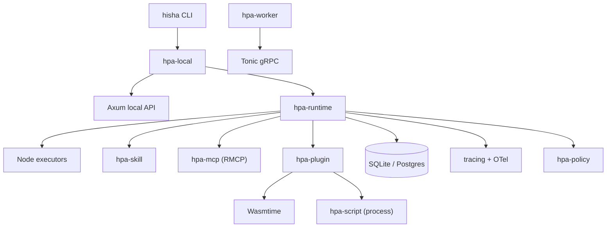

# Rust 技术栈

> 目标：用 Rust 实现可跨平台、可长期维护、可沙箱化的 Core Runtime。**不重新实现** Temporal durable execution、LangGraph、LiteLLM、OTel 等成熟组件。

## 1. 工具链

| 项 | 选择 | 说明 |
| --- | --- | --- |
| Rust | 1.99.1（stable）/ MSRV 1.97 | Wasmtime 50 需要 1.97；SQLx 0.9 需要 1.94 |
| Edition | 2024 | Tonic/Wasmtime/RMCP 已使用 2024 |
| Cargo | Workspace | `resolver = "3"`（edition 2024） |
| Target | Windows x64/arm64、macOS arm64/x64、Linux x64/arm64 | native runner 构建 |
| Profile | release：`lto="thin"`、`codegen-units=1`、`panic="unwind"`、`strip="symbols"` | 体积/性能/panic 隔离 |
| Lint | rustfmt + clippy `-D warnings` | CI 门禁 |
| Test | cargo-nextest 0.128 | 快速/并行/重试 |
| Supply chain | cargo-deny 0.20、cargo-audit 0.22 | 许可证/漏洞/来源 |
| Cache | sccache 0.19 | CI/本地编译缓存 |

> 本机未安装 cargo/rustc；以上为选型，不是实测。

## 2. 核心 crates

| 能力 | Crate | 版本 | License | 选择理由 |
| --- | --- | --- | --- | --- |
| Async runtime | tokio | 1.54.1 | MIT | 生态标准；process/time/sync/signal；`kill_on_drop` |
| HTTP | axum | 0.8.9 | MIT | Tokio/Tower 同栈；与 Tonic 共存；轻量 |
| Serialization | serde + serde_json | 1.0.229 | MIT/Apache | 事实标准；JSON/TOML |
| YAML | saphyr | 0.3.3 | MIT/Apache | YAML 1.2；annotated AST/span；替代已废弃的 serde_yaml |
| Expressions | jaq-core + jaq-std + jaq-json | 3.1.2 / 3.0.4 / 2.0.3 | MIT | jq 子集；纯 Rust；Active |
| JSON Schema gen | schemars | 1.2.3 | MIT | Derive 生成 Node/Tool schema |
| JSON Schema validation | jsonschema | 0.60.2 | MIT | Draft 2020-12；IR/工具 schema |
| DB | sqlx | 0.9.0 | MIT/Apache | Async；Postgres + SQLite；迁移；compile-time queries |
| gRPC | tonic + tonic-prost | 0.14.9 | MIT | 流式/超时/TLS；prost 0.14.4 |
| Observability | tracing + tracing-opentelemetry + opentelemetry + opentelemetry-otlp | 0.1.44 / 0.34.0 / 0.33.1 / 0.33.1 | MIT/Apache | tracing ↔ OTel 兼容配对 |
| WASM | wasmtime + wasmtime-wasi | 50.0.1 | Apache-2.0 WITH LLVM-exception | WASI p2/p3、组件、epoch/fuel/resource limiter |
| MCP | rmcp | 3.8.0 | Apache-2.0（过渡） | 官方 Rust SDK；2026-07-28 + 2025-11-25 |
| HTTP client | reqwest + rustls | 0.13.5 / 0.23.46 | MIT/Apache | 纯 Rust TLS；连接池 |
| JWT | jsonwebtoken | 11.1.0 | MIT | 内部 JWT 验证 |
| Secrets | secrecy + zeroize | 0.10.3 / 1.9.1 | Apache/MIT | 避免日志/内存泄漏 |
| Keychain | keyring | 4.2.0 | MIT/Apache | 本地凭证 |
| Paths | directories | 6.0.0 | MIT/Apache | 平台数据目录 |
| OS info | sysinfo | 0.40.1 | MIT | CPU/内存/进程 |
| Unix sandbox | nix / landlock / seccompiler | 0.31.3 / 0.4.7 / 0.5.0 | MIT/Apache/BSD | rlimit/Landlock/seccomp |
| Windows sandbox | windows-sys | 0.61.2 | MIT/Apache | Job Objects/ACL |
| Static UI | rust-embed | 8.13.0 | MIT | 本地单二进制嵌入 UI |
| Errors | thiserror | 2.0.17 | MIT/Apache | 显式错误枚举；`anyhow` 仅边界 |
| CLI | clap | 4.6.7 | MIT/Apache | `hisha` CLI |
| IDs/time | uuid / time | 1.29.0 / 0.3.55 | Apache/MIT | UUIDv7/UTC |
| Config | toml + serde | 1.1.8 / 1.0.229 | MIT/Apache | 本地配置；环境变量覆盖 |
| OpenAPI（本地 API） | utoipa | 6.0.0 | MIT/Apache | 可选；生成 TS client |

## 3. 关键 crate 评估

### 3.1 评估矩阵

| 技术 | 维护状态（更新） | 性能/资源 | 兼容性 | 替代 |
| --- | --- | --- | --- | --- |
| Tokio 1.54.1 | Active（2026-10-21） | 高吞吐/多线程；运行时中等内存；避免阻塞 reactor | 生态标准；Axum/Tonic/SQLx 依赖 | async-std（弱） |
| Axum 0.8.9 | Active（2026-04-14） | 低开销；Tower 中间件；HTTP/1/2 | Tokio/Tower；与 Tonic 共存 | Actix Web 4.18 |
| Serde 1.0.229 | Active（2026-07-18） | 编译期派生/零拷贝有限；JSON 解析 CPU 中等 | 全生态 | 手写/其他序列化（不必要） |
| Schemars 1.2.3 | Active（2026-10-12） | 编译期 schema；运行时开销低 | JSON Schema/TS 生成 | utoipa（OpenAPI） |
| jsonschema 0.60.2 | Active（2026-10-26） | 校验 CPU 较高；需缓存编译 schema | Draft 2020-12；无远程 ref | 手写校验（风险） |
| SQLx 0.9.0 | Active（2026-05-21） | async/连接池；DB 主导；编译期查询 | Postgres/SQLite/MySQL；MSRV 1.94 | SeaORM/Diesel |
| Tonic 0.14.9 | Active（2026-10-29） | HTTP/2/流式；TLS 开销；低序列化开销 | gRPC/protobuf；浏览器不直连 | ConnectRPC/jsonrpsee |
| tracing 0.1.44 | Active（2025-12-18） | 低开销（过滤后）；span 基数需控制 | tracing-subscriber/OTel | log（弱） |
| Wasmtime 50.0.1 | Active（2026-10-29） | 启动/内存较高；实例池；适合不可信插件 | WASI p2/p3/组件；MSRV 1.97 | Wasmer 7.5 |
| RMCP 3.8.0 | Active（2026-10-26） | 协议开销低；HTTP/stdio | 2026-07-28 + 2025-11-25；OAuth | rust-mcp-sdk 2.0 |

### Tokio

- 适用：Worker/Local Runtime 的异步 I/O、定时器、进程、信号、取消。
- 使用：`tokio::runtime::Builder::new_multi_thread`；`JoinSet` 监督；`CancellationToken`；有界 `mpsc`；`spawn_blocking` 处理 CPU/阻塞；`process::Command::kill_on_drop`。
- 不适用：CPU 密集计算（用 `spawn_blocking`/独立线程池或专用 Worker）。
- 替代：async-std（生态/维护较弱）；不选。

### Axum

- 适用：Local API、Worker 内部 HTTP/健康检查、Webhook 入口。
- 使用：Router + Tower middleware（trace/limit/timeout/compression）；不把业务逻辑放 handler；状态用 `Arc<AppState>`。
- 与 Tonic 并存：不同端口/路径；共享 Tokio runtime。
- 替代：Actix Web 4.18.1（成熟，但运行时/中间件生态不同）；Rocket（生态较小）。选 Axum。

### Serde + Schemars + jsonschema

- Serde：JSON/TOML/配置。
- Schemars：Node/Tool/Config 的 JSON Schema 生成；与 TS 共享。
- jsonschema：IR/工具 schema 校验；关闭 `resolve-http`/`resolve-file` 默认特性（不可信 schema 不允许远程 ref），只注册本地 `$id`。
- 替代：utoipa 生成 OpenAPI（不替代 JSON Schema）；手写 schema（易漂移）。

### YAML / 表达式

- **Saphyr 0.3.3**：YAML 1.2；annotated AST 带 span，适合 SourceMap；MIT/Apache；替代 `serde_yaml`（已 deprecated）、`yaml-rust2`（备选）。
- **jaq-core 3.1.2 + jaq-std 3.0.4 + jaq-json 2.0.3**：纯 Rust jq 解释器，MIT，Active；作为 Hisha Expression Profile。
- 不选 Rust JSONata：`jsonata-rs` 0.3.4（Apache，2025-02 后未见更新）成熟度不足；JSONata JS 无法在 Rust Core 内安全/一致运行。
- 限制 jq 内建：禁用 `input`/`inputs`/`$ENV`/`env`/`now`/`debug`/`stderr`/`halt*`/模块加载；使用 `execution.now`；限制输出/递归/时间/输入大小。
- 条件必须返回布尔；映射返回任意 JSON；模板插值 `${...}` 使用同一 jq profile。
- TS 侧不内嵌 jq 执行器；表达式预览/校验调用 Rust API；编辑器只做语法高亮/静态提示。

### SQLx

- 适用：Runtime 执行数据/检查点/事件索引；Local SQLite；Cloud Postgres。
- 特性：`runtime-tokio`、`postgres`、`sqlite-bundled`、`migrate`、`macros`、`uuid`、`time`、`json`。
- 编译期查询：CI 需 `DATABASE_URL` 或 `.sqlx` offline cache；本地 SQLite 用 `sqlite-bundled` 静态链接。
- 迁移：`sqlx::migrate!`；执行 schema 由 Rust 独占；Control Plane 不复用。
- 替代：SeaORM 2.0（快速 CRUD，但有 ORM 抽象）；Diesel 2.3（同步/强类型，不适合 async Worker）。选 SQLx。

### Tonic + Prost

- 适用：Rust ↔ NestJS/Python 内部 gRPC；流式事件/工具调用；TLS/mTLS。
- 特性：`transport`、`codegen`、`tls-ring`；`tonic-prost-build` 生成；Buf lint/breaking。
- 限制：HTTP/2；浏览器不直连；gRPC 错误码与业务错误码需映射。
- 替代：ConnectRPC 0.9.1（HTTP/JSON 友好，但生态较新）；JSON-RPC（工具协议用 MCP，不做内部主 RPC）。选 Tonic。

### tracing + OpenTelemetry

- tracing：结构化 span/事件；`tracing-subscriber` + EnvFilter。
- OTel：`opentelemetry 0.33.1` + `tracing-opentelemetry 0.34.0`（**必须配对**；0.33 依赖 otel 0.32）+ `opentelemetry-otlp 0.33.1`。
- 语义：`hisha.*` 属性；不记录 secret/PII；采样/基数控制。

### Wasmtime

- 适用：不可信 Plugin/Skill 逻辑；WASI p2（p3 观察）；组件模型。
- 安全：`Config::epoch_interruption` + `Store::set_epoch_deadline`；fuel；`ResourceLimiter`；WASI 预打开目录；默认无网络（host function 显式授予）。
- MSRV 1.97；API 迭代快，锁定版本并做升级测试。
- 替代：Wasmer 7.5.0（MIT，启动/生态不同）；Wasmtime 更贴近 Bytecode Alliance/WASI 标准。选 Wasmtime。

### RMCP

- 官方 Rust SDK，3.8.0，Apache-2.0（LICENSE 有 MIT→Apache 过渡声明）。
- 支持 `2026-07-28`：`server/discover`、MRTR、`resultType`、`subscriptions/listen`、tasks、Streamable HTTP、OAuth；同时保留 2025-11-25。
- 使用：MCP Gateway/Local MCP Server/MCP Client；feature `server`、`client`、`transport-io`、`transport-child-process`、`transport-streamable-http-server`、`transport-streamable-http-client-reqwest`、`auth`、`schemars`。
- 替代：rust-mcp-sdk 2.0.0（MIT，独立实现）；RMCP 官方/规范同步更好；自研不选。
- 注意：MCP 规范/实现处于 MIT→Apache 过渡；保留 NOTICE，法务复核。

## 4. 运行时结构

- Node executor trait 在 `hpa-node-api`；内置节点在 `hpa-nodes`；外部节点/WASM 在 `hpa-plugin`。
- Runtime 不直接依赖具体 Connector；通过 trait/registry 注入。
- 所有外部 I/O 有超时/取消/幂等键；工作线程不阻塞 Tokio reactor。

## 5. 编码约束

- 默认 `#![forbid(unsafe_code)]`；只有 `hpa-sandbox` 平台层允许 `unsafe`，集中审计。
- 禁止在 runtime 路径 `unwrap/expect`；用 `thiserror` 明确错误；`anyhow` 仅 CLI/顶层。
- 所有长任务可取消；`JoinSet`/`CancellationToken`；drop 时清理子进程（`kill_on_drop` + 进程组）。
- 有界队列/背压；禁止无界 channel。
- 不在日志打印 secret/token/完整请求体；`secrecy`/`zeroize`。
- 所有持久化迁移前向兼容；不删除事件/审计。
- 不把 Rust 类型直接序列化给 TS/Python；用 Proto/JSON Schema。

## 6. 构建/依赖规则

- Cargo Workspace 统一版本；`[workspace.dependencies]` 锁定。
- `cargo-deny`：禁止 AGPL/SSPL/未知许可；允许 MIT/Apache/BSD/ISC。
- `cargo-audit`/`cargo-deny advisories`：漏洞门禁。
- `cargo-dist` 0.32.0：安装包/发布归档；`cargo-nextest`；`sccache`。
- 不在构建时下载任意脚本；`build.rs` 仅代码生成/嵌入资源。
- 跨平台原生 runner 构建；避免交叉编译 C 依赖（SQLite 用 bundled）。

## 7. 风险

| 风险 | 缓解 |
| --- | --- |
| Rust 开发速度/人才 | MVP 切片、模块化、契约测试、外部评审 |
| 编译时间 | sccache、workspace 分层、减少泛型/宏、CI 缓存 |
| SQLx MSRV 1.94/离线查询 | 固定工具链；`.sqlx` 缓存；CI `cargo sqlx prepare` |
| Wasmtime API/MSRV | 锁定 50.x；升级测试；WASI p2 优先 |
| RMCP 许可/规范演进 | 保留 NOTICE；法务；版本锁定；conformance |
| Tonic/gRPC 复杂度 | Buf lint/breaking；生成代码；契约测试；只用于内部 |
| 沙箱跨平台 | Linux 强隔离；macOS/Windows 容器/受限进程；风险提示 |
| 过度 Rust 化 | 只做核心执行；管理/UI/AI 用 TS/Python |

## 8. 相关文档

- [语言策略](language-strategy.md)
- [跨语言通信](cross-language.md)
- [Script/Plugin 执行](script-plugin-execution.md)
- [Local Runtime](local-runtime-rust.md)
- [Monorepo 与发布](monorepo-build-release.md)
- [证据](evidence.md)
