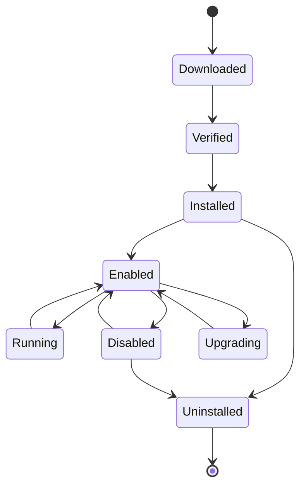

# Script 与 Plugin 执行架构

> 目标：用户脚本/插件不局限于 Rust/TS/Python；但**不可信代码不进入 Rust 进程**。统一由 Rust Plugin Host / Script Executor 调度，按信任等级选择 WASM、Native Process、External Service、MCP Server 或 Built-in Runtime。

## 1. 执行模式

| 模式 | 语言/形态 | 隔离 | 适用 | 默认 |
| --- | --- | --- | --- | --- |
| Built-in Runtime | Rust | 进程内（受信） | 核心节点/连接器 | 是 |
| WASM Sandbox | WASM（Rust/AssemblyScript/ComponentizeJS 等） | Wasmtime + WASI 能力 | 第三方插件/不可信逻辑 | **首选** |
| Native Process | Python/Node/Shell/Java（未来） | OS 进程 + 沙箱/容器 | 已知运行时/脚本 | 受限 |
| External Service | HTTP/gRPC | 网络边界 + 认证 | 外部插件/长驻服务 | 可选 |
| MCP Server | MCP 协议 | 协议 + 认证/网络 | 外部工具 | 可选 |
| JS/TS Node Sandbox | Node 进程 | 子进程/容器 | TS 连接器/插件 | 可选 |

规则：

- 第三方不可信逻辑优先 WASM；WASM 不能做的高风险操作需容器/显式授权。
- Native Process 不在 Rust 进程内加载动态库；不提供 `dlopen` 插件 ABI。
- Java 仅作为外部 JVM 进程（未来），不嵌入 Rust。
- Python/Node/Shell 运行时由用户/镜像提供；不静默安装依赖。

## 2. 统一接口

```rust
#[async_trait::async_trait]
pub trait Executor: Send + Sync {
    fn kind(&self) -> ExecutorKind;
    fn capabilities(&self) -> ExecutorCapabilities;
    async fn execute(
        &self,
        req: ExecutionRequest,
        ctx: ExecContext,
    ) -> Result<ExecutionResult, ExecError>;
    async fn cancel(&self, id: &ExecutionId) -> Result<(), ExecError>;
}

pub struct ExecutionRequest {
    pub execution_id: String,
    pub node_id: String,
    pub runtime: RuntimeKind,          // wasm | python | node | shell | external | mcp
    pub entry: String,                 // 文件/模块/工具名
    pub args: Vec<String>,
    pub stdin: Option<ArtifactRef>,
    pub workdir: Workdir,
    pub env: BTreeMap<String, String>,
    pub mounts: Vec<Mount>,
    pub network: NetworkPolicy,
    pub resources: ResourceLimits,
    pub timeout: Duration,
    pub secrets: Vec<SecretRef>,
    pub trace: TraceContext,
    pub idempotency_key: Option<String>,
}

pub struct ExecutionResult {
    pub exit_code: Option<i32>,
    pub stdout: Option<ArtifactRef>,
    pub stderr: Option<ArtifactRef>,
    pub output: Option<serde_json::Value>,
    pub artifacts: Vec<ArtifactRef>,
    pub usage: ResourceUsage,
    pub error: Option<ExecError>,
}
```

- `Executor` 不感知租户/权限；由 `Policy` 在调用前注入/检查。
- 所有输出大对象进 Artifact；内存中限制大小。
- 取消通过 `CancellationToken` + 平台 kill/终止；`execute` 必须可被 drop 清理。

## 3. Plugin Manifest

```json
{
  "schemaVersion": "hpa.plugin/v1",
  "id": "plugin_invoice_audit",
  "version": "1.2.0",
  "license": "Apache-2.0",
  "entry": { "kind": "wasm", "path": "plugin.wasm", "wit": "wit/plugin.wit" },
  "runtimes": ["wasm"],
  "permissions": {
    "filesystem": { "read": ["./inputs"], "write": ["./artifacts"] },
    "network": [],
    "commands": [],
    "resources": { "cpuMs": 60000, "memoryMb": 256 }
  },
  "dependencies": [],
  "integrity": { "algorithm": "sha256", "digest": "sha256:..." },
  "signature": { "algorithm": "ed25519", "keyId": "...", "value": "..." }
}
```

- 安装/执行前校验 manifest/schema/签名/依赖/权限/许可。
- 入口类型：`wasm`/`process`/`external`/`mcp`/`builtin`。
- `process` 需声明 runtime/entry/args/env；`external` 声明 URL/auth；`mcp` 声明 server/tool。

## 4. WASM 沙箱

- Wasmtime 50.0.1 + `wasmtime-wasi` 50.0.1；WASI p2（p3 观察）；组件模型/WIT。
- 能力授予：
  - 预打开目录（只读输入/可写 artifacts）。
  - 网络默认无；通过 host function/HTTP 代理显式授予域名。
  - 时钟/随机/环境变量按需授予。
- 资源：
  - `Config::epoch_interruption` + `set_epoch_deadline` 实现墙钟超时。
  - fuel 限制 CPU；`ResourceLimiter` 限制内存/实例。
  - 输出大小/日志速率限制。
- 生命周期：每任务实例/可复用实例池（受状态隔离约束）；取消/超时终止实例。
- 插件 ABI：WIT 定义 `execute(request) -> response`；host 提供 artifact/log/policy 接口；不暴露文件系统/网络裸能力。
- 优点：跨平台、无 OS 依赖、易分发；缺点：生态/调试/性能，复杂 SDK 可能不适合 WASM。

## 5. Native Process

- 使用 `tokio::process::Command`，`kill_on_drop`；设置进程组/会话，超时 kill 整个进程树。
- 工作目录：每任务临时目录；输入只读；artifacts 可写；拒绝 `..`/绝对路径/符号链接逃逸。
- 环境：最小 allowlist；不注入宿主 secret；短期凭证按需。
- 命令：argv 数组，禁止 shell 拼接；命令 allowlist；Shell 脚本高风险。
- 资源：
  - Linux：cgroups v2（CPU/内存/PIDs）、rlimit、Landlock、seccomp；可选 network namespace。
  - macOS：容器（Docker/Podman）优先；受限进程 + rlimit + 路径/网络代理；`sandbox-exec` 不作为可靠边界。
  - Windows：Job Objects（内存/CPU/进程数）、restricted token/AppContainer、ACL；容器可选。
- 输出：stdout/stderr 限制/截断；大结果 artifact。
- 取消：终止进程树；清理临时目录；记录“可能已发生”的外部副作用。

## 6. External Service / MCP

- External Service：HTTP/gRPC；mTLS/OAuth/PAT；网络白名单；超时/重试/幂等；结果大小限制；审计。
- MCP Server：由 Rust RMCP Client 连接；工具 schema/权限/审批；不把 MCP 当内部 RPC。
- 外部插件不获得本地文件系统/凭证；只获得调用所需短期 token。
- 外部服务不可用：熔断/退避；不影响其他节点。

## 7. Built-in Runtime

- Rust 原生节点/连接器；受信代码；仍经 Policy/权限/审计。
- 不意味着“无限制”：网络/文件/凭证按节点权限；高风险操作审批。
- 内置节点版本化；发布冻结；旧版本保留执行。

## 8. 安全控制清单

| 控制 | 要求 |
| --- | --- |
| 文件系统 | 每任务工作区；只读输入；写 artifacts；路径规范化/realpath；拒绝 symlink 逃逸 |
| 网络 | 默认拒绝；域名/端口白名单；代理审计；SSRF/DNS rebinding 防护 |
| 命令 | argv 数组；allowlist；禁止 shell 拼接；进程树终止 |
| 环境变量 | allowlist；无宿主 secret；短期注入；退出清理 |
| CPU | cgroups/Job Objects/Wasmtimes fuel/timeout |
| 内存 | cgroups/Job Objects/Wasmtime ResourceLimiter/rlimit |
| 超时 | 墙钟 + CPU；取消传播；kill 进程树 |
| 进程回收 | 进程组/会话；zombie 清理；临时目录清理 |
| 日志/审计 | 每次执行/拒绝/资源 kill；参数/结果摘要；脱敏 |
| 供应链 | 签名/哈希/依赖/SBOM/审核/撤回 |

## 9. 平台矩阵

| 平台 | 进程隔离 | 文件 | 网络 | 推荐 |
| --- | --- | --- | --- | --- |
| Linux | namespaces + Landlock + seccomp + cgroups v2 | 预打开/只读 bind | netns/代理 | 最强；默认 |
| macOS | 容器优先；受限进程次选 | 工作区 + 路径校验 | 代理/防火墙 | 高风险必须容器 |
| Windows | Job Objects + AppContainer/restricted token | ACL/工作区 | 防火墙/代理 | 高风险容器 |
| WASM（跨平台） | Wasmtime 实例 | WASI preopen | host function | 第三方首选 |

macOS/Windows 无 Linux 级沙箱时，UI 必须显示风险；不可信插件默认要求容器或拒绝执行。

## 10. 生命周期



- 安装：manifest/schema/签名/依赖/许可/权限/扫描。
- 启用：注册能力/入口；权限确认。
- 执行：按模式实例化；Policy 检查；审计。
- 升级：版本/权限差异；旧版本保留；回滚。
- 卸载：依赖影响；清理；审计。

## 11. 测试

- 逃逸：路径/符号链接/命令注入/容器。
- 网络：外联/SSRF/DNS rebinding/协议走私。
- 资源：fork bomb/内存炸弹/CPU 死循环/输出洪水。
- 超时/取消：进程树/子进程/zombie/临时目录。
- 环境：secret 泄漏/继承变量。
- WASM：fuel/epoch/ResourceLimiter/preopen/无网络。
- 签名/依赖/许可/升级/回滚。
- 并发/实例池/隔离。

## 12. 风险

- macOS/Windows 沙箱弱 → 容器/风险提示/限制功能。
- WASM 生态/工具链 → 先支持简单 WIT ABI；复杂插件用容器。
- Python/Node 运行时缺失 → 明确错误；不自动安装。
- 插件供应链 → 签名/审核/SBOM/撤回。
- 性能开销 → 实例池/缓存；测量。
- 语义漂移 → 统一 Executor 契约/测试。

## 13. 相关文档

- [插件架构](../07-plugin/plugin-architecture.md)
- [Plugin SDK](../07-plugin/plugin-sdk.md)
- [Skill 安全](../05-skill/skill-security.md)
- [跨语言通信](cross-language.md)
- [Local Runtime](local-runtime-rust.md)
