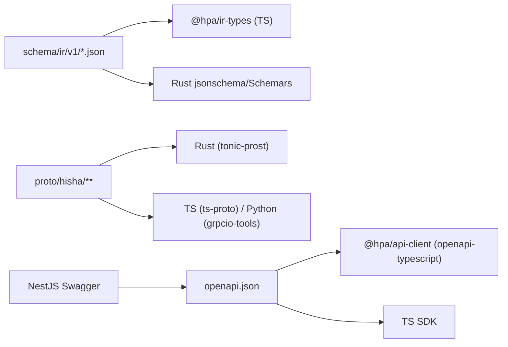

# TypeScript 技术栈

> 定位：Control Plane（NestJS）与 Web UI（React）。不执行 Workflow/脚本/沙箱；执行通过 gRPC 委托 Rust Core。

## 1. 运行时与工具链

| 项 | 版本（2026-11-01） | License | 说明 |
| --- | --- | --- | --- |
| Node.js | ≥26.13.0（26 LTS "Lithium"） | — | 本机 26.0.0；目标 26.13 |
| TypeScript | 5.9.3（生产）/ 7.0.2（评估） | Apache-2.0 | 5.9 稳定；7.0 最新但需 Nest/装饰器/构建验证 |
| pnpm | 12.16.1 | MIT | 包管理；workspace |
| Turborepo | 2.11.10 | MIT | 任务编排/缓存 |
| Vite | 8.3.5 | MIT | Node ^20.19 或 ≥22.12 |
| @vitejs/plugin-react | 6.1.2 | MIT | React Fast Refresh |
| NestJS core/common/platform-express | 12.3.2 | MIT | Node ≥20；Modular Monolith |
| @nestjs/swagger | 12.0.5 | MIT | OpenAPI 3.x |
| Prisma / @prisma/client | 7.10.1 | Apache-2.0 | Control Plane DB（control schema） |
| ts-proto / @grpc/grpc-js | 2.18.3 / 1.14.7 | ISC / Apache-2.0 | gRPC 客户端/生成 |

## 2. Web UI

| 能力 | 选择 | 版本 | License | 说明 |
| --- | --- | --- | --- | --- |
| UI | React + React DOM | 19.3.1 | MIT | 并发渲染；Suspense |
| 路由 | TanStack Router | 1.170.46 | MIT | 类型安全路由/搜索参数 |
| 服务端状态 | TanStack Query | 5.105.0 | MIT | 缓存/失效/重试 |
| 编辑器状态 | Zustand | 5.0.16 | MIT | 画布/选择/历史；不放服务端数据 |
| 表单 | React Hook Form + @hookform/resolvers | 7.91.0 / 7.0.0 | MIT | 复杂 Inspector/审批表单 |
| 校验 | Zod | 4.6.7 | MIT | API DTO/表单；IR 用 JSON Schema |
| 画布 | @xyflow/react | 12.12.0 | MIT | 节点/边/端口/子图/缩放；React ≥17 |
| 代码编辑器 | monaco-editor + @monaco-editor/react | 0.57.0 / 4.7.0 | MIT | YAML/JSON/表达式；peer React 16.8-19 |
| 表格 | TanStack Table | 9.3.1 | MIT | 列表/虚拟化（可选） |
| 虚拟滚动 | TanStack Virtual | 3.14.24 | MIT | 日志/执行列表 |
| 国际化 | i18next + react-i18next | 26.5.12 / 17.1.9 | MIT | ja 默认/en/zh；ICU |
| 图标 | lucide-react | 1.66.0 | ISC | 统一 16/20px |
| 组件基础 | radix-ui | 1.8.1 | MIT | 无样式无障碍 primitives |
| 组件分发 | shadcn CLI | 4.23.0 | MIT | 代码生成；不是运行时依赖 |
| 变体/类名 | class-variance-authority / clsx / tailwind-merge | 0.7.1 / 2.1.1 / 3.7.0 | Apache/MIT | variants/class 合并 |
| 样式 | Tailwind CSS + @tailwindcss/postcss + PostCSS | 4.3.3 / 4.3.3 / 8.5.32 | MIT | CSS-first `@theme`/CSS variables；详见 [CSS 架构](css-architecture.md) |
| 可选样式 | Sass | 1.107.1 | MIT | 仅复杂 mixin；非必需 |
| 可选压缩 | Lightning CSS | 1.33.0 | MPL-2.0 | 不进核心；不强制 |

## 3. Control Plane

- NestJS 12 Modular Monolith；Express 适配器为默认（生态/兼容），Fastify 适配器作为性能选项（需基准）。
- **增量入口**：`apps/vscode-extension` 使用同一 TypeScript 工具链 + `@types/vscode`；不改变 Control Plane/执行架构，详见 [VS Code/Copilot 模块](../14-vscode-copilot/README.md)。
- 模块：Identity、Tenancy、Workflow、Agent、Skill、MCP、Plugin、Connector、Capability、Approval、Execution（查询/编排）、Audit、Model、Quota、Notification。
- API：REST/OpenAPI 3.1；SSE 事件流；Webhook；不暴露内部 gRPC。
- 认证：OIDC/PAT/服务账号；JWT 验证；租户/工作区/项目上下文。
- 授权：RBAC + ABAC/Policy；调用 Rust `PolicyService` 或缓存决策；高风险审批由 Control Plane 记录。
- 执行：Control Plane 不执行 Workflow；通过 gRPC 调 Rust `RuntimeService`；查询事件/状态也走 gRPC/只读索引。
- 数据：Control Plane 拥有 control schema（Prisma 7.10.1）；Rust 拥有 execution/audit schema；不跨 schema join。
- 模型：LiteLLM 管理 API/预算；Python AI Worker 通过 LiteLLM HTTP。

## 4. 类型/契约共享

规则：

- IR：JSON Schema 是源；TS 类型生成（`json-schema-to-typescript` 16.0.0），Rust 用 `jsonschema` 校验 + 按节点类型解析。
- 内部 RPC：Proto 是源；Rust `tonic-prost`，TS `ts-proto 2.18.3` + `@grpc/grpc-js 1.14.7`，Python `grpcio-tools 1.85.1`。
- 外部 API：OpenAPI 是源；`openapi-typescript 7.13.0` + `openapi-fetch 0.17.0`；Orval 8.45 可选生成 hooks。
- 不手写重复 DTO；生成代码提交/CI 检查 drift。
- 不允许 TypeScript 类型进入 Rust/Python 运行时；边界为 Proto/JSON。

## 5. 状态与数据流

- 服务端状态：TanStack Query（缓存/失效/乐观更新/SSE 失效）。
- 编辑器状态：Zustand（画布选择、缩放、未保存变更、撤销栈）；不把服务器数据复制进 store。
- 表单：RHF + Zod；Inspector schema 表单由 JSON Schema 生成，复杂节点可自定义但回落到 schema。
- 路由：TanStack Router；深链/版本/执行 ID；搜索参数类型化。
- 错误：`problem+json` → 统一错误组件；traceId 展示；重试仅幂等。

## 6. 性能

- Vite 代码分割：Designer/Monaco/XYFlow/Python?（无）按路由懒加载；Monaco worker 独立。
- XYFlow：节点虚拟化/分组折叠/简化边；>500 节点降级（只渲染视口/分组）。
- Monaco：按需语言（YAML/JSON），避免全量语言包。
- TanStack Query：staleTime/缓存；执行事件增量合并；避免轮询风暴。
- CSS：Tailwind 按内容生成；CSS Modules 按组件；无运行时 CSS-in-JS；包体预算。
- 大列表：TanStack Virtual；分页/游标。
- SSE：断线重连 + Last-Event-ID；页面隐藏时降频。

## 7. 测试

- 单元/组件：Vitest + Testing Library。
- E2E：Playwright；关键路径（Designer/Skill/MCP/Execution/Approval）。
- 可访问性：axe/Playwright；键盘/焦点/对比度。
- API mock：MSW；OpenAPI 契约测试。
- 类型：`tsc --noEmit`；生成代码 drift 检查。
- CSS：视觉回归（Playwright 截图）；607px/三语/明暗主题。
- Control Plane：Nest Testing + Testcontainers（Postgres/Redis）。

## 7.1 评估矩阵

| 技术 | 维护状态（版本） | 性能/资源 | 兼容性 | 替代 |
| --- | --- | --- | --- | --- |
| React 19.3.1 | Active | 虚拟 DOM/并发；大列表需虚拟化 | React 19；XYFlow/Monaco/Radix | Vue/Svelte |
| Vite 8.3.5 | Active | 开发启动快；构建/代码分割 | Node ≥20.19/22.12；PostCSS/CSS Modules | Next.js/Rsbuild |
| NestJS 12.3.2 | Active | DI/Express 开销低；执行不在 Node | Node ≥20；OpenAPI/Swagger | Fastify/tRPC |
| @xyflow/react 12.12 | Active | DOM/SVG；500+ 节点需优化 | React ≥17 | 自研/Vue Flow |
| Monaco 0.57 | Active | 包体/worker 较重；懒加载 | React 16.8-19 | CodeMirror 6 |
| TanStack Query 5.105 | Active | 缓存/失效；低开销 | React 18/19 | SWR/Redux |
| Zustand 5.0.16 | Active | 极小；局部状态 | React 18/19 | Redux Toolkit/Jotai |
| Zod 4.6.7 | Active | 运行时校验 CPU 中等 | TS 5.9；RHF resolver | Valibot/Ajv |
| OpenAPI/ts-proto | Active | 构建期生成；无运行时开销 | OpenAPI 3.1/Proto | Orval/手写 |
| Tailwind 4.3.3 + PostCSS | Active | 构建期；无运行时 CSS-in-JS | Vite/PostCSS | CSS Modules/MUI |

## 8. 候选比较

| 领域 | 选择 | 替代 | 不选原因 |
| --- | --- | --- | --- |
| 框架 | React 19 | Vue 3、Svelte | React 生态/XYFlow/Monaco/组件库；团队主流 |
| 构建 | Vite 8 | Next.js、Rsbuild | SPA/本地 UI；无 SSR 需求；Vite 简单 |
| API | NestJS 12 | Fastify 裸、tRPC | 模块化/DI/OpenAPI；tRPC 不利外部 SDK |
| HTTP adapter | Express | Fastify | 默认生态；执行不在 Node，性能不是瓶颈 |
| 画布 | XYFlow 12 | 自研、Vue Flow | 成熟/React；自研成本高 |
| 编辑器 | Monaco | CodeMirror 6 | YAML/JSON/表达式/诊断；体积可接受 |
| 服务端状态 | TanStack Query | SWR、Redux | 缓存/失效/SSE 集成 |
| 客户端状态 | Zustand | Redux Toolkit、Jotai | 轻量/编辑器局部；Redux 过重 |
| 校验 | Zod + JSON Schema | Yup、Joi | Zod 类型推断；IR 必须 JSON Schema |
| 样式 | Tailwind + CSS Modules + CSS vars | MUI/Chakra/Emotion | 无运行时 CSS-in-JS；高密度定制；见 CSS 架构 |
| OpenAPI | openapi-typescript | Orval、手写 | 简单/类型安全；Orval 可选 |
| gRPC TS | ts-proto + grpc-js | nice-grpc、connect-es | 主流/生成稳定；connect 适合浏览器但内部不需要 |
| TS 版本 | 5.9.3 | 7.0.2 | Nest/装饰器/emit 兼容风险；7.0 评估后再升级 |

## 9. 风险

- TS 7 迁移（原生编译器/装饰器）→ 先 5.9，独立 spike。
- NestJS 12/Node 26 生态（部分包未跟上）→ 锁定版本/回归。
- Monaco/XYFlow 大图性能 → 虚拟化/预算/降级。
- OpenAPI/Proto 生成漂移 → CI drift/契约测试。
- Node 内存/长驻 → 执行全部 Rust；Control Plane 只做管理。
- CSS 运行时/全局污染 → CSS 架构规则/门禁。
- 第三方 UI 代码许可（MUI/Chakra/Flowise 等）→ 不使用受限代码；shadcn/Radix MIT。

## 10. 相关文档

- [语言策略](language-strategy.md)
- [CSS 架构](css-architecture.md)
- [跨语言通信](cross-language.md)
- [UI 设计系统](../09-ui/ui-design.md)
- [证据](evidence.md)
