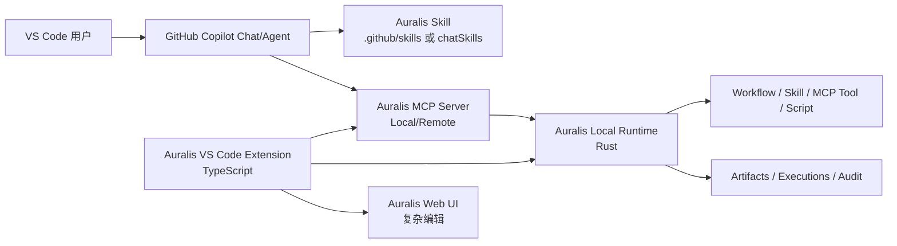

# VS Code & GitHub Copilot 集成

> 本模块是 **Auralis 平台的增量集成层**：不修改既有 Rust Core、TypeScript Control Plane、Python AI Worker、数据模型、权限模型或 MCP 核心。
> 命名说明：本模块使用展示名 **Auralis**、永久内部 ID **hpa**；本仓库既有 Phase 0 文档中的 **Hisha** 是历史别名。遵守“不修改既有架构”，本轮不全局改名；扩展使用 `hpa.*`，内部契约/API 沿用既有文档。

## 0. 本地实现状态（2026-11-01）

Phase 7 本地 MVP 已落地 `apps/vscode-extension`（扩展 ID `hpa.workbench`）：10 个 Tree View、Workflow 运行/执行 Webview/审批、Skill 安装/更新/移除、官方 MCP provider、SecretStorage、工作区信任、ja/en/zh、Vitest 60、Extension Host 7 项检查、VSIX 打包与临时目录安装。实际适配现有 8787 `/api/*` 与 `/mcp`；为 VS Code 工具名限制增加 scoped slug 别名。Copilot Chat 可发现 `.github/skills` 中的已安装 Skill；模型驱动的 MCP `tools/call` 未验证。

本页以下内容仍描述目标设计与官方机制；实际实现差异见 [本地实现](local-implementation.md)。

## 1. 目标

把 VS Code + GitHub Copilot 作为 Auralis 的官方本地 AI 工作入口之一：

- 不重新开发 AI Chat / Agent。
- 不替代 Copilot。
- 复用 Auralis 的 Skills、MCP Tools、Workflows、Agents、Local Runtime、Plugins、Connectors。
- 复杂 Workflow 编辑仍在 Auralis Web UI 完成；扩展只做发现、安装、运行、监控、跳转。

## 2. 官方机制（2026-11-01 核实）

| 能力 | VS Code / Copilot 官方机制 | 关键路径/设置 | 集成方式 |
| --- | --- | --- | --- |
| Agent Skills | 项目/个人技能目录；扩展 `chatSkills` contribution | 项目 `.github/skills/`、`.claude/skills/`、`.agents/skills/`；个人 `~/.copilot/skills/`、`~/.claude/skills/`、`~/.agents/skills/`；`chat.agentSkillsLocations`（自定义，不推荐用于 Copilot） | 安装 Auralis Skill 到原生目录；或扩展通过 `chatSkills` 贡献只读技能 |
| MCP Servers | 扩展 MCP provider API | `contributes.mcpServerDefinitionProviders` + `vscode.lm.registerMcpServerDefinitionProvider`；`McpHttpServerDefinition` / `McpStdioServerDefinition`；工作区 `.vscode/mcp.json` 顶层 `servers` | 扩展注册 Auralis Local MCP Server（Streamable HTTP），`resolve` 时取短期 token |
| Custom Instructions | 项目/个人指令文件 | Copilot：`.github/copilot-instructions.md` 或 `AGENTS.md`；定向：`.github/instructions/**/*.instructions.md`；`chat.instructionsFilesLocations` | 生成 Auralis 指令片段（用户确认，不覆盖） |
| Custom Agents | 自定义 Agent 文件 | `.github/agents/<name>.agent.md`；个人 `~/.copilot/agents`；`chat.agentFilesLocations`；`chat.modeFilesLocations` 已弃用 | 可选：从 Auralis Agent 生成 `.agent.md` |
| 其他 Copilot 能力 | 官方支持范围随版本变化 | Copilot 功能矩阵 / VS Code release notes | 只使用官方已文档化机制；不猜测 |

重要：

- **不同客户端的 Skill 路径/字段不同**：VS Code、Copilot CLI、Copilot app、Codex 共享部分路径但支持范围不同；必须按客户端当前文档验证。
- `chatSkills` 的 `path` 必须指向 `SKILL.md`，且目录名必须与 frontmatter `name` 一致，否则不加载。
- 扩展注册 MCP 时，`provideMcpServerDefinitions` 不应弹认证；认证放在 `resolveMcpServerDefinition`。
- VS Code 工作区 `.vscode/mcp.json` 使用 `servers`，不是 `mcpServers`；不要混用。

## 3. 总体形态

- **VS Code Extension**：TypeScript，VS Code API；负责 Explorer、命令、状态栏、Webview、配置、认证、MCP provider、Skill 安装。
- **Copilot**：继续作为 Chat/Agent 入口；只通过官方 Skill/MCP/Instructions/Agents 机制接入。
- **Auralis Local Runtime**：Rust 单二进制；唯一执行者；权限/沙箱/进程/日志/产物。
- **Auralis Control Plane**：远程/团队模式的账号、租户、审批、审计；扩展只调用 API。

## 4. 不修改的边界

- 不重新设计 MCP 核心；复用 Rust RMCP Gateway/Local Server。
- 不引入新执行引擎；扩展不执行 Workflow/脚本。
- 不修改 Workflow IR、数据模型、权限/审批、能力注册。
- 不新增第二套 Chat/Agent；Copilot 负责对话。
- 不在扩展内实现完整 Workflow Designer；复杂编辑跳转 Web UI。
- 不假设一个 Skill/MCP 配置适配所有客户端。

## 5. 文档

- [Phase 7 本地实现与边界](local-implementation.md)
- [集成目标与边界](integration-objective.md)
- [Extension 架构](extension-architecture.md)
- [GitHub Copilot 集成](copilot-integration.md)
- [Skill 集成](skill-integration.md)
- [MCP 集成与工具](mcp-integration.md)
- [Local Runtime 桥接](local-runtime-bridge.md)
- [Extension UI](extension-ui.md)
- [完整用户场景](user-scenarios.md)
- [安全与权限](security.md)
- [测试、发布与兼容](testing-release.md)
- [官方证据](evidence.md)
- [ADR-0019](../adr/0019-vscode-copilot-integration.md)

## 6. MVP

1. Extension 启动/状态栏/Overview。
2. Local Runtime 发现/健康检查/登录。
3. MCP provider 注册本地 Auralis MCP Server。
4. 安装/更新/移除一个标准 Skill 到 `.github/skills`。
5. Copilot 加载 Skill → 调用 `workflow.list` / `workflow.execute`。
6. Execution/Artifact 树 + Webview 查看。
7. 审批等待状态与 Web UI 跳转。

Custom Instructions / Agents 生成是 P1；完整 Designer、Marketplace 发布、远程/多根工作区高级支持后续。
