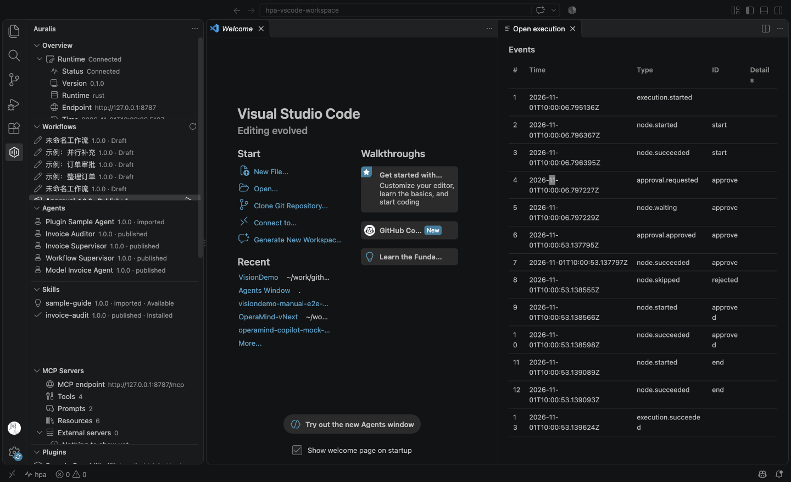
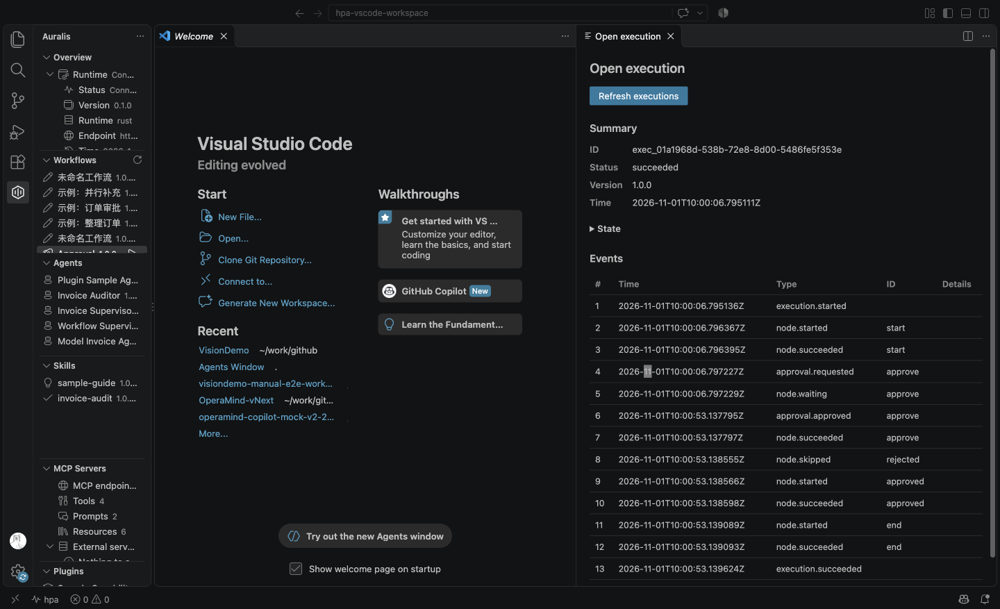
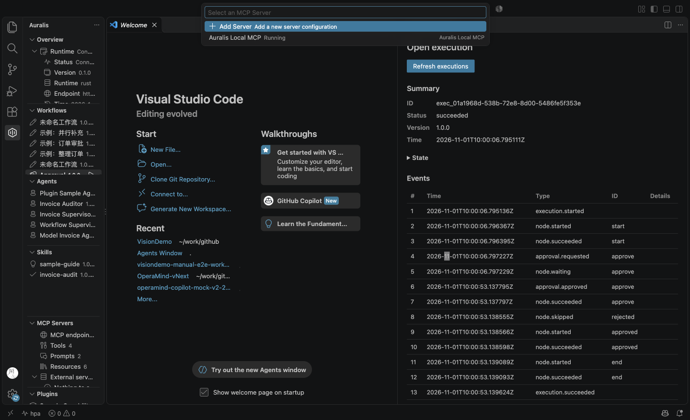
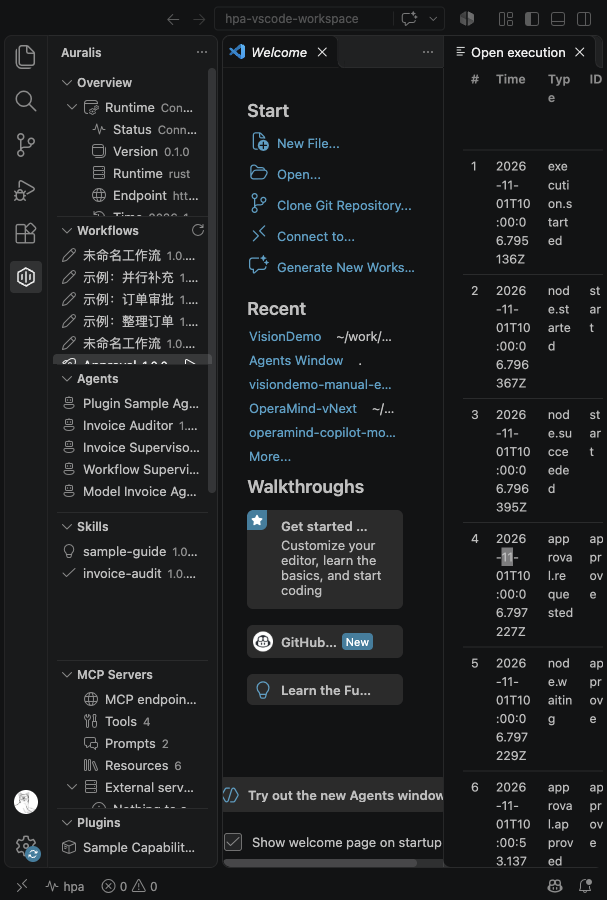

# Phase 7 本地 VS Code & Copilot 集成：实现与边界

> 本页描述 2026-11-01 实际落地的 `apps/vscode-extension`。扩展是薄客户端：只做发现、认证、MCP provider、Skill 安装、查看与跳转；Workflow/Skill 脚本/Agent/插件执行仍由 Rust Local Runtime 完成。

## 1. 实际形态

| 项 | 实现 |
| --- | --- |
| 扩展包 | `apps/vscode-extension`，npm 包 `workbench`，扩展 ID `hpa.workbench` |
| VS Code | `engines.vscode: ^1.143.0`；本机 1.143.1 实测 |
| 类型 | `@types/vscode 1.140.0`（低于最低版本以避免使用未发布 API） |
| 构建 | esbuild 单 bundle `dist/extension.js`，`vscode` external |
| 测试 | Vitest 60；`@vscode/test-electron` 7 项 Extension Host 检查 |
| 打包 | `@vscode/vsce 4.1.0` → `hpa-workbench.vsix` |
| UI 文档 | 10 个 Tree View、执行/产物 Webview、状态栏、Command Palette |
| 本地 API | `http://127.0.0.1:8787/api/*`（不是早期文档示例的 4780/`/api/v1`） |
| MCP | `http://127.0.0.1:8787/mcp`，官方 `mcpServerDefinitionProviders` |

扩展不引用 Rust crate，不打开 Runtime SQLite，不读取凭证文件，不执行工作区脚本。

## 2. 目录与职责

```text
apps/vscode-extension/
├── package.json              # 扩展清单/视图/命令/设置/MCP provider
├── package.nls*.json         # 命令、视图、设置本地化
├── src/
│   ├── extension.ts          # activation、服务装配、测试导出
│   ├── controller.ts         # Runtime 发现/健康轮询/SecretStorage/MCP token
│   ├── commands.ts           # 命令与 QuickPick/审批/取消/运行
│   ├── config.ts             # 端点/模式/语言/安装目标校验
│   ├── i18n.ts               # ja/en/zh 运行时消息
│   ├── contracts.ts          # HpaServices 与安装记录
│   ├── runtime/              # fetch/SSE 客户端与 DTO
│   ├── views/                # 10 个 TreeDataProvider
│   ├── webviews/             # 执行详情与产物预览（CSP nonce）
│   ├── copilot/index.ts      # 官方 MCP provider
│   └── skills/installer.ts   # Skill 导出/替换/回滚/本地修改检测
├── test/                     # Vitest + Extension Host + mock vscode
└── media/hpa.svg             # Activity Bar 图标
```

`activate()` 返回 `{ controller, installer, copilot }`，供 Extension Host 测试与调试使用；这是测试钩子，不是公共 SDK。

## 3. Runtime 发现与认证

- `hpa.mode=auto`：依次尝试本地端点（默认 `http://127.0.0.1:8787`）与配置的远程端点；`local` 只用本地，`remote` 只用远程。
- 本地端点必须是 loopback HTTP/HTTPS；远程必须 HTTPS，拒绝 URL userinfo。
- 健康检查 `GET /api/health` 4 秒超时，10 秒轮询；响应必须 `internalId=hpa`，否则视为不兼容。
- 状态栏显示连接/降级/离线；断线不阻塞编辑器。视图离线时显示 `view.offline` 节点。
- 远程/企业模式可设置 API token（`hpa.api.token`）到 SecretStorage；本地模式不需要。
- MCP PAT 通过现有 `POST /api/mcp/tokens` 创建，名称 `vscode-extension`，scope 为 `mcp:read mcp:execute`；MCP secret 与 token id 只存 SecretStorage。启动时通过 token 列表校验 id 是否仍有效，失败则重建；API 不可用时不会把 token 写入日志。

## 4. 视图与动作

| View | 数据 | 动作 |
| --- | --- | --- |
| Overview | health/stats/approvals/skills/agents | 连接、打开 Web、安装 Skill、注册 MCP |
| Workflows | `/api/workflows` | 运行（点击节点或上下文菜单）、打开 Web |
| Agents | `/api/agents` | 打开 Web |
| Skills | `/api/skills` + 本地安装记录 | 安装/更新/移除、打开 Web |
| MCP Servers | `/api/mcp/overview`、`/api/mcp/servers` | 刷新、注册 provider、打开 MCP Center |
| Plugins | `/api/plugins` | 打开 Marketplace |
| Local Runtime | health | 重连、显示版本/端点 |
| Executions | `/api/executions` | 打开详情、取消、审批、打开 Web |
| Artifacts | `/api/artifacts` | JSON 预览、打开 Web |
| Settings | 本地配置与 token 状态 | 打开扩展设置 |

- 所有数据视图监听 Runtime 状态和 `dataEvents`，在连接/配置/写操作后刷新。
- Workflow 运行要求工作区已信任；输入为 JSON 文本，空输入等价 `{}`。已发布 Workflow 传入冻结版本，草稿运行最新内容。
- 执行详情 Webview 每 2 秒刷新非终态执行；审批使用当前 `waiting.nodeId`，取消/审批都要求信任并二次确认。
- Webview 使用 `default-src 'none'`、nonce style/script、无远程资源；所有 Runtime 数据 HTML 转义；消息严格匹配 `refresh|cancel|decide`。

## 5. MCP provider 与 VS Code 工具名适配

扩展在激活时检查 `vscode.lm.registerMcpServerDefinitionProvider`；不支持时 `hpa.mcp.register` 明确提示并禁用。

- `provideMcpServerDefinitions` 不做认证/交互：Runtime 非在线或端点为空返回 `[]`；否则返回官方 `McpHttpServerDefinition`，label 使用 Runtime 的 `brand.productName`，版本用 `/api/health` 版本。
- `resolveMcpServerDefinition` 才获取 PAT 并写入 `Authorization: Bearer`；失败先清空 token 再抛出可读错误。
- Runtime 状态/配置变化通过 `onDidChangeMcpServerDefinitions` 刷新定义。

**VS Code 工具名约束**：VS Code 1.143 只接受 `[a-z0-9_-]`，而 Auralis 规范工具名包含点号（`workflow.list`、`skill.invoice-audit.audit` 等）。扩展发送请求头：

```text
X-HPA-Tool-Name-Style: slug
```

Rust MCP HTTP Gateway 仅对该请求使用兼容别名（`.`/非法字符 → `_`，冲突追加 `_2`）：例如 `workflow_list`、`skill_invoice-audit_audit`。`tools/call` 用同一别名映射回规范工具；`_meta.hpa/canonicalName` 保留原名。stdio 与未带该头的 HTTP 客户端继续使用规范名，Phase 3 既有测试不变。

## 6. Skill 安装、更新与移除

Skill 内容不进入扩展 bundle，扩展也不执行脚本。流程：

1. `GET /api/skills`/QuickPick 选择，`GET /api/skills/{id}/versions/{version}` 读取内容哈希与文件清单。
2. 目标：项目 `.github/skills/<name>`；或个人目录（`hpa.skills.personalPath`，否则 `~/.copilot/skills`）。Skill 名必须匹配 `^[A-Za-z0-9][A-Za-z0-9._-]*$`，目标必须位于允许根目录内。
3. 通过 `POST /api/skills/{id}/versions/{version}/export` 让 Rust Runtime 写出快照；扩展不自行复制任意 Runtime 文件。
4. 目标存在时先确认；已有安装记录且当前目录哈希与记录不同，先提示 `skills.localChanges`。替换前 rename 为同级备份，export 成功后删除备份；失败删除半成品并恢复备份。
5. 安装后递归计算目录哈希（拒绝符号链接/设备文件），记录 skillId/version/contentHash/localHash/targetPath 到扩展 `globalState`。
6. 更新复用同一目标；移除前重新计算哈希并在本地修改时要求确认，路径必须仍在允许根内。

限制：导出 API 在 Runtime 所在主机写文件，因此扩展宿主与 Runtime 必须共享文件系统；远程窗口需在远端运行 Runtime。没有在线 Marketplace 下载、自动更新或签名重验证。

## 7. 安全与信任

- `workspace.isTrusted=false`：可查看；运行/取消/审批/Skill 写入被拒绝。Personal Skill 写入也要求信任。
- 所有写操作前二次确认；取消/审批使用服务端返回的当前 nodeId；扩展不伪造审批。
- 扩展不调用 shell 执行 Workflow/Skill；`hpa.runtime.start` 只启动显式配置的机器级 binary，参数来自机器级设置，用户先确认。
- 扩展不存密码/OIDC token；MCP PAT 与 API token 只在 SecretStorage。日志只记录端点与错误摘要。
- VSIX 不含 Secret、测试夹具或源码；`.vscodeignore` 排除 `src/`、`test/`、source map 等。

## 8. 本地化

- 静态命令/视图/设置：`package.nls.json`（默认英文）、`package.nls.ja.json`、`package.nls.zh-cn.json`。
- 运行时通知/错误/Webview：`src/i18n.ts` 的 ja/en/zh 字典，`auto` 跟随 `vscode.env.language`，未知语言回退日文；测试校验三语键集。
- Webview 使用 VS Code CSS 变量，适配明暗/高对比；按钮有文本/焦点样式。

## 9. 验收与证据

已执行：

```text
npm test                     # 60 Vitest passed
npm run test:host            # 7 Extension Host checks passed
npm run package              # hpa-workbench.vsix
code --install-extension ... # 临时 extensions-dir 安装/升级成功
```

Extension Host 检查覆盖：激活、6 个核心命令、refresh/status、连接与重连、Runtime 在线与安全 Skill 目标、MCP token 创建/清理。浏览器/VS Code 实例中还实际操作了：

- 安装 `invoice-audit` 到工作区 `.github/skills`，文件完整（SKILL.md/NOTICE/manifest/references/scripts）。
- `MCP: List Servers` 显示 `Auralis Local MCP`；`Start Server` 后 `Connection state: Running`、`Discovered 4 tools`，无工具名警告；slug 别名通过 HTTP 实测 `workflow_list` 调用成功。
- 从 Workflows 运行 `Approval` → 执行 Webview 显示 `waiting_approval` → 点击 Approve → 服务端 `succeeded`，事件包含 `approval.approved`。
- Copilot Chat 读取了安装后的 `invoice-audit` Skill 并给出调用输入示例；未观察到模型驱动的 MCP `tools/call`，也未有签入的 Copilot 账号会话。

截图：









## 10. 已知差异/边界

- 文档原示例端口 4780/4781 与 `/api/v1` 未实现；扩展适配当前 8787 与 `/api/*`。
- 未有共享 `packages/ts/api-client`；MVP 使用扩展内 `runtime/client.ts` 与 DTO，后续可抽取。
- 未添加 `chatSkills` contribution：本机 VS Code 1.143.1 未确认该贡献点；Skill 通过官方 `.github/skills` 安装路径提供给 Copilot/其他客户端。
- 无 Custom Instructions/Custom Agents 生成（P1）、完整 Designer、远程 Worker、HA 或 Marketplace 发布。
- Copilot 真实模型会话语义、MCP 高风险工具的服务端审批链路由既有 Phase 3 Runtime 保证；扩展只转发服务器定义。
- VS Code/Copilot 版本兼容矩阵尚未自动化，只在 1.143.1 实测；MCP provider 在 1.140 API 类型中存在，但未做 1.140 运行时测试。

详见 [官方机制证据](evidence.md)、[MCP 集成](mcp-integration.md)、[测试与发布](testing-release.md) 与 [安全](security.md)。
