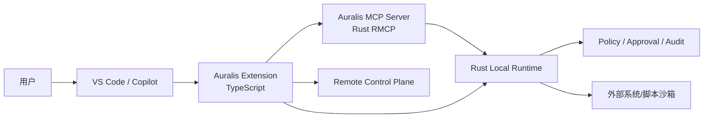

# 安全与权限

> VS Code/Copilot 只是客户端；Auralis 服务端（MCP Gateway + Rust Runtime）是权限/审批/执行的权威边界。客户端提示不能替代服务端审批。

## 1. 信任边界

- VS Code/Copilot：不可信输入（prompt、工具参数、Skill 内容、工具结果）。
- Extension：受信代码，但必须最小权限；不执行 Workflow/脚本。
- MCP Server/Runtime：服务端强制认证/租户/权限/审批/沙箱。
- Skill/Custom Instructions/Agents：不可信内容，不能提升权限。

## 2. 工作区信任

- 未信任工作区：
  - 禁止执行 Workflow/Agent/Tool。
  - 禁止安装/更新/移除 Skill、写 Instructions/Agents/`.vscode/mcp.json`。
  - 只读浏览/诊断。
- 多根工作区：写入目标显式；不跨根静默修改。
- 远程 SSH/Container：确认 Runtime 所在端；避免在错误机器执行/写文件。

## 3. Skill 安装安全

- 仅允许原生目录：`.github/skills`、`.claude/skills`、`.agents/skills`、`~/.copilot/skills` 等。
- 路径：拒绝 `..`、绝对路径、符号链接逃逸、设备文件、跨根路径。
- 目录名必须匹配 `name`；否则拒绝。
- 同名/已存在：不静默覆盖；用户确认/另存/更新。
- 只删除 Auralis 安装且 hash 匹配的文件；保留用户修改。
- Skill 内容扫描：危险命令/网络/secret 读取/混淆；不可信 Skill 警告。
- 脚本不在扩展执行；Runtime 沙箱/权限。
- 供应链：来源/签名/许可/SBOM/市场审核。

## 4. MCP 安全

- 认证：本地短期 token/远程 OAuth 2.1/PAT；token 存 SecretStorage。
- 不 token passthrough；上游凭证由 Runtime Vault/Connector 注入。
- 工具 schema/参数校验；高风险写操作服务端审批；客户端确认不算。
- 租户/工作区隔离；工具/资源按 scope 过滤。
- 工具结果不可信；不把结果当系统指令；大结果/分页。
- SSRF/路径穿越/命令注入由 MCP Server/Runtime 防护；扩展不直接发外部请求（除 Local/Control Plane API）。
- MCP provider `provide` 不弹认证；`resolve` 可认证；不把 token 写日志/设置。
- `.vscode/mcp.json` 兼容路径不写 token；使用 inputs/SecretStorage；写前确认/备份。
- 不假设 VS Code/Copilot CLI/Codex 配置相同。

## 5. 自定义 Instructions/Agents

- 生成前预览 diff；不覆盖用户内容；可移除标记块。
- 不写 secret/内部 URL；不要求 Copilot 绕过权限/审批。
- Custom Agent 工具集最小化；高风险管理仍由 Auralis 审批。
- 不把 Custom Instructions 当安全边界；服务端策略始终生效。
- `chatSkills` 扩展技能为只读/随 VSIX 签名；同名冲突提示。

## 6. Extension 执行边界

- 扩展不执行 Workflow/脚本/插件；只调用 Local API/MCP。
- 启动 Runtime：用户显式命令/终端可见；不自动下载/静默执行。
- 不读 Runtime 数据库/私钥/凭证文件。
- 不使用 `child_process` 执行用户工作区脚本；不运行 `npm install`/`pip install`。
- 打开产物用 VS Code API/临时文件；不执行产物内容。
- 扩展代码最小权限；VSIX 签名/市场审核。

## 7. 凭据

- SecretStorage：remote PAT/OIDC token、local token；不写 settings/workspace。
- 本地 token：loopback + 短期；文件 0600；不写日志。
- 远程 HTTPS；证书校验；不使用自签名（除非企业配置）。
- 轮换/撤销；失败提示重新登录；不重试风暴。
- Webview 不存 token/localStorage；消息不含 secret。

## 8. Prompt Injection

- Skill 内容、MCP 工具结果、仓库文件、Custom Instructions 都不可信。
- 系统/平台策略高于 Skill 指令；低层不能覆盖高层。
- 工具 allowlist/schema/审批；不因 Skill 指令提升权限。
- 发现“忽略策略/导出密钥/执行未知脚本” → 拒绝/告警。
- 不把 secret 注入 Prompt/上下文。

## 9. 审计

- MCP 调用：client（VS Code/Copilot）、tenant、user、tool、参数摘要、结果摘要、审批、trace。
- Execution/Artifact/Approval 由 Runtime/Control Plane 记录。
- Extension 日志只做诊断；不作为审计源。
- 不记录 token/完整凭证/敏感内容；可配置脱敏。

## 10. 供应链/发布

- VSIX 签名/市场审核；依赖 SBOM/漏洞扫描。
- 扩展内置 `chatSkills` 内容审核；不包含 secret/危险脚本。
- Runtime/MCP 版本兼容检查；不自动升级。
- 发现漏洞/恶意 Skill → 撤回/下架/通知。

## 11. 威胁表

| 威胁 | 控制 |
| --- | --- |
| 恶意 Skill 指令 | 不可信内容、服务端策略、审批、审计 |
| 路径穿越/符号链接 | 原生目录白名单、realpath、拒绝 symlink |
| Token 泄漏 | SecretStorage、短期 token、日志脱敏 |
| MCP 工具滥用 | schema、权限、risk、审批、限流 |
| 客户端绕过审批 | 服务端强制；客户端提示不权威 |
| 未信任工作区写入 | 禁用写/执行 |
| 远程开发执行错端 | 显式 Runtime location/端口转发 |
| 扩展供应链 | 签名/审核/SBOM/版本锁定 |
| 大结果/DoS | 分页/大小限制/超时/限流 |

## 12. 验收

- 未信任工作区无法安装/执行。
- 路径/符号链接攻击被拒绝。
- Token 不出现在 settings/日志/Webview。
- 高风险 MCP 调用必须服务端审批；拒绝/超时正确。
- 审批不被 Custom Instructions 绕过。
- 扩展无任意脚本执行路径（代码审查/测试）。
- 租户隔离/审计完整。

## 13. 相关

- [Extension 架构](extension-architecture.md)
- [Skill 集成](skill-integration.md)
- [MCP 集成](mcp-integration.md)
- [Local Runtime 桥接](local-runtime-bridge.md)
- [安全架构](../02-architecture/security-architecture.md)
